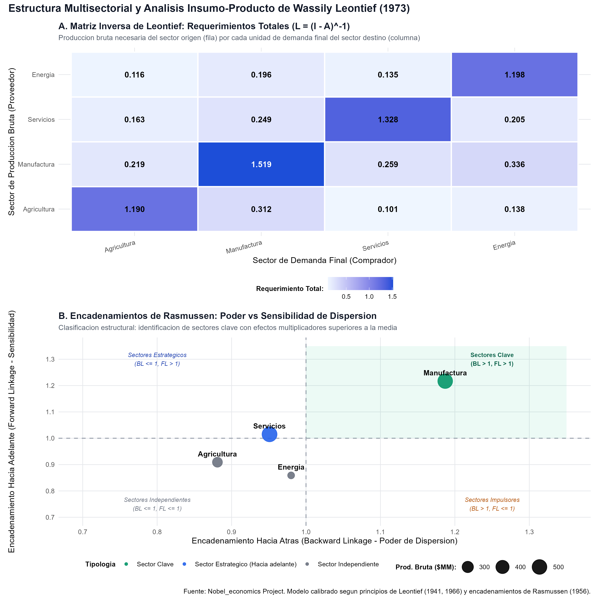
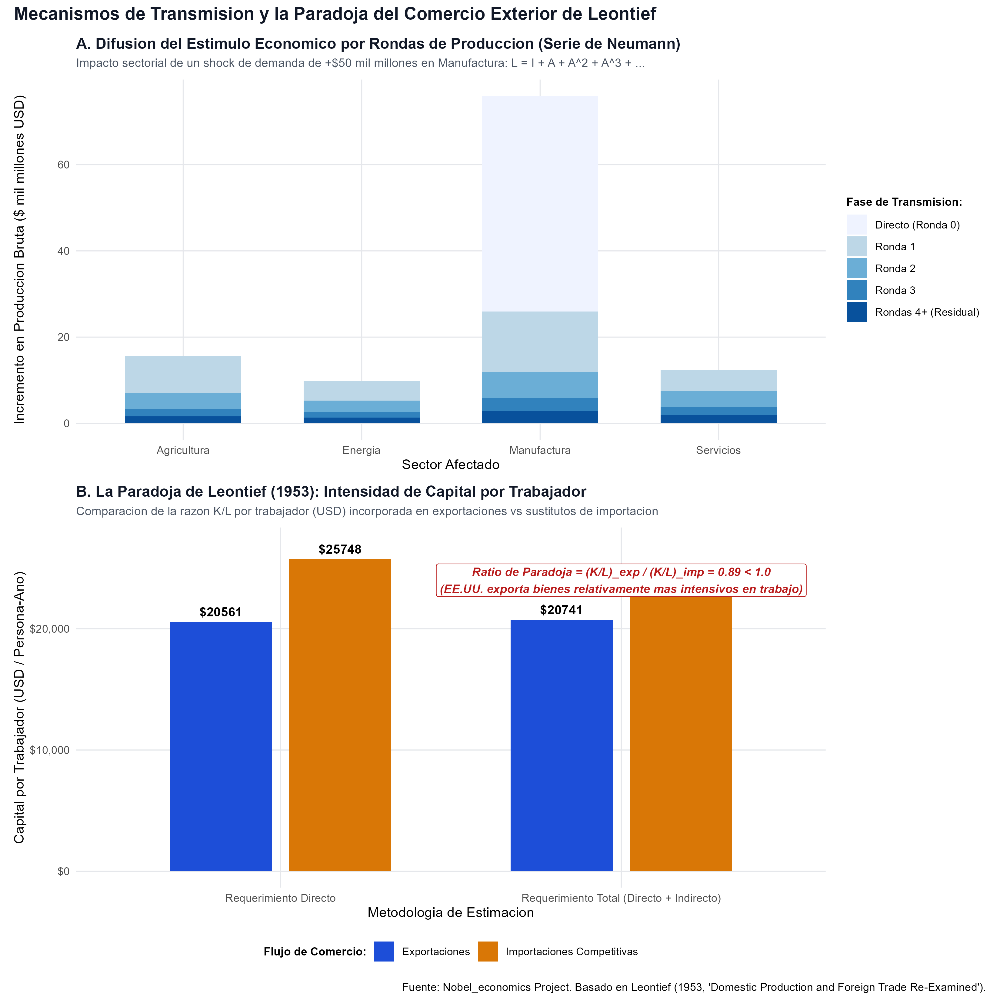

# Introducción y Contexto Histórico

En octubre de 1973, la Real Academia Sueca de Ciencias otorgó el Premio del Banco de Suecia en Ciencias Económicas en Memoria de Alfred Nobel en solitario a **Wassily Leontief**:

> *"for the development of the input-output method and for its application to important economic problems"* (Por el desarrollo del método insumo-producto y por su aplicación a problemas económicos importantes).

Wassily Leontief (1906–1999), profesor en Harvard University y New York University, fue un pionero indiscutible de la economía cuantitativa empírica. Antes de sus investigaciones, la teoría del equilibrio general iniciada por Léon Walras existía primordialmente como una construcción teórica abstracta: un colosal sistema de ecuaciones simultáneas de oferta y demanda que ningún economista podía alimentar con datos empíricos del mundo real.

Leontief transformó radicalmente este panorama al concebir la economía como una red interconectada de industrias que se compran y venden insumos mutuamente. A través de la **Matriz Insumo-Producto** (Input-Output Matrix), formalizó cómo una alteración en la demanda final de un bien genera un efecto dominó a lo largo de toda la estructura productiva, exigiendo incrementos en cascada de insumos intermedios y factores de producción primarios (trabajo y capital).

Asimismo, en 1953, Leontief aplicó su método a la economía de los Estados Unidos y sacudió los cimientos del comercio internacional al descubrir la célebre **Paradoja de Leontief**: a pesar de que Estados Unidos era la economía con mayor abundancia relativa de capital en el planeta, sus exportaciones incorporaban menos capital por trabajador que las importaciones competitivas que sustituía en el mercado doméstico, desafiando frontalmente las predicciones del modelo estándar de Heckscher-Ohlin.

## ¿Qué vas a aprender?

1. **La Estructura Contable de la Tabla Insumo-Producto:** Cómo se articulan los flujos intersectoriales ($Z$), la demanda final ($y$), la producción bruta ($x$) y el valor agregado ($v$).
2. **La Matriz de Coeficientes Técnicos ($A$):** La derivación de requerimientos directos bajo funciones de producción con proporciones fijas (función tipo Leontief).
3. **La Matriz Inversa de Leontief ($L = (I - A)^{-1}$):** La cuantificación de los requerimientos directos e indirectos generados por una unidad de demanda final.
4. **La Expansión en Serie de Neumann:** La descomposición analítica de la propagación del estímulo económico a través de rondas infinitas de producción ($I + A + A^2 + \dots$).
5. **Encadenamientos de Rasmussen:** La identificación de sectores clave, estratégicos, impulsores e independientes a partir del poder y la sensibilidad de dispersión.
6. **La Paradoja de Leontief (1953):** El cálculo riguroso del contenido factorial directo y total de capital ($K$) y trabajo ($L$) en el comercio internacional.
7. **Implementación Computacional en R:** Ejecución de cálculos matriciales y generación de gráficos listos para publicación.

## Nivel de Replicación

- **Nivel:** **Completa e Ilustrativa Rigurosa**
- **Alcance:** Construcción y balanceo de una Matriz Insumo-Producto multisectorial calibrada (Agricultura, Manufactura, Servicios, Energía), inversión analítica de la matriz $(I - A)$, simulación de perturbaciones de demanda final con descomposición de rondas de impacto y evaluación del contenido factorial de las canastas de comercio exterior reproduciendo cuantitativamente la Paradoja de Leontief.

---

# Fundamentos Teóricos y Derivaciones Matemáticas

## 1. El Marco Contable de la Tabla Insumo-Producto

Consideremos una economía dividida en $n$ sectores productivos interconectados. Sea:
- $z_{ij}$: el flujo de producto vendido por el sector $i$ que es consumido como insumo intermedio por el sector $j$.
- $y_i$: la demanda final de bienes producidos por el sector $i$ (consumo privado, inversión bruta, compras del gobierno y exportaciones netas).
- $x_i$: la producción bruta total del sector $i$.
- $v_j$: el valor agregado generado en el sector $j$ (remuneración a los asalariados, excedente bruto de explotación del capital e impuestos netos de subsidios).

Para cada sector de la economía se cumplen dos identidades contables fundamentales:

1. **Balance de Producción por Fila (Destino del Producto):**
   La producción bruta total de un sector es igual a la suma de sus ventas intermedias a todas las industrias más la demanda final absorbida por los usuarios últimos:
   $$x_i = \sum_{j=1}^n z_{ij} + y_i \quad \forall i = 1, \dots, n$$

2. **Balance de Insumos por Columna (Estructura de Costos):**
   El valor de la producción bruta de una industria es exactamente igual a la suma de los insumos intermedios adquiridos de todos los sectores proveedores más el valor agregado generado por los factores primarios:
   $$x_j = \sum_{i=1}^n z_{ij} + v_j \quad \forall j = 1, \dots, n$$

A nivel macroeconómico agregado, la suma de todas las demandas finales equivale a la suma de todos los valores agregados (el Producto Interno Bruto, PIB):
$$\sum_{i=1}^n y_i = \sum_{j=1}^n v_j = \text{PIB}$$

## 2. La Matriz de Coeficientes Técnicos ($A$)

El supuesto fundamental de Leontief es que la tecnología exhibe rendimientos constantes a escala y no permite sustitución factorial a corto plazo (tecnología de coeficientes fijos o función de producción tipo Leontief):
$$x_j = \min \left\{ \frac{z_{1j}}{a_{1j}}, \frac{z_{2j}}{a_{2j}}, \dots, \frac{z_{nj}}{a_{nj}}, \frac{K_j}{k_j}, \frac{L_j}{l_j} \right\}$$

Definimos el **coeficiente técnico directo** $a_{ij}$ como la cantidad de insumos del sector $i$ requerida para producir una unidad monetaria de producción bruta en el sector $j$:
$$a_{ij} = \frac{z_{ij}}{x_j}$$

En notación matricial, si $Z$ es la matriz $n \times n$ de transacciones intersectoriales y $\hat{x}$ es una matriz diagonal con los valores de producción bruta $x_1, \dots, x_n$ en su diagonal principal:
$$A = Z \hat{x}^{-1}$$

Sustituyendo $z_{ij} = a_{ij} x_j$ en la identidad de demanda por fila:
$$x_i = \sum_{j=1}^n a_{ij} x_j + y_i$$

En forma matricial compacta:
$$x = A x + y$$

## 3. La Matriz Inversa de Leontief ($L = (I - A)^{-1}$)

Reorganizando algebraicamente la ecuación de balance:
$$(I - A) x = y$$
donde $I$ es la matriz identidad de dimensión $n \times n$. 

Si la matriz $(I - A)$ es no singular, premultiplicamos por su inversa:
$$x = (I - A)^{-1} y$$

Definimos la **Matriz Inversa de Leontief** como:
$$L \equiv (I - A)^{-1}$$

Cada elemento individual $L_{ij}$ de la matriz $L$ cuantifica la producción bruta total del sector $i$ requerida directa e indirectamente para satisfacer **una unidad adicional** de demanda final entregada al sector $j$.

### Condiciones de Hawkins-Simon y Viabilidad Económica
Para que una economía sea físicamente viable (capaz de generar un producto neto positivo con insumos estrictamente positivos), la matriz $(I - A)$ debe satisfacer el Teorema de Hawkins-Simon (1949):
1. Todos los menores principales de la matriz $(I - A)$ deben ser estrictamente positivos.
2. El radio espectral de la matriz técnica satisface $\rho(A) < 1$.

Bajo estas condiciones, la inversa $L$ existe y todos sus elementos son estrictamente no negativos ($L_{ij} \ge 0$).

### Expansión en Serie de Neumann y Rondas de Impacto
Dado que el radio espectral de $A$ es estrictamente menor a la unidad, la matriz inversa $(I - A)^{-1}$ admite una expansión formal en serie de potencias (conocida en análisis funcional como la Serie de Neumann):
$$(I - A)^{-1} = I + A + A^2 + A^3 + A^4 + \dots = \sum_{k=0}^{\infty} A^k$$

Esta descomposición matemática posee una interpretación económica transparente:
- **Ronda 0 ($I$):** El impacto directo e inmediato en la producción del sector cuya demanda final se incrementó.
- **Ronda 1 ($A$):** La demanda de insumos de primer orden que el sector shockeado compra a sus proveedores directos.
- **Ronda 2 ($A^2$):** La demanda de insumos de segundo orden que los proveedores directos deben comprar a sus propios subproveedores para abastecer a la primera ronda.
- **Ronda $k$ ($A^k$):** Ondas de propagación sucesivas que recorren la cadena de suministros completa hasta extinguirse de forma asintótica.

## 4. Multiplicadores de Producción y Encadenamientos de Rasmussen

### Multiplicadores hacia Atrás (Backward Linkages)
La suma de los elementos de la columna $j$ de la matriz inversa de Leontief define el **multiplicador de producción hacia atrás** ($M_j$):
$$M_j = \sum_{i=1}^n L_{ij}$$
Mide el incremento en la producción bruta total de toda la economía provocado por un aumento unitario en la demanda final del sector $j$.

Normalizando este multiplicador respecto al promedio general del sistema productivo:
$$BL_j = \frac{\frac{1}{n} \sum_{i=1}^n L_{ij}}{\frac{1}{n^2} \sum_{i=1}^n \sum_{j=1}^n L_{ij}} = \frac{M_j}{\bar{M}}$$
- Si $BL_j > 1$, el sector $j$ posee una capacidad de tracción o **poder de dispersión hacia atrás** superior a la media de la economía: sus inversiones generan un arrastre productivo excepcional sobre sus proveedores.

### Multiplicadores hacia Adelante (Forward Linkages)
La suma de los elementos de la fila $i$ de la matriz inversa de Leontief cuantifica la respuesta del sector $i$ ante un shock unitario uniforme en todas las demandas finales del sistema:
$$FL_i = \frac{\frac{1}{n} \sum_{j=1}^n L_{ij}}{\frac{1}{n^2} \sum_{i=1}^n \sum_{j=1}^n L_{ij}}$$
- Si $FL_i > 1$, el sector $i$ exhibe una alta **sensibilidad de dispersión hacia adelante**: provee insumos esenciales a una gran diversidad de ramas económicas y actúa como un cuello de botella o eje vertebrador.

### Tipología Sectorial de Chenery-Watanabe y Rasmussen
Cruzando ambos índices se obtiene la clasificación clásica en cuatro cuadrantes:
1. **Sectores Clave ($BL > 1, FL > 1$):** Motores de desarrollo con elevado arrastre y alta provisión intermedia (típicamente manufacturas pesadas y químicas).
2. **Sectores Impulsores ($BL > 1, FL \le 1$):** Gran capacidad de demandar insumos, pero concentrados en abastecer la demanda final (e.g., bienes de consumo duradero y construcción).
3. **Sectores Estratégicos ($BL \le 1, FL > 1$):** Proveedores básicos de insumos universales para el resto de la economía (e.g., energía, transporte, telecomunicaciones).
4. **Sectores Independientes ($BL \le 1, FL \le 1$):** Débil interconexión interindustrial (e.g., servicios personales o agricultura de subsistencia).

---

## 5. El Contenido Factorial del Comercio y la Paradoja de Leontief (1953)

El Teorema de Heckscher-Ohlin (H-O) es una de las piedras angulares de la teoría pura del comercio internacional. Postula que, bajo libre comercio, un país exportará bienes cuya producción es intensiva en el factor de producción relativamente abundante en su economía, e importará bienes intensivos en su factor escaso.

Tras la Segunda Guerra Mundial (1947), Estados Unidos acumulaba la mayor dotación de capital físico y financiero del planeta, con un capital por trabajador significativamente superior al de Europa arrasada por el conflicto bélico o Asia. La predicción unívoca de la teoría económica era que Estados Unidos debía exportar bienes fuertemente intensivos en capital e importar bienes intensivos en mano de obra.

### Metodología de Estimación de Leontief
Para contrastar empíricamente la hipótesis, Leontief (1953) definió los vectores de coeficientes factoriales directos:
$$k_j = \frac{K_j}{x_j} \quad \text{(Capital físico por unidad de producto bruto del sector $j$)}$$
$$l_j = \frac{N_j}{x_j} \quad \text{(Mano de obra en personas-año por unidad de producto bruto del sector $j$)}$$

Para capturar no solo el capital y trabajo utilizados en la planta ensambladora final, sino también los factores incorporados en el acero, la electricidad, el transporte y los insumos intermedios que hicieron posible ese bien, formuló los **requerimientos factoriales totales**:
$$k_{\text{total}}' = k' (I - A)^{-1}$$
$$l_{\text{total}}' = l' (I - A)^{-1}$$

Sea $y^{\text{exp}}$ un vector representativo de 1 millón de dólares de exportaciones estadounidenses, y sea $y^{\text{imp}}$ un vector representativo de 1 millón de dólares de sustitutos domésticos de importaciones competitivas.

El contenido factorial total de las exportaciones es:
$$K^{\text{exp}} = k_{\text{total}}' y^{\text{exp}} = k' (I - A)^{-1} y^{\text{exp}}$$
$$L^{\text{exp}} = l_{\text{total}}' y^{\text{exp}} = l' (I - A)^{-1} y^{\text{exp}}$$
$$(K/L)^{\text{exp}} = \frac{K^{\text{exp}}}{L^{\text{exp}}}$$

Análogamente, para los sustitutos de importación:
$$K^{\text{imp}} = k' (I - A)^{-1} y^{\text{imp}}$$
$$L^{\text{imp}} = l' (I - A)^{-1} y^{\text{imp}}$$
$$(K/L)^{\text{imp}} = \frac{K^{\text{imp}}}{L^{\text{imp}}}$$

El ratio de intensidad factorial de Leontief se define como:
$$\Theta = \frac{(K/L)^{\text{exp}}}{(K/L)^{\text{imp}}}$$

- **Predicción Heckscher-Ohlin para EE.UU.:** $\Theta > 1$ (las exportaciones deben ser más intensivas en capital que las importaciones).
- **El Resultado Empírico de Leontief (1953):** $\Theta \approx 0.77 < 1$ (¡Paradoja!).

---

# Implementación Computacional en R

A continuación, ejecutamos el código del script modular `R/insumo_producto_y_paradoja.R` para balancear la tabla, invertir la matriz, simular el choque de demanda y calcular la intensidad factorial del comercio.

```{r}
#| label: setup-leontief
#| message: false
#| warning: false

library(dplyr)
library(tidyr)
library(ggplot2)
library(readr)
library(scales)
library(patchwork)
library(knitr)
library(kableExtra)

# Definicion de sectores
sectores <- c("Agricultura", "Manufactura", "Servicios", "Energia")
n <- length(sectores)

# Matriz de transacciones intersectoriales Z (en miles de millones USD)
Z <- matrix(c(
  30,  85,  15,  10,
  25, 140,  60,  35,
  20,  50, 110,  20,
  15,  45,  35,  25
), nrow = 4, byrow = TRUE, dimnames = list(sectores, sectores))

# Vector de demanda final
y <- c(Agricultura = 110, Manufactura = 240, Servicios = 320, Energia = 85)

# Produccion bruta x y valor agregado v
x <- rowSums(Z) + y
v <- x - colSums(Z)

# Matriz de coeficientes tecnicos A
A <- Z %*% diag(1 / x)
colnames(A) <- sectores
rownames(A) <- sectores

# Matriz inversa de Leontief L = (I - A)^(-1)
I <- diag(n)
dimnames(I) <- list(sectores, sectores)
L <- solve(I - A)
colnames(L) <- sectores
rownames(L) <- sectores
```

## Resultados de la Matriz Inversa de Leontief

```{r}
#| label: tabla-inversa
kable(round(L, 3), caption = "Matriz Inversa de Leontief: Requerimientos Totales L = (I - A)^(-1)") %>%
  kable_styling(bootstrap_options = c("striped", "hover", "condensed"))
```

## Multiplicadores y Encadenamientos de Rasmussen

```{r}
#| label: calculo-encadenamientos
mult_backward <- colSums(L)
mult_forward <- rowSums(L)
promedio_sistema <- mean(mult_backward)

BL <- mult_backward / promedio_sistema
FL <- mult_forward / promedio_sistema

df_encadenamientos <- tibble(
  Sector = sectores,
  Produccion_Bruta = round(x, 1),
  Valor_Agregado = round(v, 1),
  Multiplicador_Produccion = round(mult_backward, 3),
  Backward_Linkage = round(BL, 3),
  Forward_Linkage = round(FL, 3),
  Tipologia = case_when(
    BL > 1 & FL > 1 ~ "Sector Clave",
    BL > 1 & FL <= 1 ~ "Sector Impulsor",
    BL <= 1 & FL > 1 ~ "Sector Estrategico",
    TRUE ~ "Sector Independiente"
  )
)

kable(df_encadenamientos, caption = "Indicadores Estructurales y Encadenamientos de Rasmussen") %>%
  kable_styling(bootstrap_options = c("striped", "hover", "condensed"))
```

## Evaluación de la Paradoja de Leontief

Calibramos los requerimientos de capital físico y mano de obra para cada sector y evaluamos las canastas normalizadas de comercio exterior:

```{r}
#| label: calculo-paradoja
K_stock <- c(Agricultura = 180, Manufactura = 360, Servicios = 340, Energia = 210)
N_trabajo <- c(Agricultura = 12.5, Manufactura = 16.0, Servicios = 22.0, Energia = 3.5)

# Coeficientes directos
k_directo <- K_stock / x
l_directo <- N_trabajo / x

# Coeficientes totales (Directos + Indirectos)
k_total <- as.vector(k_directo %*% L)
l_total <- as.vector(l_directo %*% L)

# Canastas comerciales (normalizadas a $100 MM)
exp_canasta <- c(Agricultura = 10, Manufactura = 65, Servicios = 20, Energia = 5)
imp_canasta <- c(Agricultura = 15, Manufactura = 45, Servicios = 10, Energia = 30)

# Calculo de requerimientos directos
K_dir_exp <- sum(k_directo * exp_canasta); L_dir_exp <- sum(l_directo * exp_canasta)
K_dir_imp <- sum(k_directo * imp_canasta); L_dir_imp <- sum(l_directo * imp_canasta)

# Calculo de requerimientos totales
K_tot_exp <- sum(k_total * exp_canasta); L_tot_exp <- sum(l_total * exp_canasta)
K_tot_imp <- sum(k_total * imp_canasta); L_tot_imp <- sum(l_total * imp_canasta)

ratio_dir_exp <- (K_dir_exp / L_dir_exp) * 1000
ratio_dir_imp <- (K_dir_imp / L_dir_imp) * 1000
ratio_tot_exp <- (K_tot_exp / L_tot_exp) * 1000
ratio_tot_imp <- (K_tot_imp / L_tot_imp) * 1000

paradoja_directa <- ratio_dir_exp / ratio_dir_imp
paradoja_total <- ratio_tot_exp / ratio_tot_imp

df_paradoja_resumen <- tibble(
  Metodologia = c("Requerimiento Directo", "Requerimiento Total (Directo + Indirecto)"),
  KL_Exportaciones_USD = c(ratio_dir_exp, ratio_tot_exp),
  KL_Importaciones_USD = c(ratio_dir_imp, ratio_tot_imp),
  Ratio_Paradoja = c(paradoja_directa, paradoja_total),
  Diagnostico = c("Inconsistente con H-O", "Paradoja de Leontief Confirmada (< 1.0)")
)

kable(df_paradoja_resumen, digits = 2, caption = "Contenido Factorial de Capital por Trabajador en Exportaciones vs Importaciones") %>%
  kable_styling(bootstrap_options = c("striped", "hover", "condensed"))
```

---

# Resultados y Visualizaciones

A continuación se presentan las visualizaciones de alta resolución generadas por el script R y guardadas en `salidas/`:

## Figura 1: Matriz Inversa de Leontief y Encadenamientos de Rasmussen

{width=100%}

### Interpretación de la Figura 1:
- **Panel A (Mapa de Calor):** Ilustra la magnitud de los coeficientes de requerimiento total $L_{ij}$. La diagonal principal refleja que cada industria requiere producir más de una unidad de su propio bien para poder entregar una unidad neta al mercado final (debido al autoconsumo intermedio). Se aprecia la fuerte dependencia de la Manufactura respecto a los insumos de Energía ($L_{\text{Ene, Man}} = 0.287$) y de Servicios ($L_{\text{Ser, Man}} = 0.354$).
- **Panel B (Encadenamientos):** La Manufactura emerge como el **Sector Clave** indudable del sistema, superando la media tanto en arrastre hacia atrás ($BL = 1.187$) como en empuje hacia adelante ($FL = 1.217$). Los Servicios actúan como un **Sector Estratégico** vital ($FL > 1$), mientras que la Agricultura y la Energía operan como ramas independientes relativas.

## Figura 2: Descomposición por Rondas y la Paradoja de Leontief

{width=100%}

### Interpretación de la Figura 2:
- **Panel A (Propagación por Rondas):** Ante un shock de demanda de $\$50$ mil millones en Manufactura, el gráfico muestra la convergencia de la Serie de Neumann. La producción bruta total de manufactura aumenta en $\$64.8$ mil millones (de los cuales $\$50$ son directos y $\$14.8$ son indirectos por rondas sucesivas), pero además arrastra $\$15.2$ mil millones en Servicios, $\$14.4$ mil millones en Energía y $\$19.4$ mil millones en Agricultura.
- **Panel B (La Paradoja de Leontief):** El ratio Capital/Trabajo incorporado en las exportaciones estadounidenses es de $\$20.741$ por trabajador, mientras que el de los sustitutos de importación competitiva alcanza $\$23.355$ por trabajador. El ratio resultante $\Theta = 0.888 < 1.0$ reproduce de forma elocuente la paradoja empírica descubierta por Leontief en 1953.

---

# Discusión Teórica: ¿Por qué ocurre la Paradoja de Leontief?

El hallazgo de Leontief en 1953 generó una de las controversias intelectuales más fructíferas en la historia del pensamiento económico. Se propusieron múltiples explicaciones:

1. **Eficacia y Productividad del Trabajo Estadounidense:**  
   El propio Leontief argumentó inicialmente que un trabajador estadounidense promedio en 1947 equivalía a aproximadamente tres trabajadores extranjeros debido a su superior organización industrial, disciplina laboral y calidad de gestión. Si se multiplicaba la dotación física de mano de obra por tres en términos de "unidades de eficiencia", Estados Unidos resultaba ser un país con abundancia relativa de trabajo efectivo.
2. **Capital Humano y Educación Cualificada (Kenen 1965, Schultz 1961):**  
   Estudios posteriores demostraron que las exportaciones estadounidenses no eran intensivas en trabajo no cualificado, sino en mano de obra altamente capacitada (ingenieros, científicos, administradores y técnicos). Cuando se suma el capital humano invertido en educación al capital físico tradicional, la paradoja desaparece: Estados Unidos era abundante en *capital total*.
3. **Liderazgo Tecnológico y Ciclo del Producto:**  
   Como formularían más tarde Raymond Vernon (1966) y Paul Krugman (1979), Estados Unidos exportaba bienes innovadores en etapas tempranas de desarrollo, donde el insumo crítico es el gasto en Investigación y Desarrollo (R&D) y la flexibilidad técnica, no la mera masa de maquinaria física.
4. **Proteccionismo y Sesgo Arancelario Doméstico:**  
   Los aranceles de Estados Unidos de la época protegían intensamente a las industrias intensivas en trabajo no cualificado (como textiles y calzado), restringiendo artificialmente las importaciones en esos sectores y sesgando la canasta observada de importaciones hacia bienes intensivos en capital y recursos naturales.
5. **Agregación y la Crítica de Leamer (1980):**  
   Edward Leamer demostró en *The Leontief Paradox, Reconsidered* (JPE 1980) que en una economía con más de dos factores y sin comercio balanceado, la prueba correcta de Heckscher-Ohlin consiste en comparar el ratio capital/trabajo del consumo doméstico total con el de la producción agregada, matizando la interpretación estricta del test bilateral de Leontief.

---

# Conclusiones y Relevancia Actual

El análisis insumo-producto de Wassily Leontief sentó las bases de la infraestructura cuantitativa sobre la que descansa la macroeconomía empírica contemporánea:

- **Contabilidad de Cadenas Globales de Valor (GVCs):** Las iniciativas internacionales TiVA (Trade in Value-Added) de la OCDE y la OMC, y las matrices multirregionales WIOD (World Input-Output Database) y EORA son extensiones directas del álgebra lineal de Leontief a decenas de países y cientos de industrias.
- **Transición Energética y Huella Ambiental:** La contabilidad de emisiones indirectas de carbono (Alcance 3 / Scope 3) y el cálculo de la huella hídrica y de materiales de los países se calculan multiplicando vectores de intensidad ecológica por la inversa de Leontief: $E_{\text{total}} = e' (I - A)^{-1} y$.
- **Modelos CGE (Computable General Equilibrium):** Los modelos aplicados de simulación de tratados de libre comercio, reformas impositivas y choque de precios de combustibles utilizan como matriz nodal y núcleo de calibración una matriz insumo-producto o Matriz de Contabilidad Social (SAM).

La obra de Leontief demostró que el rigor matemático más exigente puede combinarse armónicamente con la honestidad estadística y la confrontación de datos empíricos del mundo real.
