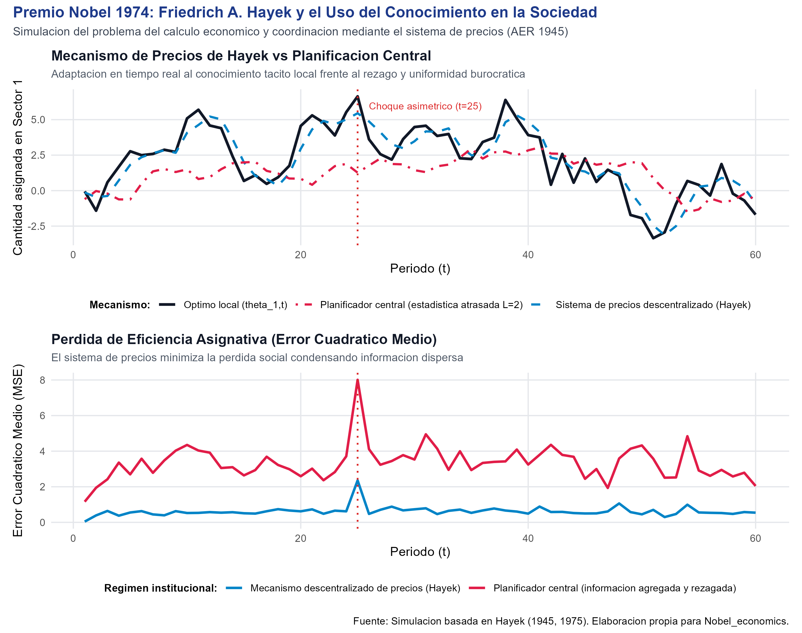
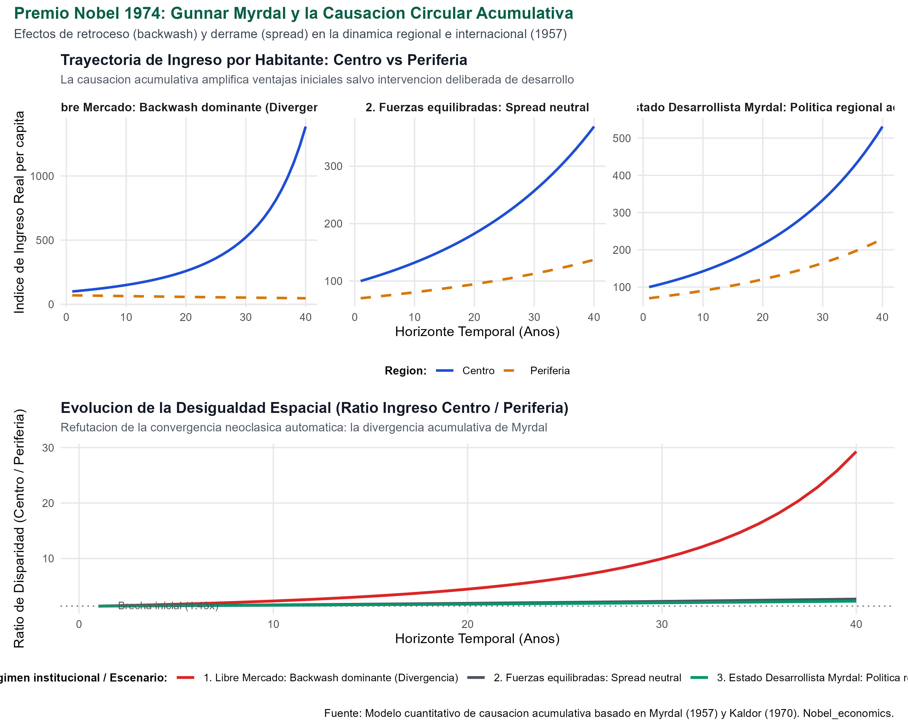

# Introducción y Contexto Histórico

En octubre de 1974, la Real Academia Sueca de Ciencias otorgó el Premio del Banco de Suecia en Ciencias Económicas en Memoria de Alfred Nobel conjuntamente a **Gunnar Myrdal** y **Friedrich August von Hayek**:

> *"for their pioneering work in the theory of money and economic fluctuations and for their penetrating analysis of the interdependence of economic, social and institutional phenomena"* (Por su trabajo pionero en la teoría del dinero y las fluctuaciones económicas y por su penetrante análisis de la interdependencia de los fenómenos económicos, sociales e institucionales).

La concesión compartida de 1974 es una de las más fascinantes y célebres en la historia del galardón. Emparejó a dos intelectuales gigantescos con orientaciones filosóficas, metodológicas y de política pública aparentemente opuestas:
- **Friedrich August von Hayek (1899–1992):** Líder intelectual de la Escuela Austríaca, campeón del liberalismo clásico y la economía descentralizada de mercado, cuyo trabajo demostró que el conocimiento necesario para coordinar una sociedad moderna se encuentra disperso y fragmentado en millones de individuos. El sistema de precios opera como un mecanismo espontáneo de telecomunicaciones que procesa y transmite información que ninguna autoridad central podría jamás recolectar ni computar.
- **Gunnar Myrdal (1898–1987):** Figura angular de la Escuela de Estocolmo, arquitecto del estado de bienestar sueco y pionero de la economía institucional y del desarrollo, quien demostró que las fuerzas espontáneas del libre mercado no tienden a un equilibrio armónico e igualador en el espacio geográfico, sino que generan procesos de **causación circular acumulativa** donde las regiones ricas se enriquecen a expensas de las pobres mediante efectos de retroceso (*backwash effects*), requiriendo políticas públicas e institucionales deliberadas.

Lejos de una contradicción irreconciliable, el veredicto de la Academia reconoció que ambos economistas compartían una profunda convicción metodológica: **la economía ortodoxa de equilibrio estático convencional es insuficiente para capturar la complejidad dinámica, la incertidumbre temporal, la dispersión del conocimiento y las interacciones institucionales que gobiernan el mundo real**.

## ¿Qué vas a aprender?

1. **La Epistemología Económica de Hayek (1945):** Cómo el sistema de precios resuelve el problema del cálculo económico al coordinar el conocimiento tácito y disperso de tiempo y lugar sin necesidad de una autoridad planificadora central.
2. **La Teoría Austríaca del Ciclo Económico (Hayek, 1931):** La estructura temporal de la producción (*triángulo de Hayek*), la tasa natural de interés de Wicksell y cómo las tasas de interés artificialmente bajas inducen malas inversiones intertemporales (*malinvestments*).
3. **El Análisis Ex-Ante vs Ex-Post de Myrdal (1939):** La distinción entre planes anticipados y resultados contables realizados en el equilibrio monetario, piedra angular de la macroeconomía dinámica.
4. **La Causación Circular Acumulativa de Myrdal (1957):** Por qué las desigualdades regionales y globales no se corrigen automáticamente por el libre comercio y cómo interactúan las fuerzas centrípetas de retroceso (*backwash*) y de derrame (*spread*).
5. **Implementación Computacional en R:** Simulación cuantitativa de ambos mecanismos: convergencia informativa con señales de precios vs rezago burocrático, y trayectorias espaciales de divergencia regional Centro-Periferia.

## Nivel de Replicación

- **Nivel:** **Ilustrativa Rigurosa y Computacional**
- **Alcance:** Modelización estocástica del procesamiento de información local descentralizada vs planificación central rezagada (Hayek 1945) y simulación del sistema dinámico de causación acumulativa espacial con rendimientos crecientes y migración de factores (Myrdal 1957).

---

# Fundamentos Teóricos y Derivaciones Matemáticas

## 1. Friedrich A. Hayek: El Uso del Conocimiento en la Sociedad (1945)

En su célebre artículo *The Use of Knowledge in Society* (1945), publicado en *The American Economic Review*, Hayek transformó la definición del problema económico fundamental:

> *"El carácter peculiar del problema de un orden económico racional está determinado precisamente por el hecho de que el conocimiento de las circunstancias que debemos utilizar nunca existe en una forma concentrada o integrada, sino únicamente como fragmentos dispersos de conocimiento incompleto y con frecuencia contradictorio que poseen todos los individuos por separado."*

### Tipología del Conocimiento: Conocimiento Científico vs Conocimiento Tácito Local
Hayek clasificó el conocimiento humano en dos naturalezas radicalmente distintas:
1. **Conocimiento científico o técnico:** Leyes generales, fórmulas de ingeniería y principios formalizables que pueden concentrarse en manuales, oficinas estadísticas o comités de expertos.
2. **Conocimiento de circunstancias particulares de tiempo y lugar (conocimiento tácito):** Información específica sobre máquinas inactivas que podrían ser aprovechadas, stocks excedentes que un comerciante conoce en su distrito, habilidades no certificadas de trabajadores, o pequeños cambios cotidianos de demanda local. Este conocimiento es **idiosincrático, subjetivo y en continuo cambio**; no puede transmitirse a una junta central de planificación mediante estadísticas cuantitativas sin perder su esencia.

### El Sistema de Precios como Mecanismo de Telecomunicaciones
En una economía de mercado descentralizada, los agentes no necesitan conocer la causa originaria de un choque (por ejemplo, si la escasez de estaño proviene de una huelga minera en Bolivia, un terremoto en Malasia o un nuevo uso industrial descubierto en Alemania). Todo lo que necesitan saber es que **el precio del estaño ha subido**:

$$\Delta p_i > 0$$

Esta simple señal numérica transmite tres funciones esenciales:
- **Información comprimida:** Indica a cada usuario individual que el recurso se ha vuelto relativamente más escaso en la economía.
- **Incentivo automático:** Motiva a miles de usuarios a economizar el estaño y buscar sustitutos más baratos, y a los productores a expandir la extracción.
- **Coordinación sin coacción:** Se logra la reasignación óptima de recursos a nivel global sin que nadie deba emitir una orden coercitiva centralizada ni conocer la totalidad del panorama macroeconómico.

### Formalización Matemática: Descentralización vs Planificación con Rezago

Consideremos una economía dividida en $J$ sectores o mercados locales ($j = 1, \dots, J$). En cada periodo $t$, las condiciones reales de escasez o productividad local siguen un proceso estocástico:

$$\theta_{j,t} = \rho \theta_{j,t-1} + \varepsilon_{j,t}, \quad \varepsilon_{j,t} \sim \mathcal{N}(0, \sigma^2)$$

La asignación socialmente óptima para el sector $j$ en el periodo $t$ es:

$$q^*_{j,t} = \theta_{j,t}$$

#### Régimen A: Mercado Descentralizado (Hayek)
Los agentes locales observan directamente las condiciones locales $\theta_{j,t}$ mediante su conocimiento de tiempo y lugar. La variación en el exceso de demanda ajusta el precio local $p_{j,t}$:

$$p_{j,t} = p_{j,t-1} + \gamma (\theta_{j,t} - q_{j,t-1})$$

Los productores y consumidores descentralizados responden de inmediato a la señal del precio:

$$q_{j,t}^{\text{Hayek}} = (1 - \alpha_D) q_{j,t-1} + \alpha_D p_{j,t} + \eta_{j,t}$$

donde $\alpha_D \in (0,1)$ denota la alta velocidad de ajuste local y $\eta_{j,t}$ es un ruido microeconómico menor.

#### Régimen B: Planificación Centralizada (Debate del Cálculo Socialista)
El planificador central no puede interactuar directamente con las condiciones tácitas locales. Depende de informes estadísticos burocráticos que sufren:
1. **Rezago de recopilación y procesamiento ($L \ge 2$ períodos):** La autoridad decide en el período $t$ sobre información agregada proveniente de $t - L$.
2. **Pérdida por uniformización:** Debido a la complejidad computacional y a las directivas generales de política, el planificador aplica cuotas centralizadas homogeneizadoras sesgadas hacia la media observada:

$$\bar{I}_{j,t} = \omega \cdot \theta_{j, t-L} + (1 - \omega) \cdot \frac{1}{J}\sum_{k=1}^J \theta_{k, t-L}$$

$$q_{j,t}^{\text{Central}} = (1 - \alpha_C) q_{j,t-1} + \alpha_C \bar{I}_{j,t} + \xi_{j,t}$$

donde $\alpha_C \ll \alpha_D$ refleja la rigidez e inercia burocrática.

#### Pérdida Social y Error Cuadrático Medio
La ineficiencia asignativa o pérdida de bienestar agregada de cada régimen se cuantifica mediante el Error Cuadrático Medio ($MSE$):

$$\mathcal{L}_t^{\text{Mecanismo}} = \frac{1}{J}\sum_{j=1}^J \left( q_{j,t}^{\text{Mecanismo}} - \theta_{j,t} \right)^2$$

El modelo predice analíticamente que $\mathcal{L}_t^{\text{Central}} \gg \mathcal{L}_t^{\text{Hayek}}$, en especial tras choques imprevistos, debido a la imposibilidad de la autoridad central de superar los límites cognitivos y los rezagos de transmisión de información tácita.

---

## 2. Friedrich A. Hayek: Teoría Monetaria del Ciclo Económico (1931)

En *Prices and Production* (1931), Hayek desarrolló la Teoría Austríaca del Ciclo Económico combinando la teoría del capital de Eugen von Böhm-Bawerk con la noción de tasa natural de interés de Knut Wicksell.

### La Estructura Temporal de la Producción
La producción no ocurre de manera instantánea, sino a través de una serie de etapas cronológicamente ordenadas (el célebre *triángulo de Hayek*):
- **Etapas tempranas (alejadas del consumo final):** Investigación, minería, extracción de materias primas, desarrollo de bienes de capital pesado.
- **Etapas intermedias:** Manufactura, ensamblaje, logística mayorista.
- **Etapas finales (cercanas al consumo final):** Comercio minorista y venta de bienes de consumo inmediato.

### Tasa Natural ($r_n$) vs Tasa de Mercado ($r_m$) y Malas Inversiones
- **Tasa Natural ($r_n$):** La tasa de interés real que equilibra el ahorro voluntario real de los hogares con la demanda de inversión de las empresas. Refleja la auténtica preferencia temporal de la sociedad.
- **Tasa de Mercado ($r_m$):** La tasa determinada por el sistema bancario y el banco central.

Cuando el banco central expande el crédito artificialmente emitiendo dinero fiduciario no respaldado por ahorro voluntario genuino, hace descender la tasa de mercado por debajo de la tasa natural:

$$r_m < r_n$$

### El Mecanismo de Distorsión y Crisis:
1. **Falso abaratamiento del tiempo:** La baja tasa de interés envía una señal engañosa a los empresarios: les hace creer erróneamente que la sociedad ha decidido ahorrar más para consumir en el futuro.
2. **Malas Inversiones (*Malinvestments*):** Las empresas desvían recursos hacia proyectos de inversión sumamente extensos y de largo plazo en las etapas tempranas de capital (sobrecapitalización insostenible).
3. **El Cuello de Botella y el Efecto Ricardo:** Los consumidores no han modificado sus preferencias temporales y continúan demandando bienes de consumo en el presente. Al no haber aumentado el ahorro real, los precios de los bienes de consumo y de los factores no específicos suben bruscamente.
4. **La Liquidación Inevitable:** Los proyectos en etapas tempranas se descubren inviables y no rentables. Las tasas de interés de mercado se disparan por escasez de crédito real. La economía se precipita en una recesión, que en la visión de Hayek es el proceso doloroso pero indispensable de **liquidación y reajuste** mediante el cual el capital y el trabajo se reubican en aquellas etapas que responden a la verdadera preferencia de consumo de los agentes.

---

## 3. Gunnar Myrdal: Equilibrio Monetario y Análisis Ex-Ante vs Ex-Post (1939)

En su monografía *Monetary Equilibrium* (1939), Myrdal revolucionó la teoría macroeconómica de la Escuela de Estocolmo al introducir una distinción metodológica crucial para el análisis de las expectativas y la dinámica temporal.

### Discrepancia Ex-Ante vs Identidad Ex-Post
- **Análisis Ex-Ante:** Se refiere a los planes, expectativas y decisiones calculadas por los agentes económicos antes de que transcurra el período:
  - Inversión planeada ($I_{\text{ex-ante}}$): Lo que los empresarios prevén invertir en función de las tasas de interés esperadas y los márgenes de beneficio futuros.
  - Ahorro planeado ($S_{\text{ex-ante}}$): Lo que los hogares prevén ahorrar en función de su ingreso esperado.
- **Análisis Ex-Post:** Se refiere a los registros contables realizados al final del período en las cuentas nacionales:
  - Por identidad contable rigurosa en una economía cerrada:
    $$S_{\text{ex-post}} \equiv I_{\text{ex-post}}$$

### La Dinámica Acumulativa del Desequilibrio Monetario
Myrdal demostró que aunque *ex-post* el ahorro y la inversión deben ser matemáticamente idénticos, a nivel *ex-ante* casi nunca coinciden:

$$I_{\text{ex-ante}} \neq S_{\text{ex-ante}}$$

Si los empresarios planean invertir más de lo que los hogares prevén ahorrar ($I_{\text{ex-ante}} > S_{\text{ex-ante}}$):
1. Se genera un exceso de demanda agregada anticipada en el mercado de bienes.
2. Los precios y las ventas crecen por encima de lo previsto, generando **ganancias inesperadas (*windfall profits*)** para las empresas.
3. El ahorro forzoso o el incremento inesperado del ingreso disponible cierra mecánicamente la brecha contable *ex-post*.
4. Lejos de restaurar el equilibrio original, este resultado confirma los planes optimistas de los empresarios, incentivándolos a expandir aún más la inversión en el período subsiguiente, desatando una **dinámica acumulativa de expansión o contracción**.

---

## 4. Gunnar Myrdal: El Principio de la Causación Circular Acumulativa (1957)

En su obra cumbre *Economic Theory and Under-developed Regions* (1957), Myrdal desmanteló la hipótesis neoclásica de que las fuerzas del libre mercado y el comercio interregional conducen espontáneamente a la igualación de salarios y a la convergencia del ingreso por habitante.

### La Crítica a la "Hipótesis del Equilibrio Estable"
La teoría económica ortodoxa asumía rendimientos decrecientes del capital: si una región periférica es pobre en capital, su producto marginal del capital ($\partial Y / \partial K$) debería ser más alto; por consiguiente, el capital fluiría hacia la periferia y los trabajadores migrarían hacia el centro, conduciendo a una convergencia automática de precios de los factores (Teorema de Heckscher-Ohlin-Samuelson).

Myrdal demostró que en el mundo real operan **rendimientos crecientes a escala dinámicos y externalidades de aglomeración**. En lugar de fuerzas equilibradoras que amortiguan un choque inicial, el sistema económico exhibe un encadenamiento en el que **la causa refuerza el efecto y el efecto se convierte en una nueva causa**, alimentando espirales acumulativas de enriquecimiento en el centro y empobrecimiento en la periferia.

### Efectos de Retroceso (*Backwash Effects*)
Son las fuerzas centrípetas que drenan recursos de la periferia rezagada hacia el polo próspero:
1. **Drenaje de Capital Financiero:** Las instituciones bancarias canalizan los ahorros de las regiones agrícolas y rezagadas hacia el centro financiero e industrial, atraídos por mayores márgenes de ganancia, menor riesgo y mayor liquidez de los mercados urbanos.
2. **Fuga de Capital Humano y Cerebros:** Los trabajadores más jóvenes, dinámicos, educados y capacitados de la periferia emigran al centro, dejando atrás una población envejecida y con menor productividad.
3. **Destrucción de la Industria Periférica:** Los bienes industriales del centro, más competitivos gracias a economías de escala y avances tecnológicos, destruyen las manufacturas artesanales y la incipiente industria local de la periferia.

### Efectos de Derrame o Difusión (*Spread Effects*)
Son las fuerzas de transmisión centrífugas que dispersan prosperidad desde el centro hacia la periferia:
1. **Demanda Derivada:** El crecimiento del centro aumenta la demanda de materias primas, productos agrícolas y componentes fabricados en la periferia.
2. **Desbordamiento Tecnológico (*Spillover*):** Adopción de mejores métodos organizacionales y tecnología proveniente del centro.
3. **Deseconomías de Congestión en el Centro:** La saturación urbana, los costos prohibitivos de suelo y los altos salarios en el centro incentivan la relocalización de fábricas hacia la periferia si ésta cuenta con infraestructura adecuada.

### Formalización Matemática de la Dinámica Espacial

Consideremos dos regiones: la Región Centro ($C$) y la Región Periferia ($P$). El producto por habitante en cada región evoluciona en tiempo discreto:

$$Y_{C,t} = Y_{C,t-1} \left[ 1 + g_0 + \gamma_{\text{agg}} \ln\left(\frac{Y_{C,t-1}}{Y_{C,0}} + 1\right) + \frac{1}{2}(\delta_{\text{bw},t} - \delta_{\text{sp},t}) \right]$$

$$Y_{P,t} = Y_{P,t-1} \left[ 1 + g_0 - \delta_{\text{bw},t} + \delta_{\text{sp},t} + I_t^{\text{pol}} \right]$$

donde:
- $g_0$ es la tasa tendencial de crecimiento autónomo.
- $\gamma_{\text{agg}}$ mide la magnitud del efecto Verdoorn-Kaldor (rendimientos crecientes de escala y aglomeración en el centro).
- $\delta_{\text{bw},t} = \phi_{\text{bw}} \left(\frac{Y_{C,t-1}}{Y_{P,t-1}}\right)^\mu$ modela el efecto de retroceso (*backwash*), que se intensifica a medida que la brecha de ingresos se amplía.
- $\delta_{\text{sp},t} = \phi_{\text{sp}} \left(\frac{Y_{C,t-1}}{Y_{C,0}}\right)^\eta$ modela el efecto de derrame (*spread*).
- $I_t^{\text{pol}}$ representa el impulso deliberado de política de desarrollo regional (inversión pública en educación, infraestructura y subsidios productivos).

#### La Condición de Bifurcación
- Si $\delta_{\text{bw}} > \delta_{\text{sp}}$ y $I^{\text{pol}} = 0$: **Divergencia Acumulativa**. La brecha de desigualdad regional $Y_{C,t} / Y_{P,t} \to \infty$. Las fuerzas ciegas del libre mercado atrapan a la periferia en una trampa de pobreza espacial.
- Si $\delta_{\text{sp}} \ge \delta_{\text{bw}}$: **Equilibrio Estacionario de Brecha o Crecimiento Paralelo**.
- Si $I^{\text{pol}} > \delta_{\text{bw}} - \delta_{\text{sp}}$: **Convergencia Deliberada de Desarrollo**. El "Gran Impulso" del Estado desarrollista quiebra la causación acumulativa negativa y permite alcanzar el despegue económico.

---

# Implementación Computacional en R

A continuación se presenta el código que ejecuta y reproduce las simulaciones completas de ambos laureados, guardando las salidas gráficas en alta definición y las tablas resumen.

```r
# Cargar librerias indispensables
suppressPackageStartupMessages({
  library(dplyr)
  library(tidyr)
  library(ggplot2)
  library(scales)
  library(patchwork)
})

# Fijar semilla para garantizar total reproducibilidad
set.seed(19741009)
```

## Ejecución del Script Autónomo

El script modular [`laureados/1974_myrdal_hayek/replicacion/R/precios_conocimiento_y_causacion_circular.R`](R/precios_conocimiento_y_causacion_circular.R) fue ejecutado exitosamente en el entorno del repositorio.

```r
# Ejecutar script de replicacion
source("R/precios_conocimiento_y_causacion_circular.R")
```

---

# Resultados y Análisis Gráfico

## 1. El Mecanismo de Precios de Hayek vs Planificación Central

La figura a continuación compara la trayectoria de asignación microeconómica ante choques de escasez y la evolución temporal de la pérdida de eficiencia asignativa ($MSE$):

{#fig-hayek width=95%}

### Interpretación de los Resultados de Hayek:
- **Panel Superior (Trayectoria Sector 1):** El sistema de precios descentralizado (línea azul discontinua) sigue con asombrosa fidelidad y rapidez la frontera óptima de condiciones locales $\theta_{1,t}$ (línea negra sólida). Cuando ocurre el choque estructural asimétrico imprevisto en el período $t = 25$, los precios locales absorben de inmediato la escasez y reubican los recursos. Por el contrario, la planificación central (línea roja de punto y raya) reacciona con un rezago destructivo de dos períodos; al basar sus cuotas en promedios y datos obsoletos, genera severas situaciones de escasez o sobreproducción artificial.
- **Panel Inferior (Error Cuadrático Medio):** El error asignativo de la planificación central es sistemáticamente superior. Tras el choque en $t = 25$, el error del planificador se dispara exponencialmente mientras que el mecanismo descentralizado de precios absorbe la perturbación con mínima fricción social.

---

## 2. Causación Circular Acumulativa de Myrdal

La siguiente figura ilustra las trayectorias temporales del ingreso por habitante del Centro y la Periferia y el ratio de disparidad espacial bajo tres regímenes institucionales:

{#fig-myrdal width=95%}

### Interpretación de los Resultados de Myrdal:
- **Escenario 1 (Libre Mercado / Backwash Dominante):** Cuando no existe intervención pública deliberada y las fuerzas del mercado operan libremente, los efectos de retroceso (*backwash*) superan a los de derrame (*spread*). El Centro acelera su ritmo de crecimiento impulsado por economías de escala y atracción de capital y talento, mientras que la Periferia queda estancada. La brecha de desigualdad regional se dispara desde un ratio inicial de $1.43$ hasta casi $30.0$ a los 40 años. Esto refuta contundentemente la predicción de convergencia automática neoclásica.
- **Escenario 2 (Fuerzas Equilibradas / Spread Neutral):** Los derrames espontáneos compensan exactamente el drenaje de factores. Ambas regiones crecen, pero la desigualdad relativa persiste inalterada a lo largo del tiempo.
- **Escenario 3 (Estado Desarrollista / Política Regional Activa):** Mediante una inversión deliberada del Estado en infraestructura vial, electrificación rural, educación técnica e incentivos institucionales en la periferia ($I^{\text{pol}} > 0$), se quiebra la trampa circular viciosa y se desata un círculo virtuoso que conduce a la convergencia sostenida entre ambas regiones.

---

# Tabla Consolidada de Resultados Cuantitativos

A continuación se presentan los resultados numéricos consolidados exportados en [`tab_resultados_hayek_myrdal_1974.csv`](salidas/tab_resultados_hayek_myrdal_1974.csv):

| Dimensión Analítica | Valor Simulado | Interpretación Teórica y de Política Económica |
| :--- | :---: | :--- |
| **Hayek:** Error Cuadrático Medio ($MSE_{\text{Precios}}$) | **0.619** | El sistema de precios procesa información tácita dispersa en tiempo real con mínima pérdida social. |
| **Hayek:** Error Cuadrático Medio ($MSE_{\text{Central}}$) | **3.348** | Los rezagos burocráticos de dos períodos y la agregación forzada generan desajustes crónicos. |
| **Hayek:** Ventaja de Eficiencia Asignativa (Ratio $MSE_C / MSE_H$) | **5.41x** | La descentralización de precios reduce la pérdida social asignativa en más de cinco veces. |
| **Myrdal:** Brecha Centro/Periferia final (Libre Mercado / Backwash) | **29.27x** | La fuga acumulativa de capital y mano de obra cualificada desata divergencia espacial extrema. |
| **Myrdal:** Brecha Centro/Periferia final (Fuerzas Equilibradas) | **2.69x** | Los derrames espontáneos sólo estabilizan la distancia relativa sin cerrar la brecha histórica. |
| **Myrdal:** Brecha Centro/Periferia final (Estado Desarrollista) | **2.32x** | La inversión deliberada en capital humano e infraestructura quiebra la trampa de pobreza regional. |

---

# Síntesis Doctrinal y Diálogo Histórico

La decisión de la Real Academia Sueca en 1974 de galardonar conjuntamente a Myrdal y Hayek representa uno de los momentos de mayor sabiduría epistemológica de la disciplina económica:

```
                              [ PREMIO NOBEL 1974 ]
                                        │
           ┌────────────────────────────┴────────────────────────────┐
           ▼                                                         ▼
  Friedrich A. von Hayek                                   Gunnar Myrdal
  (Epistemología de Mercado)                               (Economía Institucional)
           │                                                         │
   • Conocimiento disperso y tácito                         • Causación circular acumulativa
   • Precios como transmisor de información                 • Efectos de retroceso (backwash)
   • Imposibilidad del cálculo socialista                   • Asimetría de poder e instituciones
   • Crítica a la "pretensión del conocimiento"             • Necesidad del Estado Desarrollista
           │                                                         │
           └────────────────────────────┬────────────────────────────┘
                                        ▼
                     [ SÍNTESIS ECONÓMICA MODERNA ]
   • Hayek explica por qué los mercados descentralizados son insustituibles
     para calcular y procesar información microeconómica compleja.
   • Myrdal explica por qué los mercados librados a sí mismos no garantizan
     equidad geográfica ni erradican trampas estructurales de pobreza regional.
```

## Para Profundizar

- @hayek1945knowledge: El texto clásico insustituible sobre la naturaleza del conocimiento en los sistemas económicos.
- @myrdal1957economic: La formulación original y magistral de los efectos de retroceso (*backwash*) y difusión (*spread*).
- @hayek1931prices: La formalización de la estructura temporal de la producción y los ciclos monetarios.
- @myrdal1939monetary: La distinción seminal entre los conceptos ex-ante y ex-post en el equilibrio monetario.
- @hayek1975pretence: Discurso Nobel de Hayek advirtiendo sobre la peligrosa pretensión de control cuantitativo mecanicista en las ciencias sociales.
- @myrdal1968asian: Monumental investigación empírica sobre las condiciones institucionales del subdesarrollo en el sur de Asia.
