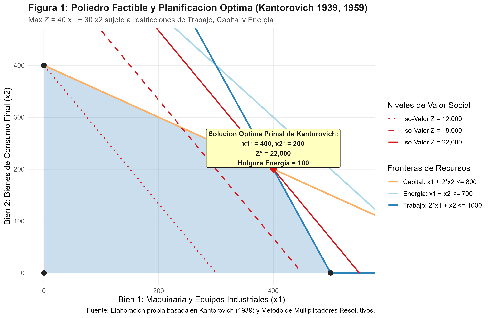
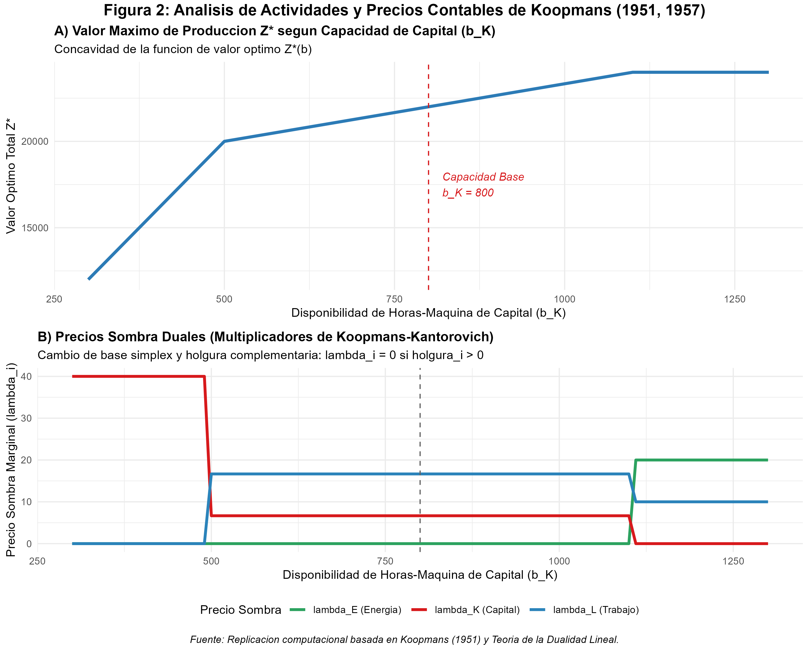

# Introducción y Contexto Histórico

En octubre de 1975, la Real Academia Sueca de Ciencias concedió el Premio de Ciencias Económicas en Memoria de Alfred Nobel conjuntamente a **Leonid Vitaliyevich Kantorovich** (Academia de Ciencias de la URSS) y a **Tjalling C. Koopmans** (Universidad de Yale, Cowles Foundation) *"por sus contribuciones a la teoría de la asignación óptima de recursos"* [@nobel1975press].

Este galardón reviste una singular trascendencia en la historia de la ciencia económica:
1. **Convergencia metodológica a través del Telón de Acero:** En plena Guerra Fría, Kantorovich (trabajando en la Unión Soviética en el marco de la planificación socialista centralizada) y Koopmans (trabajando en Estados Unidos y la Comisión Cowles en el marco del análisis insumo-producto y la teoría de mercados) llegaron de manera independiente a la misma conclusión matemática fundamental: **la eficiencia técnica en el uso de recursos escasos es indisoluble de un sistema de precios sombra o multiplicadores de valoración marginal**.
2. **Nacimiento de la Programación Matemática:** En 1939, al resolver un problema de optimización en una fábrica de madera contrachapada en Leningrado, Kantorovich formuló por primera vez la **Programación Lineal** y el concepto de *multiplicadores resolutivos* (*razreshayushchie mnozhiteli*), anticipándose en casi una década a los trabajos de George Dantzig [@kantorovich1939mathematical].
3. **El Análisis de Actividades de Koopmans:** En la monografía fundacional de la Cowles Commission (1951), Koopmans formalizó los conjuntos de producción como conos convexos poliédricos generados por actividades elementales, liberando a la teoría de la producción de las funciones neoclásicas suaves y demostrando que a toda asignación de actividades eficiente le corresponde un vector de precios contables internos de equilibrio [@koopmans1951activity; @koopmans1957three].

---

# Marco Teórico y Fundamentos Matemáticos

## El Problema Primal: Planificación y Asignación de Recursos (Kantorovich 1939, 1959)

Consideremos una economía (o un conglomerado industrial multiproductivo) que dispone de $m$ insumos productivos limitados y puede desarrollar $n$ actividades productivas que generan bienes finales valorados socialmente o comercializados a precios $c = (c_1, \dots, c_n)' \in \mathbb{R}_+^n$.

El vector de niveles de actividad $x = (x_1, \dots, x_n)' \ge 0$ determina el uso de recursos mediante una matriz tecnológica $A \in \mathbb{R}_+^{m \times n}$, donde cada elemento $a_{ij}$ representa la cantidad del recurso $i$ requerida para producir una unidad del bien $j$.

El problema primal de asignación óptima planteado por Kantorovich [@kantorovich1939mathematical; @kantorovich1965best] se formula como:

$$\max_{x \ge 0} Z = c'x = \sum_{j=1}^n c_j x_j$$

sujeto a las restricciones de capacidad física de insumos:

$$A x \le b \iff \sum_{j=1}^n a_{ij} x_j \le b_i \quad \forall i \in \{1, \dots, m\}$$

$$x_j \ge 0 \quad \forall j \in \{1, \dots, n\}$$

donde $b = (b_1, \dots, b_m)' \in \mathbb{R}_+^m$ representa el vector de dotaciones iniciales de factores de producción (trabajo, capital, energía, materias primas).

## El Problema Dual y los Precios Sombra (Koopmans 1951; Kantorovich 1959)

A todo problema de asignación física (primal) le corresponde intrínsecamente un problema dual de valoración económica. Si definimos el vector de multiplicadores resolutivos o **precios sombra** (*shadow prices*) $\lambda = (\lambda_1, \dots, \lambda_m)' \in \mathbb{R}_+^m$, el problema dual consiste en minimizar el costo contable total imputado a los recursos disponibles:

$$\min_{\lambda \ge 0} W = b'\lambda = \sum_{i=1}^m b_i \lambda_i$$

sujeto a la condición de no rentabilidad extraordinaria (*zero-profit condition* o ausencia de beneficios supra-económicos):

$$A' \lambda \ge c \iff \sum_{i=1}^m a_{ij} \lambda_i \ge c_j \quad \forall j \in \{1, \dots, n\}$$

$$\lambda_i \ge 0 \quad \forall i \in \{1, \dots, m\}$$

### Teoremas Fundamentales de Dualidad

1. **Dualidad Débil:** Para cualquier vector primal factible $x$ y cualquier vector dual factible $\lambda$, se cumple que $c'x \le b'\lambda$.
2. **Dualidad Fuerte (Von Neumann, Dantzig, Kantorovich, Koopmans):** Si el problema primal tiene una solución óptima $x^*$, entonces el problema dual tiene una solución óptima $\lambda^*$, y ambos valores objetivos coinciden exactamente:
   $$Z^* = c'x^* = b'\lambda^* = W^*$$
3. **Teorema de Holguras Complementarias (*Complementary Slackness*):**  
   Para las soluciones óptimas $x^*$ y $\lambda^*$:
   $$\lambda_i^* \cdot \left( b_i - \sum_{j=1}^n a_{ij} x_j^* \right) = 0 \quad \forall i \in \{1, \dots, m\}$$
   $$x_j^* \cdot \left( \sum_{i=1}^m a_{ij} \lambda_i^* - c_j \right) = 0 \quad \forall j \in \{1, \dots, n\}$$

### La Intuición Económica de Kantorovich y Koopmans
El teorema de holguras complementarias encierra una de las leyes más profundas de la economía:
- Si un recurso $i$ no se agota completamente en el plan óptimo ($\text{holgura}_i = b_i - \sum_j a_{ij} x_j^* > 0$), su precio sombra **debe ser exactamente cero** ($\lambda_i^* = 0$). Un bien no escaso a nivel marginal no tiene valor de escasez.
- Si un recurso $i$ tiene un precio sombra positivo ($\lambda_i^* > 0$), dicho insumo actúa como un cuello de botella estricto y se encuentra plenamente agotado ($\text{holgura}_i = 0$).
- Si una actividad $j$ se produce activamente ($x_j^* > 0$), su costo de oportunidad contable marginal debe igualar con exactitud su valoración social o precio de mercado ($\sum_i a_{ij} \lambda_i^* = c_j$).

---

# El Modelo Computacional Multi-Sectorial

Para la replicación cuantitativa, calibramos un modelo multi-sectorial con:
- **Dos sectores productivos / bienes finales:**
  - $x_1$: Maquinaria y Equipos Industriales (bienes de capital), con valor unitario $c_1 = 40$.
  - $x_2$: Manufacturas y Bienes de Consumo, con valor unitario $c_2 = 30$.
- **Tres factores de producción escasos:**
  - Factor 1: Trabajo calificado ($L$), dotación base $b_L = 1000$ horas hombre. Coeficientes: $2 x_1 + 1 x_2 \le 1000$.
  - Factor 2: Capacidad de planta de Capital ($K$), dotación base $b_K = 800$ horas máquina. Coeficientes: $1 x_1 + 2 x_2 \le 800$.
  - Factor 3: Energía / Insumos primarios ($E$), dotación base $b_E = 700$ MWh. Coeficientes: $1 x_1 + 1 x_2 \le 700$.

## Solución Analítica

El sistema formado por las restricciones activas de Trabajo y Capital genera el vértice óptimo:
$$2 x_1 + x_2 = 1000$$
$$x_1 + 2 x_2 = 800$$

Resolviendo el sistema $2 \times 2$:
$$x_1^* = 400, \quad x_2^* = 200$$

Comprobación del insumo Energía:
$$1(400) + 1(200) = 600 \le 700 \implies \text{Holgura}_E = 100 > 0$$

Por holgura complementaria: $\lambda_E^* = 0$.
Los precios sombra de Trabajo ($\lambda_L^*$) y Capital ($\lambda_K^*$) satisfacen:
$$2 \lambda_L + 1 \lambda_K = 40$$
$$1 \lambda_L + 2 \lambda_K = 30$$

Resolviendo:
$$\lambda_L^* = \frac{50}{3} \approx 16.6667, \quad \lambda_K^* = \frac{20}{3} \approx 6.6667$$

Valor total:
$$Z^* = 40(400) + 30(200) = 22,000$$
$$W^* = 1000\left(\frac{50}{3}\right) + 800\left(\frac{20}{3}\right) + 700(0) = \frac{50,000 + 16,000}{3} = 22,000$$

---

# Replicación Computacional en R

A continuación se presenta el código ejecutable que implementa la optimización simplex primal y dual mediante la biblioteca `lpSolve`, efectúa el análisis de sensibilidad y genera los resultados numéricos y gráficos.

```{r}
#| label: setup-optimizacion
#| message: false
#| warning: false

library(lpSolve)
library(ggplot2)
library(dplyr)
library(tidyr)
library(readr)
library(gridExtra)

# Parametros del modelo
c_obj <- c(40, 30)

A_mat <- matrix(c(
  2, 1,   # Trabajo (L)
  1, 2,   # Capital (K)
  1, 1    # Energia (E)
), nrow = 3, byrow = TRUE)

dir_mat <- c("<=", "<=", "<=")
b_base  <- c(1000, 800, 700)

# Resolucion primal y dual
res_primal <- lp(
  direction = "max",
  objective.in = c_obj,
  const.mat = A_mat,
  const.dir = dir_mat,
  const.rhs = b_base,
  compute.sens = TRUE
)

x_opt <- res_primal$solution
Z_opt <- res_primal$objval
holguras <- b_base - (A_mat %*% x_opt)
precios_sombra <- res_primal$duals[1:3]
```

## Resultados del Caso Base

```{r}
#| label: resultados-caso-base

cat("=== RESULTADOS DEL CASO BASE ===\n")
cat(sprintf("Produccion Optima Bien 1 (Maquinaria): x1* = %.2f unidades\n", x_opt[1]))
cat(sprintf("Produccion Optima Bien 2 (Consumo):    x2* = %.2f unidades\n", x_opt[2]))
cat(sprintf("Valor Social Agregado Maximo:          Z*  = %.2f u.m.\n\n", Z_opt))

recursos <- c("Trabajo (L)", "Capital (K)", "Energia (E)")
for (i in 1:3) {
  cat(sprintf("Recurso %-12s: Asignado = %6.2f / %6.2f | Holgura = %6.2f | Precio Sombra = %7.4f\n",
              recursos[i], sum(A_mat[i, ] * x_opt), b_base[i], holguras[i], precios_sombra[i]))
}

W_dual <- sum(b_base * precios_sombra)
cat(sprintf("\nVerificacion Teorema Fuerte de Dualidad:\n"))
cat(sprintf("Z* (Primal) = %.4f | W* (Dual) = %.4f | Brecha = %.6f\n", Z_opt, W_dual, abs(Z_opt - W_dual)))
```

---

# Análisis Gráfico y Discusión de Resultados

## Figura 1: El Poliedro Factible y la Solución Primal de Kantorovich

La Figura 1 muestra el espacio bidimensional de producción $(x_1, x_2)$, la envolvente convexa factible determinada por los hiperplanos de recursos, las líneas de iso-valor social y el vértice óptimo donde la frontera técnica hace tangencia con la mayor curva de valor posible.

{width=95%}

## Figura 2: Análisis de Actividades y Sensibilidad de Precios Sombra (Koopmans 1951)

Al variar la dotación de Capital ($b_K$) manteniendo constantes los demás factores, observamos dos fenómenos cruciales descritos por Koopmans:
1. **Concavidad de la función de valor $Z^*(b)$:** A medida que el capital se expande, la pendiente marginal decrece en escalones discretos correspondientes a los cambios de base simplex.
2. **Dinámica de los Precios Sombra:** Cuando el capital es extremadamente escaso, su precio sombra es alto. Al alcanzar $b_K = 800$, se estabiliza en $6.67$. Si el capital continuara aumentando hasta que otra restricción (e.g. energía o trabajo) se convierta en el cuello de botella dominante, el precio sombra del capital cae a cero.

{width=95%}

## Tabla Comparativa de Escenarios

A continuación se resume el comportamiento de la economía ante distintos shocks estructurales de disponibilidad de factores:

```{r}
#| label: tabla-escenarios
#| message: false

df_tab <- read_csv("salidas/tab_resultados_optimizacion_1975.csv")
knitr::kable(df_tab, digits = 2, caption = "Tabla 1: Comparativa de Escenarios de Asignación Óptima y Precios Sombra")
```

---

# ¿Qué Vas a Aprender?

Al completar esta práctica comprenderás:
1. Cómo la programación lineal resuelve el problema fundamental de la escasez mediante optimización matemática de restricciones conjuntas.
2. Por qué los precios sombra duales no son un artificio contable, sino los verdaderos indicadores del costo de oportunidad marginal de los recursos escasos.
3. Cómo la teoría de actividades de Koopmans proporciona un fundamento riguroso y convexo a la función de producción sin depender de funciones analíticas diferenciables como Cobb-Douglas o CES.
4. Cómo la asignación centralizada planificada y el equilibrio competitivo descentralizado convergen a través del teorema de dualidad de Von Neumann-Kantorovich-Koopmans.

---

# Ejercicios para el Estudiante

## Ejercicio 1 (Básico: Identificación de Cuellos de Botella y Holguras)
Suponga que una sequía reduce la disponibilidad de energía de $b_E = 700$ a $b_E = 500$ MWh, mientras que el trabajo ($b_L = 1000$) y el capital ($b_K = 800$) permanecen sin cambios.
1. Formule el nuevo sistema de restricciones y grafique la nueva región factible.
2. Calcule la nueva solución óptima $(x_1^*, x_2^*)$ y el valor total de la producción $Z^*$.
3. Indique qué factores presentan holgura positiva y verifique que sus precios sombra asociados sean nulos.

## Ejercicio 2 (Intermedio: Incorporación de una Nueva Actividad Productiva)
El departamento técnico propone incorporar una tercera actividad productiva: **Bienes de Alta Tecnología** ($x_3$), cuyo valor social unitario es $c_3 = 65$. Producir una unidad de $x_3$ requiere $3$ horas de trabajo, $2$ horas-máquina de capital y $1.5$ MWh de energía.
1. Evalúe el costo de oportunidad dual de la actividad $x_3$ evaluado a los precios sombra del caso base: $\bar{c}_3 = a_{13}\lambda_L^* + a_{23}\lambda_K^* + a_{33}\lambda_E^*$.
2. De acuerdo con el criterio del método simplex y el análisis de actividades de Koopmans, determine si resulta económicamente rentable introducir la producción del bien $x_3$.
3. Resuelva el nuevo modelo lineal en R con 3 variables de decisión y verifique si $x_3^* > 0$.

## Ejercicio 3 (Reto: Programación Entera y Costos Fijos de Activación)
Suponga que la producción de maquinaria ($x_1$) requiere activar una línea de montaje pesada con un costo fijo de activación equivalente a $4,000$ unidades monetarias, de modo que el valor neto generado es $40 x_1 - 4000 \cdot y_1$, donde $y_1 \in \{0, 1\}$ es una variable binaria que toma el valor 1 si $x_1 > 0$ y 0 si $x_1 = 0$.
1. ¿Por qué la convexidad deja de cumplirse y el teorema de dualidad lineal fuerte ya no garantiza precios sombra lineales únicos que descentralicen el óptimo?
2. Resuelva el modelo de programación lineal entera mixta (MIP) en R y discuta las implicaciones para la teoría de precios contables en presencia de indivisibilidades tecnológicas.

---

# Preguntas de Discusión

1. **El debate sobre el cálculo económico socialista:** ¿Por qué los hallazgos de Kantorovich demostraron a los líderes soviéticos que los precios administrativos basados puramente en la "teoría del valor trabajo" de Marx conducían al despilfarro masivo de recursos al ignorar el costo de oportunidad del capital y la tierra?
2. **Descentralización y precios internos:** ¿Cómo pueden las grandes corporaciones transnacionales modernas (e.g. Amazon, Toyota) utilizar los precios sombra para coordinar la producción entre divisiones autónomas sin necesidad de negociar precios de mercado externos?
3. **Externalidades ambientales y precios sombra de recursos naturales:** Si la restricción de emisiones de carbono actúa como un recurso escaso con límite superior fijo, ¿qué significado económico adquiere el precio sombra dual de dicha restricción y cómo se relaciona con un impuesto pigouviano o un mercado de bonos de carbono?

---

# Referencias
