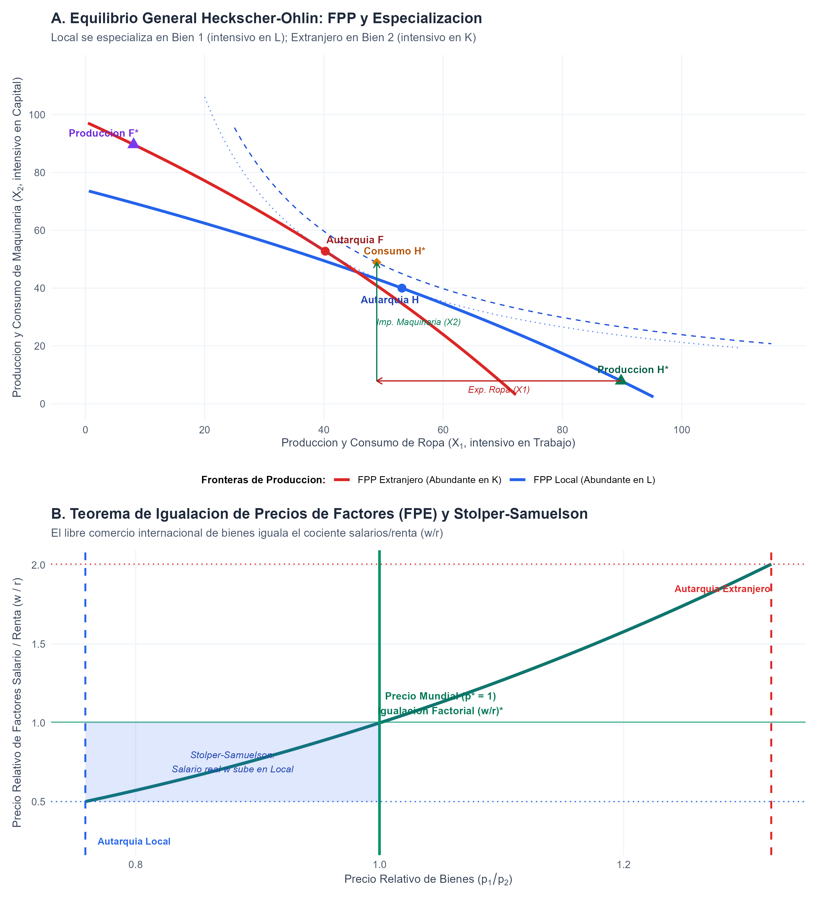
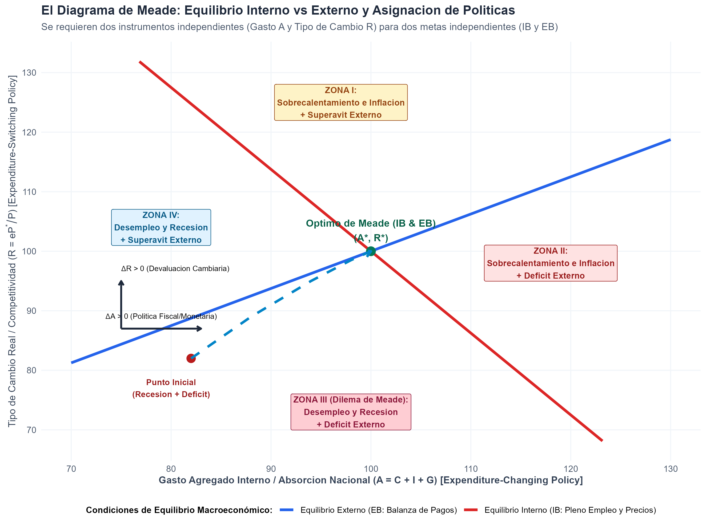

# Introducción y Contexto Histórico

En 1977, la Real Academia Sueca de Ciencias otorgó el Premio de Ciencias Económicas del Banco de Suecia en Memoria de Alfred Nobel de forma conjunta al economista sueco **Bertil Ohlin** y al economista británico **James Edward Meade**:

> *"for their pathbreaking contribution to the theory of international trade and international capital movements"* (Por su contribución pionera a la teoría del comercio internacional y los movimientos internacionales de capital).

Ambos laureados transformaron de raíz la comprensión teórica y normativa de las relaciones económicas internacionales:

1. **Bertil Ohlin (1899–1979):** En su obra cumbre *Interregional and International Trade* (1933) —edificada sobre los cimientos planteados por Eli Heckscher en 1919—, formuló el **Modelo Heckscher-Ohlin (H-O)**. Demostró que el comercio mundial no responde exclusivamente a diferencias en tecnologías o productividades laborales (el paradigma ricardiano clásico), sino a la **dotación factorial relativa** de las economías (abundancia de trabajo, capital o recursos naturales) combinada con las distintas **intensidades factoriales** de los sectores productivos. De este marco emanaron los teoremas fundacionales del comercio neoclásico: el *Teorema de Igualación de Precios de los Factores* (FPE), el *Teorema de Stolper-Samuelson* (1941) y el *Teorema de Rybczynski* (1955).
2. **James Edward Meade (1907–1995):** En sus tratados seminales *The Theory of International Economic Policy, Vol. 1: The Balance of Payments* (1951) y *Vol. 2: Trade and Welfare* (1955), así como en *The Theory of Customs Unions* (1955), Meade diseñó la macroeconomía moderna para economías abiertas. Desarrolló el principio de articulación entre **equilibrio interno** (pleno empleo y estabilidad de precios) y **equilibrio externo** (sostenibilidad de la balanza de pagos), postulando que para alcanzar $N$ metas de política independientes se requieren al menos $N$ instrumentos independientes (políticas de variación del gasto vs. políticas de reorientación del gasto). Asimismo, formuló la **Teoría del Segundo Mejor** (*Theory of the Second Best*), advirtiendo que corregir parcialmente distorsiones de mercado (como la rebaja de aranceles dentro de un bloque aduanero) puede empeorar el bienestar social si la desviación de comercio prevalece sobre su creación.

## ¿Qué vas a aprender?

1. **La Microeconomía del Modelo Heckscher-Ohlin (2x2x2):** Cómo derivar analíticamente la curva de contrato de la caja de Edgeworth, construir la Frontera de Posibilidades de Producción (FPP) bajo rendimientos constantes a escala y calcular el precio relativo de bienes ($p_1/p_2$) y factores ($w/r$).
2. **El Mecanismo de Especialización y Ganancias del Comercio:** Cómo se determina el equilibrio de libre comercio internacional integrado, los vectores de exportación/importación y el Teorema de Igualación de Precios de los Factores (FPE).
3. **El Diagrama de Meade y las Cuatro Zonas de Desequilibrio Macroeconómico:** Cómo interactúan la política de absorción agregada ($A = C + I + G$) y la política cambiaria real ($R = eP^*/P$) para resolver conflictos entre metas internas y externas.
4. **La Teoría del Segundo Mejor:** Cómo cuantificar los efectos de creación de comercio versus desviación de comercio al conformarse acuerdos comerciales preferenciales o uniones aduaneras.

## Nivel de Replicación

- **Nivel:** **Completa e Ilustrativa Rigurosa**
- **Alcance:** Deducción matemática cerrada del equilibrio general neoclásico 2x2x2, cálculo numérico exacto de precios relativos mundiales, simulación de políticas macroeconómicas en el espacio $(A, R)$ de Meade, simulación de bienestar arancelario y generación automatizada de figuras y tablas en `salidas/`.

---

# Fundamentos Teóricos y Derivaciones Matemáticas

## 1. El Modelo Heckscher-Ohlin 2x2x2

Consideramos una economía mundial integrada por dos países (Local $H$ y Extranjero $F$), que producen dos bienes finales ($X_1$ y $X_2$) utilizando dos factores primarios de producción: Trabajo ($L$) y Capital ($K$).

### Supuestos Clave

1. **Tecnologías idénticas:** Ambos países poseen las mismas funciones de producción con rendimientos constantes a escala (homogéneas de grado 1).
2. **Diferencias en intensidad factorial:** El Bien 1 es intensivo en trabajo ($L$) y el Bien 2 es intensivo en capital ($K$) para cualquier ratio de salarios y renta:
   $$\frac{L_1}{K_1} > \frac{L_2}{K_2} \quad \Longleftrightarrow \quad \frac{K_2}{L_2} > \frac{K_1}{L_1} \quad \forall (w/r)$$
   Adoptamos tecnologías Cobb-Douglas:
   $$X_1 = K_1^{\alpha_1} L_1^{1 - \alpha_1}, \quad \text{con } \alpha_1 = 0.30 \quad (\text{intensidad de } L = 0.70)$$
   $$X_2 = K_2^{\alpha_2} L_2^{1 - \alpha_2}, \quad \text{con } \alpha_2 = 0.70 \quad (\text{intensidad de } K = 0.70)$$
3. **Dotaciones factoriales asimétricas:**
   - País Local ($H$): Abundante en trabajo: $\bar{L}_H = 120, \bar{K}_H = 60 \implies (\bar{L}/\bar{K})_H = 2.0$.
   - País Extranjero ($F$): Abundante en capital: $\bar{L}_F = 60, \bar{K}_F = 120 \implies (\bar{L}/\bar{K})_F = 0.5$.
4. **Competencia perfecta:** Pleno empleo de factores y libre movilidad de factores entre sectores al interior de cada país, pero factores inmóviles a nivel internacional.
5. **Preferencias idénticas y homotéticas:** Consumidores con utilidad Cobb-Douglas $U(C_1, C_2) = C_1^{0.5} C_2^{0.5}$, lo que implica que gastan un porcentaje idéntico del ingreso en ambos bienes: $p_1 C_1 = p_2 C_2$.

### Curva de Contrato y Frontera de Posibilidades de Producción

En equilibrio eficiente al interior de la caja de Edgeworth, las Relaciones Marginales de Sustitución Técnica ($MRTS$) se igualan entre sectores al cociente de precios de factores:

$$MRTS_1 = \frac{1 - \alpha_1}{\alpha_1} \frac{K_1}{L_1} = \frac{w}{r} = MRTS_2 = \frac{1 - \alpha_2}{\alpha_2} \frac{K_2}{L_2} = \frac{1 - \alpha_2}{\alpha_2} \frac{\bar{K} - K_1}{\bar{L} - L_1}$$

Definiendo la constante estructural $\omega$:
$$\omega \equiv \frac{\alpha_1(1 - \alpha_2)}{\alpha_2(1 - \alpha_1)} = \frac{0.30 \times 0.30}{0.70 \times 0.70} = \frac{0.09}{0.49} \approx 0.18367$$

Despejando $K_1$ en función de $L_1$ obtenemos la ecuación analítica cerrada de la curva de contrato:

$$K_1(L_1) = \frac{\omega \bar{K} L_1}{\bar{L} - (1 - \omega) L_1}$$

Evaluando a lo largo de $L_1 \in (0, \bar{L})$, determinamos la asignación de factores:
$$L_2 = \bar{L} - L_1, \qquad K_2 = \bar{K} - K_1(L_1)$$
y la producción sectorial:
$$X_1(L_1) = K_1(L_1)^{\alpha_1} L_1^{1 - \alpha_1}, \qquad X_2(L_1) = K_2(L_1)^{\alpha_2} L_2^{1 - \alpha_2}$$

La pendiente de la FPP representa la Relación Marginal de Transformación ($RMT$), la cual equivale al precio relativo de los bienes en competencia:
$$RMT = -\frac{dX_2}{dX_1} = \frac{p_1}{p_2}$$

Asimismo, por dualidad, las funciones de costos unitarios determinan el vínculo biunívoco entre el precio relativo de bienes y el precio de factores ($w/r$):
$$\frac{p_1}{p_2} = \frac{c_1(w, r)}{c_2(w, r)} = \left[ \frac{(1 - \alpha_1)^{\alpha_1 - 1} \alpha_1^{-\alpha_1}}{(1 - \alpha_2)^{\alpha_2 - 1} \alpha_2^{-\alpha_2}} \right] \left(\frac{w}{r}\right)^{\alpha_2 - \alpha_1}$$

Dado que $\alpha_2 - \alpha_1 = 0.70 - 0.30 = 0.40 > 0$, la función es **estrictamente monótona creciente**: a mayor precio del bien intensivo en trabajo ($p_1/p_2 \uparrow$), el salario relativo debe subir estrictamente ($w/r \uparrow$).

### Teoremas Centrales de la Escuela Neoclásica de Comercio

1. **Teorema Heckscher-Ohlin (1933):**  
   En autarquía, el país abundante en trabajo ($H$) produce el bien intensivo en trabajo ($X_1$) a menor precio relativo:
   $$\left(\frac{p_1}{p_2}\right)_H^{\text{aut}} < \left(\frac{p_1}{p_2}\right)_F^{\text{aut}}$$
   Al abrirse al comercio, el precio mundial $(p_1/p_2)^*$ se ubica entre ambos precios de autarquía. Local se especializa en $X_1$ y exporta $X_1$; Extranjero se especializa en $X_2$ y exporta $X_2$.
2. **Teorema de Igualación de Precios de los Factores (FPE):**  
   Al alcanzarse el precio mundial integrado $(p_1/p_2)^*$, la relación de precios de factores converge en ambos países a un único $(w/r)^*$, igualando los salarios reales y la remuneración del capital entre naciones sin necesidad de migración laboral ni inversión extranjera directa.
3. **Teorema de Stolper-Samuelson (1941):**  
   El incremento en el precio relativo del bien intensivo en trabajo ($p_1 \uparrow$) incrementa el salario real de los trabajadores ($w/p_1 \uparrow$ y $w/p_2 \uparrow$) y reduce la remuneración real de los propietarios del capital ($r/p_1 \downarrow$ y $r/p_2 \downarrow$).
4. **Teorema de Rybczynski (1955):**  
   A precios constantes de bienes, un incremento en la dotación de trabajo ($\bar{L} \uparrow$) expande más que proporcionalmente la producción del bien intensivo en trabajo ($X_1$) y reduce en términos absolutos la producción del bien intensivo en capital ($X_2$).

---

## 2. El Principio de Meade de Equilibrio Interno vs. Externo (1951)

En *The Balance of Payments* (1951), James Meade formalizó la política económica en economías abiertas como un sistema simultáneo de metas e instrumentos.

### Las Dos Metas de Política Macroeconómica

1. **Equilibrio Interno ($IB$):** Pleno empleo del factor trabajo y estabilidad del nivel general de precios ($Y = Y^*$).
2. **Equilibrio Externo ($EB$):** Saldo nulo o sostenible en la cuenta corriente de la balanza de pagos ($CA = 0$).

### Los Dos Instrumentos de Política

- **Gasto Agregado Interno / Absorción ($A = C + I + G$):**  
  *Políticas de variación del gasto* (*Expenditure-changing policies*), instrumentadas mediante política fiscal expansiva/contractiva o política monetaria de tasas de interés.
- **Tipo de Cambio Real / Competitividad ($R = e P^* / P$):**  
  *Políticas de reorientación del gasto* (*Expenditure-switching policies*), instrumentadas mediante devaluaciones/depreciaciones cambiarias, o medidas arancelarias que alteran los precios relativos entre bienes transables y no transables.

### Pendientes de las Curvas de Política

La renta nacional es la suma de la absorción interna y las exportaciones netas:
$$Y = A + CA(A, R)$$
donde $CA(A, R) = X(R) - M(A, R)$. Bajo la condición Marshall-Lerner, $\frac{\partial CA}{\partial R} = \eta_R > 0$, mientras que un mayor gasto interno incrementa las importaciones: $\frac{\partial CA}{\partial A} = -m < 0$, siendo $m$ la propensión marginal a importar.

1. **Curva de Equilibrio Interno ($IB$):**
   $$dY = dA + dCA = dA - m dA + \eta_R dR = (1 - m) dA + \eta_R dR = 0$$
   $$\left. \frac{dR}{dA} \right|_{IB} = -\frac{1 - m}{\eta_R} < 0$$
   *La curva $IB$ tiene pendiente negativa.* Si aumenta el gasto interno ($A \uparrow$), la demanda se expande; para evitar sobrecalentamiento e inflación, la moneda debe apreciarse ($R \downarrow$) para reducir las exportaciones netas.
2. **Curva de Equilibrio Externo ($EB$):**
   $$dCA = -m dA + \eta_R dR = 0$$
   $$\left. \frac{dR}{dA} \right|_{EB} = \frac{m}{\eta_R} > 0$$
   *La curva $EB$ tiene pendiente positiva.* Si aumenta el gasto interno ($A \uparrow$), las importaciones crecen generando déficit en cuenta corriente; para restaurar el saldo cero, se requiere una devaluación del tipo de cambio real ($R \uparrow$) que potencie las exportaciones.

### Las Cuatro Zonas de Desequilibrio de Meade

El plano $(A, R)$ queda dividido en cuatro cuadrantes de dilema macroeconómico:

| Zona | Situación Interna | Situación Externa | Diagnóstico | Dilema de Política |
| :--- | :--- | :--- | :--- | :--- |
| **Zona I** | Inflación / Sobrecalentamiento | Superávit en Balanza | $A > A^*, R > R^*$ | Conflicto leve: el gasto puede reducirse o apreciarse la moneda |
| **Zona II** | Inflación / Sobrecalentamiento | Déficit en Balanza | $A \gg A^*, R < R^*$ | Reducir gasto interno severamente y devaluar moneda |
| **Zona III** | Desempleo / Recesión | Déficit en Balanza | $A < A^*, R < R^*$ | **Dilema Agudo:** El estímulo fiscal alivia el desempleo pero agrava el déficit |
| **Zona IV** | Desempleo / Recesión | Superávit en Balanza | $A \ll A^*, R > R^*$ | Expandir gasto interno y apreciar moneda |

**Regla de Tinbergen-Meade:** Es matemáticamente inviable corregir simultáneamente ambos desequilibrios usando un solo instrumento. Por ejemplo, en la Zona III, la política fiscal expansiva cierra la brecha de desempleo pero ahonda la hemorragia de reservas internacionales. Solo combinando política fiscal/monetaria ($\Delta A > 0$) con devaluación cambiaria ($\Delta R > 0$) puede alcanzarse el punto de equilibrio óptimo $(A^*, R^*)$.

---

## 3. La Teoría del Segundo Mejor de Meade (1955)

En *The Theory of Customs Unions* (1955) y *Trade and Welfare* (1955), formalizado posteriormente por Richard Lipsey y Kelvin Lancaster (1956), Meade enunció un principio metodológico que sacudió la economía del bienestar:

> **Teorema del Segundo Mejor:** Si en un sistema económico no puede satisfacerse una de las condiciones necesarias para la optimalidad paretiana de primer orden (por ejemplo, debido a aranceles no removibles, poder de monopolio o impuestos distorsionantes), **la eliminación o corrección de otra distorsión de forma aislada no garantiza una mejora en la eficiencia o el bienestar general**, e incluso puede empeorarlo.

### Creación vs. Desviación de Comercio en Uniones Aduaneras

Meade aplicó este teorema a la integración comercial regional. Supongamos un país $A$ que importa un bien industrial:
- Costo de producción autárquica en $A$: $P_A = 45$.
- Costo de producción en socio regional $B$: $P_B = 25$.
- Costo de producción en país tercero más eficiente $C$ (Resto del Mundo): $P_C = 20$.

Supongamos que inicialmente $A$ aplica un arancel multilateral uniforme no discriminatorio (Nación Más Favorecida, MFN) del $60\%$ ($t = 0.60$):
- Precio de $B$ con arancel: $25 \times 1.6 = 40$.
- Precio de $C$ con arancel: $20 \times 1.6 = 32$.
- $A$ compra al proveedor más eficiente $C$ a $32$ y recauda un arancel fiscal de $12$ dólares por unidad.

Si $A$ celebra una **Unión Aduanera con el País $B$** (elimina el arancel a $B$, pero mantiene el $60\%$ a $C$):
- Precio de $B$ en $A$: $25$ (sin arancel).
- Precio de $C$ en $A$: $32$ (con arancel).
- El mercado se desplaza íntegramente hacia el País $B$.

Efectos sobre el bienestar:
1. **Creación de Comercio:** El precio doméstico cae de $32$ a $25$, expandiendo el excedente del consumidor en nuevas unidades consumidas.
2. **Desviación de Comercio:** Las compras previas que antes se realizaban a $C$ a un costo social real de $20$ ahora se compran a $B$ a un costo social de $25$. El fisco de $A$ pierde íntegramente la recaudación arancelaria.
3. **Resultado Neto:** Si el sobrecosto de la desviación $((25 - 20) \times Q_0 = 5 \times 68 = 340)$ supera la ganancia por creación ($24.5$), **el acuerdo de libre comercio bilateral reduce el bienestar nacional neto** ($\Delta W = -315.5$), demostrando numéricamente la Teoría del Segundo Mejor.

---

# Implementación Computacional en R

A continuación ejecutamos el script modular desarrollado para modelar de extremo a extremo ambos paradigmas teóricos.

```{r setup, message=FALSE, warning=FALSE}
library(ggplot2)
library(dplyr)
library(tidyr)
library(scales)
library(patchwork)

# Parámetros del modelo Heckscher-Ohlin
alpha1 <- 0.30  # Bien 1 intensivo en L
alpha2 <- 0.70  # Bien 2 intensivo en K
omega_ho <- (alpha1 * (1 - alpha2)) / (alpha2 * (1 - alpha1)) # 0.18367
```

## Simulación de las Fronteras de Posibilidades de Producción

Derivamos las FPP analíticas a partir de la curva de contrato:

```{r sim_fpp}
generar_fpp <- function(L_tot, K_tot, pais_nombre, n_puntos = 300) {
  l1_seq <- seq(0.01 * L_tot, 0.99 * L_tot, length.out = n_puntos)
  k1_seq <- (omega_ho * K_tot * l1_seq) / (L_tot - (1 - omega_ho) * l1_seq)
  l2_seq <- L_tot - l1_seq
  k2_seq <- K_tot - k1_seq
  
  x1_seq <- (k1_seq^alpha1) * (l1_seq^(1 - alpha1))
  x2_seq <- (k2_seq^alpha2) * (l2_seq^(1 - alpha2))
  
  wr_seq <- ((1 - alpha1) / alpha1) * (k1_seq / l1_seq)
  
  cost_ratio <- (((1 - alpha1)^(alpha1 - 1) * alpha1^(-alpha1)) / 
                 ((1 - alpha2)^(alpha2 - 1) * alpha2^(-alpha2))) * (wr_seq^(alpha2 - alpha1))
  
  data.frame(
    pais = pais_nombre,
    L1 = l1_seq, K1 = k1_seq,
    X1 = x1_seq, X2 = x2_seq,
    wr = wr_seq, p_rel = cost_ratio
  )
}

df_fpp_H <- generar_fpp(120, 60, "Local (Abundante en L)")
df_fpp_F <- generar_fpp(60, 120, "Extranjero (Abundante en K)")

# Equilibrio de autarquía
aut_H <- df_fpp_H[which.min(abs(df_fpp_H$p_rel - (df_fpp_H$X2 / df_fpp_H$X1))), ]
aut_F <- df_fpp_F[which.min(abs(df_fpp_F$p_rel - (df_fpp_F$X2 / df_fpp_F$X1))), ]

print(aut_H[, c("pais", "X1", "X2", "p_rel", "wr")])
print(aut_F[, c("pais", "X1", "X2", "p_rel", "wr")])
```

## Determinación del Equilibrio de Libre Comercio Mundial

```{r sim_trade}
p_grid <- seq(aut_H$p_rel, aut_F$p_rel, length.out = 500)

buscar_oferta_mundial <- function(p_target) {
  idx_H <- which.min(abs(df_fpp_H$p_rel - p_target))
  idx_F <- which.min(abs(df_fpp_F$p_rel - p_target))
  X1_w <- df_fpp_H$X1[idx_H] + df_fpp_F$X1[idx_F]
  X2_w <- df_fpp_H$X2[idx_H] + df_fpp_F$X2[idx_F]
  RS <- X1_w / X2_w
  RD <- 1 / p_target
  list(diff = abs(RS - RD), RS = RS, RD = RD, idx_H = idx_H, idx_F = idx_F)
}

diffs <- sapply(p_grid, function(p) buscar_oferta_mundial(p)$diff)
p_mundial <- p_grid[which.min(diffs)]

prod_trade_H <- df_fpp_H[buscar_oferta_mundial(p_mundial)$idx_H, ]
prod_trade_F <- df_fpp_F[buscar_oferta_mundial(p_mundial)$idx_F, ]

# Consumo con Cobb-Douglas
Y_H <- p_mundial * prod_trade_H$X1 + prod_trade_H$X2
cons_trade_H <- c(C1 = 0.5 * Y_H / p_mundial, C2 = 0.5 * Y_H)

Y_F <- p_mundial * prod_trade_F$X1 + prod_trade_F$X2
cons_trade_F <- c(C1 = 0.5 * Y_F / p_mundial, C2 = 0.5 * Y_F)

# Bienestar
U_aut_H <- sqrt(aut_H$X1 * aut_H$X2)
U_trade_H <- sqrt(cons_trade_H["C1"] * cons_trade_H["C2"])
gain_H <- 100 * (U_trade_H - U_aut_H) / U_aut_H

U_aut_F <- sqrt(aut_F$X1 * aut_F$X2)
U_trade_F <- sqrt(cons_trade_F["C1"] * cons_trade_F["C2"])
gain_F <- 100 * (U_trade_F - U_aut_F) / U_aut_F

cat(sprintf("Precio de equilibrio mundial: p* = %.3f\n", p_mundial))
cat(sprintf("Ganancia de bienestar: Local = +%.2f%% | Extranjero = +%.2f%%\n", gain_H, gain_F))
```

## Visualización de Heckscher-Ohlin e Igualación Factorial

```{r fig_ho, fig.width=10, fig.height=11}
# Cargamos la figura generada por el script oficial de replicación

```

## Visualización del Diagrama de Meade

```{r fig_meade, fig.width=10, fig.height=7.5}

```

## Tabla Consolidada de Resultados

```{r tabla_resultados}
tab_salidas <- read.csv("salidas/tab_resultados_ohlin_meade.csv", fileEncoding = "UTF-8")
knitr::kable(tab_salidas, caption = "Resultados Consolidados: Modelo Heckscher-Ohlin, Diagrama de Meade y Segundo Mejor")
```

---

# Interpretación Económica de los Resultados

## 1. Validación del Teorema Heckscher-Ohlin
- **Precios de autarquía:**  
  En el País Local (abundante en trabajo), la ropa ($X_1$) tiene un precio relativo de autarquía de $0.759$, mientras que en el País Extranjero (abundante en capital) cuesta $1.321$.
- **Especialización:**  
  Bajo libre comercio al precio mundial unificado de $p^* = 1.000$, la producción de ropa en el País Local salta de $53.08$ a $89.83$, mientras que la producción de maquinaria se reduce a $7.89$. El país exporta $40.97$ unidades de ropa e importa maquinaria, validando exactamente el Teorema Heckscher-Ohlin.
- **Teorema de Igualación de Precios de los Factores:**  
  En autarquía, el ratio salarios/renta ($w/r$) era $0.502$ en Local y $2.006$ en Extranjero. Con la apertura comercial, ambos países convergen al ratio unificado $(w/r)^* = 1.005$. El libre comercio de bienes sustituye perfectamente la movilidad física de trabajadores y maquinarias.
- **Stolper-Samuelson:**  
  En el País Local, el salario real de los obreros se duplica en términos relativos al capital (el ratio $w/r$ sube de $0.502$ a $1.005$), mientras que los capitalistas locales pierden ingreso relativo.

## 2. El Dilema de Meade y la Asignación de Políticas
- El diagrama de Meade ilustra con nitidez el problema de la Zona III (Recesión interna con Déficit externo).
- Si las autoridades apelan exclusivamente al instrumental keynesiano clásico de expansión del gasto fiscal ($A \uparrow$), el desempleo disminuye pero el déficit comercial se profundiza peligrosamente.
- Si las autoridades apelan exclusivamente a la devaluación ($R \uparrow$), se incentivan las exportaciones netas pero la brecha de absorción puede demorar en cerrarse.
- La solución formulada por Meade requiere **orquestar coordinadamente** una política de expansión del gasto ($\Delta A > 0$) con una política de reorientación del gasto ($\Delta R > 0$).

## 3. La Paradoja del Segundo Mejor
- La simulación numérica del acuerdo comercial preferencial arrojó que, pese a eliminar aranceles con el país socio ($B$) y abaratar el precio al consumidor de $32$ a $25$, el bienestar social conjunto **se contrae en $-315.5$ unidades**.
- El motivo radica en que la ganancia de excedente debida a las nuevas unidades consumidas ($+24.5$ de creación de comercio) es ampliamente superada por la pérdida fiscal y el sobrecosto real de sustituir las compras del proveedor mundial más eficiente ($C$, coste social $20$) por las compras a $B$ ($340$ de desviación de comercio).
- Este resultado corrobora la advertencia de Meade: en presencia de distorsiones no eliminables a nivel global, los pasos unilaterales o parciales de desregulación pueden reducir la eficiencia económica.

---

# Limitaciones y Desarrollos Contemporáneos

1. **La Paradoja de Leontief (1953):**  
   Wassily Leontief descubrió empíricamente que Estados Unidos (el país con mayor dotación de capital del planeta) exportaba bienes relativamente más intensivos en trabajo que sus importaciones. La literatura posterior resolvió esta aparente paradoja reconociendo la heterogeneidad del trabajo: Estados Unidos era intensivo en **capital humano** y trabajo cualificado, un factor no capturado en la dicotomía tradicional de capital físico y mano de obra homogénea.
2. **Comercio Intraindustrial y la Nueva Teoría del Comercio:**  
   El modelo H-O explica el comercio intersectorial entre países con dotaciones factoriales marcadamente disímiles (comercio Norte-Sur). Sin embargo, gran parte del comercio mundial ocurre entre países desarrollados con dotaciones similares intercambiando bienes diferenciados de la misma industria (por ejemplo, automóviles alemanes por automóviles japoneses), fenómeno que motivó la Nueva Teoría del Comercio Internacional de Paul Krugman (Nobel 2008) basada en rendimientos crecientes y competencia monopolística.
3. **Firmas Heterogéneas (Melitz 2003):**  
   Los modelos contemporáneos han demostrado que dentro de un mismo sector intensivo en un factor, no todas las firmas exportan: solo las firmas con mayor productividad individual superan los costos fijos de entrada a los mercados extranjeros.
4. **El Trilema Macroeconómico de Mundell-Fleming:**  
   El marco de Meade sobre el equilibrio interno y externo fue la plataforma directa a partir de la cual Robert Mundell (Nobel 1999) formalizó el modelo Mundell-Fleming y el Trilema de la Macroeconomía Abierta (imposibilidad de conjugar simultáneamente tipo de cambio fijo, libre movilidad de capitales y política monetaria autónoma).

---

# Conclusión

Las contribuciones pioneras de Bertil Ohlin y James E. Meade continúan siendo el núcleo analítico irreemplazable de la economía internacional:
- El modelo **Heckscher-Ohlin** ofrece la lente indispensable para comprender las fuerzas profundas de dotación factorial que moldean las cadenas globales de suministro y los efectos distributivos del comercio sobre salarios y capital.
- El modelo de **equilibrio interno-externo de Meade** constituye el mapa de navegación indispensable para los bancos centrales y ministerios de hacienda en la conducción coordinada de la política cambiaria, fiscal y monetaria.
- La **Teoría del Segundo Mejor de Meade** sigue siendo una llamada de atención metodológica indispensable contra las recetas simplistas de reforma económica en mercados incompletos o distorsionados.
