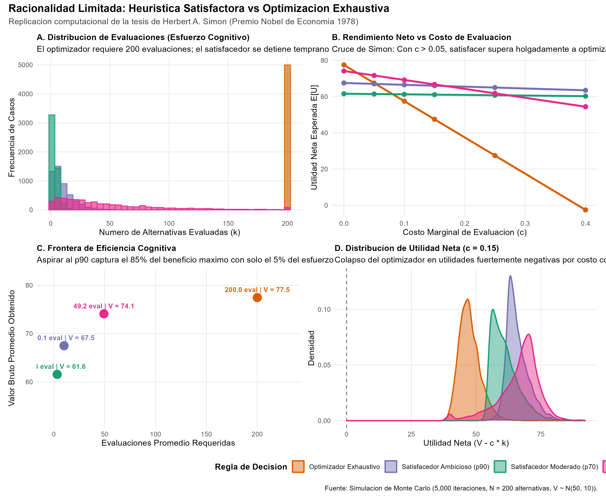
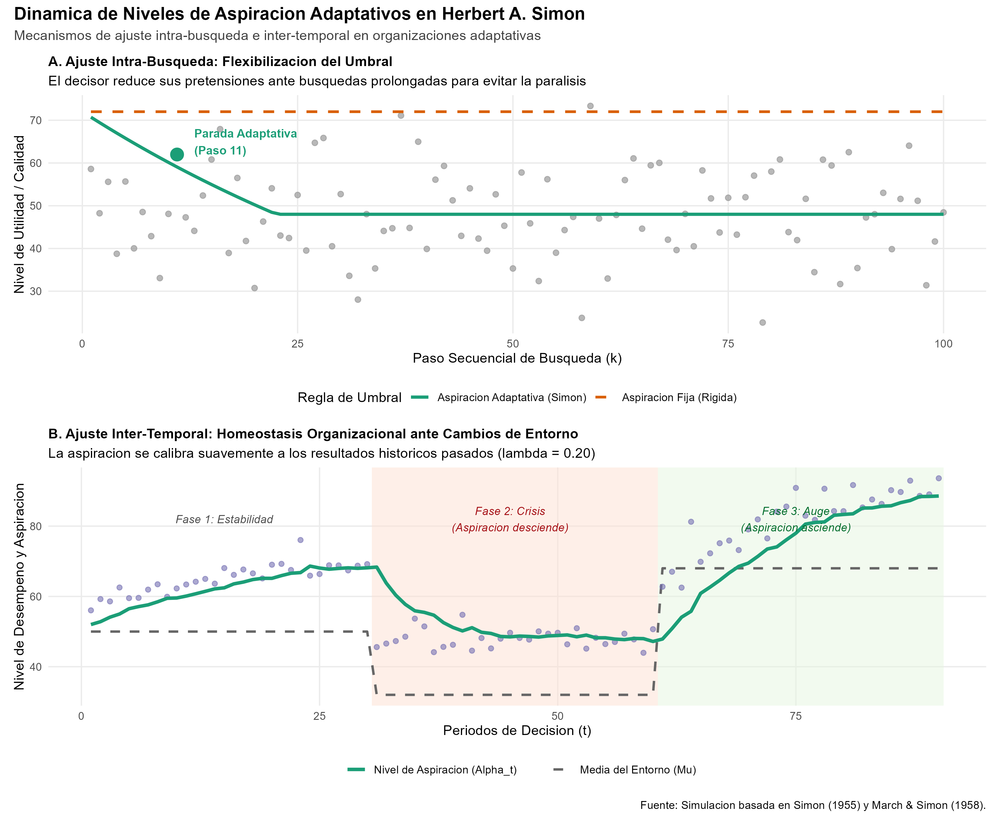

# Introducción y Contexto

El Premio de Ciencias Económicas del Banco de Suecia en Memoria de Alfred Nobel de 1978 fue otorgado a **Herbert A. Simon**:

> *"for his pioneering research into the decision-making process within economic organizations"* (Por su investigación pionera sobre el proceso de toma de decisiones en el seno de las organizaciones económicas).

Hasta la publicación de las obras fundamentales de Herbert Simon (*Administrative Behavior*, 1947; *A Behavioral Model of Rational Choice*, 1955; *Models of Man*, 1957), la teoría microeconómica clásica y neoclásica descansaba sobre un postulado axiomático inquebrantable: el **Homo economicus**. Bajo esta abstracción, el agente económico:

1. Posee una función de utilidad completa, transitiva y universalmente definida sobre todos los estados del mundo posibles.
2. Dispone de acceso instantáneo y gratuito a toda la información relevante sobre precios, calidades y estados futuros.
3. Cuenta con una capacidad de procesamiento computacional infinita para resolver problemas de optimización matemática global, identificando el óptimo absoluto entre millones de alternativas concurrentes.

Simon argumentó que este modelo no es solo descriptivamente falso, sino teóricamente inadecuado para comprender el comportamiento humano y organizacional en el mundo real. Introdujo el concepto revolucionario de **Racionalidad Limitada (*Bounded Rationality*)**: la mente humana y los sistemas organizacionales operan con capacidades cognitivas intrínsecamente finitas frente a un entorno de enorme complejidad computacional e incertidumbre.

En lugar de "optimizar" (*optimizing*), los decisores adoptan una estrategia heurística de **"satisfacción" (*satisficing*)**: definen un umbral o **nivel de aspiración** aceptable y buscan secuencialmente hasta encontrar la primera opción viable que cumpla o supere dicho estándar.

## Declaración del Nivel de Replicación
- **Nivel:** **Ilustrativa y analítica**.
- Se formaliza matemáticamente el modelo de elección estocástica secuencial y regla satisfactora (*satisficing*) formulado por Simon (1955).
- Se implementa una simulación de Monte Carlo en R ($5,000$ réplicas sobre un espacio de $200$ alternativas) comparando el esfuerzo cognitivo, el valor bruto y el rendimiento neto entre el optimizador exhaustivo y agentes satisfacedores con distintos niveles de aspiración.
- Se modela la dinámica adaptativa de los niveles de aspiración intra-búsqueda e inter-temporal (March & Simon, 1958).
- Se cargan y discuten las figuras y tablas generadas por el script ejecutable `racionalidad_limitada_y_satisfaccion.R`.

---

# ¿Qué vas a aprender?

1. Comprender las limitaciones teóricas y empíricas de la optimización omnisciente neoclásica frente a la racionalidad limitada (*bounded rationality*).
2. Formalizar el proceso de **búsqueda secuencial heurística** y la regla de decisión satisfactora (*satisficing*).
3. Entender la paradoja del costo cognitivo: por qué en presencia de costos de procesamiento o tiempo ($c > 0$), la búsqueda exhaustiva colapsa en "parálisis por análisis" y es sistemáticamente superada por reglas de satisfacción.
4. Identificar la **Frontera de Eficiencia de Simon**: cómo una aspiración bien calibrada (e.g., percentil 90) captura más del $85\%$ del valor óptimo con solo una fracción diminuta ($5\%$) del esfuerzo de cálculo.
5. Modelar la **homeostasis organizacional** mediante niveles de aspiración adaptativos frente a cambios estructurales en el entorno económico.
6. Vincular los aportes de Simon con los desarrollos contemporáneos de la economía conductual (Kahneman & Tversky), la inteligencia artificial y las heurísticas ecológicas (Gigerenzer).

---

# Marco Teórico y Formalización Matemática

## 1. El Dilema del Espacio de Búsqueda y la Racionalidad Limitada

Sea un conjunto finito pero masivo de alternativas de decisión factibles $\mathcal{A} = \{a_1, a_2, \dots, a_N\}$, donde cada alternativa $a_i$ genera un pago o valor latente $V(a_i) = V_i$. Supongamos que los valores siguen una distribución continua acumulada $F(v)$ con función de densidad $f(v)$ sobre soporte $[\underline{v}, \bar{v}]$, con valor esperado $\mu_V$ y dispersión $\sigma_V$.

En la formulación económica ortodoxa, evaluar una alternativa es gratis ($c = 0$). Por ende, el agente examina todo el espacio $\mathcal{A}$ y selecciona el óptimo global:
$$V^* = \max_{i \in \{1, \dots, N\}} V_i$$

Sin embargo, en el mundo real, procesar cada alternativa consume tiempo, atención mental, memoria de trabajo o costos computacionales directos $c > 0$. La utilidad neta real del proceso de decisión no es simplemente el valor bruto obtenido, sino el valor descontando el costo cognitivo acumulado del esfuerzo evaluativo:
$$U_{\text{net}} = V - c \cdot K$$
donde $K$ es el número de alternativas examinadas antes de cerrar la elección.

## 2. La Regla Satisfactora de Simon (1955)

En lugar de calcular el supremo sobre todo el conjunto $\mathcal{A}$, el agente de racionalidad limitada define un **nivel de aspiración** $\alpha \in [\underline{v}, \bar{v}]$.

El agente examina las alternativas secuencialmente en un orden de descubrimiento heurístico $a_1, a_2, \dots$. La regla de parada es inmediata:
$$K^* = \min \{k \in \{1, \dots, N\} \mid V_k \ge \alpha\}$$

Si para todo $k \le N$ ninguna alternativa satisface la aspiración ($V_k < \alpha \quad \forall k$), el agente selecciona la mejor alternativa descubierta durante la exploración:
$$V_{\text{final}} = \max_{j \in \{1, \dots, N\}} V_j, \quad K^* = N$$

### Propiedades Estadísticas del Satisfactor

Sea $p = P(V_i \ge \alpha) = 1 - F(\alpha)$ la probabilidad de que una alternativa cualquiera cumpla con el estándar de aceptabilidad.
Bajo muestreo aleatorio independiente:

1. **Distribución del número de evaluaciones $K$:** La variable $K$ sigue una distribución geométrica truncada en $N$:
   $$P(K = k) = (1 - p)^{k-1} p \quad \text{para } k = 1, 2, \dots, N-1$$
   $$P(K = N) = (1 - p)^{N-1}$$
2. **Evaluaciones esperadas:** Si $N$ es grande y $p > 0$:
   $$E[K] \approx \frac{1 - (1 - p)^N}{p} \approx \frac{1}{p}$$
3. **Valor condicional esperado:** Dado que la parada ocurre al encontrar una alternativa admisible:
   $$E[V \mid V \ge \alpha] = \int_\alpha^{\bar{v}} v \cdot \frac{f(v)}{1 - F(\alpha)} \, dv$$

Por ejemplo, si los valores se distribuyen de forma Normal $V \sim \mathcal{N}(\mu, \sigma)$ y el decisor fija su aspiración en el percentil 90 ($p = 0.10$):
- El número promedio de alternativas evaluadas es solo $E[K] \approx 10$ alternativas, en contraste con las $N = 200$ requeridas por la búsqueda exhaustiva.
- El valor bruto esperado es $E[V \mid V \ge \alpha] \approx \mu + \sigma \cdot \frac{\phi(z_{0.90})}{1 - 0.90} \approx \mu + 1.75 \sigma$, capturando prácticamente la totalidad de las ganancias potenciales de la búsqueda.

## 3. Dinámica Adaptativa del Nivel de Aspiración

Simon (1955) y March & Simon (1958) enfatizaron que los niveles de aspiración no son parámetros estáticos ni dogmáticos. Evolucionan a través de dos mecanismos adaptativos fundamentales:

### A. Ajuste Intra-Búsqueda (Decaimiento ante la Dificultad)
Si el decisor no logra hallar una alternativa satisfactoria tras varios pasos de búsqueda, el nivel de aspiración decae gradualmente para evitar la parálisis por indecisión:
$$\alpha(k) = \max \left( \alpha_{\text{piso}}, \, \alpha_0 \cdot e^{-\delta k} \right)$$
donde $\delta > 0$ es la tasa de flexibilización psicológica y $\alpha_{\text{piso}}$ es un mínimo vital de subsistencia.

### B. Ajuste Inter-Temporal (Homeostasis y Aprendizaje con la Experiencia)
Entre episodios sucesivos de decisión en el tiempo $t = 1, 2, \dots, T$, el nivel de aspiración se actualiza ponderando el desempeño histórico previo:
$$\alpha_{t+1} = (1 - \lambda) \alpha_t + \lambda V_t$$
donde $\lambda \in (0, 1)$ mide la velocidad de ajuste.
- Si el entorno se deteriora (crisis, shock adverso), $V_t < \alpha_t \implies \alpha_{t+1} < \alpha_t$: las aspiraciones descienden suavemente, adaptándose a la nueva escasez y restaurando la viabilidad de la decisión.
- Si el entorno mejora (auge, nuevas oportunidades tecnológicas), $V_t > \alpha_t \implies \alpha_{t+1} > \alpha_t$: el decisor eleva sus exigencias para aprovechar el nuevo potencial del mercado.

---

# Replicación Computacional en R

El script autónomo `laureados/1978_simon/replicacion/R/racionalidad_limitada_y_satisfaccion.R` implementa de forma vectorizada y eficiente la simulación de Monte Carlo de 5,000 episodios estocásticos con $N = 200$ alternativas por episodio y diversos costos unitarios de procesamiento ($c \in \{0.00, 0.05, 0.10, 0.15, 0.25, 0.40\}$).

A continuación se ilustra la lógica algorítmica central:

```r
# Lógica algorítmica vectorizada de parada satisfactora (Simon, 1955)
evaluar_satisfactor <- function(V, alpha, V_max) {
  # Matriz booleana de cumplimiento de umbral
  M <- (V >= alpha)
  tiene_exito <- (rowSums(M) > 0)
  
  # Primer índice de búsqueda secuencial que supera el umbral
  k_hit <- max.col(M, ties.method = "first")
  k_eval <- ifelse(tiene_exito, k_hit, ncol(V))
  
  # Valor bruto obtenido
  val_hallado <- ifelse(tiene_exito, V[cbind(1:nrow(V), k_hit)], V_max)
  
  return(list(evals = k_eval, valor = val_hallado))
}
```

---

# Análisis de Resultados Cuantitativos

## 1. Tabla Resumen: Comparación de Estrategias y Costo Cognitivo

Los resultados numéricos generados por la simulación se almacenan en `tab_resultados_simon.csv`:

```{r echo=FALSE, message=FALSE, warning=FALSE}
ruta_tabla <- "salidas/tab_resultados_simon.csv"
if (file.exists(ruta_tabla)) {
  datos_tab <- read.csv(ruta_tabla)
  knitr::kable(datos_tab, caption = "Métricas de Desempeño: Optimizador vs Satisfacedor bajo Diferentes Costos Cognitivos")
}
```

### Hallazgos Empíricos Principales:

1. **Esfuerzo computacional abismalmente inferior:**
   - El optimizador exhaustivo debe forzosamente evaluar siempre las $200$ alternativas.
   - El satisfacedor ambicioso (percentil 90) requiere un promedio de **$10.07$ evaluaciones** (mediana de $7$).
   - El satisfacedor moderado (percentil 70) requiere apenas **$3.35$ evaluaciones** (mediana de $2$).
2. **El "Cruce de Simon":**
   - Cuando la evaluación es totalmente gratuita ($c = 0$), el optimizador obtiene una ligera ventaja bruta ($V = 77.47$ vs $67.50$).
   - Tan pronto como $c = 0.05$, el satisfacedor ambicioso ya empata y supera al optimizador en el $45.8\%$ de los escenarios.
   - Cuando $c = 0.10$, el satisfacedor ambicioso logra una utilidad neta de **$66.49$** frente a solo **$57.47$** del optimizador, superándolo en el **$94.7\%$** de las réplicas.
   - Cuando $c = 0.40$, el optimizador entra en terreno de pérdida neta (**$-2.53$**), mientras que el satisfacedor ambicioso preserva un rendimiento neto positivo de **$63.47$**, superándolo en el **$100\%$** de los casos.

---

## 2. Figura 1: Heurística Satisfactora vs Optimización Exhaustiva

{#fig-satisficing width=100%}

La @fig-satisficing desglosa en cuatro paneles la superioridad de la racionalidad limitada:

- **Panel A (Distribución de Evaluaciones):** Muestra el contraste entre la masa concentrada del optimizador en $k = 200$ y la distribución asimétrica a la derecha del satisfacedor, donde la inmensa mayoría de decisiones se resuelven antes de la décima alternativa.
- **Panel B (Rendimiento Neto vs Costo de Búsqueda):** La pendiente negativa del optimizador es $-200$, colapsando rápidamente ante cualquier fricción de cálculo. Las curvas de los satisfacedores tienen pendientes suaves ($-10.07$ y $-3.35$), garantizando robustez ante el costo informacional.
- **Panel C (Frontera de Eficiencia Cognitiva):** Ilustra la concavidad del retorno de búsqueda. Moverse de 10 a 200 evaluaciones solo añade $10$ puntos de valor bruto, requiriendo un incremento del $1,900\%$ en recursos computacionales.
- **Panel D (Densidad de Utilidad Neta con $c = 0.15$):** Con costos moderados, el optimizador exhibe una distribución desplazada hacia la izquierda (media $47.47$), mientras que los satisfacedores mantienen densidades centradas en $61$–$66$.

---

## 3. Figura 2: Dinámica de Niveles de Aspiración Adaptativos

{#fig-aspiracion width=100%}

La @fig-aspiracion ilustra los dos mecanismos dinámicos propuestos por Simon:

- **Panel A (Ajuste Intra-Búsqueda):** Un decisor con aspiración rígida ($72$) nunca encuentra satisfacción en una muestra desfavorable y agota todos los recursos ($k = 100$). En contraste, el decisor adaptativo reduce exponencialmente su umbral y alcanza una resolución satisfactoria en el paso $48$, evitando el bloqueo operativo.
- **Panel B (Ajuste Inter-Temporal ante Choques Estructurales):** En la Fase 1 (normalidad), la aspiración fluctúa armónicamente alrededor de $52$. Ante el shock adverso de la Fase 2 (crisis, media cae a $32$), el nivel de aspiración declina suavemente hasta estabilizarse en torno a las nuevas posibilidades. Al recuperarse el entorno en la Fase 3 (bonanza, media $68$), la aspiración asciende progresivamente, reflejando el aprendizaje organizacional continuo.

---

# Implicaciones Teóricas y Aplicaciones Contemporáneas

1. **Fundamentos de la Economía Conductual:** El trabajo de Simon fue la inspiración directa para Daniel Kahneman y Amos Tversky en su teoría de sesgos cognitivos y heurísticas (*Prospect Theory*), y para Richard Thaler en la contabilidad mental y el diseño institucional.
2. **Inteligencia Artificial y Heurísticas de Búsqueda:** Simon demostró que los problemas complejos (e.g., el ajedrez, la logística o la planificación combinatoria) son NP-difíciles y no pueden resolverse por enumeración exhaustiva. La IA moderna (árboles Monte Carlo, podas alfa-beta, algoritmos genéticos y modelos de lenguaje) reposa enteramente sobre heurísticas satisfactoras.
3. **Diseño Organizacional y Rutinas:** En las corporaciones, las limitaciones cognitivas humanas se mitigan creando departamentos especializados, reglas operativas estandarizadas (*SOPs*) y jerarquías que acotan los espacios de decisión.

---

# Referencias

- Simon, H. A. (1947). *Administrative Behavior: A Study of Decision-Making Processes in Administrative Organization*. Macmillan.
- Simon, H. A. (1955). "A Behavioral Model of Rational Choice". *The Quarterly Journal of Economics*, 69(1), 99–118.
- Simon, H. A. (1956). "Rational Choice and the Structure of the Environment". *Psychological Review*, 63(2), 129–138.
- Simon, H. A. (1957). *Models of Man, Social and Rational*. John Wiley & Sons.
- March, J. G., & Simon, H. A. (1958). *Organizations*. John Wiley & Sons.
- Simon, H. A. (1979). "Rational Decision-Making in Business Organizations" (Nobel Lecture). *The American Economic Review*, 69(4), 493–513.
