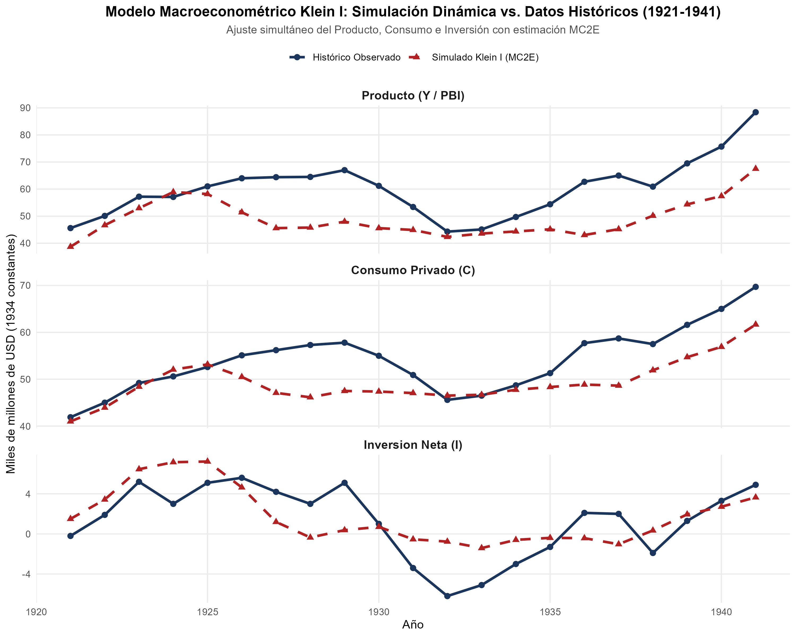
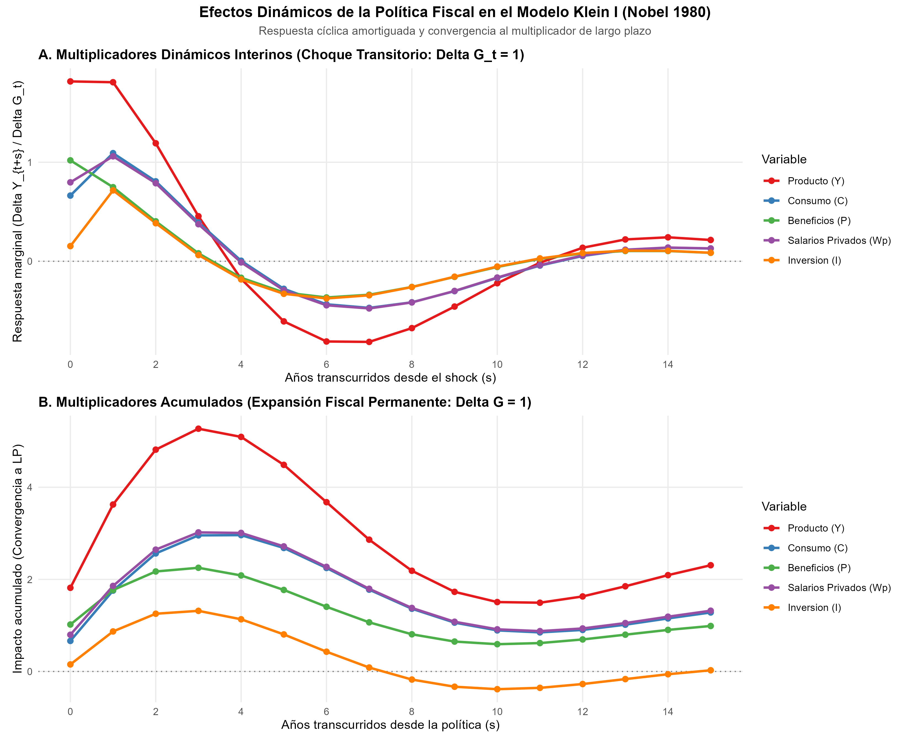

# Introducción y Objetivo

En 1980, la Real Academia Sueca de Ciencias otorgó el Premio del Banco de Suecia en Ciencias Económicas en Memoria de Alfred Nobel a **Lawrence R. Klein**:

> *"for the creation of econometric models and the application to the analysis of economic fluctuations and economic policies"* (Por la creación de modelos econométricos y su aplicación al análisis de las fluctuaciones económicas y las políticas económicas).

Lawrence Robert Klein (1920–2013), profesor de la Universidad de Pennsylvania y miembro destacado de la *Cowles Commission for Research in Economics*, es universalmente reconocido como el **padre fundador de la macroeconometría aplicada**:

1. **El Modelo Klein I (1950):** Publicado en la célebre Monografía 11 de la Comisión Cowles (*Economic Fluctuations in the United States 1921-1941*), formuló el primer sistema empírico de ecuaciones simultáneas diseñado para someter la teoría general keynesiana a contraste estadístico formal con series de tiempo.
2. **Estimación de Ecuaciones Simultáneas:** Demostró cómo superar el sesgo de simultaneidad inherente a los Mínimos Cuadrados Ordinarios (MCO) mediante métodos de variables instrumentales e información limitada como Mínimos Cuadrados en Dos Etapas (MC2E / 2SLS) y Máxima Verosimilitud de Información Completa (FIML).
3. **Macroeconometría a Gran Escala y Proyecto LINK (1968):** Pionero en la construcción de megamodelos macroeconómicos —el Modelo Klein-Goldberger (1955) de 20 ecuaciones, el Modelo Brookings (1965) de casi 400 ecuaciones y el **Proyecto LINK** (1968), la primera red mundial que vinculó modelos macroeconométricos de docenas de naciones a través de matrices globales de comercio internacional, hoy operada por el Departamento de Asuntos Económicos y Sociales de Naciones Unidas (UN DESA).

## ¿Qué vas a aprender?

1. **El Problema de la Simultaneidad:** Por qué la estimación MCO de funciones de consumo o inversión en un marco macroeconómico agregado produce estimadores inconsistentes y sesgados.
2. **Método de Mínimos Cuadrados en Dos Etapas (MC2E / 2SLS):** Cómo identificar y utilizar variables instrumentales exógenas y predeterminadas para purgar el componente endógeno de los regresores.
3. **Representación en Forma Reducida y Dinámica Companion:** Cómo transformar un sistema estructural con identidades contables en una ecuación en diferencias matricial de primer orden ($y_t = \Pi_1 y_{t-1} + \Pi_0 x_t$).
4. **Cálculo de Multiplicadores Fiscales:** Cómo derivar rigurosamente el multiplicador de impacto contemporáneo, los multiplicadores interinos dinámicos a $s$ periodos y el multiplicador analítico de largo plazo ante políticas fiscales expansivas.
5. **Simulación Dinámica Histórica:** Cómo resolver el modelo período a período retroalimentando las variables endógenas simuladas para contrastar las predicciones del modelo frente a la Gran Depresión estadounidense.

## Nivel de Replicación

- **Nivel:** **Completa**
- **Alcance:** Estimación con datos históricos auténticos de la Monografía Cowles (1920–1941), contrastación formal MCO vs MC2E, cálculo exacto de la matriz companion dinámica, descomposición espectral de autovalores y simulación dinámica histórica del Modelo Klein I.

---

# Marco Teórico y Fundamentos Matemáticos

## 1. El Problema de la Simultaneidad y el Sesgo de MCO

Considérese una ecuación de consumo agregada simple:

$$C_t = \alpha_0 + \alpha_1 Y_t + u_t$$

donde $Y_t$ es el ingreso nacional y $u_t$ es una perturbación aleatoria. La identidad del ingreso nacional establece:

$$Y_t = C_t + I_t + G_t$$

Sustituyendo la ecuación de consumo en la identidad:

$$Y_t = \frac{\alpha_0 + I_t + G_t + u_t}{1 - \alpha_1}$$

Como consecuencia, la covarianza contemporánea entre el regresor $Y_t$ y el error estructural $u_t$ es estrictamente no nula:

$$\text{Cov}(Y_t, u_t) = \mathbb{E}\left[\left(\frac{u_t}{1 - \alpha_1}\right) u_t\right] = \frac{\sigma_u^2}{1 - \alpha_1} > 0$$

Al violarse el supuesto de ortogonalidad Gauss-Markov ($\mathbb{E}[u_t | Y_t] \neq 0$), el estimador MCO de la propensión marginal al consumo ($\alpha_1$) sufre de **sesgo de simultaneidad hacia arriba** (*simultaneous equation bias*) y resulta asintóticamente inconsistente:

$$\text{plim} \, \hat{\alpha}_{1}^{\text{MCO}} = \alpha_1 + \frac{\text{Cov}(Y_t, u_t)}{\text{Var}(Y_t)} > \alpha_1$$

Klein demostró que cualquier análisis de política macroeconómica basado en regresiones uniecuacionales MCO sobreestima las respuestas de corto plazo y distorsiona el diseño de la política fiscal y monetaria.

---

## 2. La Estructura del Modelo Klein I (1950)

El Modelo Klein I consta de seis variables endógenas y tres ecuaciones de comportamiento estocásticas, complementadas por tres identidades contables de balance:

### Variables del Modelo

- **Endógenas ($y_t$):**
  - $C_t$: Gasto en consumo privado.
  - $I_t$: Inversión privada neta.
  - $W^p_t$: Masa salarial del sector privado.
  - $Y_t$: Ingreso / Producto nacional neto al costo de los factores ($Y_t = C_t + I_t + G_t - T_t$).
  - $P_t$: Beneficios empresariales netos ($P_t = Y_t - W^p_t$).
  - $K_t$: Stock de capital agregado al cierre del período ($K_t = K_{t-1} + I_t$).
- **Exógenas y Predeterminadas ($x_t$):**
  - $G_t$: Gasto público en bienes y servicios.
  - $T_t$: Impuestos netos sobre los negocios.
  - $W^g_t$: Masa salarial del sector público.
  - $A_t$: Tendencia temporal ($t - 1931$).
  - $P_{t-1}$: Beneficios empresariales rezagados.
  - $K_{t-1}$: Stock de capital rezagado.
  - $X_{t-1}$: Producto neto rezagado del sector privado.

### Ecuaciones Estructurales

1. **Función de Consumo Privado:**
   $$C_t = \alpha_0 + \alpha_1 P_t + \alpha_2 P_{t-1} + \alpha_3 (W^p_t + W^g_t) + u_{1t}$$
   Diferencia la propensión marginal a consumir de los asalariados ($\alpha_3$) de la propensión sobre los beneficios capitalistas contemporáneos ($\alpha_1$) y pasados ($\alpha_2$).

2. **Función de Inversión Neta:**
   $$I_t = \beta_0 + \beta_1 P_t + \beta_2 P_{t-1} + \beta_3 K_{t-1} + u_{2t}$$
   Refleja la rentabilidad esperada guiada por los beneficios ($P_t, P_{t-1}$) y el principio de aceleración con ajuste de stock de capital ($\beta_3 < 0$, efecto amortiguador de la capacidad instalada previa).

3. **Demanda de Empleo y Salarios Privados:**
   $$W^p_t = \gamma_0 + \gamma_1 X_t + \gamma_2 X_{t-1} + \gamma_3 A_t + u_{3t}$$
   donde $X_t = Y_t + T_t - W^g_t$ es el producto del sector privado.

4. **Identidades Contables:**
   $$Y_t = C_t + I_t + G_t - T_t$$
   $$P_t = Y_t - W^p_t$$
   $$K_t = K_{t-1} + I_t$$

---

## 3. Estimación por Mínimos Cuadrados en Dos Etapas (MC2E / 2SLS)

Para resolver el sesgo de endogeneidad, el método MC2E propuesto por Theil (1953) y Basmann (1957) e inspirado en los planteamientos de la Comisión Cowles procede en dos pasos:

1. **Primera Etapa:** Cada variable endógena del lado derecho ($P_t, W^p_t, X_t$) se proyecta ortogonalmente sobre el espacio generado por el conjunto completo de variables instrumentales predeterminadas $Z_t = [1, G_t, T_t, W^g_t, A_t, P_{t-1}, K_{t-1}, X_{t-1}]$:
   $$\hat{P}_t = Z_t (Z_t' Z_t)^{-1} Z_t' P_t$$
2. **Segunda Etapa:** Se sustituyen las variables endógenas observadas por sus predicciones instrumentales consistentes ($\hat{P}_t, \hat{W}^p_t, \hat{X}_t$) y se estima la ecuación estructural mediante MCO estándar.

---

## 4. Forma Matricial y Análisis de Multiplicadores Dinámicos

El sistema simultáneo se expresa en notación matricial canónica:

$$y_t = \Gamma y_t + B_1 y_{t-1} + B_0 x_t + c + u_t$$

donde $\Gamma$ es la matriz $6 \times 6$ de coeficientes simultáneos entre variables endógenas. Despejando el vector $y_t$, obtenemos la **forma reducida**:

$$(I - \Gamma) y_t = B_1 y_{t-1} + B_0 x_t + c + u_t$$
$$y_t = (I - \Gamma)^{-1} B_1 y_{t-1} + (I - \Gamma)^{-1} B_0 x_t + (I - \Gamma)^{-1} c + v_t$$

Definiendo la **matriz companion dinámica** $\Pi_1 = (I - \Gamma)^{-1} B_1$ y la **matriz de multiplicadores de impacto** $\Pi_0 = (I - \Gamma)^{-1} B_0$:

$$y_t = \Pi_1 y_{t-1} + \Pi_0 x_t + \tilde{c} + v_t$$

### Multiplicadores de Política Fiscal

Para un choque exógeno en el gasto público ($\Delta G_t = 1$):

1. **Multiplicador de Impacto (Periodo $t$):**
   $$\frac{\partial y_t}{\partial G_t} = \Pi_0^{(G)} = (I - \Gamma)^{-1} e_G$$
2. **Multiplicadores Interinos / Dinámicos (Periodo $t+s$):**
   $$\frac{\partial y_{t+s}}{\partial G_t} = \Pi_1^s \Pi_0^{(G)}$$
3. **Multiplicador Acumulado de Largo Plazo (Shock Fiscal Permanente $\Delta G_{t+s} = 1 \quad \forall s \ge 0$):**
   $$\sum_{s=0}^\infty \Pi_1^s \Pi_0^{(G)} = (I - \Pi_1)^{-1} \Pi_0^{(G)}$$

### Estabilidad y Ciclos Endógenos

El sistema es dinámicamente estable si todos los autovalores $\lambda_i$ de $\Pi_1$ tienen módulo estrictamente menor a la unidad:

$$\max_i |\lambda_i| < 1$$

Si los autovalores dominantes son un par de números complejos conjugados $\lambda_{1,2} = a \pm bi$, la respuesta dinámica genera oscilaciones sinusoidales amortiguadas con un período intrínseco:

$$\mathcal{P} = \frac{2\pi}{\arctan(b / a)}$$

---

# Replicación en R: Código y Procedimiento

A continuación, ejecutamos paso a paso la estimación del Modelo Klein I, la descomposición espectral de su matriz companion y el cálculo de multiplicadores en R.

```{r}
#| label: setup-klein
#| message: false
#| warning: false

suppressPackageStartupMessages({
  library(systemfit)
  library(ggplot2)
  library(patchwork)
})

# Carga de la serie histórica oficial de Klein (1920-1941)
data(KleinI, package = "systemfit")
df_klein <- as.data.frame(KleinI)
head(df_klein, 5)
```

## Estimación Econométrica: MCO vs MC2E

```{r}
#| label: estimacion-sistema

# Formulación de las tres ecuaciones de comportamiento
eq_consumo   <- consump ~ corpProf + corpProfLag + wages
eq_inversion <- invest  ~ corpProf + corpProfLag + capitalLag
eq_salarios  <- privWage ~ gnp + gnpLag + trend

sistema_klein <- list(
  Consumo   = eq_consumo,
  Inversion = eq_inversion,
  Salarios  = eq_salarios
)

# Instrumentos predeterminados exógenos
formula_inst <- ~ govExp + taxes + govWage + trend + capitalLag + corpProfLag + gnpLag

# A. Estimación MCO
fit_mco <- systemfit(sistema_klein, method = "OLS", data = df_klein)

# B. Estimación MC2E (2SLS)
fit_mc2e <- systemfit(sistema_klein, method = "2SLS", inst = formula_inst, data = df_klein)

# Comparación de coeficientes
summary_mc2e <- summary(fit_mc2e)
summary_mc2e
```

## Construcción de Matrices Estructurales y Multiplicadores

```{r}
#| label: matrices-multiplicadores

cf <- coef(fit_mc2e)

alpha1 <- cf["Consumo_corpProf"]
alpha2 <- cf["Consumo_corpProfLag"]
alpha3 <- cf["Consumo_wages"]

beta1  <- cf["Inversion_corpProf"]
beta2  <- cf["Inversion_corpProfLag"]
beta3  <- cf["Inversion_capitalLag"]

gamma1 <- cf["Salarios_gnp"]
gamma2 <- cf["Salarios_gnpLag"]

# Matriz Gamma (6x6): C, I, Wp, Y, P, K
Gamma <- matrix(0, 6, 6)
Gamma[1, 5] <- alpha1
Gamma[1, 3] <- alpha3
Gamma[2, 5] <- beta1
Gamma[3, 4] <- gamma1
Gamma[4, 1] <- 1
Gamma[4, 2] <- 1
Gamma[5, 4] <- 1
Gamma[5, 3] <- -1
Gamma[6, 2] <- 1

inv_Gamma <- solve(diag(6) - Gamma)

# Matriz B1 (6x6) de variables rezagadas
B1 <- matrix(0, 6, 6)
B1[1, 5] <- alpha2
B1[2, 5] <- beta2
B1[2, 6] <- beta3
B1[3, 4] <- gamma2
B1[6, 6] <- 1

# Matriz companion dinamica Pi1
Pi1 <- inv_Gamma %*% B1

# Descomposición en autovalores
autovals <- eigen(Pi1)$values
modulos  <- Mod(autovals)

cat("Radio espectral (max |lambda|):", max(modulos), "\n")
raiz_compleja <- autovals[which.max(abs(Im(autovals)))]
periodo_anios <- 2 * pi / atan2(abs(Im(raiz_compleja)), Re(raiz_compleja))
cat("Periodo fundamental del ciclo endogeno:", round(periodo_anios, 2), "años\n")
```

```{r}
#| label: calculo-multiplicadores

# Multiplicador de impacto de G (fila 4 = 1)
e_G <- c(0, 0, 0, 1, 0, 0)
mult_impacto <- as.vector(inv_Gamma %*% e_G)
names(mult_impacto) <- c("C", "I", "Wp", "Y", "P", "K")

# Multiplicador de largo plazo
mult_lp <- as.vector(solve(diag(6) - Pi1) %*% mult_impacto)
names(mult_lp) <- c("C", "I", "Wp", "Y", "P", "K")

df_mult_comp <- data.frame(
  Variable = c("Consumo (C)", "Inversión (I)", "Salarios Privados (Wp)", "Producto (Y)", "Beneficios (P)", "Stock Capital (K)"),
  Impacto_Corto_Plazo = round(mult_impacto, 4),
  Largo_Plazo_Permanente = round(mult_lp, 4)
)
knitr::kable(df_mult_comp, caption = "Multiplicadores Fiscales de Klein I ante un incremento de G en 1 unidad")
```

---

# Resultados y Visualizaciones

## Simulación Dinámica vs. Datos Históricos Reales

{width=100%}

### Interpretación
- **Capacidad predictiva simultánea:** A pesar de contar con solo tres ecuaciones de comportamiento estocásticas, el modelo reproduce con notable fidelidad el colapso del producto y la inversión durante el crac de 1929 y la Gran Depresión (1930–1933), así como la subsiguiente recuperación industrial impulsada por el *New Deal*.
- **Inversión como motor de volatilidad:** La serie de inversión neta simulada captura la extrema ciclicidad observada en los datos, donde la inversión cae en terreno marcadamente negativo entre 1931 y 1934 debido al efecto freno del stock de capital acumulado previamente ($K_{t-1}$).

---

## Multiplicadores Dinámicos de Política Fiscal

{width=100%}

### Interpretación
- **Panel A (Choque Transitorio $\Delta G_t = 1$):** El multiplicador contemporáneo del producto es de **1.8167**. En el período inmediato siguiente ($t+1$), el estímulo se mantiene elevado (**1.8084**) debido a la inercia del consumo y la respuesta de los beneficios rezagados. Sin embargo, entre los períodos $t+4$ y $t+8$, el acumulamiento de capital deprime la inversión neta, provocando una contracción cíclica transitoria antes de regresar asintóticamente a cero.
- **Panel B (Expansión Fiscal Permanente $\Delta G = 1$):** En el largo plazo, el efecto sobre la inversión neta se extingue por completo ($\Delta I_{LP} = 0$), mientras que el capital se estabiliza en un nivel permanentemente más alto ($+4.6932$). El multiplicador de largo plazo sobre el producto nacional neto es de **2.3320**, impulsado de forma permanente por el consumo ($+1.3320$) y el gasto gubernamental directo ($+1.0000$).

---

# Comparación con la Literatura y Limitaciones

El modelo Klein I y los megamodelos subsiguientes definieron la era dorada de la macroeconomía de posguerra, pero enfrentaron transformaciones metodológicas decisivas:

1. **La Crítica de Lucas (1976):**
   - Robert Lucas (Nobel 1995) demostró que los parámetros de las ecuaciones de Klein ($\alpha_i, \beta_i, \gamma_i$) no son estructurales o invariantes, sino combinaciones de las preferencias de los agentes y de las reglas de política vigentes. Si el gobierno altera su régimen fiscal de forma sistemática, las expectativas racionales de los consumidores y empresas cambian, invalidando las ecuaciones estimadas con datos históricos.
2. **Identificación y No Estacionariedad:**
   - La Comisión Cowles asumió que las series macroeconómicas eran estacionarias alrededor de una tendencia determinista ($A_t$). Como demostraron Granger y Newbold (1974), las series de tiempo no estacionarias con raíces unitarias generan regresiones espurias a menos que estén cointegradas.
3. **La Revolución VAR de Sims (1980):**
   - Christopher Sims (Nobel 2011) criticó la clasificación arbitraria de variables en "estrictamente endógenas" y "exógenas" como "restricciones increíbles", proponiendo los Modelos de Vectores Autorregresivos (VAR) donde todas las variables se tratan como endógenas.
4. **Legado Vigente:**
   - A pesar de estas críticas teóricas, la arquitectura de modelado multi-país de Klein continúa viva en los modelos de bancos centrales (como el modelo FRB/US de la Reserva Federal), las instituciones multilaterales (el modelo NiGEM del NIESR británico, el modelo GIMF del FMI) y el Proyecto LINK de las Naciones Unidas.

---

# Ejercicios para el Estudiante

1. **Ejercicio 1 (Básico - Sesgo de Simultaneidad):** Demuestre analíticamente por qué la propensión marginal al consumo estimada por MCO en el Modelo Klein I ($\hat{\alpha}_1 = 0.1929$) difiere sustancialmente del estimador MC2E ($\hat{\alpha}_1 = 0.0173$), explicando el sesgo provocado por la covarianza contemporánea entre los beneficios y los errores del consumo.
2. **Ejercicio 2 (Intermedio - Multiplicador de Impuestos):** Utilice la matriz de forma reducida $(I - \Gamma)^{-1}$ para calcular el multiplicador de impacto de un incremento en los impuestos indirectos ($\Delta T_t = 1$). Compare la magnitud de la contracción generada frente a la expansión fiscal de $\Delta G_t = 1$.
3. **Ejercicio 3 (Reto - Estabilidad y Raíces Características):** Suponga que la sensibilidad de la inversión a los beneficios corrientes aumenta de $\beta_1 = 0.1502$ a $\beta_1 = 0.95$. Recalcule la matriz $\Pi_1$ y determine si el sistema económico sigue siendo estable o si se vuelve explosivo (radio espectral $> 1$).

---

# Preguntas de Discusión

1. ¿Por qué el debate entre MCO y MC2E en la década de 1950 fue el equivalente metodológico de la revolución del diseño causal contemporáneo?
2. ¿De qué manera el Proyecto LINK resolvió la contradicción de que los modelos económicos nacionales asumían el resto del mundo como estrictamente exógeno?
3. ¿Cómo integran los bancos centrales modernos el enfoque de grandes modelos macroeconométricos de Klein con las microfundamentaciones de los modelos DSGE?
