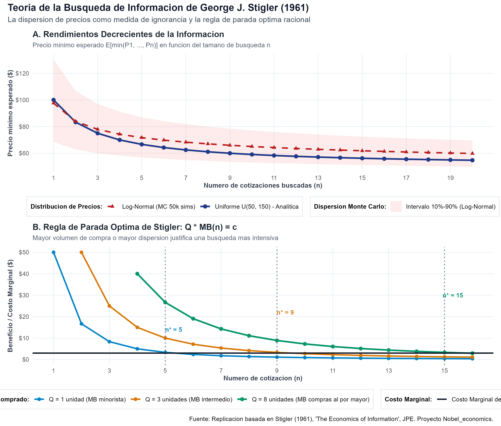
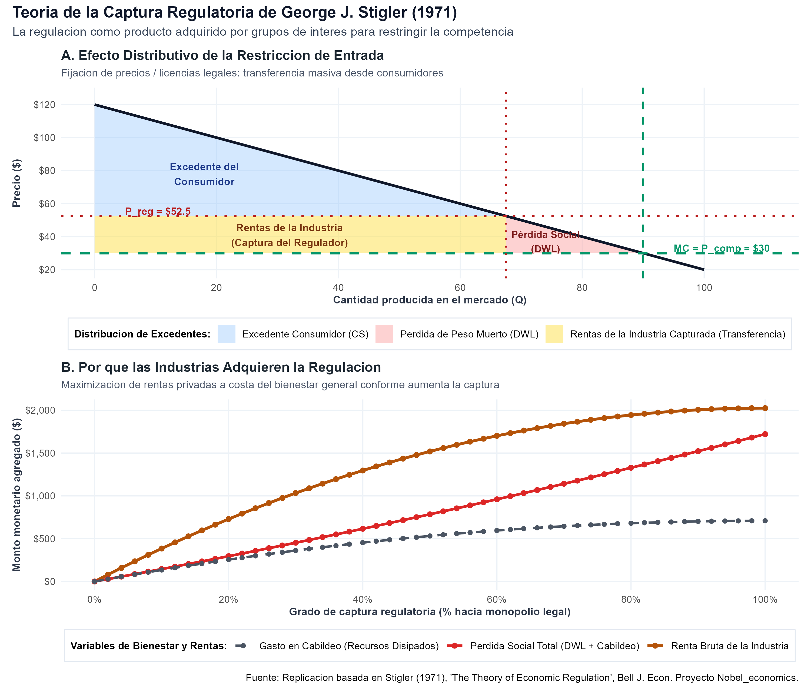

# Introducción y Objetivo

Este documento desarrolla la formalización analítica y la replicación computacional en R de los aportes cardinales de **George J. Stigler**, galardonado con el Premio del Banco de Suecia en Ciencias Económicas en Memoria de Alfred Nobel en 1982:

> *"for his seminal studies of industrial structures, markets and the causes and effects of public regulation"* (Por sus estudios seminales de las estructuras industriales, el funcionamiento de los mercados y las causas y efectos de la regulación pública).

Antes de la obra pionera de Stigler en las décadas de 1950, 1960 y 1970 en la Universidad de Chicago, la teoría microeconómica operaba bajo dos supuestos irreales:

1. **La falacia de la información perfecta:** Los modelos de equilibrio general y competencia perfecta asumían que todos los precios eran transparentes, instantáneos y de conocimiento universal sin costo. Las diferencias de precio entre comerciantes se atribuían a anomalías temporales o fallas de calidad no observadas. Stigler (1961) demostró que **la información es una mercancía costosa** y que la dispersión de precios es la manifestación natural de la ignorancia racional de los compradores.
2. **La falacia del Estado protector (Teoría del Interés Público):** La literatura económica de Arthur Pigou y sus continuadores sostenía que los gobiernos regulaban los mercados para proteger desinteresadamente a los consumidores frente a los abusos monopólicos y las fallas de mercado. Stigler (1971) desmanteló esta premisa al formular la **Teoría de la Captura Regulatoria**: demostró que la regulación es un producto político "adquirido" o cooptado por las propias industrias establecidas para erigir barreras de entrada contra competidores potenciales y garantizar rentas extraordinarias.

## Declaración del Nivel de Replicación
- **Nivel:** **Ilustrativa y analítica**.
- Se formaliza matemáticamente el modelo de búsqueda óptima de precios con estadísticas de orden (Stigler, 1961), contrastando la derivación analítica con una simulación de Monte Carlo de 50,000 réplicas.
- Se modela la captura regulatoria de mercado (Stigler, 1971), analizando el traspaso de excedentes, la pérdida irrecuperable de eficiencia (DWL) de Harberger y los recursos disipados en cabildeo político.
- Se vinculan las figuras y tablas generadas por el script ejecutable `economia_informacion_y_regulacion.R`.

---

# ¿Qué vas a aprender?

1. Comprender por qué la **dispersión de precios en el mercado es una medida directa de la ignorancia de los agentes** y no una imperfección irracional.
2. Derivar analíticamente la distribución del **precio mínimo esperado $E[\min(P_1, \dots, P_n)]$** utilizando estadísticas de orden.
3. Formular la **regla de parada óptima de búsqueda de Stigler**: el comprador detiene la búsqueda cuando el beneficio marginal esperado iguala el costo marginal de cotización ($Q \cdot MB(n^*) = c$).
4. Demostrar formalmente por qué los compradores de mayores volúmenes ($Q$) o bienes de alto valor realizan búsquedas sustancialmente más intensivas.
5. Analizar el rol pro-competitivo de la **publicidad comercial** como un reductor sistemático de los costos de búsqueda y de la dispersión de precios.
6. Desmontar la "teoría del interés público" y formalizar cómo las industrias organizadas **capturan las agencias reguladoras** para imponer barreras legales a la entrada (licencias, cupos y tarifas mínimas oficiales).
7. Cuantificar el daño sobre el bienestar social generado por las restricciones de entrada y el cabildeo corporativo frente a la libre concurrencia.

---

# Marco Teórico

## 1. El Modelo de Búsqueda de Información (Stigler, 1961)

Consideremos un mercado donde múltiples vendedores ofrecen un producto idéntico (homogéneo), pero cobran precios diversos distribuidos según una función de distribución continua $F(P)$ con función de densidad $f(P)$ en el soporte $[a, b]$, con media $\mu$ y varianza $\sigma^2$.

Un comprador desconoce qué tienda ofrece qué precio específico. Para encontrar una cotización, debe incurrir en un costo marginal de búsqueda constante $c > 0$ (tiempo de transporte, llamadas o consulta).

Si el comprador decide obtener una muestra aleatoria de $n$ cotizaciones independientes e idénticamente distribuidas ($P_1, P_2, \dots, P_n$), adquirirá el bien al precio más bajo observado:
$$P_{(1:n)} = \min(P_1, P_2, \dots, P_n)$$

### Función de Distribución Acumulada del Mínimo Muestral
La probabilidad de que el precio mínimo sea estrictamente mayor que un valor $p$ es la probabilidad de que todas las $n$ cotizaciones individuales superen $p$:
$$P(P_{(1:n)} > p) = \prod_{i=1}^n P(P_i > p) = [1 - F(p)]^n$$

Por tanto, la función de distribución acumulada de la primera estadística de orden es:
$$F_{(1:n)}(p) = 1 - [1 - F(p)]^n$$

Y la función de densidad de probabilidad viene dada por su derivada:
$$f_{(1:n)}(p) = n [1 - F(p)]^{n-1} f(p)$$

### Caso Canónico: Distribución Uniforme $P \sim U(a, b)$
Para una distribución uniforme en $[a, b]$, $F(p) = \frac{p - a}{b - a}$. Sustituyendo:
$$F_{(1:n)}(p) = 1 - \left( \frac{b - p}{b - a} \right)^n$$

El precio mínimo esperado analítico es:
$$E[P_{(1:n)}] = \int_a^b p \cdot f_{(1:n)}(p) \, dp = a + \frac{b - a}{n + 1}$$

### Beneficio Marginal Decreciente de la Información
El beneficio marginal esperado de solicitar una $n$-ésima cotización adicional (el ahorro esperado por unidad) es:
$$MB(n) = E[P_{(1:n-1)}] - E[P_{(1:n)}] = \left( a + \frac{b - a}{n} \right) - \left( a + \frac{b - a}{n + 1} \right) = \frac{b - a}{n(n + 1)}$$

Propiedades fundamentales:
1. $MB(n) > 0$: cada cotización adicional reduce el precio mínimo esperado.
2. $MB'(n) < 0$: rendimientos fuertemente decrecientes en la adquisición de información.
3. $\lim_{n \to \infty} MB(n) = 0$: después de pocas cotizaciones, el ahorro marginal esperado se vuelve insignificante.

### La Regla de Parada Óptima
Si el consumidor planea comprar una cantidad física $Q$ del bien, el ahorro monetario total esperado de la $n$-ésima cotización es $Q \cdot MB(n)$. Frente a un costo marginal de búsqueda constante $c$, la regla de parada de Stigler determina el entero óptimo $n^*$ que satisface:
$$Q \cdot MB(n^*) \ge c > Q \cdot MB(n^* + 1)$$

O en aproximación continua:
$$n^* \approx \sqrt{\frac{Q (b - a)}{c}} - \frac{1}{2}$$

**Implicaciones teóricas y empíricas:**
- A mayor volumen de compra ($Q \uparrow$), mayor intensidad de búsqueda ($n^* \uparrow$). Quienes compran automóviles o inmuebles cotizan mucho más que quienes compran alimentos cotidianos.
- A mayor dispersión de precios en el mercado ($b - a \uparrow$), mayor es la rentabilidad de buscar información ($n^* \uparrow$).
- A menor costo de cotización ($c \downarrow$, ej. con agregadores web), mayor número de comparaciones ($n^* \uparrow$) y menor precio final pagado.

---

## 2. La Teoría de la Captura Regulatoria (Stigler, 1971)

En su célebre artículo de 1971, Stigler formuló la tesis central de la economía política de la regulación:

> *"As a rule, regulation is acquired by the industry and is designed and operated primarily for its benefit."* (Por regla general, la regulación es adquirida por la industria y está diseñada y operada primordialmente para su beneficio).

Stigler identificó que los sectores empresariales demandan principalmente cuatro tipos de políticas gubernamentales:
1. **Subsidios directos en dinero:** Transferencias presupuestarias hacia las empresas consolidadas.
2. **Control estricto sobre la entrada de nuevos rivales:** Concesiones exclusivas, licencias profesionales obligatorias, cuotas de importación o certificados de necesidad pública.
3. **Regulación de sustitutos y complementos:** Gravámenes o trabas a productos sustitutos tecnológicos (ej. mantequilla vs. margarina, taxis vs. aplicaciones de transporte).
4. **Fijación de precios mínimos oficiales:** Prohibición legal de vender por debajo de tarifas establecidas por el Estado, sosteniendo un cártel formal obligatorio.

### Lógica de Acción Colectiva (Mancur Olson y Stigler)
¿Por qué el sistema político concede estas protecciones contrarias al bienestar social?
- **Beneficios concentrados:** Para una industria con pocas empresas, la restricción de entrada genera millones de dólares por empresa protegida. El beneficio per cápita es sumamente elevado, lo que incentiva a las firmas a organizarse, formar cámaras empresariales y realizar cabildeo activo.
- **Costos difusos:** El sobreprecio resultante es pagado por millones de consumidores individuales, para quienes el costo per cápita representa centavos o sumas reducidas. Los costos de informarse, organizarse y financiar una contra-campaña política superan ampliamente cualquier beneficio privado individual.

### Modelo Formal de Captura y Bienestar
Consideremos un mercado con función de demanda inversa $P(Q) = P_{\max} - b Q$ y tecnología competitiva con costo marginal constante $MC = c_0$:

1. **Competencia perfecta (Libre Entrada):**
   $$P_c = c_0, \quad Q_c = \frac{P_{\max} - c_0}{b}, \quad CS_c = \frac{1}{2} (P_{\max} - c_0) Q_c, \quad \Pi_c = 0$$
2. **Captura regulatoria:** La industria obtiene licencias que restringen la oferta y fijan un precio regulado $P_{reg} \in (c_0, P_m]$.
   - Cantidad transada: $Q_{reg} = \frac{P_{\max} - P_{reg}}{b} < Q_c$.
   - Rentas extraordinarias de la industria:
     $$\Pi_{reg} = (P_{reg} - c_0) Q_{reg}$$
   - Pérdida de peso muerto de Harberger (eficiencia productiva y de consumo perdida):
     $$DWL = \frac{1}{2} (P_{reg} - c_0) (Q_c - Q_{reg})$$
   - Disipación de rentas en cabildeo (Tullock-Stigler): Si las empresas gastan una fracción $\gamma \in (0, 1)$ de la renta en capturar y defender las licencias regulatorias ($Gasto = \gamma \Pi_{reg}$), la pérdida social agregada asciende a:
     $$Perdida\;Social = DWL + \gamma \Pi_{reg}$$

---

# Replicación Computacional en R

A continuación se presenta la ejecución del script `economia_informacion_y_regulacion.R` y el análisis detallado de los resultados generados.

```r
# Cargar librerias especializadas
library(ggplot2)
library(dplyr)
library(tidyr)
library(scales)
library(patchwork)

# Ejecutar el script central
source("R/economia_informacion_y_regulacion.R")
```

## Resultados del Modelo de Búsqueda de Precios (Stigler, 1961)

La siguiente figura muestra el comportamiento de la estadística de orden mínimo y la regla de parada óptima:

{fig-align="center" width="95%"}

### Interpretación de los Paneles:
- **Panel A (Precio mínimo esperado):** Se observa con nitidez la concavidad de la curva de aprendizaje del comprador. Partiendo de una expectativa inicial de $\$100$ en la primera cotización, dos búsquedas ($n=2$) reducen el precio esperado a $\$83.33$, y cuatro búsquedas lo bajan a $\$70.00$. A partir de $n=10$, las ganancias marginales adicionales son mínimas. La simulación de Monte Carlo con distribución log-normal exhibe la misma curvatura teórica con una dispersión asimétrica del 10% al 90%.
- **Panel B (Regla de parada $Q \cdot MB(n) = c$):** Con un costo marginal por cotización de $c = \$3.00$:
  - Para un consumidor minorista ($Q = 1$), el punto óptimo se alcanza en $n^* = 5$ cotizaciones (ahorro marginal de $\$3.33$ vs. costo de $\$3.00$).
  - Para un consumidor de volumen medio ($Q = 3$), el óptimo se desplaza a $n^* = 9$ cotizaciones.
  - Para compras al por mayor o bienes durables ($Q = 8$), la búsqueda óptima salta a $n^* = 15$ cotizaciones.

---

## Resultados de la Teoría de la Captura Regulatoria (Stigler, 1971)

La siguiente figura resume el impacto estructural de la captura política del regulador sobre la eficiencia económica y la distribución de excedentes:

{fig-align="center" width="95%"}

### Interpretación de los Paneles:
- **Panel A (Diagrama de Mercado):** En un escenario de captura moderada ($P_{reg} = \$52.50$), la restricción de licencias transfiere $\$1518.8$ de excedente del consumidor a las empresas titulares, mientras que genera un triángulo de Harberger irrecuperable de $\$253.1$.
- **Panel B (Rentas frente a Pérdida Social):** A medida que la industria eleva su grado de captura hacia la cartelización total ($100\%$), sus rentas brutas alcanzan un máximo de $\$2025.0$. Sin embargo, la pérdida social total (sumando la ineficiencia de Harberger y los recursos dilapidados en cabildeo) se dispara a $\$1721.2$, destruyendo casi la mitad del bienestar que generaba la libre concurrencia.

---

## Tabla Cuantitativa de Resultados

Los valores numéricos generados por la replicación se resumen en la siguiente tabla:

| Módulo | Métrica / Escenario | Parámetro 1 | Parámetro 2 | Parámetro 3 | Parámetro 4 | Resultado Clave |
|:---|:---|:---|:---|:---|:---|:---|
| **Búsqueda (1961)** | $n = 1$ | $E[P_{\min}] = \$100.00$ | $MB (Q=1) = \$50.00$ | $MB (Q=3) = \$150.00$ | $MB (Q=8) = \$400.00$ | - |
| **Búsqueda (1961)** | $n = 2$ | $E[P_{\min}] = \$83.33$ | $MB (Q=1) = \$16.67$ | $MB (Q=3) = \$50.00$ | $MB (Q=8) = \$133.33$ | - |
| **Búsqueda (1961)** | $n = 5$ | $E[P_{\min}] = \$66.67$ | $MB (Q=1) = \$3.33$ | $MB (Q=3) = \$10.00$ | $MB (Q=8) = \$26.67$ | **Óptimo $n^*$ para $Q=1$** |
| **Búsqueda (1961)** | $n = 9$ | $E[P_{\min}] = \$60.00$ | $MB (Q=1) = \$1.11$ | $MB (Q=3) = \$3.33$ | $MB (Q=8) = \$8.89$ | **Óptimo $n^*$ para $Q=3$** |
| **Búsqueda (1961)** | $n = 15$ | $E[P_{\min}] = \$56.25$ | $MB (Q=1) = \$0.42$ | $MB (Q=3) = \$1.25$ | $MB (Q=8) = \$3.33$ | **Óptimo $n^*$ para $Q=8$** |
| **Captura (1971)** | Libre Competencia | Precio = $\$30.00$ ($Q=90.0$) | Excedente Consumidor = $\$4050.0$ | Renta Industria = $\$0.0$ | DWL Harberger = $\$0.0$ | **Pérdida Social = $\$0.0$** |
| **Captura (1971)** | Captura Moderada | Precio = $\$52.50$ ($Q=67.5$) | Excedente Consumidor = $\$2278.1$ | Renta Industria = $\$1518.8$ | DWL Harberger = $\$253.1$ | **Pérdida Social = $\$784.7$** |
| **Captura (1971)** | Captura Total Monopólica | Precio = $\$75.00$ ($Q=45.0$) | Excedente Consumidor = $\$1012.5$ | Renta Industria = $\$2025.0$ | DWL Harberger = $\$1012.5$ | **Pérdida Social = $\$1721.2$** |

---

# Conclusiones y Legado Científico

George J. Stigler redefinió los horizontes de la teoría económica al incorporar el realismo de los costos de transacción y los incentivos políticos:

1. **La búsqueda como microfundamento:** Su modelo de búsqueda de precios (1961) abrió el campo contemporáneo de la microeconomía de la información, sirviendo de base directa para los modelos de búsqueda de empleo (Mortensen-Pissarides) y el comercio electrónico en la era digital.
2. **Desmitificación de la intervención pública:** Su teoría de la captura (1971) alteró para siempre la relación entre la economía y el derecho (*Law and Economics*), demostrando que las fallas del gobierno suelen ser más costosas y sistemáticas que las fallas de mercado que pretendían solucionar.
3. **Implicancia de política pública:** La mejor defensa del consumidor no es crear una comisión reguladora dependiente de la política, sino **garantizar la libre entrada de rivales y facilitar la transparencia informativa**.
