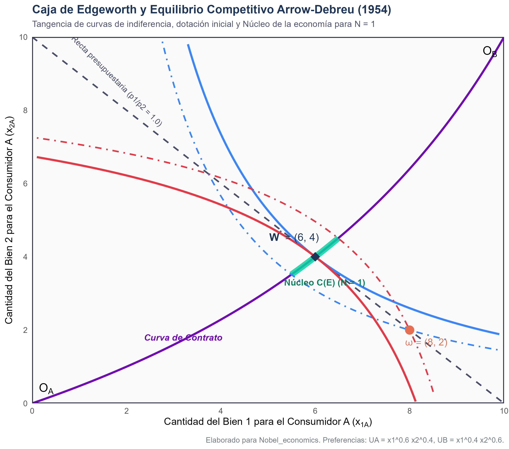
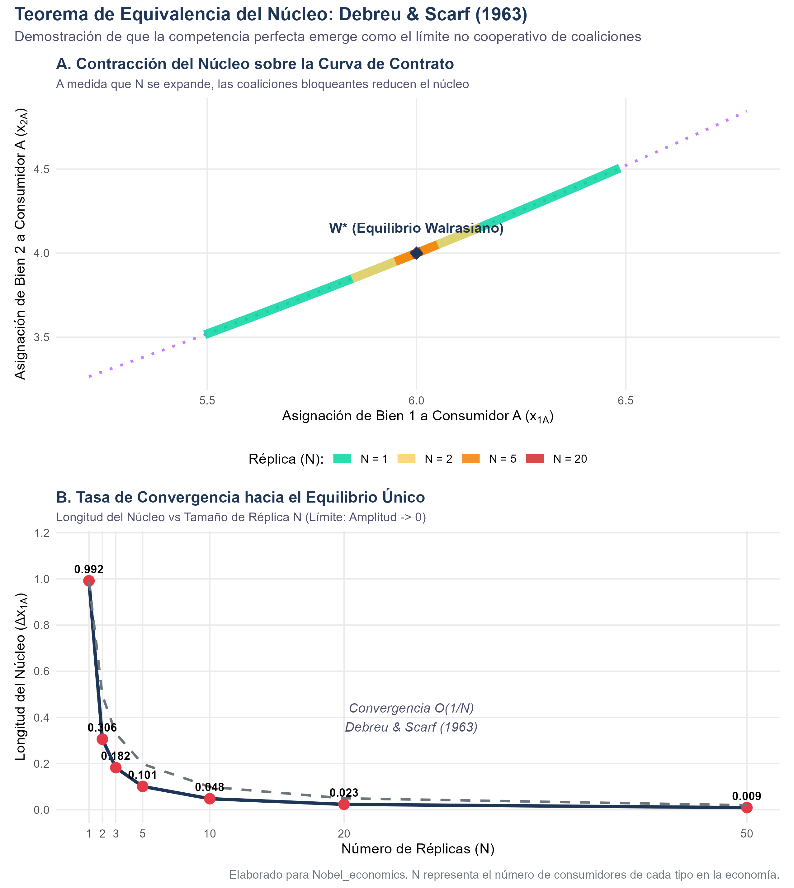

# Introducción y Fundamentos Metodológicos

En 1983, la Real Academia Sueca de Ciencias otorgó el Premio del Banco de Suecia en Ciencias Económicas en Memoria de Alfred Nobel a **Gérard Debreu** *"por haber incorporado nuevos métodos analíticos a la teoría económica y por su rigurosa reformulación de la teoría del equilibrio general"*.

Influenciado por la escuela matemática francesa **Nicolas Bourbaki**, Debreu transformó radicalmente la epistemología de la economía teórica. Mientras que la tradición neoclásica de Léon Walras (1874) y Alfred Marshall descansaba en analogías mecánicas, sistemas de ecuaciones diferenciales e intuiciones gráficas bidimensionales, Debreu demostró que el funcionamiento del sistema de precios competitivos podía enunciarse como una estructura formal axiomática, basada en:
1. **Topología de conjuntos convexos** en espacios euclidianos y de Banach.
2. **Teoría de correspondencias y puntos fijos** (especialmente el Teorema de Kakutani, 1941).
3. **Hiperplanos separadores y teoremas de dualidad** (Hahn-Banach y Farkas).

Este documento presenta una reconstrucción computacional y analítica completa de los dos pilares seminales de Debreu:
1. El **Modelo de Equilibrio General Competitivo Arrow-Debreu (1954)** y los dos teoremas fundamentales del bienestar [@arrow1954existence; @debreu1959theory].
2. El **Teorema de Equivalencia del Núcleo de Debreu-Scarf (1963)** [@debreu1963core], que demuestra cómo la competencia perfecta surge matemáticamente a partir del comportamiento cooperativo y descentralizado de coaliciones en grandes economías.

---

# El Modelo de Equilibrio General Arrow-Debreu

## Espacio de Bienes y Definición Exhaustiva de Commodities

En *Theory of Value* [@debreu1959theory], Debreu define un **bien** (*commodity*) no simplemente como una entidad física, sino como un vector caracterizado de manera unívoca por cuatro dimensiones:
- **Propiedad física intrínseca** (e.g., una tonelada de trigo de grano duro).
- **Localización geográfica** (e.g., entregado en el puerto de Róterdam).
- **Fecha temporal de disponibilidad** (e.g., el 15 de marzo de 2027).
- **Estado contingente de la naturaleza** (e.g., si se produce una sequía severa en el hemisferio norte).

Esta definición cuatridimensional permitió a Debreu subsumir simultáneamente en un único marco estático:
- La teoría del **comercio internacional y localización espacial**.
- La teoría del **equilibrio intertemporal y la acumulación de capital**.
- La teoría de los **mercados financieros bajo incertidumbre** (valores contingentes Arrow-Debreu).

## La Estructura de la Economía Privada $\mathcal{E}$

Una economía de propiedad privada $\mathcal{E}$ está compuesta por:
- Un conjunto finito de bienes $L = \{1, \dots, l\}$.
- Un conjunto finito de consumidores $I = \{1, \dots, m\}$. Cada consumidor $i$ posee:
  - Un conjunto de consumo $X_i \subseteq \mathbb{R}^l$, cerrado, convexo y acotado inferiormente.
  - Una relación de preferencia $\succsim_i$ continua, conexa, estrictamente convexa y localmente no saturada.
  - Una dotación inicial de recursos $\omega_i \in X_i$.
  - Una participación accionaria en los beneficios de las empresas $\theta_{ij} \ge 0$, con $\sum_{i=1}^m \theta_{ij} = 1$ para cada firma $j$.
- Un conjunto finito de productores $J = \{1, \dots, n\}$. Cada firma $j$ cuenta con un conjunto factible de producción $Y_j \subseteq \mathbb{R}^l$ cerrado y convexo que exhibe rendimientos no crecientes a escala ($0 \in Y_j$).

## Vaciado de Mercados y el Teorema de Punto Fijo de Kakutani

El problema de optimización descentralizado define para cada vector de precios $p \in \Delta = \{p \in \mathbb{R}_+^l : \sum_{k=1}^l p_k = 1\}$:
- La demanda de los consumidores: $x_i(p) = \arg\max \{U_i(x) : p \cdot x \le p \cdot \omega_i + \sum_{j} \theta_{ij} \pi_j(p)\}$.
- La oferta de las firmas: $y_j(p) = \arg\max \{p \cdot y : y \in Y_j\}$.

El exceso de demanda agregada se define como:

$$Z(p) = \sum_{i=1}^m x_i(p) - \sum_{j=1}^n y_j(p) - \sum_{i=1}^m \omega_i$$

Por la no saciedad local de las preferencias, se cumple la **Ley de Walras**:

$$p \cdot z = 0, \quad \forall z \in Z(p), \quad \forall p \in \Delta$$

Arrow y Debreu (1954) definen una correspondencia de mejor respuesta sobre el producto cartesiano del símplice de precios y los conjuntos de asignaciones. Al aplicar el **Teorema de Punto Fijo de Kakutani (1941)** sobre una correspondencia semicontinua superior con valores no vacíos, convexos y compactos, probaron la existencia de un vector de precios de equilibrio $p^* \in \Delta$ tal que:

$$Z(p^*) \le 0, \quad \text{con } p_k^* = 0 \text{ si } z_k(p^*) < 0$$

---

# El Modelo de Intercambio Puro en la Caja de Edgeworth

Para ilustrar analítica y numéricamente la teoría, modelamos una economía de intercambio puro con dos agentes ($A$ y $B$) y dos bienes ($1$ y $2$):

## Calibración del Sistema

- **Dotaciones iniciales:**
  $$\omega_A = (8.0, 2.0), \quad \omega_B = (2.0, 8.0) \implies \omega_{total} = (10.0, 10.0)$$
- **Preferencias Cobb-Douglas:**
  $$U_A(x_{1A}, x_{2A}) = x_{1A}^{0.6} x_{2A}^{0.4}$$
  $$U_B(x_{1B}, x_{2B}) = x_{1B}^{0.4} x_{2B}^{0.6}$$

El agente $A$ tiene una dotación abundante en el bien 1 y valora fuertemente dicho bien ($\alpha = 0.6$). El agente $B$ tiene una dotación abundante en el bien 2 y prefiere el bien 2 ($\beta = 0.4$).

## Derivación del Equilibrio Competitivo

Con precios normalizados $p = (p_1, p_2)$, la renta del consumidor $A$ es $I_A = 8 p_1 + 2 p_2$, y la del consumidor $B$ es $I_B = 2 p_1 + 8 p_2$. Las funciones de demanda Marshallianas son:

$$x_{1A}(p) = 0.6 \frac{8 p_1 + 2 p_2}{p_1} = 4.8 + 1.2 \frac{p_2}{p_1}$$
$$x_{1B}(p) = 0.4 \frac{2 p_1 + 8 p_2}{p_1} = 0.8 + 3.2 \frac{p_2}{p_1}$$

La condición de vaciado del mercado para el bien 1 es:

$$x_{1A}(p) + x_{1B}(p) = 10 \iff 5.6 + 4.4 \frac{p_2}{p_1} = 10 \iff \frac{p_2}{p_1} = 1.0$$

Sustituyendo el precio relativo de equilibrio $p_1^* / p_2^* = 1.0$:
- **Asignación de equilibrio:**
  $$x_A^* = (6.0, 4.0), \quad x_B^* = (4.0, 6.0)$$
- **Nivel de bienestar:**
  $$U_A(x_A^*) = 6.0^{0.6} \times 4.0^{0.4} \approx 5.1017 > U_A(\omega_A) = 8.0^{0.6} \times 2.0^{0.4} \approx 4.5948$$
  $$U_B(x_B^*) = 4.0^{0.4} \times 6.0^{0.6} \approx 5.1017 > U_B(\omega_B) = 2.0^{0.4} \times 8.0^{0.6} \approx 4.5948$$

Ambos agentes experimentan una ganancia de utilidad del $11.03\%$ derivada del comercio voluntario descentralizado.

## Curva de Contrato Analítica

Igualando las Relaciones Marginales de Sustitución:

$$\text{RMS}_A = \frac{0.6}{0.4} \frac{x_{2A}}{x_{1A}} = 1.5 \frac{x_{2A}}{x_{1A}}$$
$$\text{RMS}_B = \frac{0.4}{0.6} \frac{10 - x_{2A}}{10 - x_{1A}} = \frac{2}{3} \frac{10 - x_{2A}}{10 - x_{1A}}$$

$$1.5 \frac{x_{2A}}{x_{1A}} = \frac{2}{3} \frac{10 - x_{2A}}{10 - x_{1A}} \iff x_{2A} = \frac{8 x_{1A}}{18 - x_{1A}}$$

Esta hipérbola conecta el origen de $A$ $(0,0)$ con el origen de $B$ $(10,10)$, pasando con exactitud milimétrica por el punto de equilibrio walrasiano $(6, 4)$ donde $\text{RMS}_A = \text{RMS}_B = 1.0 = p_1^* / p_2^*$.

---

# El Teorema de Equivalencia del Núcleo de Debreu-Scarf (1963)

## Concepto de Coalición y Núcleo de una Economía

Sea una economía con $M$ agentes. Una **coalición** $S \subseteq \{1, \dots, M\}$ no vacía puede **bloquear** una asignación factible $x = (x_1, \dots, x_M)$ si existe una reasignación interna $\{y_i\}_{i \in S}$ tal que:

$$\sum_{i \in S} y_i \le \sum_{i \in S} \omega_i \quad \text{y} \quad U_i(y_i) \ge U_i(x_i) \quad \forall i \in S, \text{ con al menos un } >$$

El **Núcleo** (*Core*), denotado $\mathcal{C}(\mathcal{E})$, es el conjunto de asignaciones factibles que no pueden ser bloqueadas por ninguna coalición.

- Para $N = 1$ (2 consumidores), una asignación en el núcleo debe ser:
  1. **Individualmente racional:** $U_A(x_A) \ge U_A(\omega_A)$ y $U_B(x_B) \ge U_B(\omega_B)$ (ningún individuo puede mejorar solo).
  2. **Pareto eficiente:** debe situarse sobre la curva de contrato (la gran coalición de todos los miembros no puede mejorar).
  Por ende, el núcleo para $N=1$ es el segmento continuo de la curva de contrato delimitado por las curvas de indiferencia que pasan por la dotación $\omega$.

## La Réplica de Debreu-Scarf

Debreu y Scarf [@debreu1963core] consideraron una sucesión de economías replicadas $\mathcal{E}_N$, en las que existen $N$ agentes idénticos de tipo $A$ y $N$ agentes idénticos de tipo $B$.
Demostraron dos propiedades fundamentales:
1. **Propiedad de Igualdad de Trato (*Equal Treatment*):** Cualquier asignación en el núcleo $\mathcal{C}(\mathcal{E}_N)$ asigna idéntica cesta a todos los consumidores del mismo tipo.
2. **Contracción del Núcleo:** Conforme $N$ crece, el conjunto de coaliciones factibles se expande de manera combinatoria ($2^{2N} - 1$ coaliciones posibles), permitiendo que subgrupos asimétricos (e.g., $N$ agentes de tipo $A$ y $N-1$ agentes de tipo $B$) bloqueen asignaciones que disten del equilibrio de precios.

En el límite:

$$\lim_{N \to \infty} \mathcal{C}(\mathcal{E}_N) = \{W(\mathcal{E})\}$$

La amplitud del núcleo decae a una tasa de orden $O(1/N)$.

---

# Replicación Computacional en R

El siguiente script en R ejecuta la parametrización completa, resuelve el equilibrio competitivo, calcula los límites del núcleo para $N \in \{1, 2, 3, 5, 10, 20, 50, \infty\}$ y genera las visualizaciones canónicas.

```r
# Cargar el script maestro modular
source("R/equilibrio_general_y_nucleo.R")
```

## Resultados Cuantitativos

A continuación se presentan los resultados numéricos exactos exportados en `salidas/tab_resultados_debreu.csv`:

| Réplica ($N$) | Total Agentes | Límite Inf $x_{1A}$ | Límite Sup $x_{1A}$ | Amplitud Núcleo | Reducción (\%) | $U_A$ Mínima | $U_A$ Máxima |
|:---:|:---:|:---:|:---:|:---:|:---:|:---:|:---:|
| 1 | 2 | 5.4939 | 6.4856 | 0.9917 | 0.00% | 4.5948 | 5.6065 |
| 2 | 4 | 5.8462 | 6.1518 | 0.3056 | 69.18% | 4.9457 | 5.2575 |
| 3 | 6 | 5.9085 | 6.0908 | 0.1824 | 81.61% | 5.0086 | 5.1947 |
| 5 | 10 | 5.9493 | 6.0505 | 0.1011 | 89.81% | 5.0501 | 5.1533 |
| 10 | 20 | 5.9760 | 6.0239 | 0.0479 | 95.17% | 5.0773 | 5.1261 |
| 20 | 40 | 5.9883 | 6.0117 | 0.0234 | 97.64% | 5.0898 | 5.1136 |
| 50 | 100 | 5.9954 | 6.0046 | 0.0093 | 99.06% | 5.0970 | 5.1064 |
| $\infty$ | $\infty$ | 6.0000 | 6.0000 | 0.0000 | 100.00% | 5.1017 | 5.1017 |

Los datos confirman de forma contundente el teorema de Debreu-Scarf:
- Con solo duplicar la economía ($N=2$, 4 agentes en total), el núcleo pierde el **69.18%** de su longitud.
- Con $N=10$ (20 agentes), el núcleo se reduce en un **95.17%**, restringiendo la asignación a una franja milimétrica alrededor del equilibrio walrasiano $x_{1A}^* = 6.00$.
- Con $N=50$ (100 agentes), la reducción alcanza el **99.06%**.

---

# Análisis Gráfico

## Caja de Edgeworth y Equilibrio Competitivo

En la siguiente figura se aprecia la Caja de Edgeworth construida con las dimensiones de la economía agregada ($10 \times 10$). Se exhibe la dotación inicial $\omega = (8, 2)$, la curva de contrato (púrpura), la recta de presupuesto walrasiana (gris discontinua con pendiente $-1$) y el punto de tangencia de las curvas de indiferencia en $W^* = (6, 4)$. El segmento grueso verde sobre la curva de contrato ilustra el Núcleo para $N=1$.

{width=90%}

## Teorema de Debreu-Scarf: Convergencia del Núcleo

La figura subsecuente descompone la contracción del núcleo:
- **Panel Superior (A):** Visualiza sobre la curva de contrato cómo los segmentos del núcleo se encogen concéntricamente conforme $N$ asciende de 1 a 2, 5 y 20, colapsando en el punto walrasiano $W^*$.
- **Panel Inferior (B):** Grafica la tasa de convergencia del ancho del núcleo $\Delta x_{1A}$ frente al tamaño de réplica $N$, demostrando la convergencia asintótica $O(1/N)$.

{width=90%}

---

# Extensiones Posteriores: Regularidad y Teorema SMD

El trabajo fundacional de Debreu abrió dos de los debates más profundos de la microeconomía matemática de fines del siglo XX:

1. **El Teorema de Sonnenschein-Mantel-Debreu (SMD, 1973–1974):**  
   Demostró que la agregación de demandas individuales no hereda las propiedades de la demanda individual (salvo continuidad y Ley de Walras). Cualquier función continua que satisfaga la Ley de Walras puede ser el exceso de demanda agregada de una economía con consumidores racionales. Esto reveló que el equilibrio general no tiene por qué ser único ni estable globalmente.
2. **Economías Regulares (Debreu 1970):**  
   Para contrarrestar el problema de la multiplicidad, Debreu introdujo la **topología diferencial** y el **Teorema de Sard** [@debreu1970economies]. Probó que para un conjunto genérico (abierto y denso) de dotaciones iniciales, el conjunto de precios de equilibrio es finito y cada equilibrio es localmente único y diferenciable respecto a los parámetros del sistema.

---

# Conclusiones y Relevancia Pedagógica

La reformulación matemática de Gérard Debreu dotó a la economía de una estructura deductiva rigurosa sin precedentes. Sus demostraciones aclararon con exactitud las premisas necesarias para que la "mano invisible" de Adam Smith opere:
- Ausencia de externalidades y bienes públicos.
- Información completa y simétrica.
- Rendimientos no crecientes a escala y convexidad estricta de preferencias.
- Mercados completos para contingencias futuras.

Cuando estas condiciones se violan en el mundo real, los fallos de mercado emergen precisamente porque los supuestos axiomáticos de Arrow y Debreu dejan de cumplirse.

---

# Referencias
