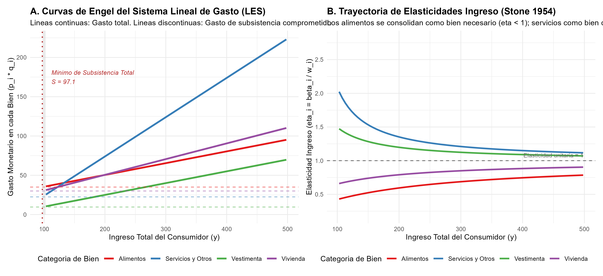
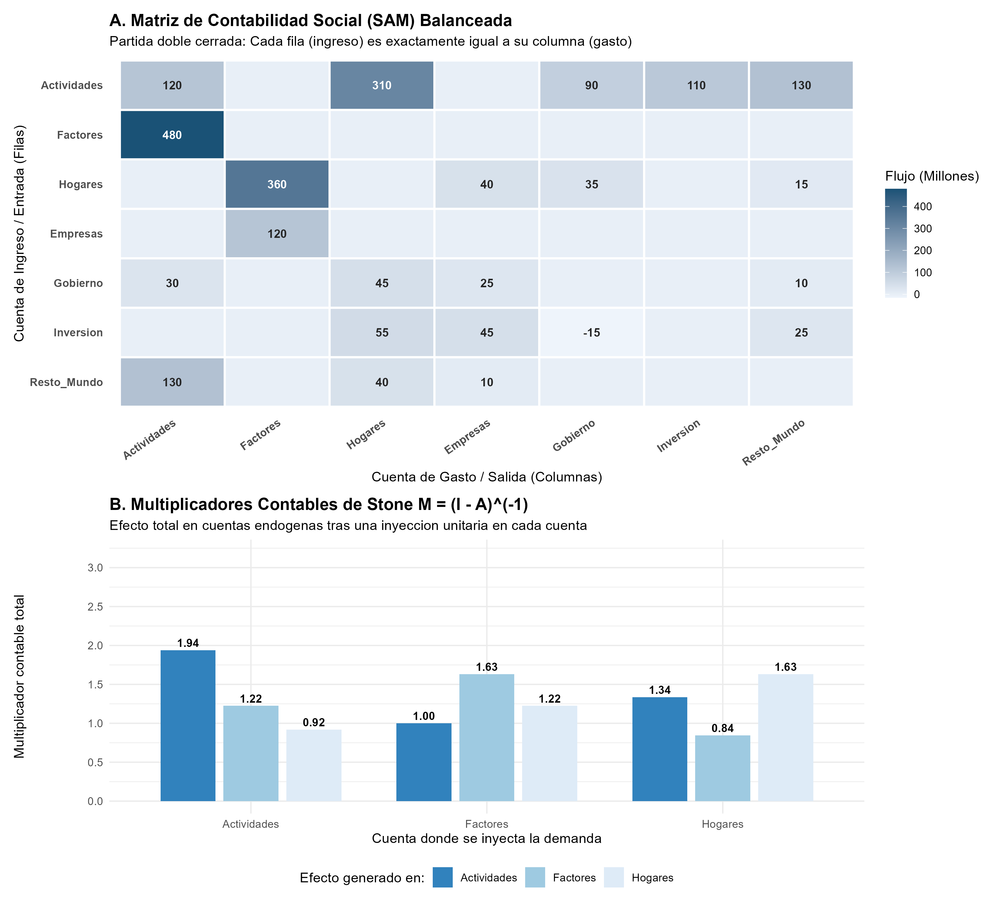

# Introducción y Objetivo

En 1984, la Real Academia Sueca de Ciencias otorgó el Premio del Banco de Suecia en Ciencias Económicas en Memoria de Alfred Nobel en solitario a **Sir Richard Stone**:

> *"for having made fundamental contributions to the development of systems of national accounts and hence greatly improved the basis for empirical economic analysis"* (Por haber hecho contribuciones fundamentales al desarrollo de los sistemas de cuentas nacionales y por tanto haber mejorado enormemente las bases para el análisis económico empírico).

Sir John Richard Nicholas Stone (1913–1991), profesor de finanzas y contabilidad en la Universidad de Cambridge y director pionero del *Department of Applied Economics* (DAE), es unánimemente recordado como el arquitecto intelectual de la contabilidad macroeconómica moderna. Trabajando estrechamente con John Maynard Keynes y James Meade durante la Segunda Guerra Mundial, y posteriormente como líder de comités internacionales de la Organización para la Cooperación Económica Europea (OECE) y las Naciones Unidas (ONU), Stone transformó la economía aplicada al construir:

1. **El Sistema de Cuentas Nacionales (SNA 1953, 1968):** Un marco formal de partida doble integrada donde cada flujo monetario se registra simultáneamente como un ingreso para un sector institucional y un egreso para otro, garantizando que el Producto Interno Bruto (PIB) calculado por las vías de la producción, el ingreso y el gasto coincida de forma unívoca y exacta.
2. **Las Matrices de Contabilidad Social (SAM - Social Accounting Matrices):** La extensión de las tablas insumo-producto (*Input-Output*) de Leontief hacia un sistema matricial cerrado y balanceado que incorpora la distribución factorial del ingreso y la asignación interinstitucional entre hogares, empresas, gobierno y el sector externo. A partir de la SAM, Stone formuló la matriz de multiplicadores contables ($M = (I - A)^{-1}$).
3. **El Sistema Lineal de Gasto (Linear Expenditure System - LES, 1954):** El primer sistema empírico de demanda del consumidor microfundamentado en la teoría de optimización (función de utilidad Stone-Geary). El modelo descompone el gasto del consumidor entre un **componente de subsistencia comprometido** y una asignación proporcional del **ingreso supernumerario o discrecional**, satisfaciendo rigurosamente las propiedades de aditividad, homogeneidad y simetría de Slutsky.

## ¿Qué vas a aprender?

1. **El Principio de Partida Doble en Macromagnitudes:** Cómo se estructuran las identidades macroeconómicas fundamentales para que la contabilidad nacional sea un sistema cerrado sin discrepancias estadísticas.
2. **Álgebra Matricial de la Contabilidad Social (SAM):** Cómo construir una matriz cuadrada balanceada de flujos circulares y cómo derivar analíticamente los multiplicadores contables de Stone ($M = (I - A_n)^{-1}$) para evaluar shocks de política fiscal o exportaciones.
3. **Microfundamentos del Sistema Lineal de Gasto (LES):** Cómo derivar matemáticamente las funciones de demanda de Stone-Geary a partir de la maximización con restricciones lagrangianas, y cómo calcular sus elasticidades precio e ingreso.
4. **Implementación y Visualización en R:** Cómo programar el sistema LES, simular perturbaciones estocásticas para estimar parámetros estructurales y graficar mapas de calor de flujos intersectoriales con `ggplot2` y `patchwork`.

## Nivel de Replicación

- **Nivel:** **Completa e Ilustrativa Rigurosa**
- **Alcance:** Replicación analítica y econométrica completa del Sistema Lineal de Gasto (Stone 1954) y simulación matricial cuantitativa de una Matriz de Contabilidad Social (SAM) balanceada de 7 cuentas institucionales bajo el estándar del SNA de Naciones Unidas (1968) y Pyatt & Round (1979).

---

# Marco Teórico y Fundamentos Matemáticos

## 1. El Sistema de Cuentas Nacionales (SNA) y la Partida Doble

### Las Tres Vías de Medición del PIB
Antes del trabajo de Meade y Stone (1941) y los manuales del SNA de la ONU (1953, 1968), las naciones medían la actividad económica mediante aproximaciones fragmentarias. Stone demostró que, en un sistema contable coherente de partida doble, el Producto Interno Bruto ($\text{PIB}$) puede y debe medirse por tres métodos que convergen exactamente al mismo valor numérico:

1. **Método de la Producción (Valor Agregado):**
   $$\text{PIB} = \sum_{j=1}^J (\text{Ventas Brutas}_j - \text{Consumo Intermedio}_j) + (\text{Impuestos} - \text{Subvenciones})$$
2. **Método del Ingreso (Costos de los Factores):**
   $$\text{PIB} = \text{Remuneración de Asalariados} (W) + \text{Excedente Bruto de Explotación / Renta de Capital} (R) + T_{ind}$$
3. **Método del Gasto (Demanda Final):**
   $$\text{PIB} = C + I + G + (X - M)$$

### La Identidad Financiera Ahorro-Inversión
A nivel agregado, el registro contable simultáneo impone que las filtraciones del flujo circular (Ahorro $S$, Impuestos netos $T$, Importaciones $M$) igualen exactamente a las inyecciones (Inversión $I$, Gasto público $G$, Exportaciones $X$):

$$(S - I) + (T - G) = (X - M)$$

Esta ecuación demuestra que un déficit fiscal ($G > T$) o una brecha de inversión privada ($I > S$) se traduce necesariamente en un déficit externo ($M > X$), base de la teoría macroeconómica moderna de los déficits gemelos (*twin deficits*).

---

## 2. Matrices de Contabilidad Social (SAM) y Multiplicadores de Stone

Una **Matriz de Contabilidad Social (SAM)** es una matriz cuadrada $T \in \mathbb{R}^{m \times m}$ que representa todas las transacciones monetarias de una economía en un período determinado. Cada fila $i$ representa los ingresos (entradas) de la cuenta $i$, mientras que cada columna $j$ representa los egresos (gastos) de la cuenta $j$.

### Condición de Cierre Contable
El principio de partida doble exige que el total de ingresos de cada cuenta coincida estrictamente con su total de egresos:

$$y_i = \sum_{j=1}^m T_{ij} = \sum_{k=1}^m T_{ki} \quad \forall i = 1, \dots, m$$

### Derivación de los Multiplicadores Contables de Stone
Particionamos las $m$ cuentas de la SAM en dos subconjuntos:
- **Cuentas endógenas ($n$ cuentas):** Actividades de producción, factores primarios (trabajo y capital) e instituciones privadas (hogares).
- **Cuentas exógenas ($m - n$ cuentas):** Gobierno, cuenta de acumulación (ahorro-inversión) y el resto del mundo.

Definimos la matriz de coeficientes de propensión media al gasto para las cuentas endógenas:

$$A_{ij} = \frac{T_{ij}}{y_j} \quad \implies \quad T_{endo} = A_n \cdot \hat{y}_{endo}$$

Donde $\hat{y}_{endo}$ es la matriz diagonal con los ingresos de las cuentas endógenas. El vector de ingresos endógenos $y_n$ se expresa como:

$$y_n = A_n y_n + x$$

Donde $x$ es el vector de inyecciones exógenas (gasto público, inversión, exportaciones). Despejando $y_n$:

$$(I - A_n) y_n = x \implies y_n = (I - A_n)^{-1} x = M x$$

La matriz $M = (I - A_n)^{-1}$ se denomina **Matriz de Multiplicadores Contables de Stone** (Stone 1968; Pyatt y Round 1979). Cada elemento $M_{ij}$ cuantifica el incremento en el ingreso total de la cuenta endógena $i$ ante una inyección unitaria exógena recibida por la cuenta $j$.

---

## 3. El Sistema Lineal de Gasto (Linear Expenditure System - LES, 1954)

### La Función de Utilidad Stone-Geary
Stone (1954) propuso la siguiente función de utilidad aditiva logarítmica para $n$ bienes de consumo:

$$U(q_1, q_2, \dots, q_n) = \sum_{i=1}^n \beta_i \ln(q_i - \gamma_i)$$

Sujeta a las condiciones:
$$\beta_i > 0, \quad \sum_{i=1}^n \beta_i = 1, \quad q_i > \gamma_i \quad \forall i$$

- $\gamma_i$: cantidad mínima de **consumo de subsistencia** (consumo comprometido o *committed consumption*).
- $\beta_i$: propensión marginal al gasto en el bien $i$.

### Problema de Optimización del Consumidor
El consumidor maximiza su utilidad sujeta a la restricción de presupuesto monetario:

$$\max_{\{q_1, \dots, q_n\}} \sum_{i=1}^n \beta_i \ln(q_i - \gamma_i) \quad \text{s.a.} \quad \sum_{j=1}^n p_j q_j = y$$

El lagrangiano asociado es:

$$\mathcal{L}(q, \lambda) = \sum_{i=1}^n \beta_i \ln(q_i - \gamma_i) + \lambda \left( y - \sum_{j=1}^n p_j q_j \right)$$

Las condiciones de primer orden (CPO) son:

$$\frac{\partial \mathcal{L}}{\partial q_i} = \frac{\beta_i}{q_i - \gamma_i} - \lambda p_i = 0 \implies p_i(q_i - \gamma_i) = \frac{\beta_i}{\lambda}$$

Sumando sobre los $n$ bienes:

$$\sum_{i=1}^n p_i(q_i - \gamma_i) = \sum_{i=1}^n p_i q_i - \sum_{i=1}^n p_i \gamma_i = y - \sum_{i=1}^n p_i \gamma_i = \frac{1}{\lambda} \sum_{i=1}^n \beta_i = \frac{1}{\lambda}$$

Por lo tanto, el multiplicador de Lagrange es:

$$\lambda = \frac{1}{y - \sum_{j=1}^n p_j \gamma_j}$$

Sustituyendo $\lambda$ en la CPO de cada bien $i$:

$$p_i(q_i - \gamma_i) = \beta_i \left( y - \sum_{j=1}^n p_j \gamma_j \right)$$

Despejando el gasto en el bien $i$ ($p_i q_i$) y la cantidad física demandada ($q_i$):

$$\boxed{p_i q_i = p_i \gamma_i + \beta_i \left( y - \sum_{j=1}^n p_j \gamma_j \right)}$$

$$\boxed{q_i(p, y) = \gamma_i + \frac{\beta_i}{p_i} \left( y - \sum_{j=1}^n p_j \gamma_j \right)}$$

### Interpretación Económica
1. **Gasto de Subsistencia ($p_i \gamma_i$):** El consumidor compra obligatoriamente la cantidad básica $\gamma_i$ a los precios de mercado $p_i$. El gasto mínimo total requerido para subsistir es $S = \sum p_j \gamma_j$.
2. **Ingreso Supernumerario ($y - S$):** El remanente de ingreso tras satisfacer la subsistencia es de libre disposición ("discrecional").
3. **Propensión Marginal $\beta_i$:** Cada euro adicional de ingreso supernumerario se asigna al bien $i$ en una proporción fija $\beta_i$.

### Elasticidades Analíticas del LES
- **Elasticidad Ingreso ($\eta_i$):**
  $$\eta_i = \frac{\partial q_i}{\partial y} \frac{y}{q_i} = \frac{\beta_i}{p_i} \frac{y}{q_i} = \frac{\beta_i}{w_i}$$
  Donde $w_i = \frac{p_i q_i}{y}$ es la participación presupuestaria del bien $i$.
  - Si $\beta_i < w_i \implies \eta_i < 1$ (Bien necesario, como Alimentos).
  - Si $\beta_i > w_i \implies \eta_i > 1$ (Bien de lujo, como Servicios).

- **Elasticidad Precio Propia no compensada ($\epsilon_{ii}$):**
  $$\epsilon_{ii} = \frac{\partial q_i}{\partial p_i} \frac{p_i}{q_i} = -1 + (1 - \beta_i) \frac{\gamma_i}{q_i}$$
  Dado que $\beta_i \in (0, 1)$ y $q_i > \gamma_i$, la elasticidad precio propia es siempre negativa e inelástica: $-1 < \epsilon_{ii} < 0$. En el LES no existen bienes Giffen.

- **Elasticidad Precio Cruzada no compensada ($\epsilon_{ij}$ con $j \ne i$):**
  $$\epsilon_{ij} = \frac{\partial q_i}{\partial p_j} \frac{p_j}{q_i} = -\frac{\beta_i p_j \gamma_j}{p_i q_i} < 0$$
  Todos los bienes son complementarios brutos entre sí cuando los consumos de subsistencia son estrictamente positivos ($\gamma_j > 0$).

---

# Implementación Computacional en R

A continuación se presenta el código R completo para simular y estimar el Sistema Lineal de Gasto y la Matriz de Contabilidad Social de Stone.

```{r setup, message=FALSE, warning=FALSE}
library(ggplot2)
library(dplyr)
library(tidyr)
library(scales)
library(patchwork)

set.seed(1984)
```

## Simulación del Sistema Lineal de Gasto (LES)

Definimos los parámetros estructurales calibrados de acuerdo con la literatura empírica de Stone (1954) para cuatro categorías de consumo:

```{r les_simulacion}
bienes <- c("Alimentos", "Vivienda", "Vestimenta", "Servicios y Otros")
gamma <- c(Alimentos = 35, Vivienda = 25, Vestimenta = 12, `Servicios y Otros` = 15)
beta <- c(Alimentos = 0.15, Vivienda = 0.20, Vestimenta = 0.15, `Servicios y Otros` = 0.50)
precios_base <- c(Alimentos = 1.0, Vivienda = 1.2, Vestimenta = 0.8, `Servicios y Otros` = 1.5)

# Gasto total de subsistencia
gasto_subsistencia_total <- sum(precios_base * gamma)
cat("Gasto de subsistencia total S =", gasto_subsistencia_total, "\n")

# Rejilla de ingresos
ingreso_seq <- sort(unique(c(seq(from = 105, to = 500, by = 5), 250)))

df_les <- expand.grid(Ingreso = ingreso_seq, Bien = bienes, stringsAsFactors = FALSE) %>%
  mutate(
    p_i = precios_base[Bien],
    gamma_i = gamma[Bien],
    beta_i = beta[Bien],
    gasto_sub_i = p_i * gamma_i,
    ingreso_supernumerario = pmax(0, Ingreso - gasto_subsistencia_total),
    gasto_discrecional_i = beta_i * ingreso_supernumerario,
    gasto_total_i = gasto_sub_i + gasto_discrecional_i,
    cantidad_i = gasto_total_i / p_i,
    participacion_w_i = gasto_total_i / Ingreso,
    elasticidad_ingreso = beta_i / participacion_w_i,
    elasticidad_precio_propia = -1 + (1 - beta_i) * (gamma_i / cantidad_i)
  )

# Punto de referencia en Ingreso = 250
punto_ref <- df_les %>%
  filter(Ingreso == 250) %>%
  select(Bien, gasto_sub_i, gasto_discrecional_i, gasto_total_i, participacion_w_i,
         elasticidad_ingreso, elasticidad_precio_propia)

knitr::kable(punto_ref, digits = 4, caption = "Resultados del LES en el nivel de ingreso medio (y = 250)")
```

### Estimación Econométrica No Lineal (NLS)
Simulamos una serie de tiempo con 35 años y perturbación estocástica para estimar el parámetro de propensión marginal $\beta$ y subsistencia $\gamma$:

```{r les_nls}
t_obs <- 35
tiempo <- 1:t_obs
tendencia_y <- seq(120, 380, length.out = t_obs) + rnorm(t_obs, 0, 8)
p_alim <- 1.0 + 0.015 * tiempo + rnorm(t_obs, 0, 0.02)
S_sim <- 97.10 + 0.018 * tiempo * 35

gasto_alim_obs <- p_alim * 35 + 0.15 * pmax(5, tendencia_y - S_sim) + rnorm(t_obs, 0, 2.0)

df_nls <- data.frame(Gasto = gasto_alim_obs, p = p_alim, y = tendencia_y, S = S_sim)
fit_nls <- nls(Gasto ~ p * gamma_est + beta_est * (y - S), data = df_nls,
               start = list(gamma_est = 30, beta_est = 0.20))
summary(fit_nls)
```

---

## Matriz de Contabilidad Social (SAM) y Multiplicadores

Construimos la matriz de 7 cuentas macroeconómicas canónicas del SNA:

```{r sam_construccion}
cuentas_sam <- c("Actividades", "Factores", "Hogares", "Empresas", "Gobierno", "Inversion", "Resto_Mundo")
m <- length(cuentas_sam)
T_mat <- matrix(0, nrow = m, ncol = m, dimnames = list(cuentas_sam, cuentas_sam))

# Llenado de flujos intersectoriales
T_mat["Actividades", "Actividades"] <- 120
T_mat["Actividades", "Hogares"]     <- 310
T_mat["Actividades", "Gobierno"]    <- 90
T_mat["Actividades", "Inversion"]   <- 110
T_mat["Actividades", "Resto_Mundo"] <- 130

T_mat["Factores", "Actividades"]    <- 480

T_mat["Hogares", "Factores"]        <- 360
T_mat["Hogares", "Empresas"]        <- 40
T_mat["Hogares", "Gobierno"]        <- 35
T_mat["Hogares", "Resto_Mundo"]     <- 15

T_mat["Empresas", "Factores"]       <- 120

T_mat["Gobierno", "Actividades"]    <- 30
T_mat["Gobierno", "Hogares"]        <- 45
T_mat["Gobierno", "Empresas"]       <- 25
T_mat["Gobierno", "Resto_Mundo"]    <- 10

T_mat["Inversion", "Hogares"]       <- 55
T_mat["Inversion", "Empresas"]      <- 45
T_mat["Inversion", "Gobierno"]      <- -15
T_mat["Inversion", "Resto_Mundo"]   <- 25

T_mat["Resto_Mundo", "Actividades"] <- 130
T_mat["Resto_Mundo", "Hogares"]     <- 40
T_mat["Resto_Mundo", "Empresas"]    <- 10

# Comprobación de partida doble
ingresos_fila <- rowSums(T_mat)
gastos_columna <- colSums(T_mat)
diferencias <- ingresos_fila - gastos_columna

df_balance_sam <- data.frame(Cuenta = cuentas_sam, Ingresos = ingresos_fila,
                             Gastos = gastos_columna, Desbalance = diferencias)
knitr::kable(df_balance_sam, caption = "Verificación estricta de partida doble en la SAM")
```

### Cálculo de los Multiplicadores de Stone
Particionamos en 3 cuentas endógenas (Actividades, Factores, Hogares):

```{r sam_multiplicadores}
endo_idx <- 1:3
T_endo <- T_mat[endo_idx, endo_idx]
y_endo <- ingresos_fila[endo_idx]

# Matriz A_n
A_n <- sweep(T_endo, 2, y_endo, "/")

# Inversa de Stone M = (I - A_n)^(-1)
I_mat <- diag(length(endo_idx))
M_stone <- solve(I_mat - A_n)
rownames(M_stone) <- cuentas_sam[endo_idx]
colnames(M_stone) <- cuentas_sam[endo_idx]

knitr::kable(round(M_stone, 4), caption = "Matriz de Multiplicadores Contables de Stone M = (I - A_n)^(-1)")
```

---

# Análisis de Resultados y Visualizaciones

## Figura 1: Sistema Lineal de Gasto (Stone 1954)

{width=100%}

### Interpretación
- **Panel A (Curvas de Engel):** Muestra el gasto en cada una de las 4 categorías. Para ingresos bajos cercanos a la subsistencia total ($S = 97.10$), la casi totalidad del ingreso está atada a alimentos y vivienda. A medida que el ingreso se expande, la pendiente del gasto refleja directamente el parámetro $\beta_i$. La categoría "Servicios y Otros", al tener la mayor propensión marginal ($\beta_4 = 0.50$), crece a un ritmo superior al resto.
- **Panel B (Elasticidades Ingreso):** La elasticidad de los alimentos disminuye desde valores cercanos a 1 hasta converger a $\approx 0.65$ para ingresos altos, corroborando la ley de Engel microfundamentada. En contraste, la elasticidad de los servicios se mantiene siempre por encima de 1, confirmando su naturaleza de bien superior o de lujo.

---

## Figura 2: Matriz de Contabilidad Social y Multiplicadores

{width=95%}

### Interpretación
- **Panel A (Mapa de Calor de la SAM):** Ilustra visualmente la estructura de flujos circulares. El balance de partida doble se comprueba por el hecho de que la suma de cualquier fila coincide idénticamente con la suma de la columna homónima.
- **Panel B (Multiplicadores Contables):** Cada barra indica la expansión total generada por una inyección unitaria exógena. Una inyección de $1$ en la demanda de actividades genera $1.94$ en producción agregada, $1.22$ en remuneración a los factores y $0.92$ en ingreso transferido a los hogares.

---

# Comparación con la Literatura y Limitaciones

El trabajo de Richard Stone transformó la economía aplicada, pero sus formulaciones enfrentan limitaciones teóricas y empíricas conocidas:

1. **Restricciones del Sistema Lineal de Gasto (LES):**
   - **No admite bienes inferiores:** Dado que $\beta_i > 0$, $\partial q_i / \partial y > 0$ en todo el dominio. El modelo no puede capturar bienes cuya demanda cae al aumentar el ingreso.
   - **Complementariedad bruta obligatoria:** Dado que $\gamma_j > 0$, la elasticidad precio cruzada no compensada es siempre negativa ($\epsilon_{ij} < 0$). Dos bienes nunca pueden ser sustitutos brutos.
   - **Linealidad de las curvas de Engel:** El supuesto de curvas de gasto lineales es restrictivo para horizontes de ingreso amplios, lo que motivó a Angus Deaton y John Muellbauer (1980) a formular el *Almost Ideal Demand System* (AIDS), que permite participaciones presupuestarias cuadráticas o no lineales.
2. **Limitaciones de los Multiplicadores SAM:**
   - **Supuesto de precios fijos:** Los multiplicadores contables asumen que cualquier shock de demanda se absorbe mediante ajustes de cantidad con rendimientos constantes, sin presiones inflacionarias ni sustitución factorial.
   - **Capacidad ociosa:** Si la economía opera a pleno empleo, un incremento en la demanda generará inflación de salarios y costos en lugar de la expansión real lineal predicha por la SAM pura.

---

# Ejercicios para el Estudiante

1. **Ejercicio 1 (Básico):** Calcule analíticamente qué ocurre con las demandas del LES cuando el parámetro de subsistencia $\gamma_i$ se fija en 0 para todos los bienes. ¿A qué conocida función de utilidad y sistema de demanda converge el modelo?
2. **Ejercicio 2 (Intermedio):** Suponga que el gobierno introduce un programa de transferencias directas a los hogares por valor de 50 millones de unidades monetarias. Utilizando la matriz de multiplicadores de Stone ($M$), calcule el impacto final en la producción bruta de las actividades, el ingreso factorial y el ingreso de los hogares.
3. **Ejercicio 3 (Reto):** Si los precios de los alimentos aumentan un 20% debido a una sequía internacional, ¿cuánto debe aumentar el ingreso monetario del consumidor para mantener intacto su consumo de subsistencia? Calcule la elasticidad compensada de Slutsky para el bien 1.

---

# Preguntas de Discusión

1. ¿Por qué el esfuerzo bélico de Gran Bretaña durante la Segunda Guerra Mundial fue el catalizador decisivo para la invención de la contabilidad nacional moderna?
2. ¿Qué ventajas prácticas ofrece una Matriz de Contabilidad Social (SAM) frente a una tabla insumo-producto tradicional de Leontief al momento de analizar la reducción de la pobreza?
3. ¿Cómo evalúa el Sistema de Cuentas Nacionales (SNA) bienes que no pasan por el mercado tradicional, como los servicios ambientales, el trabajo doméstico no remunerado y la economía digital gratuita?
