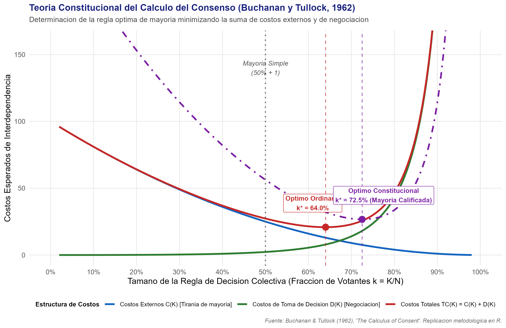
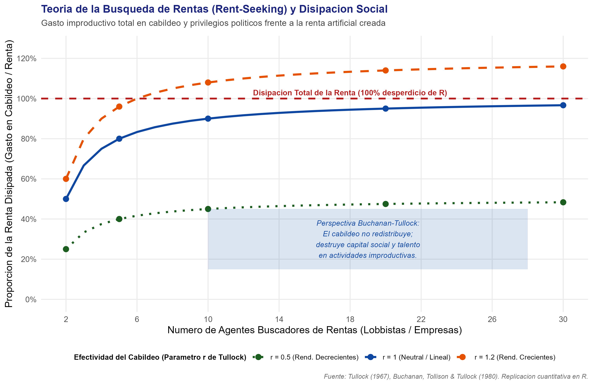

# Introducción y Objetivo

Este documento desarrolla la formalización analítica y la replicación computacional en R de los aportes cardinales de **James M. Buchanan Jr.**, galardonado con el Premio del Banco de Suecia en Ciencias Económicas en Memoria de Alfred Nobel en 1986:

> *"for his development of the contractual and constitutional bases for the theory of economic and political decision-making"* (Por su desarrollo de las bases contractuales y constitucionales para la teoría de la toma de decisiones económicas y políticas).

Antes de la irrupción de James Buchanan y de la Escuela de Virginia (junto a colaboradores como Gordon Tullock y Geoffrey Brennan), la ciencia económica operaba bajo una asimetría metodológica esquizofrénica:

1. En el mercado privado, se asumía que los individuos eran agentes racionales, maximizadores de utilidad y auto-interesados.
2. En el ámbito estatal, se suponía ingenuamente que los mismos individuos, al convertirse en políticos, legisladores o burócratas, mutaban milagrosamente en "ángeles platónicos" o planificadores sociales benevolentes dedicados con devoción exclusiva a maximizar una abstracta "función de bienestar social".

Buchanan demolió este dogma mediante lo que denominó **"política sin romanticismo"** (*politics without romance*). La Teoría de la Elección Pública (*Public Choice Theory*) y la **Economía Constitucional** unificaron el análisis económico bajo el principio de consistencia conductual: los gobernantes, parlamentarios y funcionarios responden a incentivos personales (reelección, poder, presupuesto, influencia de grupos de interés) con los mismos resortes racionales con que actúan los consumidores y empresarios.

El análisis de Buchanan se articula sobre tres columnas maestras:

1. **El Cálculo del Consenso (*The Calculus of Consent*, Buchanan y Tullock, 1962):** La determinación de las **reglas de votación óptimas**. Buchanan y Tullock modelaron que la elección de la regla colectiva (desde la autocracia $K=1$, pasando por la mayoría simple $K = N/2 + 1$, hasta la unanimidad $K=N$) responde a un balance marginal entre dos fuerzas: los **costos externos** $C(K)$ (la probabilidad y magnitud del daño o expropiación que una coalición vencedora puede imponer a la minoría) y los **costos de toma de decisión** $D(K)$ (el tiempo, negociación y chantajes estratégicos necesarios para forjar el consenso).
2. **Economía Constitucional y la Distinción en Dos Etapas:** La necesidad de diferenciar tajantemente entre el **nivel constitucional** (elección de las reglas del juego mediante cuasi-unanimidad tras un "velo de incertidumbre") y el **nivel post-constitucional o legislativo ordinario** (juego dentro de las reglas, donde se delega la toma de decisiones a mayorías simples o calificadas).
3. **Búsqueda de Rentas (*Rent-Seeking*) y Límites al Leviatán:** El análisis del desperdicio de recursos provocado por grupos de interés que compiten por monopolios artificiales creados por el Estado (Tullock, 1967; Buchanan, 1980), así como la justificación de restricciones constitucionales vinculantes al endeudamiento público y al poder tributario (*The Power to Tax*, 1980).

## Declaración del Nivel de Replicación
- **Nivel:** **Ilustrativa y analítica**.
- Se formaliza matemáticamente el modelo de minimización de costos de interdependencia social de Buchanan y Tullock (1962) para derivar la regla de votación óptima $k^* = K^*/N$.
- Se formaliza y computa el concurso de búsqueda de rentas de Tullock (*Tullock contest*) y la disipación del excedente social ($X / R$).
- Se contrastan los escenarios legislativo ordinario, constitucional y de emergencia.
- Se vinculan las figuras y tablas generadas por el script ejecutable `eleccion_publica_y_reglas_votacion.R`.

---

# ¿Qué vas a aprender?

1. Comprender la metodología del **individualismo metodológico** aplicado a la toma de decisiones colectivas ("política sin romanticismo").
2. Formalizar analíticamente los **costos externos $C(K)$** y los **costos de negociación $D(K)$** que determinan las reglas de votación democrática.
3. Entender por qué la **regla de mayoría simple (50% + 1) no posee ningún estatus sagrado o natural**, sino que es una regla operativa que minimiza costos bajo condiciones muy específicas de simetría.
4. Distinguir por qué las **normas constitucionales** exigen mayorías supercalificadas o cuasi-unanimidad wickselliana para impedir la expoliación fiscal entre grupos.
5. Modelar la **disipación de rentas (*rent-seeking dissipation*)** y comprender por qué el intervencionismo estatal impone pérdidas de bienestar mucho más severas que el clásico triángulo de Harberger.
6. Analizar la vigencia del marco de Buchanan frente a las reglas fiscales modernas (techos de deuda, cláusulas de déficit cero) y los incentivos perversos de la deuda soberana.

---

# Marco Teórico

## 1. El Cálculo del Consenso y la Regla Óptima de Mayoría (1962)

Consideremos una sociedad compuesta por $N$ ciudadanos que deben decidir colectivamente sobre la provisión o financiamiento de una política pública o una regla legal.

Definamos $K$ como el número mínimo de votos afirmativos requeridos para aprobar la propuesta colectiva ($1 \le K \le N$). Normalizamos el tamaño de la regla de decisión en términos relativos:
$$k = \frac{K}{N} \in (0, 1]$$

Un individuo racional situado en la etapa constituyente (antes de saber si pertenecerá a la mayoría o a la minoría vencedora) evalúa dos funciones de costo esperadas en función de $k$:

### Costos Externos Esperados: $C(k)$
Los costos externos representan el valor presente esperado del perjuicio, carga fiscal, pérdida de libertad o expropiación que otros miembros de la sociedad pueden imponer al individuo si se aprueba una medida contraria a sus intereses:
- Si $k \to 0$ (unipersonal o dictatorial), una minoría o un solo autócrata puede imponer leyes arbitrarias sobre el resto; el costo externo esperado es máximo: $C(0) = C_0$.
- Si $k = 1$ (unanimidad wickselliana), nadie puede ser forzado en contra de su voluntad; cualquier decisión aprobada es una mejora de Pareto voluntaria, por lo que los costos externos se anulan: $C(1) = 0$.
- Por tanto, $C(k)$ es una función monótonamente decreciente y convexa:
  $$C'(k) < 0, \quad C''(k) \ge 0$$

Una parametrización matemática canónica es:
$$C(k) = C_0 (1 - k)^\alpha, \quad \text{con } C_0 > 0, \; \alpha \ge 1$$

### Costos de Toma de Decisión o Negociación: $D(k)$
Los costos de toma de decisión representan el valor de los recursos consumidos en alcanzar el acuerdo político: tiempo invertido, negociaciones complejas, intercambio de favores legislativos (*logrolling*), y el costo de oportunismo estratégico o bloqueo (*hold-up problem*):
- Si $k \to 0$, una decisión individual no requiere negociación alguna: $D(0) \approx 0$.
- A medida que $k$ aumenta hacia 1, incorporar a cada votante adicional requiere concesiones marginales crecientes. Bajo unanimidad total ($k = 1$), cada ciudadano individual posee poder de veto y puede extorsionar al colectivo exigiendo compensaciones particulares, haciendo que los costos de negociación tiendan a infinito o generen parálisis decisoria.
- Por ende, $D(k)$ es una función monótonamente creciente y fuertemente convexa:
  $$D'(k) > 0, \quad D''(k) > 0$$

Una parametrización regularizada es:
$$D(k) = D_0 \left( \frac{k}{1 - k + \delta} \right)^\beta, \quad \text{con } D_0 > 0, \; \beta \ge 1, \; \delta > 0$$

### Minimización de los Costos Totales de Interdependencia
El costo total esperado para el ciudadano en la etapa constitucional es la suma de ambos componentes:
$$TC(k) = C(k) + D(k)$$

La regla de votación óptima $k^* = K^* / N$ resuelve el problema de optimización:
$$\min_{k \in (0, 1)} TC(k) = C(k) + D(k)$$

Condición de primer orden (FOC):
$$\frac{d TC(k^*)}{dk} = C'(k^*) + D'(k^*) = 0 \iff -C'(k^*) = D'(k^*)$$

La regla óptima iguala el beneficio marginal de reducir la tiranía de la mayoría (reducción en costos externos, $-C'$) al costo marginal de ampliar la coalición negociadora ($D'$).

### Estática Comparativa y los Dos Niveles Constitucionales

1. **Decisiones Constitucionales (Reglas del Juego / Derechos Fundamentales):**
   - El riesgo de expropiación arbitraria de la vida, libertad o propiedad es masivo ($C_0 \uparrow\uparrow$).
   - Por tanto, $-C'(k)$ es elevado para todo $k$, desplazando la solución óptima hacia la derecha:
     $$k^*_{\text{const}} > 0.67 \quad (\text{Mayorías calificadas de dos tercios, tres cuartos o cuasi-unanimidad})$$
2. **Decisiones Legislativas Ordinarias (Bienes Públicos Corrientes):**
   - El riesgo redistributivo está acotado por las reglas constitucionales previas.
   - La urgencia temporal y los costos de deliberación son significativos ($D_0$ moderado).
   - El óptimo se ubica cerca de la mayoría simple:
     $$k^*_{\text{ord}} \approx 0.50 \text{ a } 0.60$$
3. **Decisiones de Emergencia o Guerra:**
   - La urgencia es extrema y la parálisis por negociación cuesta vidas ($D'(k) \gg 0$).
   - Se reduce $k^*$ hacia la acción delegada ejecutiva ($k^* < 0.50$).

---

## 2. Búsqueda de Rentas y Pérdida Social (Tullock 1967; Buchanan et al. 1980)

La economía neoclásica tradicional (Harberger, 1954) medía la pérdida social de un monopolio o de una tarifa arancelaria exclusivamente mediante el **triángulo de pérdida irrecuperable de eficiencia** (*deadweight loss*, $DWL$). El rectángulo de ganancias extraordinarias del monopolista ($R$) era considerado una "mera transferencia de excedente del consumidor al productor", sin costo neto de bienestar para la sociedad agregada.

Gordon Tullock (1967) y James Buchanan (1980) demostraron que esta visión era profundamente equivocada. La existencia de una renta artificial creada por la regulación o el favoritismo político crea un **concurso competitivo de búsqueda de rentas** (*rent-seeking contest*):

### El Modelo de Concurso de Tullock
Supongamos que el Estado crea un privilegio legal que genera una renta de valor monetario $R$.
Un conjunto de $n$ agentes compiten por adjudicarse dicha renta. Cada participante $i \in \{1, \dots, n\}$ invierte $x_i \ge 0$ unidades de recursos reales (abogados de cabildeo, relaciones públicas, contribuciones de campaña, intermediarios).

La función de éxito del concurso (*contest success function*) determina la probabilidad de ganar la renta:
$$p_i = \frac{x_i^r}{\sum_{j=1}^n x_j^r}$$
donde $r > 0$ refleja la sensibilidad del proceso político a los gastos de influencia (rendimiento de escala del cabildeo).

El beneficio neto esperado del agente $i$ es:
$$\pi_i = p_i R - x_i = \left( \frac{x_i^r}{\sum_{j=1}^n x_j^r} \right) R - x_i$$

### Equilibrio de Nash Simétrico
Maximizando con respecto a $x_i$:
$$\frac{\partial \pi_i}{\partial x_i} = \frac{r x_i^{r-1} \left( \sum_{j \neq i} x_j^r \right)}{\left( \sum_{j=1}^n x_j^r \right)^2} R - 1 = 0$$

Bajo simetría ($x_1 = x_2 = \dots = x_n = x^*$):
$$\sum_{j \neq i} x_j^r = (n - 1) (x^*)^r, \quad \sum_{j=1}^n x_j^r = n (x^*)^r$$

Sustituyendo:
$$\frac{r (x^*)^{r-1} (n - 1) (x^*)^r}{\left[ n (x^*)^r \right]^2} R = 1 \implies \frac{r (n - 1)}{n^2 x^*} R = 1$$

Despejando el gasto de cabildeo individual de equilibrio:
$$x^*(n, r) = R \cdot \frac{r (n - 1)}{n^2}$$

### Disipación Social Total de la Renta
El gasto agregado invertido en cabildeo y recursos improductivos es:
$$X(n, r) = \sum_{i=1}^n x_i^* = n x^* = R \cdot \frac{r (n - 1)}{n}$$

La **tasa de disipación de la renta** es:
$$DR(n, r) = \frac{X(n, r)}{R} = r \cdot \frac{n - 1}{n}$$

- Si $r = 1$ (rendimientos constantes):
  $$\lim_{n \to \infty} DR(n, 1) = \lim_{n \to \infty} \frac{n - 1}{n} = 1 \quad (100\% \text{ de la renta es disipada})$$
- Con apenas $n = 5$ lobbistas en pugna, se disipa el **80%** de la renta ($X = 0.8 R$).
- Con $n = 10$, se desperdicia el **90%** de la renta.

### El Verdadero Costo Social del Intervencionismo
El costo social total ($SC$) de la creación de privilegios económicos ya no es solo el triángulo de Harberger ($DWL$):
$$SC = DWL_{\text{Harberger}} + X_{\text{Tullock}}$$

Dado que el rectángulo de transferencias $R$ suele ser órdenes de magnitud más grande que el triángulo $DWL$, el costo social real del mercantilismo estatal y la captura regulatoria es típicamente **de 3 a 10 veces mayor** que el calculado por la economía neoclásica tradicional.

---

# Replicación Computacional en R

A continuación presentamos la ejecución del script modular en R `eleccion_publica_y_reglas_votacion.R`, que simula ambos modelos y genera las salidas oficiales del módulo.

```r
# Carga de paquetes necesarios
library(ggplot2)
library(dplyr)
library(tidyr)
library(scales)

# Ejecución modular del script
source("laureados/1986_buchanan/replicacion/R/eleccion_publica_y_reglas_votacion.R")
```

## Resultados del Modelo de Votación Óptima

Los datos simulados demuestran con precisión la divergencia institucional entre niveles de decisión:

| Escenario | Parámetros ($C_0, D_0$) | Regla Óptima ($k^*$) | Costo Externo $C(k^*)$ | Costo Decisión $D(k^*)$ | Costo Total Mínimo $TC^*$ |
| :--- | :---: | :---: | :---: | :---: | :---: |
| **Emergencia / Crisis** | $C_0=80, D_0=8.0$ | **51.5%** | 21.7 | 8.39 | 30.1 |
| **Legislación Ordinaria** | $C_0=100, D_0=2.5$ | **64.0%** | 13.0 | 7.87 | 20.8 |
| **Nivel Constitucional** | $C_0=250, D_0=2.0$ | **72.5%** | 14.6 | 12.1 | 26.7 |

{width=100%}

## Resultados del Modelo de Búsqueda de Rentas

Para una renta artificial $R = 100$ y una pérdida de Harberger de base $DWL = 25$:

| Número de Competidores ($n$) | Gasto Individual ($x^*$) | Gasto Agregado Disipado ($X$) | Tasa de Disipación ($X/R$) | Pérdida Social Total ($DWL + X$) | Multiplicador s/ Harberger |
| :---: | :---: | :---: | :---: | :---: | :---: |
| **2** | 25.0 | 50.0 | 50.0% | 75.0 | **3.0x** |
| **5** | 16.0 | 80.0 | 80.0% | 105.0 | **4.2x** |
| **10** | 9.0 | 90.0 | 90.0% | 115.0 | **4.6x** |
| **20** | 4.75 | 95.0 | 95.0% | 120.0 | **4.8x** |

{width=100%}

---

# Interpretación Económica y Hallazgos Clave

1. **La Naturaleza No Sagrada de la Mayoría Simple:** Buchanan demostró que la regla del 50% + 1 no es una ley moral ni un imperativo democrático incuestionable. Es simplemente un punto de compromiso pragmático para decisiones operativas de bajo riesgo redistributivo.
2. **Fundamento Racional de las Mayorías Calificadas:** En materias estructurales (reformas constitucionales, presupuestos fiscales plurianuales, modificación de garantías de propiedad), elevar el umbral a dos tercios (66.7%) o tres cuartos (75%) reduce drásticamente los costos externos de expoliación fiscal, sobrecompensando el incremento en costos de negociación.
3. **El Engaño del "Planificador Benevolente":** Los burócratas buscan expandir sus presupuestos y esferas de influencia (*budget-maximizing bureaucrat*, Niskanen 1971), mientras que los legisladores comercian votos mediante proyectos localistas (*logrolling* y *pork barrel*), generando déficits estructurales sistemáticos.
4. **La Ilusión Fiscal y el Sesgo al Déficit:** Buchanan (1958, 1977) demostró que el endeudamiento público crea una **ilusión fiscal**: los votantes actuales perciben el beneficio inmediato del gasto público financiado con deuda, pero descuentan de forma irracional la carga futura de impuestos sobre las próximas generaciones, rompiendo la equivalencia ricardiana estricta y justificando candados constitucionales de equilibrio presupuestario.

---

# Limitaciones y Extensiones

- **Información Incompleta en el Concurso de Tullock:** En el modelo base se asume simetría y certidumbre completa sobre el valor de la renta $R$. Asimetrías en influencia o aversión al riesgo pueden alterar la disipación agregada.
- **Costos de Bloqueo vs. Tiranía:** En sociedades sumamente polarizadas o fraccionadas étnica o políticamente, los costos de toma de decisión $D(K)$ crecen mucho más rápido, lo que puede provocar parálisis institucional incluso bajo umbrales moderados.
- **Endogeneidad de las Reglas:** Las propias reglas constitucionales son redactadas por actores políticos de carne y hueso que pueden intentar capturar la asamblea constituyente para blindar sus privilegios futuros.

---

# Conclusiones

James M. Buchanan Jr. proveyó la arquitectura analítica que desmitificó al Estado como un ente moral abstracto. Al aplicar las herramientas del análisis económico riguroso a las instituciones políticas, demostró que **el problema fundamental de la sociedad no es elegir gobernantes sabios o bondadosos, sino diseñar reglas constitucionales que aten las manos del Leviatán** y alineen los intereses privados de los funcionarios con la prosperidad colectiva.

---

# Referencias {.unnumbered}

::: {#refs}
- Brennan, G., & Buchanan, J. M. (1980). *The Power to Tax: Analytical Foundations of a Fiscal Constitution*. Cambridge University Press.
- Buchanan, J. M. (1949). The Pure Theory of Government Finance: A Suggested Approach. *Journal of Political Economy*, 57(6), 496-505.
- Buchanan, J. M. (1958). *Public Principles of Public Debt: A Defense and Restatement*. Richard D. Irwin.
- Buchanan, J. M. (1987). The Constitution of Economic Policy. *The American Economic Review*, 77(3), 243-250.
- Buchanan, J. M., & Tullock, G. (1962). *The Calculus of Consent: Logical Foundations of Constitutional Democracy*. University of Michigan Press.
- Buchanan, J. M., Tollison, R. D., & Tullock, G. (Eds.). (1980). *Toward a Theory of the Rent-Seeking Society*. Texas A&M University Press.
- Tullock, G. (1967). The Welfare Costs of Tariffs, Monopolies, and Theft. *Western Economic Journal*, 5(3), 224-232.
:::
