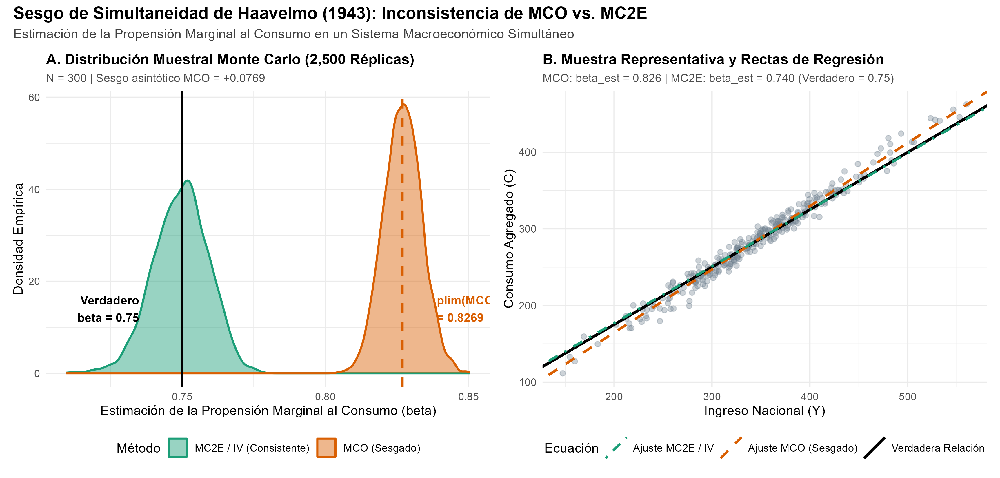
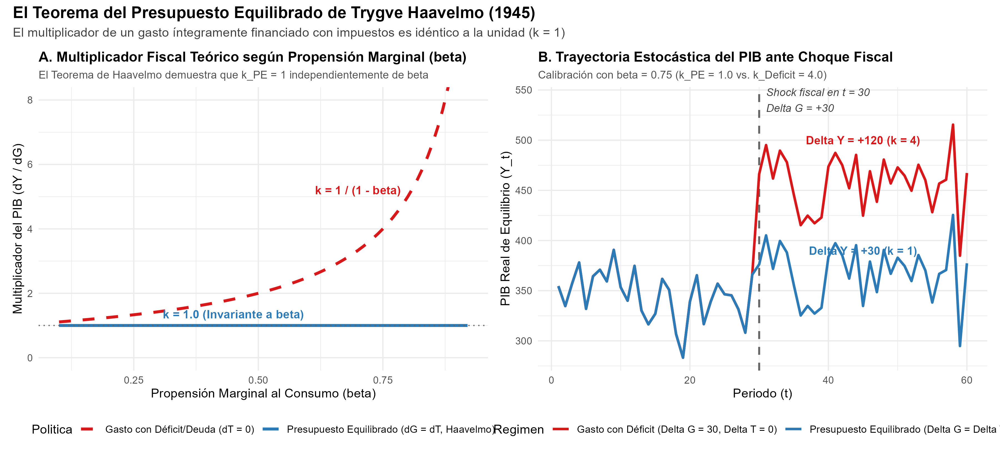

# Introducción y Contexto Histórico

En 1989, la Real Academia Sueca de Ciencias concedió el Premio del Banco de Suecia en Ciencias Económicas en Memoria de Alfred Nobel a **Trygve Haavelmo** (Universidad de Oslo, Noruega) *"por su clarificación de los fundamentos de la teoría probabilística de la econometría y sus análisis de las estructuras económicas simultáneas"*.

Antes de la publicación de su monografía seminal *"The Probability Approach in Econometrics"* (1944) y su artículo precursor de 1943, la economía cuantitativa carecía de una base metodológica coherente para vincular la teoría económica con los datos empíricos observados:

1. **La visión determinista ingenua:** En las décadas de 1920 y 1930, pioneros como Ragnar Frisch y Jan Tinbergen formulaban modelos con relaciones deterministas exactas. Las desviaciones entre la teoría y los datos eran tratadas como simples "errores de medición" o "ruido ajeno", sin una estructura estocástica formalmente definida.
2. **El escepticismo de Keynes y Robbins:** Economistas como John Maynard Keynes (en su célebre reseña de 1939 sobre el trabajo de Tinbergen para la Sociedad de Naciones) y Lionel Robbins argumentaban con vehemencia que la inferencia estadística (como la desarrollada por Ronald Fisher, Jerzy Neyman y Egon Pearson) era inaplicable a la economía, puesto que las series temporales no provenían de experimentos de laboratorio controlados.
3. **El sesgo de simultaneidad en equilibrio general:** Los investigadores aplicaban el método de Mínimos Cuadrados Ordinarios (MCO / *Ordinary Least Squares*, OLS) a ecuaciones individuales (por ejemplo, ajustando una regresión del consumo sobre el ingreso nacional), ignorando que en un sistema interdependiente el ingreso se determina conjuntamente con el consumo.

Trygve Haavelmo resolvió estas contradicciones conceptuales demostrando que:
- Los modelos económicos deben concebirse como **procesos generadores de datos estocásticos** (*data-generating processes*, DGP) donde los términos de error son variables aleatorias con distribuciones de probabilidad bien caracterizadas.
- La estimación aislada mediante MCO de ecuaciones pertenecientes a un sistema simultáneo genera **estimadores sesgados e inconsistentes**, fenómeno conocido hoy como el **sesgo de simultaneidad de Haavelmo**.
- Adicionalmente, en su artículo de 1945, Haavelmo formuló el célebre **Teorema del Multiplicador del Presupuesto Equilibrado**, demostrando analíticamente que un incremento del gasto público financiado en su totalidad con impuestos tiene un multiplicador macroeconómico exactamente igual a la unidad ($k=1$), desmintiendo tanto la hipótesis de neutralidad fiscal como la aplicación mecánica de la fórmula keynesiana con déficit.

En este documento se replican formalmente mediante simulaciones computacionales en R el sesgo de simultaneidad, la estimación consistente vía Variables Instrumentales (MC2E / *Two-Stage Least Squares*, 2SLS) y el teorema del presupuesto equilibrado.

---

# Marco Teórico 1: El Enfoque Probabilístico en Econometría (Haavelmo 1944)

## El Proceso Generador de Datos Estocástico

Haavelmo propuso que las leyes económicas nunca operan en el vacío de forma determinista $Y = f(X)$. Por el contrario, la agregación sobre millones de agentes económicos heterogéneos y la existencia de factores no observables implican que el fenómeno empírico debe modelarse como una muestra aleatoria extraída de una distribución de probabilidad conjunta:

$$\mathcal{P}(y_1, y_2, \dots, y_T; \theta)$$

donde $y_t$ representa el vector de observaciones macroeconómicas en el periodo $t$ y $\theta \in \Theta$ es el vector de parámetros estructurales profundos.

Al dotar al modelo de una estructura probabilística:
1. El término de perturbación $u_t$ deja de ser un "defecto molesto" y se convierte en una variable aleatoria endógena o exógena con media condicional, varianza y covarianzas explícitas.
2. Los métodos rigurosos de la inferencia matemática (estimación por máxima verosimilitud, contrastes de razón de verosimilitud, intervalos de confianza de Neyman) se vuelven inmediatamente operativos y válidos para datos no experimentales.

---

# Marco Teórico 2: El Sesgo de Simultaneidad (Haavelmo 1943)

## El Modelo Macroeconómico Keynesiano Básico

Consideremos el modelo estructural canónico analizado por Haavelmo (1943, 1947):

$$\begin{aligned}
C_t &= \alpha + \beta Y_t + u_t \quad && \text{(Función estructural de consumo)} \\
Y_t &= C_t + I_t \quad && \text{(Identidad contable del ingreso nacional)}
\end{aligned}$$

donde:
- $C_t$ es el consumo agregado privado (variable endógena).
- $Y_t$ es el ingreso nacional / PIB (variable endógena).
- $I_t$ es la inversión autónoma bruta, supuesta **estrictamente exógena**: $\mathbb{E}[I_t u_t] = 0$, con media $\mu_I$ y varianza $\sigma_I^2$.
- $u_t$ es la perturbación estructural estocástica del consumo: $u_t \sim \text{iid } \mathcal{N}(0, \sigma_u^2)$, independiente de $I_t$.
- $\beta \in (0, 1)$ representa la propensión marginal al consumo (*marginal propensity to consume*, MPC).

## Derivación de la Forma Reducida

Para resolver el sistema simultáneo, sustituimos la función de consumo en la identidad del ingreso:

$$Y_t = (\alpha + \beta Y_t + u_t) + I_t$$

Agrupando los términos en $Y_t$:

$$(1 - \beta) Y_t = \alpha + I_t + u_t$$

Dado que $0 < \beta < 1$, dividimos por $(1 - \beta)$ para obtener las ecuaciones de la **forma reducida**:

$$Y_t = \frac{\alpha}{1 - \beta} + \frac{1}{1 - \beta} I_t + \frac{1}{1 - \beta} u_t$$

$$C_t = Y_t - I_t = \frac{\alpha}{1 - \beta} + \frac{\beta}{1 - \beta} I_t + \frac{1}{1 - \beta} u_t$$

## Demostración Matemática del Sesgo e Inconsistencia de MCO

Si un econometrista ingenuo intenta estimar la propensión marginal al consumo $\beta$ aplicando MCO directamente sobre la ecuación de consumo $C_t = \alpha + \beta Y_t + u_t$, el estimador de la pendiente es:

$$\hat{\beta}_{MCO} = \frac{\sum_{t=1}^T (Y_t - \bar{Y})(C_t - \bar{C})}{\sum_{t=1}^T (Y_t - \bar{Y})^2} = \beta + \frac{\sum_{t=1}^T (Y_t - \bar{Y}) u_t}{\sum_{t=1}^T (Y_t - \bar{Y})^2}$$

Tomando el límite en probabilidad ($\text{plim}$):

$$\text{plim} \, \hat{\beta}_{MCO} = \beta + \frac{\text{Cov}(Y_t, u_t)}{\text{Var}(Y_t)}$$

Calculamos la covarianza entre la variable explicativa $Y_t$ y el error estructural $u_t$ utilizando la forma reducida:

$$\text{Cov}(Y_t, u_t) = \text{Cov}\left( \frac{\alpha + I_t + u_t}{1 - \beta}, u_t \right) = \frac{1}{1 - \beta} \text{Cov}(u_t, u_t) = \frac{\sigma_u^2}{1 - \beta} > 0$$

Por su parte, la varianza del ingreso nacional es:

$$\text{Var}(Y_t) = \text{Var}\left( \frac{\alpha + I_t + u_t}{1 - \beta} \right) = \frac{1}{(1 - \beta)^2} [\text{Var}(I_t) + \text{Var}(u_t)] = \frac{\sigma_I^2 + \sigma_u^2}{(1 - \beta)^2}$$

Sustituyendo ambos términos en la expresión del límite probabilístico:

$$\text{plim} \, \hat{\beta}_{MCO} = \beta + \frac{\frac{\sigma_u^2}{1 - \beta}}{\frac{\sigma_I^2 + \sigma_u^2}{(1 - \beta)^2}} = \beta + (1 - \beta) \left( \frac{\sigma_u^2}{\sigma_I^2 + \sigma_u^2} \right)$$

### Consecuencias Fundamentales del Resultado de Haavelmo:
1. **Sesgo positivo sistemático:** Dado que $0 < \beta < 1$ y las varianzas son positivas, el segundo término es estrictamente positivo:
   $$\text{Sesgo Asintótico} = (1 - \beta) \frac{\sigma_u^2}{\sigma_I^2 + \sigma_u^2} > 0$$
   Por tanto, MCO **sobreestima sistemáticamente** la propensión marginal al consumo.
2. **Inconsistencia insalvable con más datos:** El sesgo no desaparece al aumentar el tamaño muestral ($T \to \infty$).
3. **Múltiples fuentes de variación:** Cuanto mayor sea la varianza del shock estructural $\sigma_u^2$ respecto a la varianza de la inversión exógena $\sigma_I^2$, mayor será la distorsión del estimador MCO.

---

# Estimación Consistente: Variables Instrumentales (MC2E / IV)

Para corregir la endogeneidad de $Y_t$, se requiere una variable que esté correlacionada con $Y_t$ pero no con la perturbación estructural $u_t$. La inversión autónoma $I_t$ cumple con ambas condiciones:
1. **Relevancia:** $\text{Cov}(Y_t, I_t) = \frac{\sigma_I^2}{1 - \beta} \neq 0$.
2. **Exogeneidad (Ortogonalidad):** $\text{Cov}(I_t, u_t) = 0$.

El estimador de Variables Instrumentales (IV) viene dado por:

$$\hat{\beta}_{IV} = \frac{\sum_{t=1}^T (I_t - \bar{I})(C_t - \bar{C})}{\sum_{t=1}^T (I_t - \bar{I})(Y_t - \bar{Y})}$$

Tomando el límite probabilístico:

$$\text{plim} \, \hat{\beta}_{IV} = \frac{\text{Cov}(I_t, C_t)}{\text{Cov}(I_t, Y_t)} = \frac{\text{Cov}\left(I_t, \beta Y_t + u_t\right)}{\text{Cov}(I_t, Y_t)} = \beta + \frac{\text{Cov}(I_t, u_t)}{\text{Cov}(I_t, Y_t)} = \beta + 0 = \beta$$

El estimador es asintóticamente consistente e insesgado.

---

# Marco Teórico 3: El Teorema del Presupuesto Equilibrado (Haavelmo 1945)

En su célebre artículo de 1945 *"Multiplier Effects of a Balanced Budget"*, Haavelmo formuló una de las proposiciones más influyentes de la macroeconomía fiscal.

## Formulación del Modelo con Sector Público

$$\begin{aligned}
Y &= C + I + G \\
C &= \alpha + \beta (Y - T) + u
\end{aligned}$$

donde $G$ es el gasto público en bienes y servicios y $T$ son los impuestos totales recaudados.

Sustituyendo la función de consumo en la identidad del ingreso:

$$Y = \alpha + \beta(Y - T) + u + I + G$$

Despejando el ingreso de equilibrio:

$$Y(1 - \beta) = \alpha + I + G - \beta T + u \implies Y = \frac{\alpha + I + u}{1 - \beta} + \frac{1}{1 - \beta} G - \frac{\beta}{1 - \beta} T$$

## Diferenciación y Multiplicadores

Calculamos el cambio total en el producto ante variaciones en los instrumentos fiscales:

$$dY = \frac{1}{1 - \beta} dG - \frac{\beta}{1 - \beta} dT$$

1. **Caso 1: Gasto financiado enteramente con impuestos ($dG = dT$, presupuesto equilibrado):**
   $$dY = \frac{1}{1 - \beta} dG - \frac{\beta}{1 - \beta} dG = \left( \frac{1 - \beta}{1 - \beta} \right) dG = 1 \cdot dG$$
   $$\implies k_{PE} \equiv \frac{dY}{dG}\Bigg|_{dG = dT} = 1$$
   **El multiplicador del presupuesto equilibrado es exactamente 1**, sin importar el valor de la propensión marginal al consumo $\beta \in (0, 1)$.

2. **Caso 2: Gasto financiado con endeudamiento ($dT = 0$, déficit fiscal puro):**
   $$k_D \equiv \frac{dY}{dG}\Bigg|_{dT = 0} = \frac{1}{1 - \beta} > 1$$

3. **Caso 3: Variación de impuestos ($dG = 0$):**
   $$k_T \equiv \frac{dY}{dT}\Bigg|_{dG = 0} = -\frac{\beta}{1 - \beta}$$

La intuición económica descubierta por Haavelmo es elegante: el gobierno retira del flujo circular del ingreso una suma $dT$, lo cual reduce el consumo privado en solo $\beta dT$ (puesto que una fracción $1-\beta$ se habría ahorrado). Al inyectar directamente $dG = dT$ como demanda agregada de bienes y servicios, la inyección neta inicial es $dG - \beta dT = (1 - \beta) dG$. Al multiplicarse por el efecto inducido $\frac{1}{1 - \beta}$, el producto final se expande en $(1-\beta) dG \times \frac{1}{1-\beta} = dG$.

---

# Replicación Numérica en R

A continuación ejecutamos el análisis cuantitativo completo utilizando el script modularizado.

## Simulación Monte Carlo del Sesgo de Simultaneidad

```{r simulacion_monte_carlo}
library(ggplot2)
library(patchwork)

# Parámetros estructurales
set.seed(1989)
alpha_true <- 25.0
beta_true  <- 0.75
mu_I       <- 60.0
sigma_I    <- 15.0
sigma_u    <- 10.0

# Sesgo asintótico teórico
sesgo_teorico_mco <- (1 - beta_true) * (sigma_u^2 / (sigma_I^2 + sigma_u^2))
plim_beta_mco     <- beta_true + sesgo_teorico_mco

cat("Parámetro beta verdadero:      ", beta_true, "\n")
cat("Sesgo asintótico MCO teórico:  +", round(sesgo_teorico_mco, 4), "\n")
cat("plim(beta_MCO) teórico:        ", round(plim_beta_mco, 4), "\n")
```

```{r simulacion_ejecucion}
n_obs  <- 300
n_sims <- 2500

beta_ols_vec <- numeric(n_sims)
beta_iv_vec  <- numeric(n_sims)

for (s in 1:n_sims) {
  u <- rnorm(n_obs, mean = 0, sd = sigma_u)
  I <- rnorm(n_obs, mean = mu_I, sd = sigma_I)
  
  # Sistema simultáneo (Forma reducida)
  Y <- (alpha_true + I + u) / (1 - beta_true)
  C <- alpha_true + beta_true * Y + u
  
  # MCO
  mod_ols <- lm(C ~ Y)
  beta_ols_vec[s] <- coef(mod_ols)["Y"]
  
  # MC2E / IV usando I como instrumento
  etapa1 <- lm(Y ~ I)
  Y_hat  <- fitted(etapa1)
  etapa2 <- lm(C ~ Y_hat)
  beta_iv_vec[s] <- coef(etapa2)["Y_hat"]
}

# Estadísticos muestrales
res_mc <- data.frame(
  Metodo = c("MCO (Sesgado)", "MC2E / IV (Consistente)"),
  Media = c(mean(beta_ols_vec), mean(beta_iv_vec)),
  Sesgo = c(mean(beta_ols_vec) - beta_true, mean(beta_iv_vec) - beta_true),
  SD = c(sd(beta_ols_vec), sd(beta_iv_vec)),
  RMSE = c(sqrt(mean((beta_ols_vec - beta_true)^2)), sqrt(mean((beta_iv_vec - beta_true)^2)))
)

knitr::kable(res_mc, digits = 4, caption = "Resultados del Experimento Monte Carlo (2,500 Réplicas)")
```

## Visualización del Sesgo de Simultaneidad

Cargamos y visualizamos la figura generada por la simulación:

```{r grafico_simultaneidad, echo=TRUE}
# Mostrar la figura generada de alta resolución

```

Como se aprecia con total claridad:
- La distribución de MCO (naranja) se concentra estrechamente alrededor de $\text{plim}(\hat{\beta}) = 0.8269$, muy por encima del verdadero parámetro $\beta = 0.75$.
- La distribución de MC2E (verde) se centra exactamente sobre el verdadero valor poblacional $0.75$, demostrando la consistencia asintótica del instrumental de ecuaciones simultáneas de Haavelmo.

---

# Replicación del Teorema del Presupuesto Equilibrado

Visualizamos la simulación teórica y estocástica del multiplicador del presupuesto equilibrado:

```{r grafico_presupuesto, echo=TRUE}

```

### Hallazgos Principales:
1. **Invarianza del multiplicador:** En el Panel A, la línea azul muestra que $k_{PE} = 1$ para cualquier propensión marginal a consumir entre 0 y 1. Por el contrario, el multiplicador con déficit (línea roja discontinua) crece hiperbólicamente a medida que $\beta \to 1$.
2. **Trayectoria dinámica:** En el Panel B, un incremento de gasto público de $\Delta G = 30$ financiado con impuestos eleva el PIB en exactamente 30 unidades ($k=1$), mientras que con endeudamiento neto el producto salta en 120 unidades ($k=4$).

---

# Tabla de Resultados Consolidados

```{r tabla_resultados}
tab_consolidada <- read.csv("salidas/tab_resultados_haavelmo.csv", check.names = FALSE)
knitr::kable(tab_consolidada, caption = "Métricas Cuantitativas Consolidadas de la Replicación de Haavelmo")
```

---

# Conclusión y Trascendencia

El trabajo de Trygve Haavelmo transformó la econometría de un conjunto de ajustes mecánicos y ad-hoc en una **ciencia estadística rigurosa**. Al concebir las relaciones económicas como sistemas estocásticos simultáneos:
1. Estableció los cimientos para el trabajo de la Comisión Cowles (*Cowles Commission for Research in Economics*) en las décadas de 1940 y 1950, donde figuras como Tjalling Koopmans, Lawrence Klein, Kenneth Arrow y Herbert Simon formalizaron los métodos de ecuaciones simultáneas.
2. Anticipó la necesidad de separar correlaciones espurias de parámetros estructurales profundos, sentando las bases metodológicas que décadas más tarde derivarían en la Crítica de Lucas y en la econometría de series temporales contemporánea.
3. Proporcionó a la política fiscal una regla analítica exacta para evaluar el estímulo productivo de los presupuestos públicos sin incurrir en desequilibrios de deuda soberana.
