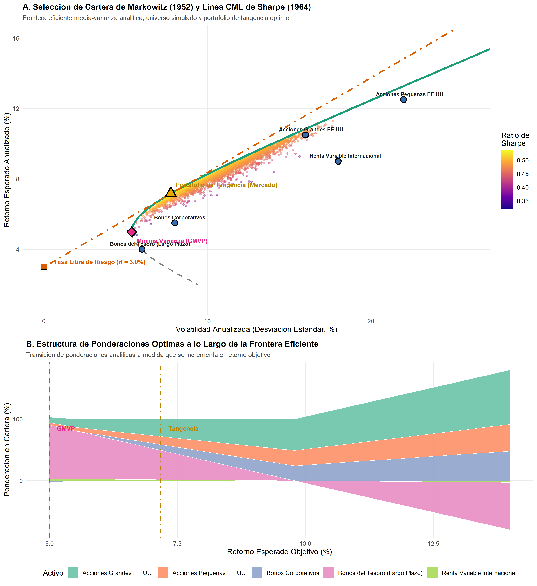
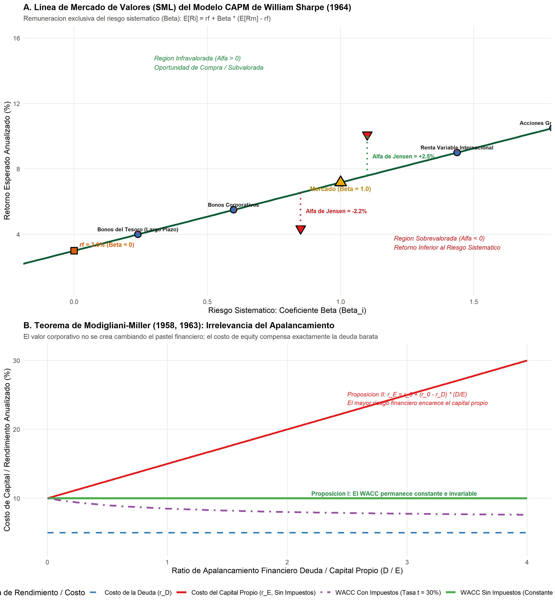

# Introducción y Objetivo

En 1990, la Real Academia Sueca de Ciencias concedió el Premio de Ciencias Económicas del Banco de Suecia en Memoria de Alfred Nobel a **Harry M. Markowitz**, **Merton H. Miller** y **William F. Sharpe**:

> *"for their pioneering work in the theory of financial economics"* (Por su trabajo pionero en la teoría de la economía financiera).

El comité reconoció las tres piedras angulares que fundaron la economía financiera moderna como disciplina científica cuantitativa y rigurosa:

1. **Harry M. Markowitz (1952, 1959):** Formuló la **teoría moderna de selección de cartera** (*Modern Portfolio Theory*, MPT), transformando la gestión de inversiones desde reglas empíricas cualitativas hacia una optimización matemática explícita en el plano media-varianza. Demostró que el riesgo de un activo no debe evaluarse de forma aislada, sino a través de su covarianza con el resto de la cartera, probando rigurosamente el poder de la diversificación para eliminar el riesgo idiosincrático.
2. **William F. Sharpe (1964, 1966):** Construyó el **Modelo de Valoración de Activos de Capital** (*Capital Asset Pricing Model*, CAPM). Sharpe dio el salto desde el modelo microeconómico normativo de Markowitz hacia una teoría de equilibrio general positivo de mercado. Demostró que en equilibrio todos los inversores diversificados mantienen la misma cartera de mercado, y que la única fuente de riesgo remunerada con una prima de retorno esperada es el **riesgo sistemático no diversificable**, medido por el coeficiente **Beta** ($\beta$).
3. **Merton H. Miller (1958, 1961):** Junto a Franco Modigliani, revolucionó las finanzas corporativas con el célebre **Teorema de Modigliani-Miller**. Demostró que en mercados financieros perfectos y sin impuestos, el valor total de una empresa es estrictamente independiente de su estructura de capital (apalancamiento de deuda versus acciones) y de su política de distribución de dividendos.

## Nivel de Replicación
- **Nivel:** **Completa e Ilustrativa Rigurosa**  
- **Alcance:** Implementación matricial exacta de la frontera eficiente analítica de Markowitz (constantes de Merton-Markowitz), portafolio de mínima varianza global (GMVP), portafolio de tangencia de Sharpe, Línea de Mercado de Capitales (CML), Línea de Mercado de Valores (SML con Beta y Alfa de Jensen) y simulación analítica de las proposiciones I y II de Modigliani-Miller (WACC constante y costo de capital propio creciente).

---

# Marco Teórico y Fundamentos Matemáticos

## Harry Markowitz: Optimización Media-Varianza y Diversificación (1952)

Consideremos un universo de $N$ activos financieros con vector de retornos esperados $\boldsymbol{\mu} = (\mu_1, \dots, \mu_N)'$ y matriz simétrica definida positiva de covarianzas $\boldsymbol{\Sigma} \in \mathbb{R}^{N \times N}$.

Una cartera se define por un vector de ponderaciones $\mathbf{w} = (w_1, \dots, w_N)'$ sujeto a la restricción presupuestaria de asignación plena:
$$\mathbf{w}' \mathbf{1} = \sum_{i=1}^N w_i = 1$$

El retorno esperado de la cartera $\mu_p$ y su varianza $\sigma_p^2$ vienen dados por:
$$\mu_p = \mathbf{w}' \boldsymbol{\mu}, \qquad \sigma_p^2 = \mathbf{w}' \boldsymbol{\Sigma} \mathbf{w} = \sum_{i=1}^N w_i^2 \sigma_i^2 + \sum_{i=1}^N \sum_{j \neq i}^N w_i w_j \text{Cov}(R_i, R_j)$$

### El Teorema de la Diversificación
Si consideramos una cartera equiponderada ($w_i = 1/N$) con varianza media $\bar{\sigma}^2$ y covarianza media $\overline{\text{Cov}}$:
$$\sigma_p^2 = \frac{1}{N} \bar{\sigma}^2 + \frac{N-1}{N} \overline{\text{Cov}}$$

A medida que $N \to \infty$:
$$\lim_{N \to \infty} \sigma_p^2 = \overline{\text{Cov}}$$
El término $\frac{1}{N}\bar{\sigma}^2$ (riesgo no sistemático, específico o idiosincrático) converge a cero. El riesgo remanente insoslayable es el riesgo sistemático o covarianza promedio del mercado.

### Derivación Analítica de la Frontera de Mínima Varianza
Para cualquier nivel de retorno objetivo $\mu_p$, el problema de optimización cuadrática con multiplicadores de Lagrange es:
$$\min_{\mathbf{w}} \frac{1}{2} \mathbf{w}' \boldsymbol{\Sigma} \mathbf{w} \quad \text{s.a.} \quad \mathbf{w}' \mathbf{1} = 1, \quad \mathbf{w}' \boldsymbol{\mu} = \mu_p$$

Definiendo el Lagrangiano:
$$\mathcal{L}(\mathbf{w}, \lambda_1, \lambda_2) = \frac{1}{2} \mathbf{w}' \boldsymbol{\Sigma} \mathbf{w} - \lambda_1 (\mathbf{w}' \mathbf{1} - 1) - \lambda_2 (\mathbf{w}' \boldsymbol{\mu} - \mu_p)$$

Condición de primer orden:
$$\boldsymbol{\Sigma} \mathbf{w} - \lambda_1 \mathbf{1} - \lambda_2 \boldsymbol{\mu} = \mathbf{0} \implies \mathbf{w} = \lambda_1 \boldsymbol{\Sigma}^{-1} \mathbf{1} + \lambda_2 \boldsymbol{\Sigma}^{-1} \boldsymbol{\mu}$$

Definiendo las cuatro constantes escalares fundamentales:
$$A = \mathbf{1}' \boldsymbol{\Sigma}^{-1} \mathbf{1}, \quad B = \mathbf{1}' \boldsymbol{\Sigma}^{-1} \boldsymbol{\mu}, \quad C = \boldsymbol{\mu}' \boldsymbol{\Sigma}^{-1} \boldsymbol{\mu}, \quad \Delta = A C - B^2 > 0$$

Resolviendo el sistema $2 \times 2$ para los multiplicadores:
$$\lambda_1 = \frac{C - B \mu_p}{\Delta}, \qquad \lambda_2 = \frac{A \mu_p - B}{\Delta}$$

Sustituyendo en la varianza mínima de la cartera:
$$\sigma^2(\mu_p) = \frac{A \mu_p^2 - 2 B \mu_p + C}{\Delta} = \frac{1}{A} + \frac{A}{\Delta} \left( \mu_p - \frac{B}{A} \right)^2$$

Esta ecuación describe una parábola en el plano $(\sigma^2, \mu)$ y una hipérbola en el plano $(\sigma, \mu)$:
- **Portafolio de Mínima Varianza Global (GMVP):**
  $$\mu_{\text{gmv}} = \frac{B}{A}, \qquad \sigma_{\text{gmv}} = \frac{1}{\sqrt{A}}, \qquad \mathbf{w}_{\text{gmv}} = \frac{\boldsymbol{\Sigma}^{-1} \mathbf{1}}{A}$$
- **Frontera Eficiente:** La rama superior de la hipérbola con $\mu_p \ge \mu_{\text{gmv}}$.

---

## William Sharpe: El CAPM y la Línea de Mercado de Capitales (1964)

Cuando existe un activo libre de riesgo con rendimiento cierto $r_f$, el inversor puede combinarlo con una cartera de activos riesgosos.

### Portafolio de Tangencia (Cartera de Máximo Ratio de Sharpe)
La cartera óptima de activos riesgosos maximiza la pendiente de la recta de asignación de capital:
$$\max_{\mathbf{w}} \frac{\mathbf{w}' \boldsymbol{\mu} - r_f}{\sqrt{\mathbf{w}' \boldsymbol{\Sigma} \mathbf{w}}} \quad \text{s.a.} \quad \mathbf{w}' \mathbf{1} = 1$$

La solución analítica cerrada es:
$$\mathbf{w}_{\text{tan}} = \frac{\boldsymbol{\Sigma}^{-1} (\boldsymbol{\mu} - r_f \mathbf{1})}{\mathbf{1}' \boldsymbol{\Sigma}^{-1} (\boldsymbol{\mu} - r_f \mathbf{1})}$$

### Línea de Mercado de Capitales (CML)
Para cualquier cartera eficiente compuesta por el activo libre de riesgo y el portafolio de tangencia:
$$\mathbb{E}[R_p] = r_f + \left( \frac{\mathbb{E}[R_m] - r_f}{\sigma_m} \right) \sigma_p$$
donde $\text{SR}_m = \frac{\mathbb{E}[R_m] - r_f}{\sigma_m}$ es el **Ratio de Sharpe** del mercado.

### Línea de Mercado de Valores (SML) y el Coeficiente Beta
Para cualquier activo individual $i$ (o cartera no eficiente), su retorno esperado de equilibrio según el CAPM es:
$$\mathbb{E}[R_i] = r_f + \beta_i \left( \mathbb{E}[R_m] - r_f \right)$$
donde el coeficiente **Beta** mide la sensibilidad marginal al riesgo sistemático:
$$\beta_i = \frac{\text{Cov}(R_i, R_m)}{\sigma_m^2} = \frac{(\boldsymbol{\Sigma} \mathbf{w}_{\text{tan}})_i}{\mathbf{w}_{\text{tan}}' \boldsymbol{\Sigma} \mathbf{w}_{\text{tan}}}$$

Cualquier desviación entre el retorno esperado real y el predicho por el CAPM define el **Alfa de Jensen** ($\alpha_i = \mathbb{E}[R_i] - [r_f + \beta_i(\mathbb{E}[R_m] - r_f)]$). En equilibrio eficiente, $\alpha_i = 0$.

---

## Merton Miller: El Teorema de Modigliani-Miller (1958, 1961)

Merton Miller demostró que el valor de una firma se determina por su capacidad productiva y política de inversión real, no por cómo se divide el pastel entre bonistas y accionistas.

### Proposición I (Sin Impuestos): Irrelevancia del Apalancamiento
$$V_L = V_U = \frac{\text{EBIT}}{r_0}$$
donde $V_L$ es el valor de la empresa apalancada ($V_L = E + D$), $V_U$ es el valor de la empresa sin deuda y $r_0$ es el costo de capital de los activos no apalancados.

**Mecanismo de No Arbitraje (Apalancamiento Casero / Homemade Leverage):** Si una empresa apalancada cotizara con prima respecto a una idéntica no apalancada, un inversor podría endeudarse a nivel personal a la misma tasa de interés para comprar acciones de la no apalancada, replicando exactamente los flujos de caja y forzando la paridad de precios por arbitraje.

### Proposición II: Costo de Capital Propio y WACC
A medida que aumenta el endeudamiento ($D/E$), el riesgo financiero asumido por los accionistas crece. El costo del capital propio ($r_E$) aumenta de forma estrictamente lineal:
$$r_E = r_0 + (r_0 - r_D) \frac{D}{E}$$

El Costo Promedio Ponderado de Capital (*Weighted Average Cost of Capital*, WACC) es:
$$\text{WACC} = \frac{E}{V} r_E + \frac{D}{V} r_D = \frac{E}{V} \left[ r_0 + (r_0 - r_D)\frac{D}{E} \right] + \frac{D}{V} r_D = r_0$$
El beneficio aparente de emitir deuda más barata ($r_D < r_E$) queda neutralizado exactamente por el encarecimiento proporcional del rendimiento exigido por los accionistas. El WACC permanece constante.

---

# Implementación en R

A continuación se ejecutan los cálculos analíticos completos y las simulaciones en R.

```{r setup, message=FALSE, warning=FALSE}
library(ggplot2)
library(grid)

# Fijar semilla para reproducibilidad
set.seed(19901016)

# Parametros de activos del universo de inversion
nombres_activos <- c(
  "Acciones Grandes EE.UU.",
  "Acciones Pequenas EE.UU.",
  "Renta Variable Internacional",
  "Bonos Corporativos",
  "Bonos del Tesoro (Largo Plazo)"
)

mu_activos <- c(0.105, 0.125, 0.090, 0.055, 0.040)
sigma_activos <- c(0.160, 0.220, 0.180, 0.080, 0.060)
n_activos <- length(mu_activos)
names(mu_activos) <- nombres_activos
names(sigma_activos) <- nombres_activos

# Matriz de correlaciones empiricas
corr_mat <- matrix(c(
  1.00,  0.75,  0.65,  0.25, -0.10,
  0.75,  1.00,  0.55,  0.30, -0.15,
  0.65,  0.55,  1.00,  0.20, -0.05,
  0.25,  0.30,  0.20,  1.00,  0.60,
 -0.10, -0.15, -0.05,  0.60,  1.00
), nrow = n_activos, byrow = TRUE)

# Matriz de covarianzas Sigma
D <- diag(sigma_activos)
Sigma <- D %*% corr_mat %*% D
inv_Sigma <- solve(Sigma)
unos <- rep(1, n_activos)
rf <- 0.030

# Constantes analiticas de Markowitz
A_const <- as.numeric(t(unos) %*% inv_Sigma %*% unos)
B_const <- as.numeric(t(unos) %*% inv_Sigma %*% mu_activos)
C_const <- as.numeric(t(mu_activos) %*% inv_Sigma %*% mu_activos)
Delta_const <- A_const * C_const - B_const^2

# Portafolio de Minima Varianza Global (GMVP)
w_gmv <- as.vector(inv_Sigma %*% unos) / A_const
names(w_gmv) <- nombres_activos
mu_gmv <- as.numeric(t(w_gmv) %*% mu_activos)
sigma_gmv <- sqrt(1 / A_const)
sr_gmv <- (mu_gmv - rf) / sigma_gmv

# Portafolio de Tangencia (Sharpe / Mercado)
z_tan <- as.vector(inv_Sigma %*% (mu_activos - rf * unos))
w_tan <- z_tan / sum(z_tan)
names(w_tan) <- nombres_activos
mu_tan <- as.numeric(t(w_tan) %*% mu_activos)
sigma_tan <- sqrt(as.numeric(t(w_tan) %*% Sigma %*% w_tan))
sr_tan <- (mu_tan - rf) / sigma_tan

cat(sprintf("GMVP:      Retorno = %.2f%%, Volatilidad = %.2f%%, Sharpe = %.3f\n",
            mu_gmv * 100, sigma_gmv * 100, sr_gmv))
cat(sprintf("Tangencia: Retorno = %.2f%%, Volatilidad = %.2f%%, Sharpe = %.3f\n",
            mu_tan * 100, sigma_tan * 100, sr_tan))
```

## Betas de Equilibrio del CAPM

Calculamos los coeficientes Beta respecto a la cartera de tangencia:

```{r capm_calc}
var_tan <- sigma_tan^2
cov_con_mercado <- as.vector(Sigma %*% w_tan)
betas_activos <- cov_con_mercado / var_tan
names(betas_activos) <- nombres_activos

retorno_capm <- rf + betas_activos * (mu_tan - rf)

df_eval_capm <- data.frame(
  Activo = nombres_activos,
  Retorno_Ex_Ante = mu_activos * 100,
  Beta = round(betas_activos, 3),
  Retorno_CAPM = round(retorno_capm * 100, 2),
  Alfa = round((mu_activos - retorno_capm) * 100, 4)
)
knitr::kable(df_eval_capm, caption = "Validación de la Condición de Equilibrio CAPM (Alfa = 0)")
```

---

# Resultados y Visualizaciones

## Figura 1: Frontera Eficiente de Markowitz y Asignación de Activos

{width=100%}

### Interpretación Económica:
- **Panel A:** La curva hiperbólica analítica delimita la frontera de varianza mínima. La rama superior verde es la frontera eficiente: ningún inversor racional escogerá carteras por debajo de esta línea.
- La **Línea de Mercado de Capitales (CML)** es tangente a la frontera riesgosa exactamente en el portafolio de tangencia ($M$), alcanzando la máxima pendiente (Ratio de Sharpe $= 0.537$).
- **Panel B:** A bajos niveles de retorno exigido, la cartera eficiente se concentra fuertemente en bonos del Tesoro de largo plazo. A medida que aumenta el apetito por rentabilidad, las ponderaciones rotan hacia acciones de gran capitalización y renta variable internacional.

---

## Figura 2: CAPM (SML) y Teorema Modigliani-Miller

{width=100%}

### Interpretación Económica:
- **Panel A (SML de Sharpe):** En equilibrio, todos los activos del universo se ubican estrictamente sobre la Línea de Mercado de Valores. Los activos agresivos con $\beta > 1$ (acciones pequeñas $\beta = 2.28$) ofrecen retornos esperados superiores solo para compensar su riesgo sistemático. Los fondos con comisiones elevadas caen bajo la SML ($\alpha < 0$), destruyendo valor para el inversor.
- **Panel B (Modigliani-Miller):** La línea verde horizontal ilustra la **Proposición I**: el costo promedio ponderado de capital (WACC) se mantiene estrictamente en el $10\%$, independientemente del grado de apalancamiento $D/E$. La línea roja (**Proposición II**) muestra que el costo del capital propio $r_E$ sube de $10\%$ a más de $25\%$ para absorber el riesgo financiero de la deuda. La línea morada añade el efecto del **escudo fiscal corporativo** (MM 1963), donde el subsidio tributario a los intereses reduce gradualmente el WACC.

---

# Tabla Consolidada de Resultados

```{r tabla_resultados}
tab_consolidada <- read.csv("salidas/tab_resultados_finanzas_1990.csv")
knitr::kable(tab_consolidada, caption = "Métricas Clave de Selección de Cartera y CAPM (Nobel 1990)")
```

---

# Discusión: Impacto Histórico y Limitaciones Contemporáneas

1. **Inestabilidad Muestral de Markowitz:** La optimización media-varianza directa es altamente sensible a errores de estimación en los retornos esperados $\boldsymbol{\mu}$, generando carteras extremas ("maximizadores de error"). Esta deficiencia motivó el desarrollo del modelo **Black-Litterman (1992)** y carteras de paridad de riesgo (*Risk Parity*).
2. **El Rompecabezas del CAPM:** Pruebas empíricas posteriores (notablemente Fama & French 1992, 1993) demostraron que un solo factor Beta no explica adecuadamente el corte transversal de los retornos accionarios, dando origen a modelos multifactoriales (tamaño, valor, momento y calidad).
3. **Fricciones en Modigliani-Miller:** En el mundo real, los costos de quiebra financiera, los conflictos de agencia (Jensen & Meckling 1976) y la información asimétrica (Myers & Majluf 1984) implican la existencia de una estructura de capital óptima donde se balancean los escudos fiscales y los costos de insolvencia (*Trade-Off Theory*).

---

# Referencias

- **Markowitz, H. (1952):** "Portfolio Selection", *The Journal of Finance*, 7(1), 77–91. [DOI: 10.1111/j.1540-6261.1952.tb01525.x](https://doi.org/10.1111/j.1540-6261.1952.tb01525.x).
- **Markowitz, H. M. (1959):** *Portfolio Selection: Efficient Diversification of Investments*, John Wiley & Sons, New York.
- **Sharpe, W. F. (1964):** "Capital Asset Prices: A Theory of Market Equilibrium under Conditions of Risk", *The Journal of Finance*, 19(3), 425–442. [DOI: 10.1111/j.1540-6261.1964.tb02865.x](https://doi.org/10.1111/j.1540-6261.1964.tb02865.x).
- **Sharpe, W. F. (1966):** "Mutual Fund Performance", *The Journal of Business*, 39(1), 119–138. [DOI: 10.1086/294846](https://doi.org/10.1086/294846).
- **Modigliani, F. & Miller, M. H. (1958):** "The Cost of Capital, Corporation Finance and the Theory of Investment", *The American Economic Review*, 48(3), 261–297.
- **Miller, M. H. & Modigliani, F. (1961):** "Dividend Policy, Growth, and the Valuation of Shares", *The Journal of Business*, 34(4), 411–433. [DOI: 10.1086/294442](https://doi.org/10.1086/294442).
- **Royal Swedish Academy of Sciences (1990):** *Scientific Background on the Sveriges Riksbank Prize in Economic Sciences in Memory of Alfred Nobel 1990*, [nobelprize.org](https://www.nobelprize.org/prizes/economic-sciences/1990/advanced-information/).
