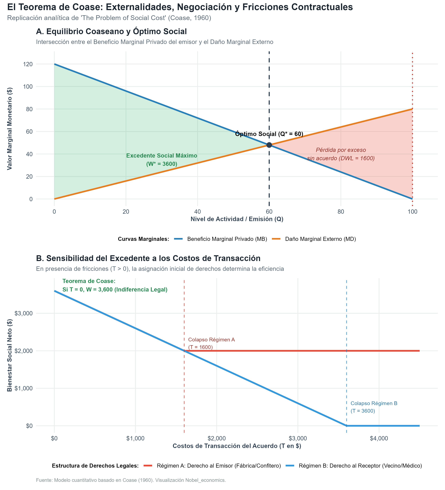
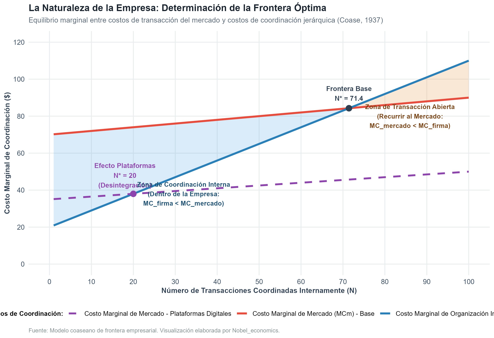

# Introducción y Objetivo

Este documento desarrolla la formalización analítica y computacional de las contribuciones cardinales de **Ronald H. Coase**, galardonado con el Premio del Banco de Suecia en Ciencias Económicas en Memoria de Alfred Nobel en 1991:

> *"for his discovery and clarification of the significance of transaction costs and property rights for the institutional structure and functioning of the economy"* (Por su descubrimiento y clarificación del significado de los costos de transacción y los derechos de propiedad para la estructura institucional y el funcionamiento de la economía).

Antes de la obra de Coase, la teoría económica estándar operaba bajo el supuesto implícito de un sistema de precios perfectamente fluido y sin fricciones: los intercambios ocurrían sin costo alguno en un vacío institucional, las empresas eran cajas negras representadas por funciones de producción tecnocráticas, y las fallas de mercado (externalidades) se "resolvían" mecánicamente mediante impuestos correctivos del Estado ideados por Arthur C. Pigou.

Coase derribó este paradigma a través de dos artículos seminales que redefinieron para siempre la microeconomía aplicada, la organización industrial y el análisis económico del derecho (*Law and Economics*):

1. **"The Nature of the Firm" (1937):** Planteó la pregunta elemental que los economistas habían pasado por alto: *Si los mercados coordinan la producción eficientemente mediante el sistema de precios, ¿por qué existen las empresas y las jerarquías de mando?* Su respuesta fundacional fue que **utilizar el mecanismo de precios de mercado acarrea costos** (costos de transacción: descubrir precios, negociar contratos, redactar cláusulas de contingencia). Una empresa sustituye el mercado por la dirección interna del empresario cuando el costo de organizar internamente una transacción es inferior al costo de transarla en el mercado abierto.
2. **"The Problem of Social Cost" (1960):** Formuló una crítica devastadora a la tradición pigouviana de externalidades. Coase demostró que las externalidades tienen una **naturaleza recíproca** (evitar el daño a la víctima necesariamente impone un daño al causante). Demostró que, si los costos de transacción fuesen nulos y los derechos de propiedad estuviesen claramente delimitados, las partes negociarían privadamente hasta alcanzar la asignación de recursos socialmente eficiente, independientemente de a quién se le asignara inicialmente el derecho legal (**Teorema de Coase**). Lejos de sostener que vivimos en ese mundo ideal, Coase enfatizó lo contrario: en el mundo real, los costos de transacción son omnipresentes y positivos ($T > 0$), por lo que **la delimitación legal de los derechos y el diseño de las instituciones importan de manera decisiva para la eficiencia económica**.

## Declaración del Nivel de Replicación
- **Nivel:** **Ilustrativa y analítica**.
- Se reproduce la estructura formal del Teorema de Coase bajo asignación alternativa de derechos legales y costos de transacción continuos.
- Se formaliza el modelo marginalista de la frontera óptima de la empresa comparando el costo marginal de acudir al mercado vs. el costo de coordinación interna.
- Se integran los resultados computacionales del script autónomo en R `teorema_coase_y_costos_transaccion.R`.

---

# ¿Qué vas a aprender?

1. Comprender la **naturaleza recíproca del daño social** en presencia de externalidades frente a la visión unidireccional tradicional.
2. Formular algebraicamente el **Teorema de Coase** y verificar la propiedad de invarianza de la asignación de recursos cuando los costos de transacción son nulos ($T = 0$).
3. Demostrar rigurosamente cómo la presencia de **costos de transacción positivos ($T > 0$)** quiebra la invarianza coaseana y hace indispensable que los tribunales o los legisladores asignen los derechos de propiedad a la parte que más los valora o con menor costo de evitación.
4. Modelar la **frontera óptima de la empresa** (Coase, 1937) a partir del equilibrio entre costos marginales de transacción de mercado ($MC_m$) y costos marginales de organización jerárquica interna ($MC_f$).
5. Analizar el impacto de la **revolución digital y las plataformas bilaterales** (desintegración vertical y auge del outsourcing) frente a las tecnologías de gestión corporativa con inteligencia artificial (expansión del tamaño de la firma).

---

# Marco Teórico

## 1. El Problema del Costo Social y el Teorema de Coase (1960)

### La Naturaleza Recíproca del Conflicto

El enfoque estándar previo a Coase (asociado a Arthur Pigou en *The Economics of Welfare*, 1920) concebía las externalidades como agresiones unilaterales: si el confitero hace ruido con su mortero e incomoda al médico (*Sturges v. Bridgman*, 1879), o si una fábrica contamina el lago de un piscicultor, la receta inmediata era imponer un impuesto correctivo pigouviano a la fábrica o emitir una orden judicial de clausura (*injunction*).

Coase advirtió la falacia de esta perspectiva:

> *"La cuestión se concibe habitualmente como una en la que A causa un daño a B, y lo que se debe decidir es: ¿cómo debemos restringir a A? Pero esto es erróneo. Estamos tratando con un problema de naturaleza recíproca. Evitar el daño a B infligirá un daño a A. La verdadera cuestión que debe decidirse es: ¿debe permitirse que A dañe a B o que B dañe a A? El objetivo es evitar el daño más grave."* (Coase, 1960, p. 2).

### Formalización del Modelo Coaseano

Consideremos dos agentes económicos:
- **Agente 1 (Emisor):** Realiza una actividad productiva con nivel de intensidad $Q \ge 0$ (por ejemplo, volumen de producción con emisión de ruido o vertidos). Su beneficio privado es estrictamente cóncavo:
  $$B(Q) = p_0 Q - \frac{1}{2} b Q^2, \quad \text{con } p_0, b > 0$$
  El beneficio marginal privado del emisor es:
  $$MB(Q) = \frac{\partial B}{\partial Q} = p_0 - b Q$$

- **Agente 2 (Receptor):** Sufre una desutilidad o daño monetario creciente y convexo debido a la actividad de 1:
  $$D(Q) = \frac{1}{2} c Q^2, \quad \text{con } c > 0$$
  El daño marginal externo sufrido por el receptor es:
  $$MD(Q) = \frac{\partial D}{\partial Q} = c Q$$

El **bienestar social neto agregado** (excedente social) se define como:
$$W(Q) = B(Q) - D(Q) = p_0 Q - \frac{1}{2} (b + c) Q^2$$

#### La Asignación Socialmente Óptima (Primer Mejor)

El planificador social benevolente maximiza $W(Q)$ igualando el beneficio marginal al daño marginal ($MB(Q) = MD(Q)$):
$$p_0 - b Q^* = c Q^* \implies Q^* = \frac{p_0}{b + c}$$

El excedente social máximo correspondiente es:
$$W(Q^*) = \frac{1}{2} \frac{p_0^2}{b + c}$$

#### Régimen Legal A: Derecho Asignado al Emisor (Permiso de Emisión)
Si los tribunales declaran que la fábrica tiene derecho ilimitado a realizar su actividad, el emisor operará unilateralmente donde su beneficio marginal privado sea nulo:
$$MB(Q_{priv}) = 0 \implies p_0 - b Q_{priv} = 0 \implies Q_{priv} = \frac{p_0}{b} > Q^*$$

En este punto sin negociación, el bienestar social es:
$$W(Q_{priv}) = B(Q_{priv}) - D(Q_{priv}) = \frac{p_0^2}{2b} - \frac{c p_0^2}{2b^2} < W(Q^*)$$

La pérdida irrecuperable de eficiencia social (*deadweight loss*, DWL) por sobreproducción es:
$$DWL_A = W(Q^*) - W(Q_{priv}) = \frac{c p_0^2}{2 b (b + c)} > 0$$

#### Régimen Legal B: Derecho Asignado al Receptor (Silencio o Cese de Actividad)
Si los tribunales conceden al vecino el derecho absoluto al silencio o la clausura, en ausencia de negociación la actividad se paraliza:
$$Q_{rec} = 0 \implies W(0) = 0$$

La pérdida de eficiencia por subproducción es:
$$DWL_B = W(Q^*) - W(0) = W(Q^*) = \frac{1}{2} \frac{p_0^2}{b + c}$$

### La Negociación Coaseana con Costos de Transacción Nulos ($T = 0$)

- **Bajo Régimen Legal A (status quo $Q = Q_{priv}$):**
  Para cada unidad producida entre $Q^*$ y $Q_{priv}$, el daño marginal que sufre el receptor excede el beneficio marginal del emisor ($MD > MB$). El receptor está dispuesto a pagar al emisor una compensación $P$ por unidad para que reduzca la producción hasta $Q^*$.
  El excedente bruto total generado por el acuerdo de reducción es:
  $$\Delta W_A = W(Q^*) - W(Q_{priv}) = DWL_A$$
  Cualquier transferencia monetaria neta pactada entre las partes distribuirá este excedente, alcanzándose exactamente $Q = Q^*$.

- **Bajo Régimen Legal B (status quo $Q = 0$):**
  Para cada unidad entre $0$ y $Q^*$, el beneficio marginal del emisor supera con creces el daño del receptor ($MB > MD$). El emisor puede compensar al receptor con un pago que cubra sus daños y retener una ganancia positiva.
  El excedente bruto generado por autorizar la actividad hasta el óptimo es:
  $$\Delta W_B = W(Q^*) - 0 = W(Q^*)$$
  Se alcanza nuevamente la cantidad eficiente $Q = Q^*$.

**Conclusión del Teorema de Coase:** Con derechos claros y costos de transacción cero, el nivel de producción real y la eficiencia social son idénticos e independientes de a quién favorezca la ley. La asignación inicial de derechos solo afecta la **distribución de la riqueza** entre los agentes, pero no la asignación física de recursos.

### El Mundo Real: Costos de Transacción Positivos ($T > 0$)

En la realidad, negociar implica costos: localizar a los afectados, recopilar información, coordinar a múltiples vecinos (problema del polizón o *free rider*), contratar abogados y fiscalizar el cumplimiento de acuerdos.

Sea $T \ge 0$ el costo total de transacción requerido para consumar el pacto.
- Las partes negociarán si y solo si la ganancia social bruta del pacto excede el costo de transacción:
  $$\Delta W > T$$
- Si $\Delta W > T$, el acuerdo se materializa y el excedente social neto es $W(Q^*) - T$.
- Si $\Delta W \le T$, **la negociación colapsa**, y la economía queda atrapada en el resultado legal inicial.

Dado que $\Delta W_A \ne \Delta W_B$, si el costo de transacción $T$ se ubica en el intervalo intermedio:
$$\Delta W_A < T < \Delta W_B$$
el Régimen A colapsará en ineficiencia ($Q = Q_{priv}$), mientras que bajo el Régimen B la negociación sí podrá costear $T$ y alcanzar el óptimo $Q^*$.

Por ende, **cuando los costos de transacción son positivos, la regla legal determina la asignación de recursos y la riqueza social**. De ahí la máxima de Coase: los tribunales y el marco regulatorio deben estructurarse de modo que asignen los derechos a la parte que tenga el menor costo de evitación del daño o que minimicen los costos agregados de fricción contractual.

---

## 2. La Naturaleza de la Empresa y sus Fronteras Óptimas (1937)

En su célebre artículo de 1937, Coase observó la coexistencia paradójica entre dos métodos de asignación:
- El **mercado**, donde la coordinación es descentralizada a través del sistema de precios.
- La **empresa**, donde la coordinación es centralizada y jerárquica a través de la orden del empresario (*direction*).

### ¿Por qué surgen las empresas?

Recurrir al mercado impone costos:
1. **Costos de búsqueda e información:** Determinar cuáles son los precios relevantes y la calidad de los proveedores.
2. **Costos de negociación y contratación:** Redactar contratos separados para cada insumo, tarea o servicio.
3. **Incertidumbre y contratos incompletos:** En un entorno dinámico, es imposible prever todas las contingencias en un contrato de mercado a largo plazo.

Al constituir una empresa y contratar empleados bajo contratos de trabajo generales, el empresario adquiere el derecho de dirigir la asignación de tareas dentro de ciertos límites convenidos, evitando el costo de celebrar miles de contratos individuales continuos.

### Determinación del Tamaño Óptimo de la Empresa

¿Por qué, entonces, no se organiza toda la economía dentro de una única megaempresa gigantesca (como pretendía la planificación soviética)?

Coase argumentó que la organización jerárquica interna también enfrenta costos crecientes:
1. **Rendimientos decrecientes a la gestión empresarial:** A medida que la empresa se expande, la capacidad del empresario para supervisar y monitorear decae (*managerial diseconomies of scale*).
2. **Pérdida y distorsión de información:** Las jerarquías burocráticas largas retrasan la toma de decisiones y crean problemas de agencia.
3. **Mala asignación de factores:** El empresario puede equivocarse al colocar trabajadores y recursos al no contar con las señales de precios del mercado abierto.

#### Modelo Marginalista de la Frontera Coaseana

Definamos $N$ como la cantidad de transacciones integradas internamente dentro de la firma:
- **Costo marginal de realizar la transacción en el mercado:**
  $$MC_m(N) = m_0 + m_1 N$$
- **Costo marginal de organizar la transacción dentro de la empresa:**
  $$MC_f(N) = g_0 + g_1 N$$

Donde $g_1 > m_1 > 0$, reflejando que los costos internos de congestión administrativa crecen más rápido con la escala que las fricciones del mercado.

La **frontera óptima de la empresa ($N^*$)** se ubica en el punto de indiferencia marginal:
$$MC_f(N^*) = MC_m(N^*) \implies g_0 + g_1 N^* = m_0 + m_1 N^*$$
$$N^* = \frac{m_0 - g_0}{g_1 - m_1}$$

- Para toda transacción $N \le N^*$: $MC_f(N) \le MC_m(N) \implies$ **Integración interna (Hacer / *Make*)**.
- Para toda transacción $N > N^*$: $MC_m(N) < MC_f(N) \implies$ **Contratación externa de mercado (Comprar / *Buy*)**.

---

# Replicación Computacional en R

A continuación se ejecutan los cálculos cuantitativos a partir de los parámetros definidos en el script `teorema_coase_y_costos_transaccion.R`.

## 1. Parámetros del Modelo de Externalidades

Consideramos los siguientes parámetros calibrados:
- Beneficio marginal privado: $MB(Q) = 120 - 1.2 Q$ ($p_0 = 120, b = 1.2$).
- Daño marginal externo: $MD(Q) = 0.8 Q$ ($c = 0.8$).

Resolviendo los equilibrios:
- **Óptimo social:**
  $$Q^* = \frac{120}{1.2 + 0.8} = 60 \text{ unidades}$$
  $$W(Q^*) = 120(60) - \frac{1}{2}(1.2 + 0.8)(60)^2 = 7,200 - 3,600 = \$3,600$$

- **Derecho al Emisor sin pacto:**
  $$Q_{priv} = \frac{120}{1.2} = 100 \text{ unidades}$$
  $$W(Q_{priv}) = [120(100) - 0.6(100)^2] - [0.4(100)^2] = 6,000 - 4,000 = \$2,000$$
  $$\text{Ganancia de negociar } \Delta W_A = 3,600 - 2,000 = \$1,600$$

- **Derecho al Receptor sin pacto:**
  $$Q = 0 \implies W(0) = \$0$$
  $$\text{Ganancia de negociar } \Delta W_B = 3,600 - 0 = \$3,600$$

## 2. Gráficas Generadas de Negociación y Fricciones

La visualización de la negociación coaseana se exportó en alta resolución en la carpeta de salidas:

{#fig-negociacion width=90%}

### Interpretación del Panel A
- El triángulo verde representa el **excedente social máximo** alcanzado en el nivel óptimo $Q^* = 60$, donde el beneficio marginal iguala al daño marginal ($MB = MD = \$48$).
- El triángulo rojo representa la **pérdida irrecuperable de eficiencia social ($DWL = \$1,600$)** si el emisor produce hasta su saciedad privada individual ($Q = 100$). Para todas las unidades entre 60 y 100, el costo para la sociedad excede el valor privado generado.

### Interpretación del Panel B
- Si el costo de transacción es nulo ($T = 0$), ambos regímenes jurídicos convergen exactamente al mismo bienestar social máximo de $\$3,600$. La regla legal de partida es irrelevante para la asignación eficiente de recursos (confirmación gráfica del Teorema de Coase).
- A medida que $T$ se incrementa, el bienestar neto decae linealmente ($W^* - T$).
- Cuando $T > \$1,600$, el acuerdo bajo el Régimen A colapsa y el bienestar cae bruscamente al status quo de $\$2,000$. En cambio, bajo el Régimen B las partes aún pueden absorber hasta $T = \$3,600$ de fricción contractual antes de que la actividad cese por completo.

---

## 3. La Frontera Óptima de la Empresa y la Disrupción Tecnológica

Calibramos los parámetros de la frontera empresarial:
- Caso Base (Economía Tradicional): $m_0 = 70, m_1 = 0.20$ vs. $g_0 = 20, g_1 = 0.90$.
  $$N^*_{base} = \frac{70 - 20}{0.90 - 0.20} = \frac{50}{0.70} \approx 71.4 \text{ transacciones internas}$$

- Disrupción por Plataformas Digitales (reducción radical de costos de transacción en el mercado abierto):
  $m_0' = 35, m_1' = 0.15$.
  $$N^*_{digital} = \frac{35 - 20}{0.90 - 0.15} = \frac{15}{0.75} = 20.0 \text{ transacciones internas}$$

{#fig-frontera width=85%}

### Interpretación de la Frontera Coaseana
- A la izquierda de la frontera ($N < N^*$), el costo marginal de organización interna jerárquica es menor al costo de contratar en el mercado ($MC_f < MC_m$). Conviene coordinar internamente mediante subordinación laboral.
- A la derecha de la frontera ($N > N^*$), las ineficiencias de supervisión interna superan los costos de búsqueda y contratación del mercado abierto. Conviene subcontratar o comprar en el mercado abierto.
- La caída de los costos de transacción generada por internet, plataformas de comercio electrónico y APIs reduce la escala integrada óptima de $71.4$ a $20.0$, explicando analíticamente la tendencia contemporánea hacia empresas más delgadas (*lean organizations*), trabajo independiente (*freelancing*) y cadenas de suministro modulares.

---

## 4. Tabla de Resultados Numéricos

Los resultados consolidados exportados por el script se presentan a continuación:

```{r}
#| echo: false
#| message: false
tab_coase <- readr::read_csv("salidas/tab_resultados_coase.csv")
knitr::kable(tab_coase, caption = "Resultados Analíticos y Cuantitativos de los Modelos de Ronald H. Coase (1937, 1960)")
```

---

# Discusión Teórica y Legado

## El Mito del "Cero Costos de Transacción"

Uno de los mayores malentendidos en la historia del pensamiento económico consistió en atribuir a Coase la creencia ingenua de que los mercados resuelven automáticamente cualquier problema ambiental o contractual sin intervención estatal.

En su libro recopilatorio *The Firm, the Market, and the Law* (1988) y en su conferencia Nobel (1991), Coase dedicó extensos pasajes a desmentir esta distorsión:

> *"El mundo de costos de transacción nulos es a menudo denominado como un 'mundo coaseano'. Nada podría estar más lejos de la verdad. Fue el mundo de la teoría económica contemporánea el que asumió costos de transacción nulos. Lo que yo hice fue mostrar que, en ese mundo, los impuestos pigouvianos y la delimitación de derechos eran irrelevantes; y que, por ende, para entender el mundo real, teníamos que introducir los costos de transacción en el centro de nuestro análisis."* (Coase, 1992, p. 717).

## De Coase a Williamson y Hart: La Nueva Economía Institucional

El trabajo de Coase sentó las bases para el desarrollo de la **Nueva Economía Institucional** (*New Institutional Economics*):
1. **Oliver E. Williamson (Nobel 2009):** Operacionalizó los costos de transacción de Coase mediante los conceptos de **especificidad de activos**, **racionalidad limitada** y **oportunismo post-contractual**. Cuando las inversiones son altamente específicas de una relación bilateral, el riesgo de expropiación (*hold-up problem*) dispara los costos de transacción del mercado y hace indispensable la integración vertical jerárquica.
2. **Oliver Hart y Bengt Holmström (Nobel 2016):** Desarrollaron la **Teoría de Contratos Incompletos** (Grossman-Hart-Moore). Como no es posible redactar contratos que prevean todas las contingencias futuras, la propiedad de los activos físicos otorga los **derechos residuales de control** (*residual control rights*), determinando el poder de negociación en caso de contingencias no estipuladas.

---

# Conclusión

Las ideas de Ronald Coase demostraron que las leyes, las normas de responsabilidad civil y las estructuras organizacionales no son detalles superficiales ajenos a la microeconomía, sino los pilares mismos sobre los cuales descansa la asignación de recursos escasos. Cuando los costos de transacción existen, el marco legal y contractual determina qué intercambios se producen, qué empresas se crean y cuánta riqueza puede prosperar en una sociedad.
