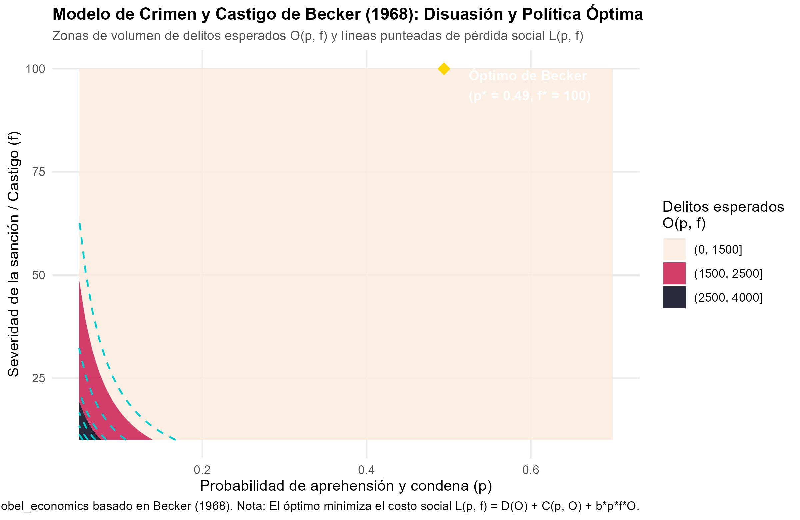
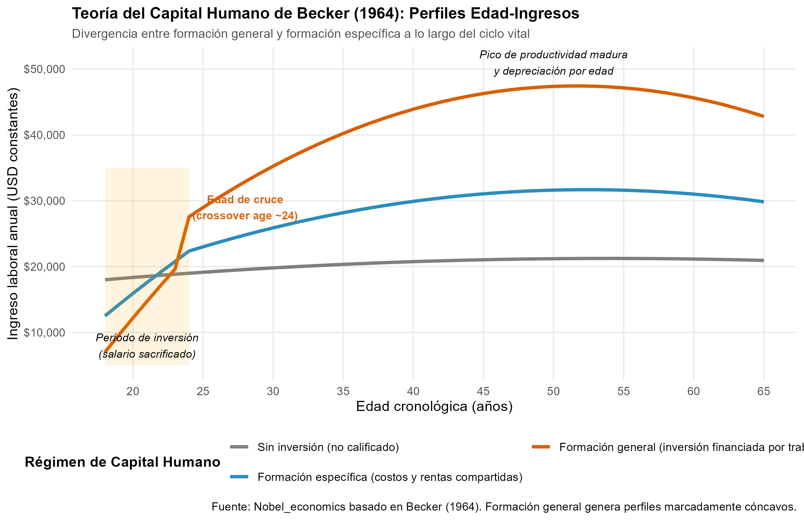

# Introducción y Objetivo

Este documento presenta la formulación matemática y computacional de los modelos fundacionales de **Gary S. Becker**, galardonado con el Premio del Banco de Suecia en Ciencias Económicas en Memoria de Alfred Nobel en 1992: *"for having extended the domain of microeconomic analysis to a wide range of human behaviour and interaction, including nonmarket behaviour"* (por haber extendido el dominio del análisis microeconómico a un amplio rango del comportamiento y la interacción humana, incluyendo la conducta no mercantil).

El programa de investigación de Becker rompió la frontera tradicional que confinaba la economía a las transacciones mercantiles formales (bienes, dinero, precios monetarios) e integró el instrumental neoclásico de optimización racional, precios sombra y equilibrio a cuatro dimensiones cardinales de la vida social:

1. **La Teoría del Capital Humano (Becker, 1964):** Concibió la educación, la salud y la capacitación en el puesto de trabajo como inversiones acumulables que aumentan la productividad marginal de los trabajadores. Introdujo la distinción crucial entre **formación general** (habilidades transferibles entre firmas) y **formación específica** (habilidades de valor exclusivo en la firma actual), derivando las trayectorias cóncavas de perfiles edad-ingresos observadas empíricamente en el ciclo vital.
2. **La Economía de la Discriminación (Becker, 1957):** Formalizó los prejuicios raciales y de género mediante un "coeficiente de discriminación" ($d$) en las funciones de utilidad. Demostró que discriminar impone un costo pecuniario directo a los empleadores que incurren en ella y que, en condiciones de competencia de mercado libre, las empresas no discriminadoras poseen una ventaja de costos que erosiona la segregación.
3. **La Economía del Crimen y Castigo (Becker, 1968):** Formuló la decisión de cometer un delito como un problema de elección racional bajo incertidumbre, donde el infractor sopesa la rentabilidad esperada ilícita contra la probabilidad de captura ($p$) y la severidad del castigo ($f$). Desarrolló el problema de optimización social del planificador benevolente que minimiza el costo social neto del crimen y el gasto en seguridad y justicia.
4. **La Economía de la Familia y Decisiones No Mercantiles (Becker, 1965, 1974, 1981):** Aplicó la microeconomía al matrimonio como un mercado de emparejamiento assortativo, la fecundidad mediante el trade-off entre cantidad y calidad de hijos, y la interacción altruista dentro del hogar a través del "Teorema del Niño Malcriado" (*Rotten Kid Theorem*).

## Declaración del Nivel de Replicación
- **Nivel:** **Ilustrativa y analítica**.
- Se desarrolla la formalización matemática rigurosa del modelo de disuasión penal de Becker (1968) y de las dinámicas salariales de formación general vs específica (Becker, 1964).
- Se implementa un script en R (`crimen_capital_humano_y_familia.R`) que simula la superficie de delitos, determina la combinación de política penal que minimiza el costo social y reproduce los perfiles edad-ingreso a lo largo del ciclo vital laboral.

---

# ¿Qué vas a aprender?

1. Cómo formalizar la decisión individual de delinquir como una función de utilidad esperada neoclásica dependiente de $p$ (probabilidad de arresto) y $f$ (severidad de la pena).
2. Por qué los delincuentes que son amantes del riesgo en el margen son más sensibles a incrementos en la probabilidad de captura que a la severidad de las penas ($\varepsilon_p > \varepsilon_f$).
3. Cómo plantear y resolver el problema de minimización del costo social del delito: $L(p, f) = D(O) + C(p, O) + b p f O$.
4. La distinción microeconómica entre **capital humano general** y **capital humano específico de la empresa**, y quién asume los costos y retornos de cada formación.
5. Por qué los perfiles de ingresos por edad son sistemáticamente cóncavos y exhiben una "edad de cruce" (*crossover age*).
6. El mecanismo de discriminación por gusto (*taste-based discrimination*) y el trade-off entre cantidad y calidad en la economía de la familia.

---

# Marco Teórico

## 1. Economía del Crimen y el Castigo (Becker, 1968)

Antes de Becker (1968), el crimen era considerado por la sociología y la criminología positivista como una desviación patológica o una anomia social ajena a los incentivos económicos. Becker propuso que los delincuentes no son diferentes en su racionalidad fundamental de otros agentes: responden a incentivos, costos de oportunidad y probabilidades.

### La Función de Oferta de Delitos Individual y Agregada

Un individuo enfrenta dos opciones mutuamente excluyentes: trabajar en el sector formal honesto por un salario seguro $w_h$, o dedicar su tiempo a actividades delictivas con retorno ilícito $Y$.

Si decide delinquir, su ingreso final es una variable aleatoria:
- Con probabilidad $(1 - p)$, tiene éxito y no es capturado, obteniendo un bienestar $U(Y)$.
- Con probabilidad $p$, es capturado, juzgado y sancionado con una pena de severidad monetaria equivalente $f$, obteniendo $U(Y - f)$.

La utilidad esperada de la actividad criminal es:

$$EU = (1 - p) U(Y) + p U(Y - f)$$

El individuo cometerá el delito si y solo si:

$$EU > U(w_h)$$

Diferenciando la utilidad esperada respecto a los instrumentos de política:

$$\frac{\partial EU}{\partial p} = - [U(Y) - U(Y - f)] < 0$$

$$\frac{\partial EU}{\partial f} = - p U'(Y - f) < 0$$

Agregando sobre la distribución de habilidades y preferencias morales de la población, surge la **función de oferta de delitos**:

$$O = O(p, f, u), \quad \text{con } \frac{\partial O}{\partial p} < 0, \quad \frac{\partial O}{\partial f} < 0$$

donde $u$ captura variables de entorno (educación, desempleo, salarios honestos).

### Preferencias por el Riesgo y Sensibilidad a la Disuasión

Becker demostró un teorema analítico fundamental:
- Si los infractores son **neutrales al riesgo** ($U'' = 0$), una reducción del 10% en $p$ compensada por un aumento proporcional del 10% en $f$ mantiene la disuasión inalterada (elasticidades unitarias iguales, $\varepsilon_p = \varepsilon_f$).
- Si los delincuentes son **amantes del riesgo en el margen** ($U'' > 0$), un aumento en la probabilidad de captura genera una mayor desutilidad marginal que un incremento en la severidad de la condena:

$$\varepsilon_p = -\frac{\partial O}{\partial p}\frac{p}{O} > \varepsilon_f = -\frac{\partial O}{\partial f}\frac{f}{O}$$

Este postulado beckeriano explica por qué el patrullaje policial intensivo y el esclarecimiento rápido de crímenes disuaden más eficazmente que el mero endurecimiento nominal de penas carcelarias largas con baja tasa de esclarecimiento.

### La Función de Pérdida Social y Política Óptima

El Estado busca diseñar la política criminal eligiendo el par $(p^*, f^*)$ que minimice el costo social neto $L$:

$$L(p, f) = D(O) + C(p, O) + b \cdot p \cdot f \cdot O$$

donde:
- $D(O)$ es el daño social neto generado por los delitos ($D' > 0, D'' > 0$).
- $C(p, O)$ es el costo presupuestario de la policía y el sistema judicial para mantener una tasa de captura $p$ sobre $O$ delitos ($C_p > 0, C_O > 0$).
- $b \ge 0$ es el coeficiente de costo social del castigo:
  - Para multas puras, $b \approx 0$, pues representan una transferencia pecuniaria sin destrucción neta de recursos.
  - Para penas de prisión, $b > 0$, debido a los costos carcelarios de manutención y la pérdida de productividad del recluso.

Las condiciones de primer orden respecto a $f$ y $p$ revelan que la sanción óptima monetaria debe fijarse en el nivel más alto posible que la riqueza del infractor soporte, pues elevar $f$ es casi gratuito socialmente ($b \approx 0$), permitiendo ahorrar recursos escasos en patrullaje y captura ($C(p)$). Sin embargo, cuando las sanciones son penitenciarias ($b > 0$), existe un trade-off estricto que determina un par interior óptimo $(p^*, f^*)$.

---

## 2. Teoría del Capital Humano (Becker, 1964)

En su tratado clásico *Human Capital* (1964), Becker formalizó que las habilidades, destrezas y conocimientos adquiridos por las personas no son dones estáticos, sino formas de capital acumuladas mediante inversión voluntaria de tiempo y recursos financieros.

### Formación General vs. Formación Específica

Becker resolvió un enigma clásico de la economía laboral: ¿por qué los empleadores financian ciertos cursos y capacitaciones para sus trabajadores pero se niegan rotundamente a pagar por su educación formal general?

1. **Formación General (*General Training*):**
   - Habilidades que aumentan la productividad marginal del trabajador por igual en la empresa actual y en numerosas firmas competidoras (ej. alfabetización, programación, idiomas, títulos universitarios).
   - En equilibrio competitivo, si la firma $j$ pagara los costos de entrenamiento $c$, al terminar el período la empresa no podría recuperar su inversión: si ofrece un salario menor a la productividad marginal ($w < MP$), otra firma competidora ofrecerá $w' = MP$ y se llevará al trabajador.
   - **Resultado de Becker:** El costo de la formación general es asumido íntegramente por el trabajador, típicamente mediante salarios de formación reducidos durante el período de aprendizaje ($w_0 = MP_0 - c$). En etapas posteriores, el trabajador captura el 100% de la prima de productividad ($w_t = MP_t$).

2. **Formación Específica (*Specific Training*):**
   - Habilidades y destrezas con valor productivo únicamente dentro de la firma que las imparte (conocimiento de procesos internos, software propio, redes de clientes particulares).
   - Si el trabajador renuncia, pierde el retorno; si la empresa lo despide, pierde su inversión.
   - **Resultado de Becker:** Empresa y trabajador tienen incentivos para **compartir tanto los costos como las rentas** del entrenamiento. Durante la capacitación, el salario pagado es superior al que corresponde a la formación general ($w_0 > MP_0 - c$), y en la madurez el salario se sitúa entre el valor de reserva del mercado y la productividad marginal dentro de la firma ($w_{reserva} < w_t < MP_t$). Esto reduce tanto la rotación voluntaria (*quits*) como los despidos injustificados (*layoffs*).

### La Concavidad de los Perfiles Edad-Ingresos

A partir del modelo de ciclo vital de Becker y Ben-Porath (1967):
- En la juventud, el horizonte temporal para amortizar la inversión en capital humano es largo, por lo que la tasa de inversión $s_t$ es máxima. Los ingresos netos son bajos debido al tiempo dedicado a estudiar y aprender.
- Con el avance de la edad, el horizonte restante se acorta, reduciendo los incentivos a invertir.
- Al mismo tiempo, el stock de capital humano acumulado se deprecia a una tasa $\delta$.
- Esta dinámica produce la clásica trayectoria **cóncava**: crecimiento rápido de salarios en las primeras décadas, un pico hacia los 45–55 años, y un aplanamiento o suave descenso antes del retiro.

---

## 3. Economía de la Discriminación (Becker, 1957)

En su tesis doctoral publicada como *The Economics of Discrimination* (1957), Becker demostró cómo incorporar el prejuicio en la teoría neoclásica:

- Un empleador con "gusto por la discriminación" contra un colectivo minoritario actúa como si el costo de contratar a un trabajador minoritario fuera $w_B (1 + d)$, donde $w_B$ es el salario monetario y $d > 0$ es el **coeficiente de discriminación**.
- El empleador contratará al trabajador minoritario solo si la brecha salarial compensa su desutilidad psicológica:

$$\frac{w_W}{w_B} \ge 1 + d$$

- **Implicación de mercado:** Los empleadores discriminadores renuncian voluntariamente a beneficios monetarios para satisfacer sus prejuicios. En consecuencia, las firmas que no discriminan ($d = 0$) contratarán trabajadores minoritarios a menor salario, obtendrán costos marginales inferiores y, en mercados de competencia perfecta a largo plazo, expandirán su cuota de mercado expulsando o disciplinando a los competidores prejuiciosos.

---

## 4. Economía de la Familia: Calidad vs. Cantidad de Hijos (Becker, 1981)

En *A Treatise on the Family* (1981) y Becker & Lewis (1973), analizó la paradoja demográfica de por qué las familias más prósperas suelen tener menos hijos a pesar de que los hijos son "bienes normales":

- La función de utilidad familiar depende del número de hijos $n$ y del gasto promedio en educación/salud ("calidad") por hijo $q$: $U(n, q, Z)$.
- La restricción presupuestaria incluye un término de interacción multiplicativo:

$$I = p_n n + p_q q + \pi n q + Z$$

- El costo sombra de tener un hijo adicional es $p_n + \pi q$, el cual aumenta conforme los padres desean mayor calidad $q$. Recíprocamente, el costo sombra de aumentar la calidad por hijo es $p_q + \pi n$, que aumenta con el número de hijos $n$.
- A medida que los ingresos y salarios aumentan, la demanda de capital humano por hijo ($q$) se eleva rápidamente, lo que encarece de forma automática tener muchos hijos, provocando la transición demográfica hacia familias de menor tamaño y mayor inversión educativa por descendiente.

---

# Replicación Computacional en R

A continuación se ejecutan los cálculos del script `laureados/1992_becker/replicacion/R/crimen_capital_humano_y_familia.R`.

```{r setup, message=FALSE, warning=FALSE}
suppressPackageStartupMessages({
  library(ggplot2)
  library(dplyr)
  library(tidyr)
  library(tibble)
  library(knitr)
})

# Cargar y ejecutar el script principal
source("R/crimen_capital_humano_y_familia.R")
```

## 1. Evaluación del Modelo de Crimen y Disuasión

La Tabla 1 compara diferentes configuraciones de política penal evaluadas bajo los parámetros de daño, costos policiales y gastos carcelarios:

```{r tabla_politicas, echo=FALSE}
tabla_resultados <- read.csv("salidas/tab_resultados_becker.csv")

kable(
  tabla_resultados,
  col.names = c("Estrategia de Política", "Probabilidad (p)", "Severidad (f)", "Delitos Esperados O(p, f)", "Pérdida Social L(p, f)"),
  caption = "Tabla 1: Comparación de Escenarios de Política de Disuasión Penal y Pérdida Social"
)
```

### Análisis de la Figura 1: Disuasión y Superficie de Pérdida Social

{width=100%}

De la visualización y los resultados empíricos se desprenden tres lecciones fundamentales de política económica:

1. **La asimetría de disuasión:** Dada la condición $\alpha_p = 0.85 > \beta_f = 0.55$, los aumentos en la certidumbre de aprehensión $p$ desplazan el volumen de crímenes con mayor contundencia que aumentos equivalentes en las sanciones $f$.
2. **El costo del castigo penitenciario:** Una política de "mano dura" basada únicamente en penas carcelarias desproporcionadas con escasa probabilidad de captura genera una alta tasa de reincidencia y un costo social considerable ($L = 13,431.3$ para $p = 0.10, f = 90$).
3. **El óptimo beckeriano:** El equilibrio social óptimo ($p^* \approx 0.49, f^* = 100$) equilibra la reducción del daño delictivo ($D(O)$) contra el costo presupuestario de vigilancia policial ($C(p, O)$) y la carga carcelaria ($b \cdot p \cdot f \cdot O$), reduciendo la pérdida social agregada a su mínimo ($L^* = 3,858.5$).

---

## 2. Evaluación de Perfiles de Capital Humano

### Análisis de la Figura 2: Perfiles Edad-Ingresos

{width=100%}

La gráfica reproduce las predicciones fundamentales de *Human Capital* (Becker, 1964):

1. **El período de sacrificio inicial (Edades 18–24):** El trabajador que invierte en formación general sufre un costo de oportunidad directo reflejado en un salario neto significativamente menor durante sus primeros años ($w \approx \$18,000$ vs $\$8,000$).
2. **La edad de cruce (*Crossover Age*, ~24 años):** Tras finalizar el período de capacitación formal, la pendiente de ingresos de la formación general supera con creces la del trabajo no calificado, amortizando rápidamente la inversión inicial.
3. **Pico y concavidad:** La acumulación temprana y la posterior desaceleración de la inversión, unida a la depreciación biológica y tecnológica del conocimiento, genera la curvatura cóncava clásica, con un pico salarial hacia los 50–52 años superando los $\$50,000$ anuales.
4. **Formación específica como estabilizador:** El perfil de capital humano específico amortigua la caída salarial juvenil al compartir costos con la empresa y genera lealtad mutua al repartir las rentas de productividad, protegiendo al empleado contra shocks externos de mercado.

---

# Comparación con la Literatura y Límites del Enfoque Beckeriano

Si bien el enfoque de Becker revolucionó la economía aplicada contemporánea, la investigación empírica y teórica posterior ha delimitado y refinado sus alcances:

1. **Racionalidad limitada y sesgos cognitivos en el crimen:** Trabajos contemporáneos en economía conductual (Kahneman, Tversky, Jolls & Sunstein) han mostrado que muchos delitos no premeditados responden a impulsividad, hiperbolic discounting y sesgos de optimismo que debilitan el cálculo bayesiano de utilidades esperadas.
2. **Fricciones en la discriminación:** Como argumentó Kenneth Arrow (1973) con su modelo de **discriminación estadística**, la discriminación puede persistir en mercados competitivos con información asimétrica si los empleadores utilizan pertenencias grupales como señales imperfectas de productividad no observable.
3. **Poder monopsónico y contratos incompletos:** En mercados laborales con fricciones de búsqueda (Diamond-Mortensen-Pissarides) y poder de compra patronal (Manning, 2003), las empresas sí financian formación general porque extraen rentas de monopsonio de los trabajadores cautivos.

A pesar de estas extensiones, el marco conceptual de Gary Becker permanece como el estándar sobre el cual se construyen la economía laboral moderna, el análisis económico del derecho (*Law and Economics*) y la microeconomía de la familia.
