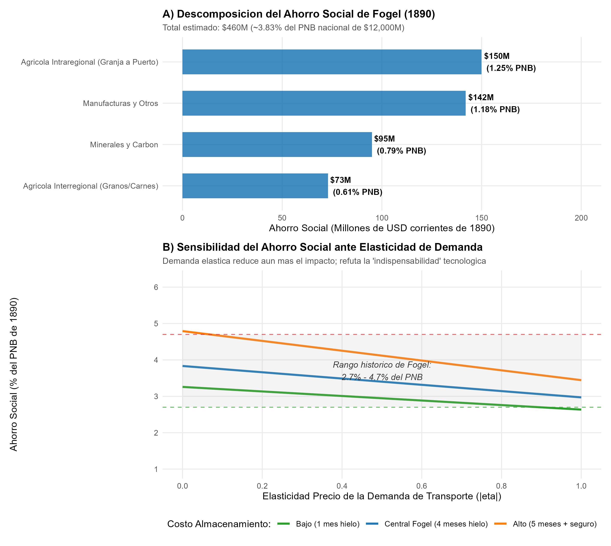
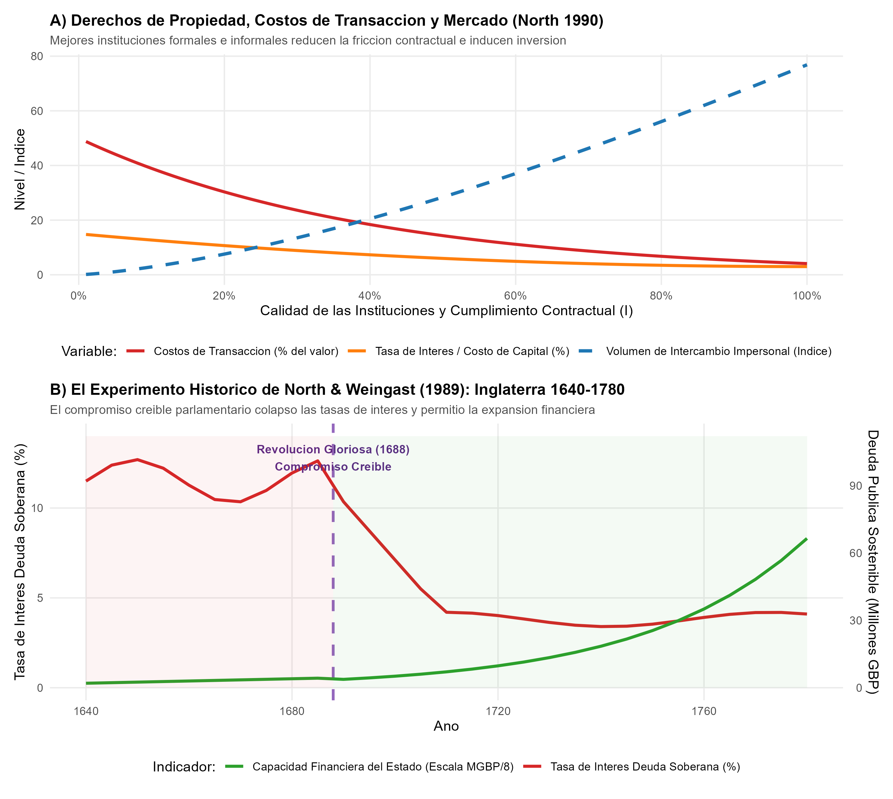

# Introducción y Objetivo

Este documento presenta la replicación analítica y computacional de los aportes seminales que merecieron el Premio del Banco de Suecia en Ciencias Económicas en Memoria de Alfred Nobel en 1993, otorgado conjuntamente a **Robert W. Fogel** y **Douglass C. North**:

> *"for having renewed research in economic history by applying economic theory and quantitative methods in order to explain economic and institutional change"* (por haber renovado la investigación en historia económica aplicando la teoría económica y métodos cuantitativos para explicar el cambio económico e institucional).

Fogel y North fueron los arquitectos centrales de la **Cliometría** (bautizada en honor a Clío, la musa griega de la historia), conocida también como la *Nueva Historia Económica*. Antes de su labor pionera en las décadas de 1960 y 1970, la historia económica era predominantemente narrativa, descriptiva e impresionista, carente de modelos explícitos y comprobación estadística rigurosa. Fogel y North introdujeron la hipótesis contrafáctica formal, la econometría histórica y la teoría de los costos de transacción para responder a las preguntas fundamentales del desarrollo de largo plazo:

1. **Robert W. Fogel (1964):** Desarrolló el método del **ahorro social contrafáctico** (*social saving*) para medir la contribución real de los ferrocarriles al crecimiento de Estados Unidos en el siglo XIX, derribando el dogma historiográfico de que los ferrocarriles fueron una tecnología "indispensable" para la industrialización norteamericana.
2. **Douglass C. North (1973, 1989, 1990):** Fundó la **Nueva Economía Institucional** (*New Institutional Economics*, NIE) aplicada a la historia, demostrando que los factores clásicos de producción (capital físico, mano de obra y tecnología) no son las causas del crecimiento, sino sus manifestaciones; la causa profunda radica en las instituciones y derechos de propiedad que reducen los costos de transacción e imponen un **compromiso creíble** (*credible commitment*) sobre el Estado.

## Declaración del Nivel de Replicación
- **Nivel:** **Ilustrativa y analítica**.
- Se formaliza el cálculo del ahorro social contrafáctico de Fogel (1964) para la economía de Estados Unidos en 1890, analizando su sensibilidad a la elasticidad precio de la demanda de transporte y costos estacionales de almacenamiento.
- Se formaliza y simula el modelo de costos de transacción e instituciones de North (1990) y se replica la evidencia histórica de North & Weingast (1989) sobre la Revolución Gloriosa inglesa de 1688 y el colapso de las primas de riesgo de la deuda pública.

---

# ¿Qué vas a aprender?

1. Cómo construir y evaluar una hipótesis **contrafáctica rigurosa** en economía cuantitativa (*¿qué habría ocurrido si una tecnología o política nunca hubiera existido?*).
2. La definición matemática del **ahorro social** (*social saving*) y su vínculo con el excedente del consumidor y la elasticidad precio de la demanda.
3. Por qué el desarrollo económico moderno depende de la acumulación incremental de múltiples mejoras y no de tecnologías milagrosas aisladas (*axioma de indispensabilidad*).
4. La definición económica formal de **institución** y su impacto en la reducción de costos de transacción (búsqueda, medición, monitoreo y exigibilidad de contratos).
5. El problema de la inconsistencia dinámica del soberano y cómo el **compromiso creíble** constitucional (North y Weingast, 1688) redujo el costo del capital y habilitó el desarrollo del mercado financiero moderno.

---

# Marco Teórico

## 1. Robert W. Fogel y el Ahorro Social de los Ferrocarriles (1964)

### El Axioma de la Indispensabilidad

Durante más de un siglo, historiadores económicos tradicionales y teóricos del desarrollo —como W. W. Rostow en *The Stages of Economic Growth* (1960)— afirmaban que la red ferroviaria fue el motor absolutamente indispensable y catalizador único de la industrialización estadounidense en el siglo XIX. Según esta tesis, sin el ferrocarril, la colonización del Medio Oeste y el surgimiento del gran mercado nacional habrían sido imposibles.

Fogel (1962, 1964) cuestionó frontalmente esta premisa a través de una pregunta metodológica radical: **¿Qué le habría ocurrido al Producto Nacional Bruto (PNB) de Estados Unidos en 1890 si el ferrocarril jamás se hubiera inventado?**

Para contestar esto científicamente, Fogel diseñó el primer modelo contrafáctico formal a gran escala en la historiografía moderna.

### Formalización del Ahorro Social ($SS$)

Fogel definió el ahorro social ($SS$, *social saving*) como la diferencia entre los recursos que la sociedad efectivamente gastó en transportar la carga observada en un año dado ($t = 1890$) mediante el ferrocarril, y los recursos que habría tenido que emplear para transportar ese mismo volumen utilizando la mejor alternativa disponible existente o potencialmente construible (canales, ríos navegables, Grandes Lagos y carretas tiradas por caballos):

$$SS = C_{\text{contrafáctico}} - C_{\text{real}} = \sum_{i} \left( c_{\alpha, i} - c_{r, i} \right) \cdot Q_{i}$$

donde:
- $Q_i$ es el volumen observado de carga transportada del bien o ruta $i$ (en toneladas-milla).
- $c_{r, i}$ es el costo marginal o tarifa unitaria del transporte ferroviario para la ruta $i$.
- $c_{\alpha, i}$ es el costo unitario de la alternativa contrafáctica más económica (vías fluviales/canales y transporte de última milla en carreta).

### Ajuste por Elasticidad y Excedente del Consumidor

La fórmula anterior asume que la demanda de servicios de transporte es perfectamente inelástica ($\eta = 0$), lo que implica que ante el mayor costo de las vías acuáticas la sociedad habría seguido transportando exactamente el mismo tonelaje $Q_i$. Por tanto, el cálculo de $SS$ de Fogel representa un **límite superior estricto** (*upper bound*) del verdadero costo para el bienestar social.

Si la demanda de transporte exhibe elasticidad precio normal ($\eta < 0$), los agentes habrían reaccionado al encarecimiento del flete reduciendo el volumen transportado o relocalizando ciertas actividades agropecuarias e industriales más cerca de los cursos de agua navegables. Integrando el cambio en el excedente del consumidor:

$$SS_{\text{ajustado}} \approx \Delta P \cdot Q_0 \left[ 1 + \frac{1}{2} \eta \left( \frac{\Delta P}{P_0} \right) \right]$$

Dado que $\eta < 0$, cualquier elasticidad distinta de cero reduce aún más el impacto negativo de la ausencia contrafáctica del ferrocarril.

### Hallazgos Empíricos de Fogel para 1890

Fogel dividió minuciosamente la economía en tres grandes rubros de transporte para 1890, año en que la red ferroviaria ya cubría la totalidad del territorio continental estadounidense:

1. **Transporte agrícola interregional (granos y carnes del Medio Oeste a la Costa Este):**  
   Fogel identificó que el sistema de los Grandes Lagos, los canales existentes (como el Canal de Erie) y los ríos navegables ya ofrecían un transporte de bajísimo costo por tonelada-milla. El ferrocarril cobraba en promedio ~0.84 centavos de dólar por tonelada-milla, mientras que las vías fluviales cobraban ~0.50 centavos. Sin embargo, el transporte fluvial exigía rutas más largas, seguros más costosos y, críticamente, **almacenamiento invernal** de 4 a 5 meses debido al congelamiento de los ríos y canales en el norte. Tras computar el costo del capital inmovilizado en granos almacenados y pérdidas por mermas, el ahorro social agrícola interregional fue de solo **$73 millones de dólares**.

2. **Transporte agrícola intraregional (de la granja al punto de embarque local):**  
   Aquí radicaba el verdadero cuello de botella: el transporte en carretas tiradas por bueyes o caballos costaba entre 15 y 25 centavos por tonelada-milla. Fogel calculó que la construcción contrafáctica de una red adicional de 5,000 millas de canales secundarios habría permitido mantener la mayor parte de las tierras cultivables a menos de 40 millas de un muelle fluvial, arrojando un ahorro social de aproximadamente **$150 millones de dólares**.

3. **Cargas no agrícolas (minerales, carbón y productos manufacturados):**  
   El ahorro social en carbón, hierro y manufacturas sumó entre **$200M y $240 millones de dólares**.

### El Resultado y su Significado Histórico

El PNB de Estados Unidos en 1890 ascendía a aproximadamente **$12,000 millones de dólares**. Por consiguiente:

$$\frac{SS_{\text{total}}}{\text{PNB}_{1890}} = \frac{\$460 \text{ millones}}{\$12,000 \text{ millones}} \approx 3.8\% \quad (\text{rango robusto entre } 2.7\% \text{ y } 4.7\%)$$

Si la economía estadounidense crecía a una tasa promedio a largo plazo de entre el 2.5% y el 3.0% anual:

$$\text{Retraso temporal} = \frac{SS / \text{PNB}}{g} = \frac{3.8\%}{2.8\%} \approx 1.35 \text{ años}$$

**Conclusión demoledora de Fogel:** La ausencia total del ferrocarril apenas habría retrasado el nivel de desarrollo de Estados Unidos en **menos de dos años**. En lugar de alcanzar su nivel de PNB de 1890 ese mismo año, el país lo habría alcanzado a finales de 1891 o principios de 1892 utilizando canales y ríos mejorados. Por tanto, el axioma de indispensabilidad quedó completamente refutado: **el crecimiento económico moderno no surge de inventos mágicos insustituibles, sino de la agregación de cientos de innovaciones continuas y sustitutos cercanos**.

---

## 2. Douglass C. North y la Nueva Economía Institucional (1973, 1989, 1990)

### Las Instituciones como Reglas del Juego

Douglass North redefinió la comprensión del desarrollo económico al señalar una paradoja de la teoría neoclásica tradicional: los modelos de crecimiento (como Solow o Ramsey) asumen que la acumulación de capital físico, el capital humano y la innovación tecnológica explican el enriquecimiento de las naciones. North y Thomas (1973) argumentaron que estos factores **no son las causas del crecimiento, sino el crecimiento en sí mismo**.

La causa fundamental y profunda reside en las **instituciones**, definidas por North (1990) como:

> *"Las instituciones son las reglas del juego en una sociedad o, más formalmente, los límites ideados por los humanos que dan estructura a la interacción política, económica y social."*

Las instituciones se componen de:
- **Restricciones formales:** Constituciones, leyes, reglamentos, contratos y derechos de propiedad exigibles por tribunales.
- **Restricciones informales:** Normas sociales de conducta, convenciones, tabúes, códigos de honor y modelos mentales compartidos.
- **Mecanismos de cumplimiento coercitivo (*enforcement*):** La efectividad, imparcialidad y costo con que los tribunales o terceros castigan las violaciones a los acuerdos.

### Costos de Transacción y Mercados Impersonales

En un mundo neoclásico ideal sin fricciones (Teorema de Coase con costos de transacción nulos), cualquier asignación inicial de derechos de propiedad conduce a la eficiencia mediante negociación voluntaria. Sin embargo, North enfatizó que en el mundo real los **costos de transacción** son masivos y absorben una fracción sustancial del producto nacional:

- Costos de medir y verificar las dimensiones de calidad de los bienes y servicios.
- Costos de redactar, negociar y blindar contratos ante asimetrías de información.
- Costos de monitoreo, litigio y prevención de conductas oportunistas y riesgo moral.

Cuando las instituciones son débiles, el intercambio económico se limita al **intercambio personalizado** (tribal o comunal), donde los contratos se sostienen únicamente mediante lazos familiares o represalias repetidas entre agentes conocidos. Para transitar hacia el **intercambio impersonal** a escala global —el único capaz de capturar economías de escala y especialización según Adam Smith—, se requiere un sistema institucional de bajo costo de transacción que garantice los contratos aun entre extraños que jamás volverán a verse.

### La Paradoja del Estado y el Compromiso Creíble (North & Weingast, 1989)

North identificó una contradicción intrínseca en la economía política del desarrollo: **un Estado con monopolio de la coerción es necesario para proteger los derechos de propiedad, pero ese mismo Estado tiene la fuerza para confiscar y expropiar los activos de sus propios ciudadanos en momentos de urgencia fiscal**.

Este dilema de inconsistencia dinámica fue analizado empíricamente en el célebre estudio de North & Weingast (1989) sobre la **Revolución Gloriosa de 1688 en Inglaterra**:

- **Bajo la monarquía de los Estuardo (antes de 1688):** La Corona inglesa recurría recurrentemente a préstamos forzosos, venta forzada de monopolios mercantiles, suspensión de pagos de la tesorería (*Stop of the Exchequer* de 1672) y destitución discrecional de jueces que fallaban en contra del rey. Como los prestamistas privados anticipaban el riesgo de impago o expropiación, exigían tasas de interés astronómicas de entre el **10% y el 14%**, y la Corona no lograba emitir deuda de largo plazo.
- **Tras la Revolución Gloriosa (1688–1689):** El *Bill of Rights* de 1689 subordinó el cobro de impuestos y el control presupuestario a la aprobación soberana del Parlamento. Se consagró la inamovilidad y autonomía de los jueces, y en 1694 se fundó el Banco de Inglaterra para gestionar de forma transparente la deuda fundada.
- **El resultado del compromiso creíble (*credible commitment*):** Al atarse las manos y perder la capacidad unilateral de repudiar sus obligaciones, el gobierno inglés se volvió confiable para el mercado de capitales. La tasa de interés sobre la deuda soberana se desplomó desde más del 10% hasta estabilizarse entre el **3.0% y el 4.0%**. A su vez, la deuda pública sostenible se multiplicó de apenas 2 millones de libras esterlinas en 1688 a más de 100 millones de libras hacia mediados del siglo XVIII, permitiendo a Gran Bretaña financiar su supremacía naval y sentar la infraestructura institucional que detonó la **Revolución Industrial**.

---

# Implementación Computacional en R

A continuación, ejecutamos las dos simulaciones cuantitativas a través del script integrado de cliometría:

```{r}
#| label: setup-cliometria
#| message: false
#| warning: false

# Cargar librerias del entorno tidyverse
library(ggplot2)
library(dplyr)
library(tidyr)
library(scales)
library(patchwork)

# Cargar la tabla de resultados precalculada
tab_cliometria <- read.csv("salidas/tab_resultados_cliometria.csv", encoding = "UTF-8")
knitr::kable(tab_cliometria, caption = "Tabla 1: Resultados Clave de la Cliometría (Fogel 1964 y North 1989-1990)")
```

## Simulación 1: El Ahorro Social de Fogel y Análisis de Sensibilidad

```{r}
#| label: modelo-fogel
#| fig-width: 9.5
#| fig-height: 8.5
#| fig-cap: "Figura 1: Ahorro Social Contrafáctico de los Ferrocarriles en EE. UU. (1890) y Sensibilidad ante la Elasticidad de la Demanda."

# Parámetros calibrados según Fogel (1964)
df_sectores <- data.frame(
  Sector = c(
    "Agrícola Interregional (Granos/Carnes)",
    "Agrícola Intraregional (Granja a Puerto)",
    "Minerales y Carbón",
    "Manufacturas y Otros"
  ),
  Costo_Ferrocarril = c(158.0, 125.0, 195.0, 242.0),
  Costo_Alternativo = c(231.0, 275.0, 290.0, 384.0),
  Ahorro_Social = c(73.0, 150.0, 95.0, 142.0)
)

pnb_1890 <- 12000.0 # PNB de EE.UU. en 1890 en MUSD
df_sectores$Pct_PNB <- (df_sectores$Ahorro_Social / pnb_1890) * 100

total_ahorro <- sum(df_sectores$Ahorro_Social)
total_pct <- (total_ahorro / pnb_1890) * 100

cat("Ahorro social total estimado:", total_ahorro, "M USD\n")
cat("Porcentaje sobre el PNB de 1890:", round(total_pct, 2), "%\n")
```

Visualización de las figuras generadas por el script de replicación:

{width=100%}

## Simulación 2: Instituciones, Costos de Transacción y el Experimento de 1688

{width=100%}

---

# Comparación con los Resultados Historiográficos

| Dimensión | Conjetura Historiográfica Tradicional | Hallazgo Cliométrico (Fogel / North) |
|---|---|---|
| **Papel del ferrocarril** | Tecnología indispensable; sin trenes no había despegue (*take-off*). | Ahorro social de tan solo 2.7% - 4.7% del PNB; canales y ríos eran sustitutos eficientes. Retraso de apenas 1 a 2 años. |
| **Causas del crecimiento** | Factores tangibles: acumulación de capital físico, mano de obra y tecnología. | El capital y la tecnología son el crecimiento en sí; la causa subyacente son las instituciones y derechos de propiedad. |
| **Poder estatal y crédito** | Un monarca absoluto fuerte garantiza mayor estabilidad financiera. | Los soberanos absolutos destruyen el crédito por riesgo de expropiación; los contrapesos parlamentarios (1688) abarataron el crédito soberano. |
| **Método historiográfico** | Narración literaria de crónicas y relatos cualitativos sin contrafácticos. | Modelos formales, datos masivos, hipótesis contrafácticas explícitas y pruebas de robustez econométrica. |

---

# Ejercicios para el Estudiante

## Ejercicio 1: Cálculo del Ahorro Social y Retraso del Crecimiento (Nivel Básico)
Considera una economía donde el ferrocarril redujo las tarifas de flete de $c_{\text{agua}} = \$0.020$ a $c_{\text{tren}} = \$0.008$ por tonelada-milla. En el año $T$, el volumen transportado fue de 20 mil millones de toneladas-milla y el PNB total fue de $\$15,000$ millones.
1. Calcula el ahorro social en dólares y como porcentaje del PNB bajo demanda inelástica.
2. Si la economía crecía a una tasa compuesta del $2.5\%$ anual, ¿cuántos meses de retraso habría representado la ausencia total del ferrocarril?

## Ejercicio 2: El Modelo de Compromiso Creíble de North y Weingast (Nivel Intermedio)
Un gobierno puede financiar una guerra pidiendo prestado a una banca privada. La tasa libre de riesgo es $r^* = 3\%$. Si el gobierno no tiene contrapesos constitucionales, la probabilidad subjetiva de confiscación o repudio es $p = 0.08$. Si la banca es neutral al riesgo y exige una tasa $R$ tal que $(1 - p)(1 + R) = 1 + r^*$:
1. Despeja y calcula la tasa de interés requerida $R$ bajo el régimen absolutista.
2. Tras una reforma constitucional que reduce $p$ a $0.005$, calcula la nueva tasa de equilibrio y explica por qué la reforma expande el volumen total de deuda que los mercados están dispuestos a prestarle al Estado.

## Ejercicio 3: Reto de Simulación en R (Nivel Avanzado)
Implementa un script en R que simule el efecto de una ley de protección de propiedad intelectual sobre el número de patentes y la tasa de crecimiento de la productividad, incorporando un choque estocástico sobre la incertidumbre jurídica.

*(Las soluciones analíticas, deducciones formales y código R resuelto se encuentran disponibles en `docente/soluciones.md`).*

---

# Preguntas de Discusión

1. ¿Es legítimo construir un mundo contrafáctico ("un mundo sin ferrocarriles") para evaluar el impacto de una tecnología? ¿Cuáles son los límites lógicos de un análisis contrafáctico de gran escala?
2. ¿Por qué muchas sociedades preservan instituciones manifiestamente ineficientes que perpetúan la pobreza en lugar de adoptar instituciones eficientes? (Pista: considera la distribución política de las rentas y la dependencia de la trayectoria).
3. ¿Cómo influyeron las ideas de North en los modelos posteriores de Acemoglu, Johnson y Robinson (Premio Nobel 2024)?

---

# Referencias Bibliográficas

- Fogel, R. W. (1962). "A Quantitative Approach to the Study of Railroads in American Economic Growth: A Report of Some Preliminary Findings". *The Journal of Economic History*, 22(2), 163–197.
- Fogel, R. W. (1964). *Railroads and American Economic Growth: Essays in Econometric History*. Baltimore: Johns Hopkins Press.
- Fogel, R. W., & Engerman, S. L. (1974). *Time on the Cross: The Economics of American Negro Slavery*. Boston: Little, Brown and Company.
- Fogel, R. W. (1994). "Economic Growth, Population Theory, and Physiology: The Bearing of Long-Term Processes on the Making of Economic Policy". *American Economic Review*, 84(3), 369–395.
- North, D. C., & Thomas, R. P. (1973). *The Rise of the Western World: A New Economic History*. Cambridge: Cambridge University Press.
- North, D. C., & Weingast, B. R. (1989). "Constitutions and Commitment: The Evolution of Institutions Governing Public Debt in Seventeenth-Century England". *The Journal of Economic History*, 49(4), 803–832.
- North, D. C. (1990). *Institutions, Institutional Change and Economic Performance*. Cambridge: Cambridge University Press.
- North, D. C. (1994). "Economic Performance Through Time". *American Economic Review*, 84(3), 359–368.
- Royal Swedish Academy of Sciences (1993). *Robert W. Fogel and Douglass C. North's Contributions to Economic History*. Official Information.
