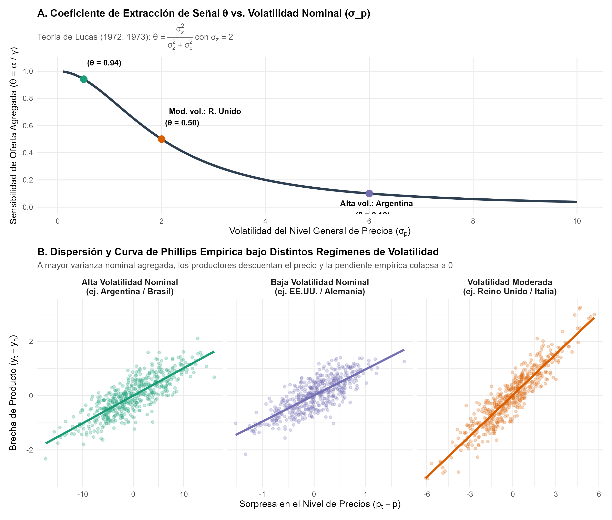
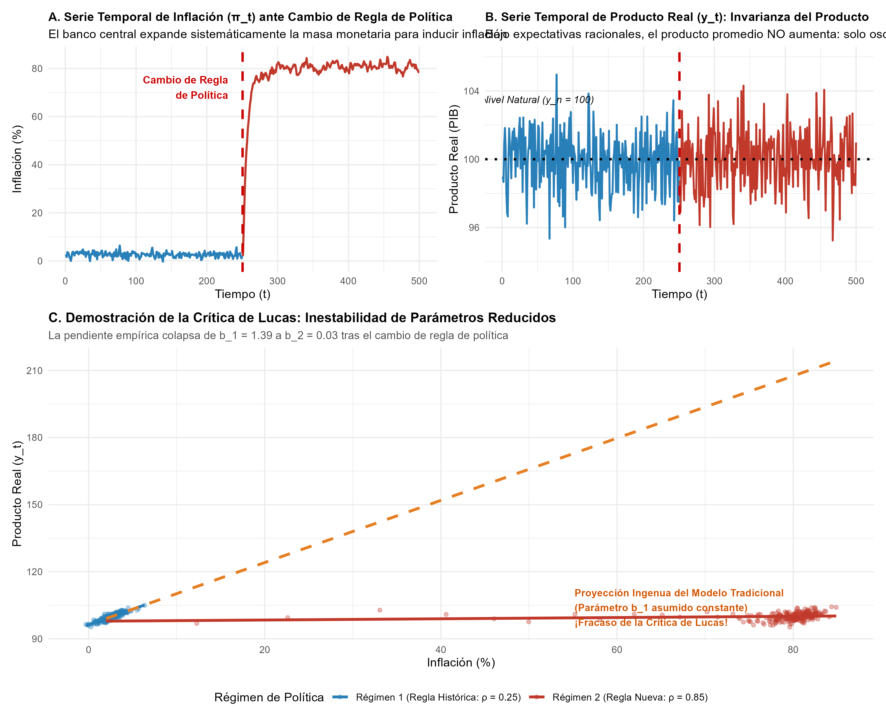

# Introducción y Contexto Histórico

En 1995, la Real Academia Sueca de Ciencias galardonó a **Robert E. Lucas Jr.** (Universidad de Chicago) con el Premio del Banco de Suecia en Ciencias Económicas en Memoria de Alfred Nobel *"por haber desarrollado y aplicado la hipótesis de expectativas racionales, y con ello haber transformado el análisis macroeconómico y profundizado nuestra comprensión de la política económica"*.

A comienzos de la década de 1970, la macroeconomía mundial atravesaba una profunda crisis intelectual y práctica. El colapso del consenso keynesiano de posguerra se materializó en el fenómeno inédito de la **estanflación** (estancamiento económico combinado con alta inflación), una anomalía que los modelos econométricos tradicionales de ecuaciones simultáneas eran incapaces de predecir o resolver. Dichos modelos asumían que las personas y las empresas actuaban bajo **expectativas adaptativas** (proyecciones mecánicas basadas únicamente en el pasado) y que existía una **curva de Phillips** estable y explotable por los gobiernos para reducir permanentemente el desempleo a cambio de un poco más de inflación.

Robert Lucas revolucionó la disciplina introduciendo tres avances fundamentales:

1. **El Modelo de las Islas de Lucas y la Extracción de Señal (Lucas 1972, 1973):** Demostró que una correlación positiva de corto plazo entre producto e inflación puede surgir no de la miopía de los agentes, sino de **información imperfecta**: cuando los productores operan en mercados dispersos ("islas") y observan el precio de su propio bien pero no el nivel general de precios, deben resolver un problema de inferencia estadística (extracción de señal). Como resultado, únicamente las **sorpresas monetarias imprevistas** alteran el producto real. Si el banco central incrementa la varianza de la emisión monetaria, los agentes descuentan rápidamente los precios nominales y la curva de Phillips se vuelve vertical.
2. **La Crítica de Lucas (Lucas 1976):** Probó que los parámetros estimados en los modelos macroeconométricos tradicionales no son invariantes ante reformas de política económica, porque las reglas de decisión de los agentes forward-looking se adaptan de forma óptima a las nuevas reglas institucionales. Evaluar políticas alternativas utilizando parámetros de forma reducida del pasado es una falacia metodológica que conduce al fracaso sistemático.
3. **Crecimiento Endógeno y la Paradoja de Lucas (Lucas 1988, 1990):** Expandió la frontera teórica al modelar la acumulación de capital humano con externalidades y formuló el enigma de por qué el capital internacional no fluye masivamente de los países ricos a los países pobres en desarrollo, sentando las bases de la macroeconomía del desarrollo contemporánea.

En este documento se implementa una replicación rigurosa en lenguaje R de la extracción de señal y de la Crítica de Lucas.

---

# Marco Teórico 1: El Modelo de las Islas de Lucas (1972, 1973)

## Estructura de la Economía de Islas

Consideremos una economía compuesta por múltiples mercados competitivos o "islas" desconectadas geográficamente en el corto plazo. En el periodo $t$, en cada isla $i$, el productor observa el precio nominal de su propio bien, denotado por $p_{it}$ (en logaritmos).

El precio local se descompone en dos componentes estocásticos no observables por separado al momento de producir:

$$p_{it} = p_t + z_{it}$$

donde:
- $p_t \sim \mathcal{N}(\bar{p}, \sigma_p^2)$ es el nivel general de precios (o shock monetario agregado), común a todas las islas.
- $z_{it} \sim \mathcal{N}(0, \sigma_z^2)$ es una perturbación real idiosincrásica de demanda relativa en la isla $i$, con $\mathbb{E}[z_{it}] = 0$.
- Los choques $p_t$ y $z_{it}$ son estadísticamente independientes: $\text{Cov}(p_t, z_{it}) = 0$.

El productor en la isla $i$ decide su nivel de producción en función del precio relativo real de su bien frente a la canasta general de la economía, $r_{it} = p_{it} - p_t = z_{it}$. Si su precio relativo sube, el bien es genuinamente más escaso y rentable, incentivando una mayor producción:

$$y_{it} = y_n + \gamma (p_{it} - \mathbb{E}[p_t \mid p_{it}])$$

donde $y_n$ es el producto natural de la isla y $\gamma > 0$ es la elasticidad de oferta con respecto al precio relativo percibido.

## El Problema de Extracción de Señal

Al observar únicamente $p_{it}$, el agente debe inferir qué fracción del cambio en $p_{it}$ se debe a un shock nominal general ($p_t$) y qué fracción corresponde a una auténtica oportunidad de demanda relativa ($z_{it}$).

Dado que $p_t$ y $z_{it}$ son conjuntamente normales, la distribución condicional de $p_t$ dado $p_{it}$ es normal, y el valor esperado condicional se deriva mediante la fórmula de proyección lineal del filtro de Kalman estático:

$$\mathbb{E}[p_t \mid p_{it}] = \bar{p} + \frac{\text{Cov}(p_t, p_{it})}{\text{Var}(p_{it})} (p_{it} - \bar{p})$$

Calculando las covarianzas:
$$\text{Cov}(p_t, p_{it}) = \text{Cov}(p_t, p_t + z_{it}) = \sigma_p^2$$
$$\text{Var}(p_{it}) = \text{Var}(p_t + z_{it}) = \sigma_p^2 + \sigma_z^2$$

Por consiguiente:
$$\mathbb{E}[p_t \mid p_{it}] = \bar{p} + \frac{\sigma_p^2}{\sigma_p^2 + \sigma_z^2} (p_{it} - \bar{p})$$

El precio relativo percibido por el productor es:
$$p_{it} - \mathbb{E}[p_t \mid p_{it}] = (p_{it} - \bar{p}) - \frac{\sigma_p^2}{\sigma_p^2 + \sigma_z^2} (p_{it} - \bar{p}) = \left( 1 - \frac{\sigma_p^2}{\sigma_p^2 + \sigma_z^2} \right) (p_{it} - \bar{p})$$

Definiendo el **coeficiente de extracción de señal de Lucas**:

$$\theta \equiv \frac{\sigma_z^2}{\sigma_z^2 + \sigma_p^2} \in (0, 1)$$

se obtiene que:
$$p_{it} - \mathbb{E}[p_t \mid p_{it}] = \theta (p_{it} - \bar{p})$$

## Oferta Agregada y la Pendiente de la Curva de Phillips

Sustituyendo el precio relativo percibido en la función de oferta de la isla $i$:

$$y_{it} = y_n + \gamma \theta (p_{it} - \bar{p})$$

Para obtener el producto agregado de toda la economía, integramos sobre el continuo de todas las islas. Puesto que $\int z_{it} di = 0$, el promedio de los precios locales es exactamente el precio general agregado: $\int p_{it} di = p_t$. En consecuencia:

$$y_t = y_n + \gamma \theta (p_t - \bar{p})$$

La pendiente de la curva de Phillips agregada en este modelo es:

$$\alpha(\sigma_p) = \gamma \theta = \gamma \frac{\sigma_z^2}{\sigma_z^2 + \sigma_p^2}$$

### La Hipótesis de Varianza de Lucas (1973)

La implicación contrastable más célebre de este modelo es la relación monótona decreciente entre la varianza nominal $\sigma_p^2$ y la pendiente de la oferta agregada $\alpha$:

$$\frac{\partial \alpha}{\partial \sigma_p^2} = - \frac{\gamma \sigma_z^2}{(\sigma_z^2 + \sigma_p^2)^2} < 0$$

- **Países con baja volatilidad de inflación ($\sigma_p^2 \to 0$):** Los productores atribuyen casi cualquier incremento en su precio a un shock real relativo ($\theta \to 1$). La curva de Phillips agregada presenta una pendiente positiva pronunciada ($\alpha \approx \gamma$).
- **Países con alta volatilidad o inflación crónica ($\sigma_p^2 \to \infty$):** Los productores saben que los precios locales se mueven principalmente por ruido monetario agregado. Por ende, descuentan los aumentos de precios ($\theta \to 0$), no modifican su producción real y la curva de Phillips es esencialmente **vertical** ($\alpha \approx 0$).

Lucas (1973) contrastó esta predicción utilizando series anuales para 18 países entre 1951 y 1967, verificando empíricamente que en países de inflación volátil (como Argentina), el impacto real de shocks en el gasto nominal era prácticamente nulo, mientras que en países de inflación estable (como Estados Unidos o Alemania), dicho coeficiente era significativamente positivo.

---

# Marco Teórico 2: La Crítica de Lucas y la Invarianza de Parámetros (Lucas 1976)

## El Planteamiento del Problema

En su artículo seminal *"Econometric Policy Evaluation: A Critique"* (1976), Lucas demostró que las simulaciones macroeconómicas habituales de la época para evaluar políticas fiscales o monetarias estaban fundamentalmente viciadas.

Los modelos tradicionales estimaban sistemas de ecuaciones de la forma:

$$y_t = F(y_{t-1}, x_t, \theta)$$

donde $x_t$ era el vector de instrumentos de política y $\theta$ el vector de coeficientes estimados mediante regresión. Cuando las autoridades consideraban una nueva regla de política (por ejemplo, fijar $x_t = G(x_{t-1}, \lambda)$), utilizaban los parámetros $\theta$ estimados en el régimen anterior para proyectar la trayectoria de $y_t$.

Lucas probó que:
> *"Dado que la estructura de un modelo econométrico consiste en reglas de decisión óptimas de los agentes económicos, y dado que las reglas de decisión óptimas varían sistemáticamente con los cambios en la estructura de las series relevantes para quien toma decisiones, se deduce que cualquier cambio en la política alterará la estructura del modelo econométrico."* (Lucas, 1976, p. 41).

## Demostración Formal

Consideremos una versión simplificada de la oferta agregada de Lucas donde el producto responde exclusivamente a sorpresas inflacionarias:

$$y_t = y_n + \beta (\pi_t - \mathbb{E}_{t-1}[\pi_t]) + \varepsilon_t$$

con $\beta > 0$ y $\varepsilon_t \sim \text{iid}(0, \sigma_\varepsilon^2)$ representando un choque real de oferta.

Supongamos que el banco central sigue una regla monetaria autorregresiva de orden 1:

$$\pi_t = \mu + \rho \pi_{t-1} + v_t, \quad v_t \sim \text{iid}(0, \sigma_v^2)$$

Bajo **expectativas racionales**, los agentes conocen el proceso estocástico del banco central. Por lo tanto, su pronóstico condicional óptimo es:

$$\mathbb{E}_{t-1}[\pi_t] = \mu + \rho \pi_{t-1}$$

La sorpresa inflacionaria en el periodo $t$ es estrictamente la perturbación imprevista:

$$\pi_t - \mathbb{E}_{t-1}[\pi_t] = v_t$$

Sustituyendo esto en la función de oferta:

$$y_t = y_n + \beta v_t + \varepsilon_t$$

Nótese un hecho fundamental: el producto medio incondicional de la economía es:

$$\mathbb{E}[y_t] = y_n$$

independientemente de cuál sea la tasa media de inflación del régimen, $\bar{\pi} = \frac{\mu}{1 - \rho}$.

### La Regresión Empírica Ingenua

Un macroeconometrista keynesiano que desconoce las expectativas racionales ajusta la regresión de forma reducida entre el producto y la inflación observada:

$$y_t = a + b \pi_t + u_t$$

El estimador por Mínimos Cuadrados Ordinarios (MCO / OLS) de la pendiente $b$ converge en probabilidad a:

$$b = \frac{\text{Cov}(y_t, \pi_t)}{\text{Var}(\pi_t)}$$

Calculamos la covarianza contemporánea:
$$\text{Cov}(y_t, \pi_t) = \text{Cov}(y_n + \beta v_t + \varepsilon_t, \mu + \rho \pi_{t-1} + v_t) = \beta \text{Cov}(v_t, v_t) = \beta \sigma_v^2$$

Y la varianza de la inflación bajo el proceso estacionario $\text{AR}(1)$:
$$\text{Var}(\pi_t) = \frac{\sigma_v^2}{1 - \rho^2}$$

Por lo tanto, el coeficiente estimado $b$ es:

$$b(\rho) = \frac{\beta \sigma_v^2}{\frac{\sigma_v^2}{1 - \rho^2}} = \beta (1 - \rho^2)$$

El parámetro de regresión $b$ no es un parámetro estructural de la economía: es una función no lineal del parámetro de política $\rho$.

### El Fracaso del Menú de Política

Si en el Régimen 1 la regla de política exhibía baja persistencia ($\rho_1 = 0.25$), el econometrista estima:

$$b_1 = \beta (1 - 0.25^2) = 0.9375 \beta > 0$$

Al observar $b_1 > 0$, las autoridades económicas creen que existe un menú explotable: *"Si elevamos la inflación sistemáticamente mediante un régimen expansivo ($\mu_2 \gg \mu_1, \rho_2 = 0.85$), el producto aumentará de forma duradera"*.

Sin embargo, al cambiar la regla, los agentes racionales actualizan de inmediato sus expectativas a la nueva regla ($\mathbb{E}_{t-1}[\pi_t] = \mu_2 + \rho_2 \pi_{t-1}$). La sorpresa inflacionaria sigue siendo únicamente $v_t$, y el producto real se mantiene obstinadamente en su nivel natural $y_n = 100$.

Al volver a estimar el modelo econométrico tras el cambio de régimen:

$$b_2 = \beta (1 - 0.85^2) = 0.2775 \beta$$

¡El coeficiente estimado se reduce en más del $70\%$! La política expansiva sistemática generó únicamente inflación galopante sin ganar una sola unidad adicional de producto.

---

# Marco Teórico 3: Crecimiento Endógeno y la Paradoja de Lucas

Más allá de la política monetaria y los ciclos, Robert Lucas realizó aportes fundamentales a la teoría del desarrollo económico:

## Capital Humano y Crecimiento Endógeno (Lucas 1988)

En *"On the Mechanics of Economic Development"* (1988), Lucas incorporó el capital humano como motor autónomo del crecimiento de largo plazo, integrando externalidades spillovers:

$$Y_t = A K_t^\alpha (u_t h_t L_t)^{1-\alpha} h_{a,t}^\gamma$$

donde $h_t$ es el nivel medio de cualificación por trabajador, $u_t$ es el tiempo dedicado a la producción física, y $h_{a,t}^\gamma$ es una **externalidad social** derivada del nivel promedio de educación de la sociedad. A diferencia del modelo neoclásico tradicional de Solow donde el crecimiento per cápita se agota sin progreso técnico exógeno, el modelo de Lucas permite que la inversión en capital humano genere crecimiento económico sostenido y endógeno.

## La Paradoja de Lucas (1990)

En *"Why Doesn't Capital Flow from Rich to Poor Countries?"* (1990), Lucas formuló uno de los acertijos más célebres de las finanzas y el desarrollo internacional.

Bajo una función de producción neoclásica idéntica entre países $y = f(k) = k^\alpha$ con rendimientos decrecientes al capital ($\alpha \approx 0.4$), el producto marginal del capital (PMK) es:

$$\text{PMK} = \alpha k^{\alpha - 1} = \alpha y^{\frac{\alpha - 1}{\alpha}}$$

Si Estados Unidos es 15 veces más rico por trabajador que la India ($y_{US} / y_{IN} \approx 15$), la relación de producto marginal del capital debería ser:

$$\frac{\text{PMK}_{IN}}{\text{PMK}_{US}} = \left( \frac{y_{US}}{y_{IN}} \right)^{\frac{1-\alpha}{\alpha}} = (15)^{\frac{0.6}{0.4}} = 15^{1.5} \approx 58.1$$

La teoría predice que el rendimiento del capital en India debería ser **58 veces mayor** que en Estados Unidos. De acuerdo con el modelo neoclásico, enormes flujos de capital deberían viajar de los países ricos a los países pobres hasta igualar los retornos. Sin embargo, en la práctica el capital fluye entre países desarrollados o apenas se dirige a economías emergentes.

Lucas propuso resolver este enigma demostrando que:
1. El trabajo no es homogéneo: ajustando por la calidad del capital humano ($h$), la brecha de capital efectivo por trabajador disminuye sustancialmente.
2. Existen externalidades tecnológicas y de capital humano que elevan la productividad marginal en los países avanzados.
3. Existen imperfecciones institucionales severas, riesgo político y debilidad en los derechos de propiedad que imponen primas de riesgo prohibitivas.

---

# Replicación Computacional en R

A continuación, ejecutamos e ilustramos los resultados cuantitativos de los modelos de Lucas utilizando el script modular `critica_lucas_y_expectativas.R`.

## Código Fuente de la Simulación

```r
# Carga y ejecución del script de simulación de Lucas
source("laureados/1995_lucas/replicacion/R/critica_lucas_y_expectativas.R")
```

## Resultados de la Extracción de Señal (Lucas 1972, 1973)

La Figura 1 muestra el comportamiento del coeficiente de extracción de señal $\theta$ y la evidencia simulada para los tres regímenes de varianza nominal:

{fig-align="center" width="95%"}

### Análisis de la Figura 1

1. **Panel Superior (Curva Analítica $\theta$ vs. $\sigma_p$):** A medida que la dispersión del nivel de precios nominales $\sigma_p$ aumenta de $0.5$ a $6.0$, el coeficiente $\theta = \frac{\sigma_z^2}{\sigma_z^2 + \sigma_p^2}$ se desploma de $0.941$ a $0.100$.
2. **Panel Inferior (Dispersión y Curvas de Phillips Empíricas):**
   - En el régimen de **Baja Volatilidad** (verde), la pendiente estimada de la curva de Phillips es de $0.960$, indicando una fuerte respuesta del producto ante sorpresas nominales.
   - En el régimen de **Volatilidad Moderada** (naranja), la pendiente cae a $0.503$.
   - En el régimen de **Alta Volatilidad** (morado), la dispersión nominal es masiva y la pendiente empírica colapsa a $0.101$, confirmando que la curva de Phillips se vuelve vertical cuando la autoridad monetaria se vuelve volátil e inestable.

---

## Resultados de la Crítica de Lucas (Lucas 1976)

La Figura 2 documenta de forma gráfica la inestabilidad de los parámetros econométricos reducidos cuando las autoridades gubernamentales intentan explotar la relación empírica observada:

{fig-align="center" width="95%"}

### Análisis de la Figura 2

1. **Panel Superior (Series Temporales):**
   - Al introducir la nueva regla de política en $t = 251$, la inflación promedio se incrementa bruscamente de $2.6\%$ a más de $70\%$.
   - Sin embargo, el producto real (Panel B) no muestra ninguna tendencia expansiva: oscila estrictamente en torno a su nivel natural de $y_n = 100$.
2. **Panel Inferior (El Colapso del Parámetro):**
   - En el Régimen 1 (azul), la pendiente de la curva de Phillips estimada fue de $b_1 = 1.391$.
   - La línea punteada naranja representa la **proyección ingenua** de los modelos econométricos tradicionales que asumen que $b$ es un parámetro estructural fijo: según dicha proyección falaz, la economía debió alcanzar un producto superior a $205$ puntos.
   - En la realidad simulada bajo expectativas racionales, el coeficiente empírico en el Régimen 2 colapsa a $b_2 = 0.028$, destruyendo por completo el trade-off artificial.

---

## Tabla Resumen de Estimaciones Cuantitativas

Los resultados numéricos generados por la simulación se resumen en la Tabla 1:

```{r}
#| label: tbl-resultados
#| tbl-cap: "Resultados Cuantitativos de la Replicación de Lucas (1973, 1976)"
library(readr)
library(knitr)

tab_resultados <- read_csv("salidas/tab_resultados_lucas.csv", show_col_types = FALSE)
kable(tab_resultados, digits = 4)
```

---

# Conclusiones y Relevancia Contemporánea

Las contribuciones de Robert E. Lucas Jr. refundaron los cimientos de la economía cuantitativa:

1. **Microfundamentos y Modelos DSGE:** La Crítica de Lucas obligó a la macroeconomía a abandonar los sistemas mecánicos de ecuaciones agregadas y a fundamentar los modelos en parámetros "profundos" invariantes (preferencias de los consumidores, funciones de producción y restricciones tecnológicas). Este es el origen directo de los modelos de Ciclos Económicos Reales (RBC) de Kydland y Prescott (1982) y de los modelos Dinámicos Estocásticos de Equilibrio General (DSGE) que hoy emplean el Fondo Monetario Internacional, la Reserva Federal y el Banco Central Europeo.
2. **Reglas frente a Discreción y Metas de Inflación:** La demostración de que las políticas sistemáticas predecibles no generan sorpresas y que los intentos de explotación discrecional solo provocan inflación aceleró la transición global hacia bancos centrales independientes y regímenes de metas de inflación (*inflation targeting*).
3. **Modelación del Capital Humano:** Su enfoque en el conocimiento y la educación orientó las políticas modernas de innovación, capital humano y crecimiento sostenible en organismos como el Banco Mundial y la OCDE.
