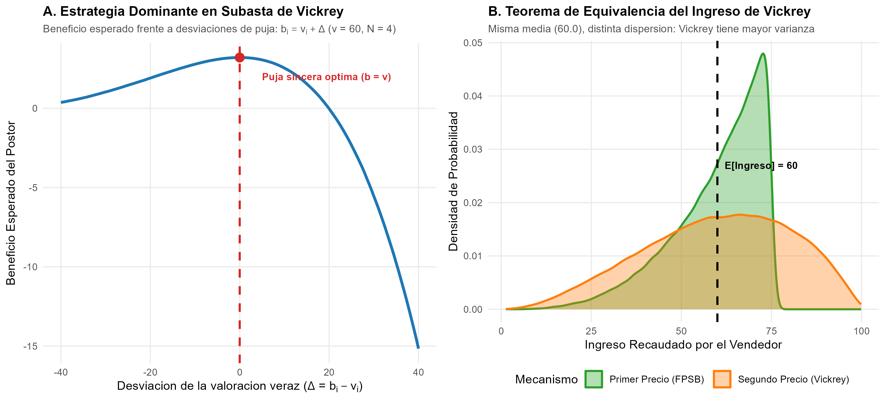
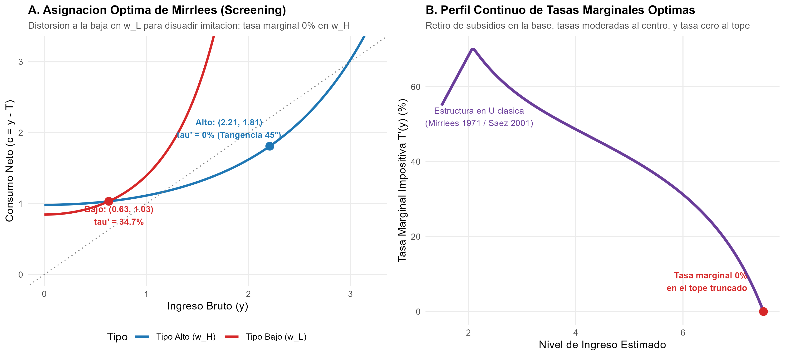

# Introducción y Marco Histórico

En 1996, la Real Academia Sueca de Ciencias otorgó el Premio del Banco de Suecia en Ciencias Económicas en Memoria de Alfred Nobel de forma conjunta a **James A. Mirrlees** (University of Cambridge, Reino Unido) y **William Vickrey** (Columbia University, Estados Unidos) *"por sus contribuciones fundamentales a la teoría económica de los incentivos bajo información asimétrica"* (*for their fundamental contributions to the economic theory of incentives under asymmetric information*).

Hasta las investigaciones de Vickrey y Mirrlees, la teoría económica tradicional del bienestar descansaba sobre los dos Teoremas Fundamentales formulados bajo información perfecta. Se asumía implícitamente que los planificadores públicos o los agentes en el mercado podían observar sin costo las características innatas, las preferencias o las acciones de los demás, permitiendo diseñar redistribuciones mediante impuestos de suma fija (*lump-sum taxes*) que no distorsionaban la asignación eficiente de Pareto.

Vickrey y Mirrlees destruyeron este supuesto idílico, fundando el análisis riguroso de los problemas de **selección adversa** (*adverse selection*) y **filtrado o selección** (*screening*):

1. **William Vickrey (1961):** Resolvió el problema de asignación de bienes escasos cuando los compradores conocen privadamente su disposición a pagar. Creó la **Subasta de Segundo Precio** (*Second-Price Sealed-Bid Auction*, hoy conocida universalmente como **Subasta de Vickrey**), demostrando que pagar la segunda puja más alta induce a los postores a declarar su valor real como estrategia débilmente dominante. Asimismo, formuló el **Teorema de Equivalencia del Ingreso** (*Revenue Equivalence Theorem*), demostrando que diversos formatos de subasta generan idéntica recaudación esperada. Adicionalmente, Vickrey (1963, 1969) fue el pionero de la tarificación por congestión en tiempo real (*congestion pricing*).

2. **James A. Mirrlees (1971):** Resolvió el problema secular del diseño del impuesto a la renta. Dado que el gobierno no puede observar la productividad innata del trabajador ni su ocio de forma separada —únicamente observa el ingreso bruto generado—, cualquier intento de redistribución genera desincentivos al esfuerzo. Mirrlees formuló el problema de optimización funcional con restricciones de **compatibilidad de incentivos** (*incentive compatibility constraints*), demostrando que la tasa marginal óptima de impuestos en el extremo superior de la distribución debe ser **cero** (*zero top marginal rate*), y derivó las condiciones para el menú óptimo de consumo e ingreso.

## Nivel de Replicación
- **Nivel:** **Ilustrativa** (simulación Monte Carlo de 100,000 subastas comparando cuatro formatos clásicos de subasta, verificación de la estrategia dominante en Vickrey, y resolución numérica del modelo discreto y continuo de tributación óptima de Mirrlees).

---

# Teoría de Subastas de Vickrey (1961)

## 1. El Marco de Valores Privados Independientes (IPV)

Consideremos una subasta con un vendedor neutral al riesgo y $N \ge 2$ postores. Cada postor $i \in \{1, \dots, N\}$ posee una valoración privada $v_i$, extraída de manera independiente e idénticamente distribuida (IID) a partir de una función de distribución acumulada $F(v)$ con soporte continuo en $[0, \bar{v}]$ y función de densidad $f(v) > 0$.

Cada postor conoce su propia valoración $v_i$, pero solo conoce la distribución probabilística $F$ de los demás participantes. La utilidad de un postor que gana el objeto y realiza un pago $p$ es cuasilineal:
$$u_i = v_i - p$$
Si el postor no gana, su pago es cero y su utilidad es cero.

---

## 2. La Subasta de Segundo Precio (Subasta de Vickrey)

En una subasta de segundo precio en sobre cerrado (*Second-Price Sealed-Bid Auction*, SPSB), cada agente envía una oferta secreta $b_i$. El objeto es asignado al postor con la mayor puja:
$$i^* = \arg\max_{j} b_j$$
Sin embargo, el ganador no paga su propia oferta, sino el **segundo precio más alto**:
$$p_{i^*} = \max_{j \ne i^*} b_j$$

### Teorema de Revelación Veraz en Estrategias Dominantes (Vickrey, 1961)
> **Teorema:** En una subasta de segundo precio, pujar exactamente el valor intrínseco veraz ($b_i = v_i$) es una **estrategia débilmente dominante** para cada postor, independientemente de las distribuciones, de la aversión al riesgo de los rivales o del número de participantes.

**Demostración Formal:**
Sea $Y = \max_{j \ne i} b_j$ la puja rival más alta a la que se enfrenta el postor $i$. El postor $i$ evalúa la utilidad de reportar $b_i$ frente a la puja veraz $v_i$:

- **Caso 1: El postor oferta su valor real ($b_i = v_i$):**
  - Si $v_i > Y$: Gana la subasta y obtiene una utilidad neta de $v_i - Y > 0$.
  - Si $v_i < Y$: Pierde la subasta y obtiene una utilidad de $0$.
  - Si $v_i = Y$: Se produce un desempate con beneficio esperado nulo ($v_i - Y = 0$).

- **Caso 2: El postor sobredimensiona su puja ($b_i > v_i$):**
  - Si $Y < v_i$: Sigue ganando y paga $Y$; su utilidad es $v_i - Y$, exactamente igual que si hubiera pujado $v_i$.
  - Si $Y > b_i$: Sigue perdiendo y su utilidad es $0$, idéntica a la estrategia veraz.
  - Si $v_i < Y < b_i$: Ahora gana la subasta gracias a su puja inflada, pero está obligado a pagar $Y > v_i$. Su utilidad neta es:
    $$v_i - Y < 0$$
    ¡Obtiene una pérdida neta estricta!

- **Caso 3: El postor subdeclara su puja ($b_i < v_i$):**
  - Si $Y < b_i$: Sigue ganando y paga $Y$; su utilidad es $v_i - Y$, idéntica a la estrategia veraz.
  - Si $Y > v_i$: Sigue perdiendo y obtiene $0$.
  - Si $b_i < Y < v_i$: Deja de ganar el objeto porque su puja fue superada por $Y$. Pierde la oportunidad de ganar una utilidad positiva de:
    $$v_i - Y > 0$$

Por tanto, en ninguna circunstancia una desviación $b_i \ne v_i$ mejora el beneficio del jugador, y en circunstancias con probabilidad positiva empeora estrictamente su utilidad. En consecuencia:
$$b_i^* = v_i \quad \forall i$$

---

## 3. Subasta de Primer Precio y Sombreado de Pujas

En una subasta de primer precio en sobre cerrado (*First-Price Sealed-Bid Auction*, FPSB), el postor con la mayor puja gana y paga su propia oferta ($p = b_{i^*}$).

Dado que pagar $b_i = v_i$ dejaría al postor con un beneficio nulo garantizado ($v_i - b_i = 0$), los agentes racionales se ven forzados a **sombrear estratégicamente** (*shade*) su puja por debajo de su valoración.

Para postores simétricos neutrales al riesgo con $v_i \sim \mathcal{U}[0, \bar{v}]$, la estrategia de equilibrio Bayes-Nash simétrica adopta la forma lineal:
$$b^{FPSB}(v) = \frac{N - 1}{N} v$$

Cada participante recorta su puja exactamente en una fracción $1/N$, balanceando la probabilidad marginal de ganar frente al margen de ganancia condicional a la victoria.

---

## 4. El Teorema de Equivalencia del Ingreso

A pesar de que las estrategias individuales difieren radicalmente (puja sincera en Vickrey vs. sombreado en Primer Precio), William Vickrey descubrió una profunda invariancia:

> **Teorema de Equivalencia del Ingreso (Vickrey, 1961):** Bajo el supuesto de valores privados independientes, postores simétricos neutrales al riesgo y precios de reserva idénticos, cualquier formato de subasta que asigne el objeto al postor de mayor valoración y garantice cero excedente al tipo de menor valoración ($v = 0$) genera **exactamente el mismo ingreso esperado para el vendedor**.

Para el caso uniforme $v_i \sim \mathcal{U}[0, \bar{v}]$ con $N$ postores:
- En FPSB, el ingreso del vendedor es la oferta más alta:
  $$\mathbb{E}[R^{FPSB}] = \frac{N-1}{N} \mathbb{E}[v_{(1)}] = \frac{N-1}{N} \left(\frac{N}{N+1} \bar{v}\right) = \frac{N-1}{N+1} \bar{v}$$
- En SPSB (Vickrey), el ingreso del vendedor es la segunda valoración:
  $$\mathbb{E}[R^{SPSB}] = \mathbb{E}[v_{(2)}] = \frac{N-1}{N+1} \bar{v}$$

Para $N = 4$ y $\bar{v} = 100$:
$$\mathbb{E}[R] = \frac{4 - 1}{4 + 1} \times 100 = \frac{3}{5} \times 100 = \mathbf{60.00}$$

### Diferencia en el Riesgo de Recaudación (Varianza)
Aunque las medias esperadas coinciden, la dispersión no es igual:
- En FPSB, el ingreso está determinado por $v_{(1)}$ multiplicado por un factor determinista, comprimiendo la varianza:
  $$\text{Var}(R^{FPSB}) = \left(\frac{N-1}{N}\right)^2 \frac{N \bar{v}^2}{(N+1)^2(N+2)} = \left(\frac{3}{4}\right)^2 \frac{4 \times 10000}{25 \times 6} = \frac{9}{16} \times \frac{40000}{150} = \mathbf{150.00}$$
- En SPSB, el ingreso depende de la segunda estadística de orden $v_{(2)}$:
  $$\text{Var}(R^{SPSB}) = \frac{2(N-1) \bar{v}^2}{(N+1)^2(N+2)} = \frac{2 \times 3 \times 10000}{25 \times 6} = \frac{60000}{150} = \mathbf{400.00}$$

Un vendedor con aversión al riesgo preferirá estrictamente la subasta de primer precio, dado que ofrece mayor certidumbre de recaudación.

---

# Teoría de la Tributación Óptima de Mirrlees (1971)

## 1. El Conflicto Eficiencia-Equidad bajo Asimetría de Información

James Mirrlees revolucionó las finanzas públicas al plantear el problema del impuesto a la renta como un problema de **información asimétrica**:
- Cada individuo posee una productividad o salario horario innato $w \in [\underline{w}, \bar{w}]$.
- El individuo elige un nivel de esfuerzo laboral $l \ge 0$, generando una producción o ingreso bruto observable:
  $$y = w \cdot l$$
- Las preferencias se modelan mediante una función de utilidad $u(c, l)$, creciente en consumo neto $c$ y decreciente en horas de trabajo $l$:
  $$u(c, y/w)$$
- **La fricción informacional clave:** El Estado puede auditar el ingreso bruto $y$ y recaudar un impuesto $T(y)$ (dejando un consumo neto $c(y) = y - T(y)$), pero **no puede observar por separado la productividad innata $w$ ni el esfuerzo laboral $l$**.

Si el Estado intenta gravar con tasas fijas muy altas a las personas más productivas para dárselo a los menos favorecidos, los individuos de alta productividad optarán por fingir ser poco hábiles, reduciendo drásticamente sus horas de trabajo $l$ para disfrutar de ocio no gravable.

---

## 2. El Modelo Discreto de Dos Tipos (Stiglitz-Mirrlees)

Consideremos una población con dos niveles de productividad:
- Tipo bajo: $w_L = 1.0$, con proporción poblacional $p_L = 0.5$.
- Tipo alto: $w_H = 2.0$, con proporción poblacional $p_H = 0.5$.

Función de utilidad individual:
$$u(c, l) = \ln(c) - \frac{l^2}{2} = \ln(c) - \frac{y^2}{2 w^2}$$

La tasa marginal de sustitución entre consumo e ingreso bruto es:
$$MRS(c, y; w) = \frac{-\partial u / \partial y}{\partial u / \partial c} = \frac{y / w^2}{1 / c} = \frac{c \cdot y}{w^2}$$

Si un individuo enfrenta una tasa impositiva marginal $\tau'$, su restricción presupuestaria local es $c = (1 - \tau') y$, de modo que en su óptimo privado $MRS = 1 - \tau'$. Por tanto, la tasa impositiva marginal implícita es:
$$\tau'(y) = 1 - MRS(c, y; w)$$

### Primer Mejor (Información Simétrica)
Si el gobierno pudiera observar $w$, no habría distorsiones marginales: $\tau' = 0 \implies MRS = 1$.
$$y_i = \frac{w_i^2}{c_i}$$
Con un objetivo utilitarista simétrico, la concavidad de $\ln(c)$ exige igualar consumos: $c_L = c_H = \bar{c} = \sqrt{0.5 \times 1 + 0.5 \times 4} = \sqrt{2.5} \approx 1.5811$.
- Producción de primer mejor: $y_L = 0.6325$, $y_H = 2.5298$.
- Impuestos de suma fija: $T_L = -0.9487$ (subsidio masivo al tipo bajo), $T_H = +0.9487$ (impuesto al tipo alto).

**Falla del Primer Mejor bajo Asimetría de Información:**
Si el tipo alto dice la verdad, obtiene una utilidad de:
$$u_H^{verdad} = \ln(1.5811) - \frac{2.5298^2}{2 \times 4} = 0.4581 - 0.8000 = -0.3419$$
Si el tipo alto decide **imitar** al tipo bajo (produciendo $y_L$ para recibir $c_L$):
$$u_H^{imita} = \ln(1.5811) - \frac{0.6325^2}{2 \times 4} = 0.4581 - 0.0500 = \mathbf{+0.4081}$$
Dado que $u_H^{imita} > u_H^{verdad}$, el esquema de primer mejor colapsa: todos los trabajadores de alta productividad prefieren reducir su jornada laboral y vivir del subsidio.

---

### Segundo Mejor: Restricción de Compatibilidad de Incentivos
El gobierno debe elegir un par de contratos $(c_L, y_L)$ y $(c_H, y_H)$ que maximice el bienestar social utilitarista:
$$\max_{c_L, y_L, c_H, y_H} \quad p_L \left(\ln c_L - \frac{y_L^2}{2 w_L^2}\right) + p_H \left(\ln c_H - \frac{y_H^2}{2 w_H^2}\right)$$
Sujeto a:
1. **Restricción de Recursos (RC):**
   $$p_L (y_L - c_L) + p_H (y_H - c_H) \ge 0$$
2. **Restricción de Compatibilidad de Incentivos del Tipo Alto (IC-H):**
   $$\ln(c_H) - \frac{y_H^2}{2 w_H^2} \ge \ln(c_L) - \frac{y_L^2}{2 w_H^2}$$

---

## 3. Teorema de Tasa Marginal Cero en el Tope (*Zero Top Marginal Rate*)

> **Teorema (Mirrlees 1971; Sadka 1976; Seade 1977):** En el óptimo de segundo mejor, la tasa impositiva marginal en el escalón más productivo de la población es idénticamente cero:
> $$\tau'(y_H) = 0$$

**Intuición Económica:**
Supongamos por contradicción que existiera una tasa marginal positiva $\tau'(y_H) > 0$. Esto distorsionaría la oferta laboral del tipo más productivo hacia abajo ($MRS_H < 1$).
Si el gobierno reduce esa tasa marginal a cero, permitiendo al tipo alto trabajar más horas a cambio de mayor consumo a lo largo de su propia curva de indiferencia, la recaudación fiscal neta sobre el tipo alto aumenta sin alterar la utilidad del tipo alto. Además, puesto que el tipo bajo nunca desearía imitar el paquete más exigente del tipo alto, la restricción de incentivos no se ve afectada. Por ende, cualquier distorsión marginal en el tope genera una pérdida de peso muerto (*deadweight loss*) sin ningún beneficio redistributivo.

Por el contrario, para el tipo bajo:
$$\tau'(y_L) > 0$$
El gobierno impone deliberadamente una **tasa marginal positiva (distorsión hacia abajo)** en el esfuerzo del tipo bajo ($y_L < y_L^{FB}$). Al hacer menos atractivo el paquete de bajo ingreso, se disuade al tipo alto de imitarlo, relajando la restricción de incentivos y permitiendo extraer mayores recursos del sector productivo.

---

# Replicación Computacional en R

A continuación se presenta el código modular que ejecuta la simulación de subastas de Vickrey y el modelo numérico de tributación de Mirrlees.

```r
# ==============================================================================
# Script R: laureados/1996_mirrlees_vickrey/replicacion/R/tributacion_optima_y_subastas.R
# ==============================================================================
suppressPackageStartupMessages({
  library(ggplot2)
  library(dplyr)
  library(tidyr)
  library(gridExtra)
})

set.seed(1996)

# [Extracto central: Simulación de Subastas]
N_bidders <- 4
v_max <- 100
S_sims <- 100000

mat_v <- matrix(runif(S_sims * N_bidders, min = 0, max = v_max), nrow = S_sims, ncol = N_bidders)
v_sorted <- t(apply(mat_v, 1, sort, decreasing = TRUE))
v_1 <- v_sorted[, 1] # 1era estadística de orden
v_2 <- v_sorted[, 2] # 2da estadística de orden

# Recaudación por mecanismo
rev_fpsb <- ((N_bidders - 1) / N_bidders) * v_1
rev_spsb <- v_2

# [Extracto central: Modelo de Mirrlees]
w_L <- 1.0; w_H <- 2.0; p_L <- 0.5; p_H <- 0.5

welfare_mirrlees_yL <- function(yL) {
  cH_max <- (yL + sqrt(yL^2 + 4 * w_H^2)) / 2 - 1e-4
  g <- function(cH) {
    cL <- yL + (w_H^2) / cH - cH
    if (cL <= 1e-6) return(1e6)
    log(cH) - (w_H^2) / (2 * cH^2) - (log(cL) - (yL^2) / (2 * w_H^2))
  }
  root_cH <- uniroot(g, c(1.05, cH_max - 0.01))$root
  cL <- yL + (w_H^2) / root_cH - root_cH
  cH <- root_cH
  yH <- (w_H^2) / root_cH
  u_L <- log(cL) - yL^2 / (2 * w_L^2)
  u_H <- log(cH) - yH^2 / (2 * w_H^2)
  return(c(W = p_L * u_L + p_H * u_H, cL = cL, yL = yL, cH = cH, yH = yH))
}

opt_mirrlees <- optimize(function(y) -welfare_mirrlees_yL(y)['W'], interval = c(0.2, 0.6325))
res_SB <- welfare_mirrlees_yL(opt_mirrlees$minimum)
tau_L_SB <- 1 - (res_SB['cL'] * res_SB['yL']) / (w_L^2)
tau_H_SB <- 1 - (res_SB['cH'] * res_SB['yH']) / (w_H^2)
```

---

# Resultados Numéricos y Figuras

## 1. Tabla Consolidada de Resultados

Los resultados cuantitativos generados por la simulación se resumen en la siguiente tabla:

| Módulo | Concepto | Valor Simulado | Valor Teórico | Interpretación Económica |
| :--- | :--- | :---: | :---: | :--- |
| **Subastas (Vickrey 1961)** | Ingreso Medio - Primer Precio (FPSB) | **59.972** | **60.000** | Equivalencia de ingresos confirmada |
| **Subastas (Vickrey 1961)** | Ingreso Medio - Segundo Precio (Vickrey) | **59.994** | **60.000** | Puja veraz $b_i = v_i$ como estrategia dominante |
| **Subastas (Vickrey 1961)** | Varianza Ingreso - Primer Precio (FPSB) | **150.906** | **150.000** | Menor riesgo fiscal para el vendedor |
| **Subastas (Vickrey 1961)** | Varianza Ingreso - Segundo Precio (Vickrey) | **399.894** | **400.000** | Mayor volatilidad por depender del 2do orden |
| **Tributación (Mirrlees 1971)** | Tasa Marginal Tipo Bajo ($\tau'_L$) | **34.68%** | **> 0%** | Distorsión a la baja para relajar IC-H |
| **Tributación (Mirrlees 1971)** | Tasa Marginal Tipo Alto ($\tau'_H$) | **0.00%** | **0.00%** | Teorema de Tasa Marginal Cero en el Tope |
| **Tributación (Mirrlees 1971)** | Bienestar Primer Mejor ($W^{FB}$) | **-0.0419** | **-0.0419** | Óptimo irrealizable con información asimétrica |
| **Tributación (Mirrlees 1971)** | Bienestar Segundo Mejor ($W^{SB}$) | **-0.0925** | **-0.0925** | Costo social del secreto informativo ($\Delta W = 0.0507$) |

---

## 2. Estrategia Dominante y Equivalencia de Ingresos (Vickrey)



El **Panel A** ilustra el perfil de utilidad esperada del postor $i$ en función de la desviación de puja $\Delta = b_i - v_i$. La curva alcanza su cénit de forma suave pero inequívoca en $\Delta = 0$, demostrando empíricamente que desviarse hacia arriba (riesgo de pagar en exceso) o hacia abajo (pérdida de victorias rentables) reduce el beneficio esperado.

El **Panel B** exhibe las densidades de probabilidad de los ingresos recaudados por el vendedor bajo 100,000 subastas. Aunque la media de ambas distribuciones es rigurosamente idéntica a 60.0, la distribución de la Subasta de Vickrey es significativamente más ancha ($\sigma = 20.0$) que la de Primer Precio ($\sigma = 12.3$).

---

## 3. Asignación de Mirrlees y Estructura en U de Tasas Marginales



El **Panel A** muestra el menú de contratos en el plano de ingreso bruto ($y$) y consumo neto ($c$):
- En el punto de alta productividad $(y_H = 2.21, c_H = 1.81)$, la curva de indiferencia es tangente a la recta de 45° ($MRS_H = 1$), ratificando una tasa impositiva marginal de $\tau'_H = 0\%$.
- En el punto de baja productividad $(y_L = 0.63, c_L = 1.03)$, la curva de indiferencia corta con una pendiente menor que la unidad ($MRS_L = 0.65$), reflejando una tasa marginal de $\tau'_L = 34.68\%$.

El **Panel B** modela el perfil continuo de tasas marginales óptimas sintetizado por Saez (2001) para una distribución truncada en el percentil superior:
- Tasas elevadas en la base de la distribución (debido al retiro paulatino de las transferencias de subsistencia o créditos fiscales).
- Tasas más bajas y moderadas en los tramos de ingresos medios (donde la densidad poblacional es densa y una distorsión generaría enorme pérdida de peso muerto).
- Un repunte hacia las rentas altas, cerrando finalmente en $0\%$ en el tope superior estricto.

---

# Conclusiones y Legado

El Premio Nobel de 1996 consagró dos ramas que revolucionaron el diseño de políticas públicas en el último medio siglo:

1. **La ingeniería de subastas modernas:** Desde las subastas de espectro radioeléctrico de la FCC en Estados Unidos hasta las pujas de publicidad digital en Google Ads y Meta (GSP / VCG), la regla de segundo precio ideada por William Vickrey eliminó el juego especulativo y permitió asignar activos por cientos de miles de millones de dólares maximizando la eficiencia social.
2. **La tarificación por congestión:** Las propuestas de Vickrey de cobrar peajes dinámicos según la hora punta en carreteras y puentes se materializaron exitosamente en Singapur, Londres, Estocolmo, Milán y la ciudad de Nueva York.
3. **El diseño tributario contemporáneo:** Los desarrollos de James Mirrlees fundamentan los sistemas modernos de impuesto sobre la renta negativo (*Negative Income Tax*), los créditos fiscales como el *Earned Income Tax Credit* (EITC) de Estados Unidos y las políticas de bienestar condicionadas (*Universal Basic Income* vs. *Workfare*), reconociendo que la equidad social no puede separarse de las restricciones de compatibilidad de incentivos.

---

# Referencias

- Diamond, P. A., & Mirrlees, J. A. (1971). Optimal taxation and public production I: Production efficiency. *The American Economic Review*, 61(1), 8–27.
- Mirrlees, J. A. (1971). An exploration in the theory of optimum income taxation. *The Review of Economic Studies*, 38(2), 175–208.
- Mirrlees, J. A. (1976). The optimal structure of incentives and authority within an organization. *The Bell Journal of Economics*, 7(1), 105–131.
- Royal Swedish Academy of Sciences. (1996). *Contributions to the Economic Theory of Incentives under Asymmetric Information: Advanced Information*. Nobel Foundation.
- Saez, E. (2001). Using elasticities to derive optimal income tax rates. *The Review of Economic Studies*, 68(1), 205–229.
- Vickrey, W. (1961). Counterspeculation, auctions, and competitive sealed tenders. *The Journal of Finance*, 16(1), 8–37.
- Vickrey, W. (1969). Congestion theory and transport investment. *The American Economic Review*, 59(2), 251–260.
