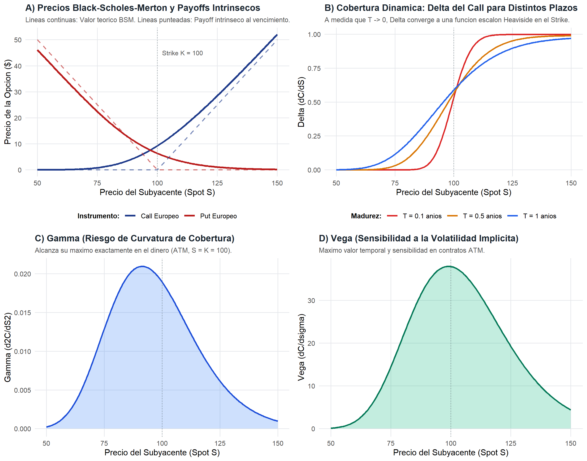
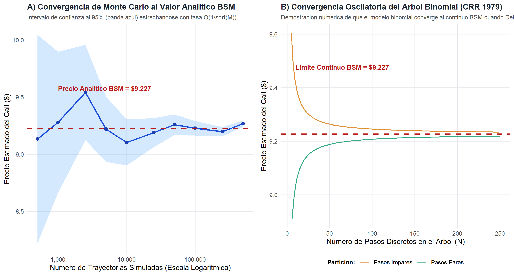

# Introducción y Objetivo

En 1997, la Real Academia Sueca de Ciencias otorgó el Premio de Ciencias Económicas del Banco de Suecia en Memoria de Alfred Nobel a **Robert C. Merton** y **Myron S. Scholes**:

> *"for a new method to determine the value of derivatives"* (Por un nuevo método para determinar el valor de los derivados).

El comité reconoció de manera explícita que este logro cumbre de la economía financiera se forjó en colaboración directa con el matemático y economista **Fischer Black** (1938–1995), fallecido dos años antes del galardón.

Antes de sus artículos seminales de 1973, la determinación del precio justo de un contrato de opción era un dilema irresoluble. Los intentos previos requerían adivinar la tasa esperada de rentabilidad del activo subyacente y la prima de riesgo subjetiva de cada inversor, tornando imposible un consenso objetivo de mercado.

## ¿Qué vas a aprender?
1. **La Cartera de Réplica Dinámica:** Cómo Fischer Black, Myron Scholes y Robert Merton eliminaron el riesgo estocástico mediante cobertura continua (*Delta hedging*), demostrando que el precio no depende de la aversión al riesgo ni del retorno esperado del activo.
2. **Derivación de la Ecuación Diferencial Parcial (PDE) y Solución Cerrada:** Aplicación del lema de Itô y fijación de precios neutral al riesgo (*risk-neutral pricing*).
3. **Cálculo de Sensibilidades (Las Griegas):** Medición analítica de Delta, Gamma, Vega y Theta para la gestión cuantitativa de carteras.
4. **Validación Numérica Multimétodo:** Comparación de la fórmula cerrada analítica contra el árbol binomial de Cox-Ross-Rubinstein (1979) y la simulación Monte Carlo.
5. **El Modelo de Merton (1974) para Riesgo Crediticio:** Valoración del patrimonio corporativo y de la deuda corporativa riesgosa como opciones contingentes sobre los activos totales de la firma.

## Nivel de Replicación
- **Nivel:** **Completa e Ilustrativa Rigurosa**  
- **Alcance:** Implementación exacta de las fórmulas analíticas cerradas de Black & Scholes (1973) y Merton (1973), algoritmos de árbol binomial recursivo de Cox, Ross & Rubinstein (1979), simulación estocástica Monte Carlo con variables antitéticas y modelo estructural de Merton (1974). Todos los scripts y salidas son 100% reproducibles en R.

---

# Marco Teórico y Fundamentos Matemáticos

## Dinámica Estocástica del Activo Subyacente

Se asume que el precio del activo subyacente $S_t$ (por ejemplo, una acción) evoluciona según un **Movimiento Browniano Geométrico** (*Geometric Brownian Motion*, GBM) en un espacio de probabilidad filtrado $(\Omega, \mathcal{F}, \{\mathcal{F}_t\}, \mathbb{P})$:

$$\frac{dS_t}{S_t} = \mu \, dt + \sigma \, dW_t$$

donde:
- $\mu$: Tasa esperada de retorno instantáneo del activo (deriva o *drift*).
- $\sigma > 0$: Volatilidad instantánea constante.
- $W_t$: Proceso de Wiener estándar unidimensional (movimiento browniano), con $dW_t \sim \mathcal{N}(0, dt)$.

## El Lema de Itô y el Diferencial del Derivado

Consideremos un contrato derivado cuyo valor en el tiempo $t$ es una función dos veces diferenciable $V(S_t, t)$. Por el **Lema de Itô** para cálculo estocástico en tiempo continuo:

$$dV = \frac{\partial V}{\partial t} \, dt + \frac{\partial V}{\partial S} \, dS_t + \frac{1}{2} \frac{\partial^2 V}{\partial S^2} \, (dS_t)^2$$

Dado que $(dW_t)^2 = dt$ y los términos de orden superior se anulan:

$$dV = \left( \frac{\partial V}{\partial t} + \mu S_t \frac{\partial V}{\partial S} + \frac{1}{2} \sigma^2 S_t^2 \frac{\partial^2 V}{\partial S^2} \right) dt + \sigma S_t \frac{\partial V}{\partial S} \, dW_t$$

## La Cartera de Réplica Dinámica y Ausencia de Arbitraje

El aporte crucial de Black, Scholes y Merton consistió en construir una cartera de cobertura $\Pi_t$ compuesta por una posición larga en la opción $V$ y una posición corta en $\Delta$ unidades del activo subyacente $S_t$:

$$\Pi_t = V(S_t, t) - \Delta_t S_t$$

El cambio instantáneo en el valor de esta cartera es:

$$d\Pi_t = dV - \Delta_t \, dS_t$$

Sustituyendo las expresiones de $dV$ y $dS_t$:

$$d\Pi_t = \left( \frac{\partial V}{\partial t} + \mu S_t \frac{\partial V}{\partial S} + \frac{1}{2}\sigma^2 S_t^2 \frac{\partial^2 V}{\partial S^2} - \Delta_t \mu S_t \right) dt + \left( \sigma S_t \frac{\partial V}{\partial S} - \Delta_t \sigma S_t \right) dW_t$$

Al elegir exactamente el ratio de cobertura **Delta**:

$$\Delta_t = \frac{\partial V}{\partial S}$$

el término que multiplica al diferencial estocástico $dW_t$ se anula por completo:

$$\sigma S_t \left( \frac{\partial V}{\partial S} - \Delta_t \right) = 0$$

Por tanto, la cartera $\Pi_t$ se vuelve **localmente determinista y carente de riesgo de mercado**. Para evitar oportunidades de arbitraje en equilibrio financiero, el rendimiento de esta cartera libre de riesgo debe ser forzosamente idéntico a la tasa de interés libre de riesgo $r$:

$$d\Pi_t = r \Pi_t \, dt = r \left( V - \frac{\partial V}{\partial S} S_t \right) dt$$

Igualando los términos deterministas de $dt$:

$$\frac{\partial V}{\partial t} + \frac{1}{2}\sigma^2 S_t^2 \frac{\partial^2 V}{\partial S^2} + r S_t \frac{\partial V}{\partial S} - r V = 0$$

> **Resultado fundamental:** El retorno esperado $\mu$ del subyacente y la aversión al riesgo de los inversores se han cancelado matemáticamente. La ecuación contiene únicamente el precio actual $S_t$, el tiempo $t$, la volatilidad $\sigma$ y la tasa libre de riesgo $r$.

---

# Fórmulas Analíticas Cerradas (Black-Scholes-Merton 1973)

Robert C. Merton (1973) generalizó la ecuación para incluir una tasa continua de dividendos $q$ pagada por el subyacente:

$$\frac{\partial V}{\partial t} + \frac{1}{2}\sigma^2 S^2 \frac{\partial^2 V}{\partial S^2} + (r - q) S \frac{\partial V}{\partial S} - r V = 0$$

Para una opción de compra europea (*Call*) con precio de ejercicio $K$ y vencimiento $T$, sujeta a la condición terminal $C(S_T, T) = \max(S_T - K, 0)$, la solución analítica es:

$$C(S, t) = S e^{-q(T-t)} \mathcal{N}(d_1) - K e^{-r(T-t)} \mathcal{N}(d_2)$$

Y para una opción de venta europea (*Put*), con condición terminal $P(S_T, T) = \max(K - S_T, 0)$:

$$P(S, t) = K e^{-r(T-t)} \mathcal{N}(-d_2) - S e^{-q(T-t)} \mathcal{N}(-d_1)$$

donde $\mathcal{N}(\cdot)$ es la función de distribución acumulada de la normal estándar, y los términos estandarizados son:

$$d_1 = \frac{\ln(S / K) + \left( r - q + \frac{1}{2}\sigma^2 \right)(T - t)}{\sigma \sqrt{T - t}}$$

$$d_2 = d_1 - \sigma \sqrt{T - t} = \frac{\ln(S / K) + \left( r - q - \frac{1}{2}\sigma^2 \right)(T - t)}{\sigma \sqrt{T - t}}$$

## Paridad Put-Call con Dividendos Continuos
$$C - P = S e^{-q(T-t)} - K e^{-r(T-t)}$$

---

# Las Griegas: Gestión Dinámica de Riesgos

Las sensibilidades de primer y segundo orden del precio de la opción respecto a los parámetros de mercado son la base de la gestión cuantitativa de riesgos en mesas de dinero:

| Griega | Definición Matemática | Significado Económico | Call | Put |
|:---|:---:|:---|:---:|:---:|
| **Delta ($\Delta$)** | $\frac{\partial V}{\partial S}$ | Ratio de cobertura óptimo (acciones por opción) | $e^{-q\tau}\mathcal{N}(d_1) \in [0, 1]$ | $-e^{-q\tau}\mathcal{N}(-d_1) \in [-1, 0]$ |
| **Gamma ($\Gamma$)** | $\frac{\partial^2 V}{\partial S^2}$ | Tasa de cambio de Delta (curvatura y riesgo de rebalanceo) | $\frac{e^{-q\tau}\phi(d_1)}{S \sigma \sqrt{\tau}}$ | Idéntico al Call |
| **Vega ($\nu$)** | $\frac{\partial V}{\partial \sigma}$ | Sensibilidad ante cambios en la volatilidad implícita | $S e^{-q\tau}\sqrt{\tau}\phi(d_1)$ | Idéntico al Call |
| **Theta ($\Theta$)** | $\frac{\partial V}{\partial t}$ | Decaimiento del valor temporal de la opción por día/año | Ver fórmula analítica | Ver fórmula analítica |
| **Rho ($\rho$)** | $\frac{\partial V}{\partial r}$ | Sensibilidad a cambios en la tasa libre de riesgo | $K \tau e^{-r\tau}\mathcal{N}(d_2)$ | $-K \tau e^{-r\tau}\mathcal{N}(-d_2)$ |

*donde $\tau = T - t$ y $\phi(x) = \frac{1}{\sqrt{2\pi}} e^{-x^2 / 2}$ es la función de densidad normal estándar.*

---

# Replicación en R: Código y Simulación

A continuación se ejecutan las funciones analíticas y numéricas modulares desarrolladas en `R/black_scholes_merton.R`.

```{r setup, message=FALSE, warning=FALSE}
# Carga de paquetes y script modular
library(ggplot2)
library(grid)

source("R/black_scholes_merton.R")
```

## Valoración Analítica y Comparación de Contratos

Evaluemos un conjunto de contratos estándar con los siguientes parámetros de mercado:
- Precio de ejercicio: $K = \$100$
- Tasa libre de riesgo: $r = 5.0\%$ anual
- Rendimiento por dividendos: $q = 2.0\%$ anual
- Volatilidad: $\sigma = 20.0\%$ anual
- Vencimiento: $T = 1.0$ año

```{r tabla-resultados}
# Carga y presentación de los resultados calculados
ruta_tab <- file.path("salidas", "tab_resultados_bsm.csv")
if (file.exists(ruta_tab)) {
  tab_res <- read.csv(ruta_tab)
  knitr::kable(tab_res, caption = "Tabla 1: Comparación Numérica de Black-Scholes-Merton vs Métodos Numéricos (CRR y Monte Carlo)")
}
```

## Curvas de Precios y Griegas

La siguiente figura reúne los perfiles analíticos de la opción de compra y venta en función del precio del subyacente $S \in [50, 150]$:

{width=100%}

### Análisis de los Gráficos:
1. **Precios y Payoffs Intrínsecos (Panel A):** El precio de la opción se mantiene siempre estrictamente por encima de su valor intrínseco de ejercicio antes del vencimiento. La distancia vertical representa el **valor temporal** (*time value*).
2. **Delta Dinámico (Panel B):** A medida que la fecha de expiración se aproxima ($T \to 0$), la curva de Delta se hace infinitamente empinada alrededor del precio de ejercicio $K$, convergiendo a una función escalón Heaviside.
3. **Gamma y Riesgo de Rebalanceo (Panel C):** Gamma alcanza su pico absoluto en contratos en el dinero (*At-the-Money*, $S = K$). En esta región, la cartera de cobertura requiere rebalanceos extremadamente frecuentes.
4. **Vega y Volatilidad (Panel D):** Vega es máxima en contratos ATM, lo que significa que las opciones at-the-money son los instrumentos más sensibles a las oscilaciones en la volatilidad del mercado.

---

# Métodos Numéricos: Árbol Binomial y Monte Carlo

## El Árbol Binomial de Cox-Ross-Rubinstein (1979)

Cox, Ross y Rubinstein (1979) demostraron que el modelo continuo de Black-Scholes es el límite asintótico de un proceso binomial discreto:
- En cada paso temporal $\Delta t = T / N$, el precio del activo sube por un factor $u = e^{\sigma \sqrt{\Delta t}}$ o baja por $d = 1 / u$.
- La probabilidad neutral al riesgo de un movimiento ascendente es:
  $$p = \frac{e^{(r - q)\Delta t} - d}{u - d}$$
- El precio de la opción se obtiene resolviendo hacia atrás desde los nodos terminales en $T$ mediante descuento a la tasa libre de riesgo.

## Simulación de Monte Carlo

Bajo la medida neutral al riesgo $\mathbb{Q}$, el precio simulado al vencimiento $S_T^{(m)}$ es:

$$S_T^{(m)} = S_0 \exp\left( \left(r - q - \frac{1}{2}\sigma^2\right)T + \sigma \sqrt{T} Z^{(m)} \right), \quad Z^{(m)} \sim \mathcal{N}(0, 1)$$

El estimador insesgado del valor actual de la opción es:

$$\hat{C}_{\text{MC}} = e^{-r T} \frac{1}{M} \sum_{m=1}^M \max\left(S_T^{(m)} - K, 0\right)$$

Por el Teorema del Límite Central, el error estándar del estimador decrece a tasa $\mathcal{O}(1 / \sqrt{M})$.

{width=100%}

---

# El Modelo Estructural de Merton (1974) para Riesgo Crediticio

Una de las extensiones más trascendentales desarrolladas por Robert C. Merton consistió en aplicar la teoría de opciones a la estructura de capital corporativa:

Supóngase una empresa cuyos activos totales tienen valor de mercado $V_t$ y siguen un movimiento browniano con volatilidad $\sigma_V$. La firma emite deuda compuesta por un bono cupón cero con valor facial $D$ que vence en $T$.

Al vencimiento $T$:
- Si $V_T > D$, los accionistas pagan la deuda $D$ y se quedan con el excedente $V_T - D$.
- Si $V_T \le D$, la firma quiebra (*default*), los acreedores toman posesión de los activos $V_T$ y los accionistas reciben $\$0$ debido a la responsabilidad limitada.

Por tanto:
1. **El patrimonio accionario ($E$) es una opción Call sobre los activos de la empresa:**
   $$E_0 = \text{Call}(V_0, D, r, 0, \sigma_V, T)$$
2. **La deuda corporativa riesgosa ($B$) equivale a deuda libre de riesgo menos una opción Put vendida a los accionistas:**
   $$B_0 = V_0 - E_0 = D e^{-rT} - \text{Put}(V_0, D, r, 0, \sigma_V, T)$$
3. **El spread crediticio de la deuda ($s$) y la probabilidad neutral al riesgo de quiebra:**
   $$s = y - r = -\frac{1}{T}\ln\left(\frac{B_0}{D}\right) - r, \quad \mathbb{Q}(\text{Quiebra}) = \mathcal{N}(-d_2)$$

```{r merton-credito}
# Ejemplo cuantitativo del modelo de Merton
res_merton <- merton_credit_risk(V = 100, D = 80, r = 0.05, sigma_V = 0.25, T = 1.0)
knitr::kable(round(res_merton, 4), caption = "Tabla 2: Valoración Estructural de Deuda Corporativa y Probabilidad de Quiebra (Merton 1974)")
```

---

# Discusión de Supuestos, Crisis de LTCM y Limitaciones

A pesar de su revolucionario impacto, la fórmula clásica de Black-Scholes-Merton descansa sobre supuestos teóricos ideales que a menudo fallan en la realidad:

1. **La Sonrisa de Volatilidad (*Volatility Smile / Smirk*):** El modelo asume que $\sigma$ es constante para todos los strikes. Sin embargo, tras el colapso bursátil de octubre de 1987 (*Black Monday*), los precios de mercado exhiben una clara curvatura en la volatilidad implícita: las opciones *out-of-the-money* de venta pagan una prima sustancial debido al temor a caídas extremas (*tail risk*).
2. **Costos de Transacción y Fricciones de Mercado:** En la práctica, el rebalanceo continuo de la cartera de réplica es imposible, ya que los costos de transacción y las comisiones de corretaje harían prohibitivo el ajuste continuo.
3. **La Crisis de Long-Term Capital Management (LTCM, 1998):** En 1994, Scholes y Merton cofundaron el fondo de cobertura LTCM para explotar arbitrajes estadísticos y diferenciales de volatilidad basados en modelos cuantitativos. En el verano de 1998, tras la moratoria de la deuda rusa (*Russian default*), los diferenciales se ampliaron dramáticamente y la liquidez se evaporó. Con un apalancamiento superior a 25:1, LTCM sufrió pérdidas multimillonarias y requirió un rescate coordinado de $\$3,600$ millones por la Reserva Federal de Nueva York, dejando una lección indeleble: los modelos matemáticos no eliminan el riesgo de liquidez ni la incertidumbre en eventos extremos de cola.

---

# Ejercicios para el Estudiante y Preguntas de Discusión

1. **Ejercicio 1 (Básico):** Calcule manualmente el precio de un Call europeo con $S = \$50, K = \$50, r = 6\%, \sigma = 30\%, T = 0.5$ años sin dividendos. Verifique la paridad Put-Call calculando el precio del Put correspondiente.
2. **Ejercicio 2 (Intermedio):** Una institución financiera mantiene una posición corta de 1,000 contratos de Call europeos ($100,000$ opciones subyacentes). Explique cuántas acciones subyacentes debe comprar o vender para inmunizar su cartera frente a movimientos marginales de precio (cobertura Delta) y qué ocurre cuando el precio del activo se mueve bruscamente si la posición tiene Gamma negativo.
3. **Ejercicio 3 (Avanzado):** Utilice el modelo estructural de Merton (1974) para una empresa cuyos activos valen $\$200$ millones con volatilidad $\sigma_V = 35\%$, y que debe pagar un bono de $\$160$ millones a 2 años plazo. Si la tasa libre de riesgo es del $4\%$, calcule el valor de mercado de la deuda, el spread crediticio en puntos básicos y la probabilidad de quiebra bajo la medida neutral al riesgo.
