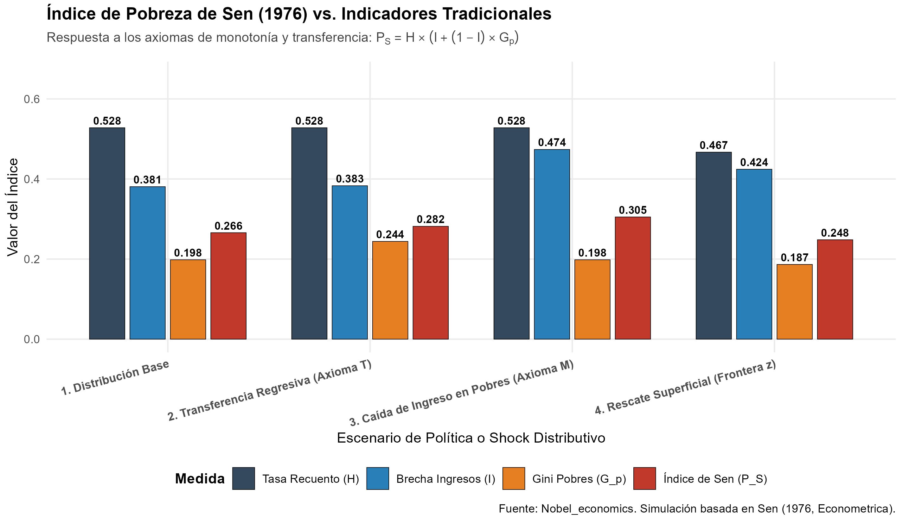
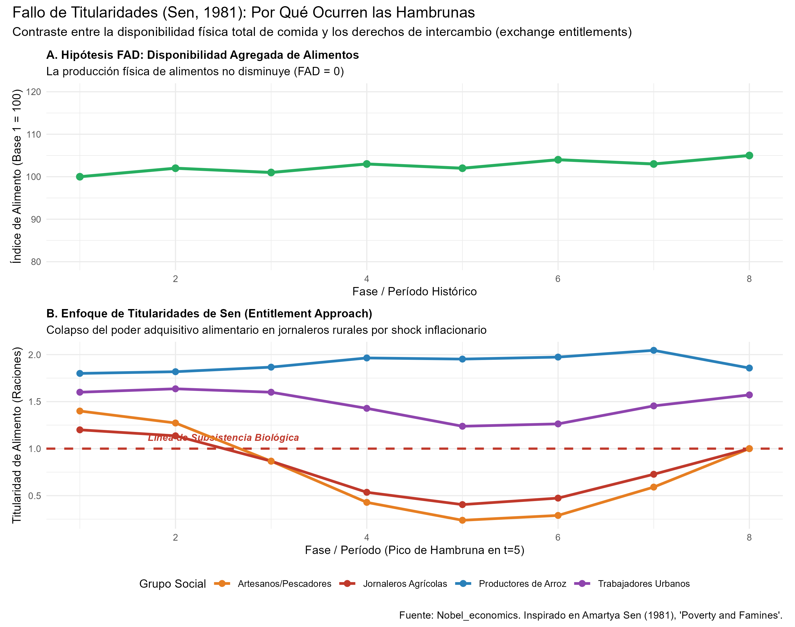

# Introducción y Objetivo

Este documento presenta la replicación metodológica, matemática y computacional de los aportes seminales por los cuales **Amartya Sen** fue galardonado con el Premio del Banco de Suecia en Ciencias Económicas en Memoria de Alfred Nobel en 1998: *"for his contributions to welfare economics"* (por sus contribuciones a la economía del bienestar).

La obra de Sen redefinió los cimientos de la economía del bienestar, la teoría de la elección social y el análisis de la privación humana a través de tres pilares interconectados:

1. **La medición axiomática de la pobreza y la desigualdad (Sen, 1976):** Demostró que las medidas tradicionales como la tasa de recuento (*headcount ratio*, $H$) y la brecha de ingresos agregada violan principios éticos y distributivos esenciales (el axioma de monotonía y el axioma de transferencia). Formuló el célebre **Índice de Pobreza de Sen**, $P_S = H [I + (1-I) G_p]$, que integra la incidencia, la intensidad y la desigualdad interna entre los pobres.
2. **El enfoque de titularidades y la economía de las hambrunas (Sen, 1981):** En su obra cumbre *Poverty and Famines*, refutó empírica e históricamente la hipótesis malthusiana convencional de caída agregada de alimentos (*Food Availability Decline*, FAD), demostrando que las hambrunas masivas (como la hambruna de Bengala de 1943) ocurren debido a un **fallo de titularidades** (*entitlement failure*) provocado por shocks inflacionarios y pérdida de capacidad de compra relativa en grupos ocupacionales vulnerables, aun cuando la producción física total de alimentos se mantiene estable o en aumento.
3. **El enfoque de capacidades y funcionamientos (*Capability Approach*, 1980, 1985, 1999):** Reemplazó la métrica utilitarista unidimensional del ingreso por la evaluación de las libertades reales de las personas para alcanzar estados y acciones valiosas (*functionings* y *capabilities*), cimiento directo del Índice de Desarrollo Humano (IDH) del PNUD.

## Declaración del Nivel de Replicación
- **Nivel:** **Ilustrativa y analítica**.
- Se desarrolla la formalización matemática completa de los índices axiomáticos de pobreza de Sen (1976) y del mapeo de titularidades de intercambio de Sen (1981).
- Se implementa una simulación en R que reproduce la conducta del Índice de Sen frente a experimentos distributivos controlados y recrea la dinámica histórica de la hambruna de Bengala de 1943 con FAD nulo.

---

# ¿Qué vas a aprender?

1. Por qué la tasa de recuento de la pobreza ($H$) genera incentivos perversos de política pública y cómo corregirlos mediante índices axiomáticos.
2. La derivación analítica e interpretación del Índice de Pobreza de Sen ($P_S$) y su descomposición en incidencia ($H$), brecha relativa ($I$) y coeficiente de Gini entre los pobres ($G_p$).
3. Cómo formalizar los axiomas de Monotonía (Axioma M), Transferencia (Axioma T) y Foco (Axioma F) propuestos por Sen.
4. El concepto de conjunto de titularidades (*entitlement set*), vector de dotaciones (*endowment vector*) y mapeo de titularidades de intercambio (*exchange entitlement mapping* $E$).
5. Por qué las hambrunas modernas son tragedias distributivas e institucionales y no meros shocks climáticos de oferta agregada.

---

# Marco Teórico

## 1. Medición Axiomática de la Pobreza (Sen, 1976)

Antes de la publicación de *"Poverty: An Ordinal Approach to Measurement"* (Econometrica, 1976), la literatura económica y los organismos internacionales evaluaban la pobreza casi exclusivamente mediante dos indicadores unidimensionales:

1. **Tasa de recuento (*Headcount Ratio*, $H$):**
   $$H = \frac{q}{N}$$
   donde $N$ es el tamaño total de la población y $q$ es el número de individuos cuyos ingresos caen por debajo de la línea de pobreza fijada $z$ ($y_i < z$).

2. **Razón de brecha de ingresos (*Income Gap Ratio*, $I$):**
   $$I = \frac{1}{q} \sum_{i=1}^q \frac{z - y_i}{z} = 1 - \frac{\mu_p}{z}$$
   donde $\mu_p = \frac{1}{q} \sum_{i=1}^q y_i$ es el ingreso promedio de las personas pobres.

### Las Limitaciones Éticas y Axiomáticas

Sen identificó que ambos indicadores tradicionales violan postulados fundamentales de justicia distributiva:

- **Violación del Axioma de Monotonía (Axioma M):** Un índice de pobreza debe incrementarse estrictamente si el ingreso de cualquier individuo pobre disminuye, manteniéndose todo lo demás constante.
  - La tasa de recuento $H$ es totalmente insensible a este empobrecimiento: si una familia en pobreza extrema pierde la mitad de sus ingresos, $H$ permanece inalterada.
- **Violación del Axioma de Transferencia (Axioma T):** Una transferencia de ingreso desde un individuo pobre hacia cualquier persona más rica (dentro o fuera de la pobreza) debe incrementar estrictamente el índice de pobreza.
  - Tanto $H$ como la brecha promedio $I$ violan este axioma. Una transferencia regresiva entre personas pobres no cambia la suma agregada del déficit ni el conteo de pobres; por ende, $H$ e $I$ permanecen ciegos ante el aumento de la desigualdad interna.
- **Incentivos perversos para la política pública:** Un gobierno evaluado únicamente por la tasa $H$ tiene un fuerte incentivo para concentrar todos sus recursos en rescatar a quienes están inmediatamente por debajo de $z$ ("los casi ricos entre los pobres"), abandonando a los más indigentes.

### El Índice de Pobreza de Sen ($P_S$)

Sen postuló un sistema axiomático ordinal que pondera las privaciones de cada individuo según su rango relativo de bienestar entre los pobres. Para una población con ingresos ordenados ascendentemente ($y_1 \le y_2 \le \dots \le y_q < z$):

$$P_S = \frac{2}{(q+1) N z} \sum_{i=1}^q (q - i + 1)(z - y_i)$$

Para poblaciones moderadamente grandes ($q \gg 1$), esta formulación se simplifica a la célebre expresión canónica:

$$P_S = H \left[ I + (1 - I) G_p \right]$$

donde:
- $H$: Tasa de recuento (dimensión de **incidencia**).
- $I$: Brecha proporcional promedio de ingresos de los pobres (dimensión de **profundidad o intensidad**).
- $G_p$: Coeficiente de Gini entre la población pobre (dimensión de **severidad o desigualdad interna**).

Si todos los pobres poseen el mismo ingreso, $G_p = 0$, reduciéndose el índice a $P_S = H \cdot I$ (el déficit normalizado de pobreza). En presencia de desigualdad entre los pobres, $G_p > 0$, penalizando fuertemente la concentración de la privación en los estratos más bajos.

---

## 2. El Enfoque de Titularidades y Hambrunas (Sen, 1981)

En *Poverty and Famines: An Essay on Entitlement and Deprivation* (1981), Sen investigó las grandes catástrofes humanitarias del siglo XX: la hambruna de Bengala (1943), las hambrunas de Etiopía (Wollo 1973, Harerghe 1974), el Sahel y Bangladesh (1974).

### La Crítica a la Hipótesis FAD (*Food Availability Decline*)

La teoría convencional asumía que las hambrunas se deben inexorablemente a una caída drástica en la oferta agregada de alimentos per cápita causada por sequías o inundaciones. Sen contrastó esta hipótesis con los datos reales:
- En Bengala (1943), la disponibilidad física de arroz fue aproximadamente **11% superior a la de 1941** (un año sin hambruna) y comparable al promedio del quinquenio anterior.
- En Wollo (Etiopía, 1973), mientras miles de campesinos morían de hambre en los caminos, los camiones transportaban granos hacia Adís Abeba, donde había demanda solvente.

### El Marco Analítico de Titularidades

Sen formalizó la capacidad de acceso a bienes mediante tres conceptos esenciales:

1. **Vector de dotaciones (*Endowment Vector*, $\mathbf{x}$):** Los recursos de los que dispone un agente: tierra, mano de obra, herramientas, bienes o ganado. Para un jornalero rural sin tierra, su dotación se reduce casi exclusivamente a su fuerza laboral: $\mathbf{x} = \{L\}$.
2. **Conjunto de titularidades (*Entitlement Set*, $E(\mathbf{x})$):** El conjunto de todos los paquetes de consumo accesibles para la persona a través de los mecanismos legales y de mercado (producción directa, intercambio comercial, empleo o transferencias estatales).
3. **Mapeo de titularidades de intercambio (*Exchange Entitlement Mapping*, $E_p$):** La tasa a la cual los recursos del individuo pueden transformarse en alimentos:
   $$F_i = \frac{w_i \cdot L_i}{P_f}$$
   donde $w_i$ es el salario nominal y $P_f$ es el precio del alimento básico (arroz).

Una hambruna ocurre para un grupo socioeconómico $i$ cuando su conjunto de titularidades colapsa por debajo de la canasta mínima de subsistencia biológica $F_{\text{min}}$:

$$\frac{w_i \cdot L_i}{P_f} < F_{\text{min}}$$

### La Dinámica de una "Hambruna de Expansión" (*Boom Famine*)

En Bengala 1943, el detonante no fue una sequía, sino el gasto militar británico asociado a la Segunda Guerra Mundial y el esfuerzo bélico en Calcuta. La inyección de liquidez aceleró la inflación de precios de bienes básicos. Los comerciantes urbanos y especuladores acapararon grano, cuadruplicando el precio del arroz ($P_f \times 4$). 

Mientras los trabajadores fabriles en Calcuta recibían raciones subsidiadas y los productores con tierra se beneficiaban de los precios astronómicos, los **jornaleros agrícolas rurales** y los **artesanos locales** sufrieron salarios nominales rígidos. Su titularidad de intercambio se desmoronó a menos del 40% del mínimo vital, pereciendo entre 2 y 3 millones de personas en medio de mercados con almacenes abastecidos.

---

# Replicación Computacional en R

A continuación se ejecutan y visualizan los dos bloques del modelo desarrollado en `laureados/1998_sen/replicacion/R/capacidades_pobreza_y_hambrunas.R`.

```{r setup, message=FALSE, warning=FALSE}
# Cargar librerías y script principal
suppressPackageStartupMessages({
  library(dplyr)
  library(tidyr)
  library(ggplot2)
  library(scales)
  library(patchwork)
})

# Ejecutar el script central de replicación
source("R/capacidades_pobreza_y_hambrunas.R")
```

## 1. Resultados de la Medición de Pobreza

La siguiente tabla resume el comportamiento de los indicadores analizados frente a los 4 escenarios planteados:

```{r tabla_pobreza, echo=FALSE}
knitr::kable(
  tabla_pobreza,
  digits = 4,
  caption = "Tabla 1: Comparación del Índice de Sen vs. Indicadores Tradicionales frente a Shocks y Políticas",
  col.names = c("Escenario", "N", "Pobres (q)", "Tasa H", "Brecha I", "Poverty Gap P_G", "Gini Pobres G_p", "Índice Sen P_S")
)
```

### Interpretación Económica de la Figura 1

{width=100%}

1. **Axioma de Transferencia (Escenario 2):** Al realizar una transferencia regresiva entre personas pobres que preserva la media intacta, la tasa de recuento ($H = 0.528$) y la brecha agregada ($P_G = 0.202$) permanecen casi inalteradas. Sin embargo, la desigualdad interna ($G_p$) escala de $0.1983$ a $0.2441$, lo que provoca un incremento directo del **Índice de Sen ($P_S$) de $0.2659$ a $0.2818$**.
2. **Axioma de Monotonía (Escenario 3):** Una contracción generalizada del 15% en los ingresos de quienes ya son pobres eleva la brecha $I$ de $0.3808$ a $0.4737$ y el índice $P_S$ a $0.3052$, mientras que la tasa tradicional $H$ es completamente ciega a este deterioro.
3. **Rescate Oportunista (Escenario 4):** Una política focalizada exclusivamente en transferir subsidios mínimos a quienes están a menos de 5 unidades monetarias de la línea de pobreza reduce fuertemente la tasa de recuento de $0.528$ a $0.467$. No obstante, la brecha $I$ de los que quedan en indigencia extrema aumenta a $0.4243$, evidenciando el sesgo ético de utilizar únicamente $H$ como objetivo gubernamental.

---

## 2. Dinámica del Colapso de Titularidades (Bengala 1943)

La Figura 2 ilustra el núcleo de la tesis de Sen sobre las hambrunas:

{width=100%}

- **Panel Superior (FAD):** La disponibilidad total agregada de alimentos se mantiene en una banda estable y ligeramente ascendente (100 a 105), descartando un colapso generalizado de la oferta.
- **Panel Inferior (Titularidades):** A pesar de la abundancia física de granos, el shock inflacionario en el arroz reduce la titularidad real de los jornaleros agrícolas de $1.20$ raciones a apenas $0.40$ raciones en el período de crisis ($t=5$), situándolos en inanición terminal. En agudo contraste, los productores agrícolas con excedente disfrutan de un aumento sustancial de sus ingresos reales, duplicando su capacidad de compra.

---

# Ejercicios para el Estudiante

## Ejercicio 1 (Básico: Descomposición del Índice de Sen)
Supongamos una comunidad con $N = 100$ habitantes y una línea de pobreza $z = 10$. Hay $q = 20$ personas pobres. Todos los pobres tienen exactamente el mismo ingreso individual de $y_i = 6$.
1. Calcula la tasa de recuento ($H$), la brecha de ingresos ($I$) y el coeficiente de Gini entre los pobres ($G_p$).
2. Calcula el valor del Índice de Sen ($P_S$).
3. ¿Qué ocurre con $P_S$ si la mitad de los pobres pasa a ganar $y_j = 4$ y la otra mitad pasa a ganar $y_k = 8$, manteniendo la media $\mu_p = 6$?

## Ejercicio 2 (Intermedio: El Dilema del Liberal Paretiano)
En *"The Impossibility of a Paretian Liberal"* (1970), Sen demostró que el principio de Optimalidad de Pareto y el principio de Libertad Individual Mínima son formalmente incompatibles.
1. Define formalmente la condición de Liberalismo Mínimo ($L^*$).
2. Explica la famosa paradoja del libro prohibido (*Lady Chatterley's Lover*) entre el censor puritano (Prude) y el lector libertino (Lewd), y demuestra por qué se genera un ciclo social intransitivo en la regla de decisión colectiva.

## Ejercicio 3 (Avanzado / Reto: Simulación de Política Anti-Hambruna en R)
Utilizando el marco de titularidades implementado en `capacidades_pobreza_y_hambrunas.R`, diseña una función en R que evalúe dos alternativas de intervención pública frente al shock inflacionario en $t=5$:
- **Alternativa A (Enfoque FAD):** El gobierno importa y reparte una cantidad física equivalente al 10% del grano total a través de bodegas urbanas.
- **Alternativa B (Enfoque de Titularidades de Sen):** El gobierno implementa un programa de transferencias monetarias condicionadas o empleo público de emergencia (*cash for work*) focalizado en los jornaleros rurales para restaurar su poder adquisitivo.
Evalúa cuál de las dos medidas evita que los jornaleros caigan por debajo de la subsistencia biológica.

---

# Preguntas de Discusión

1. ¿Por qué Sen sostiene que "nunca ha ocurrido una hambruna sustancial en un país independiente con elecciones regulares y prensa libre"? Analiza el rol de la retroalimentación informativa y la rendición de cuentas democrática frente a regímenes autoritarios (como la China del Gran Salto Adelante o la India colonial).
2. ¿Cómo influyó el enfoque de capacidades de Sen en la transición desde el enfoque de necesidades básicas hacia el Índice de Desarrollo Humano (IDH) y el Índice de Pobreza Multidimensional (IPM)?
3. Si un ministerio de hacienda busca reducir la pobreza utilizando subsidios monetarios con presupuesto limitado, ¿qué distorsiones se producen si su meta exclusiva es reducir la tasa de recuento $H$ en lugar de un índice axiomático de severidad como el de Foster-Greer-Thorbecke ($FGT_2$) o el de Sen?

---

# Referencias Bibliográficas

- Sen, A. (1970). *Collective Choice and Social Welfare*. San Francisco: Holden-Day.
- Sen, A. (1970). "The Impossibility of a Paretian Liberal". *Journal of Political Economy*, 78(1), 152–157.
- Sen, A. (1976). "Poverty: An Ordinal Approach to Measurement". *Econometrica*, 44(2), 219–231.
- Sen, A. (1981). *Poverty and Famines: An Essay on Entitlement and Deprivation*. Oxford: Clarendon Press.
- Sen, A. (1999). *Development as Freedom*. New York: Alfred A. Knopf.
- Royal Swedish Academy of Sciences (1998). "Amartya Sen's Contributions to Welfare Economics". *Nobelprize.org*.
