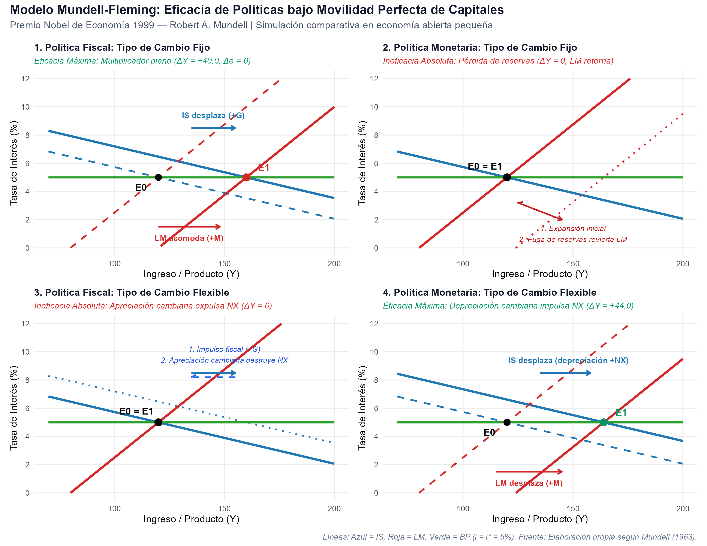

# Declaración de Nivel de Replicación

> **Nivel de Replicación:** **Ilustrativa**  
> **Fundamentación:** El aporte seminal de Robert A. Mundell galardonado con el Premio del Banco de Suecia en Ciencias Económicas en Memoria de Alfred Nobel 1999 es analítico y conceptual. Sus investigaciones sentaron las bases de la macroeconomía moderna de economías abiertas sin descansar en un microconjunto de datos econométricos de un único país, sino formulando modelos teóricos generales que explicaron el comportamiento macroeconómico internacional de la posguerra. Este reporte presenta una **simulación numérica computacional y analítica** de:
> 1. El **modelo canónico Mundell-Fleming (IS-LM-BP)** con perfecta movilidad de capitales, comparando la eficacia de las políticas fiscal y monetaria bajo tipos de cambio fijos versus flexibles.
> 2. La geometría analítica del **Trilema Macroeconómico (Trinidad Imposible de Mundell)**.
> 3. El marco de evaluación de perturbaciones asimétricas de la **Teoría de las Áreas Monetarias Óptimas (OCA)** de Mundell (1961).

---

# Marco Teórico

## El Modelo Mundell-Fleming (1960, 1962, 1963)

A principios de la década de 1960, la macroeconomía operaba casi en su totalidad bajo el supuesto de economías cerradas sintetizado en el esquema IS-LM de John Hicks y Alvin Hansen. Robert Mundell (1960, 1962, 1963) y Marcus Fleming (1962) extendieron este marco para analizar una economía abierta pequeña expuesta a los mercados internacionales de bienes y de capitales.

### Estructura de Ecuaciones de Economía Abierta

1. **Mercado de Bienes (Curva IS):**
   $$Y = C(Y - T) + I(i) + G + NX(Y, e)$$
   donde:
   - $C = c_0 + c_1(Y - T)$ es el consumo privado ($0 < c_1 < 1$).
   - $I = I_0 - d \cdot i$ es la inversión sensible a la tasa de interés doméstica ($d > 0$).
   - $G$ es el gasto del gobierno y $T = T_0 + t Y$ son los impuestos netos.
   - $NX = X_0 - m Y + q e$ son las exportaciones netas, donde $m > 0$ es la propensión marginal a importar y $q > 0$ captura la sensibilidad comercial al tipo de cambio nominal $e$ (definido como unidades de moneda nacional por unidad de divisa extranjera; una subida de $e$ representa una depreciación de la moneda nacional, abaratando los productos locales y expandiendo $NX$ bajo la condición Marshall-Lerner).

   Agrupando términos, la curva IS se despeja en el plano $(Y, i)$ como:
   $$i = \frac{A_0 + G + q e - s Y}{d}$$
   donde $s = 1 - c_1(1 - t) + m$ es la propensión marginal al ahorro e importación agregados, y $A_0 = c_0 - c_1 T_0 + I_0 + X_0$.

2. **Mercado de Dinero (Curva LM):**
   $$\frac{M}{P} = k Y - h i$$
   donde $M$ es la oferta nominal de dinero, $P$ el nivel de precios doméstico (fijo en el corto plazo), $k > 0$ es la sensibilidad de la demanda de dinero al producto y $h > 0$ su elasticidad a la tasa de interés. Despejando $i$:
   $$i = \frac{k Y - (M/P)}{h}$$

3. **Balanza de Pagos y Movilidad de Capitales (Curva BP):**
   $$BP = NX(Y, e) + CF(i - i^*)$$
   donde $CF$ representa el flujo neto de capitales privados en función del diferencial entre la tasa de interés interna $i$ y la tasa internacional $i^*$.
   Bajo el supuesto clásico de **movilidad perfecta de capitales** ($CF \to \infty$), los activos domésticos y foráneos son sustitutos perfectos. En equilibrio:
   $$i = i^*$$
   La curva BP es estrictamente horizontal al nivel de la tasa de interés del resto del mundo.

---

## Comparación de Regímenes y Eficacia de Políticas

Bajo libre movilidad de capitales, la efectividad de los instrumentos macroeconómicos se polariza de manera absoluta según el régimen cambiario adoptado:

| Régimen Cambiario | Política Económica | Multiplicador del Producto | Efecto Tasa de Interés | Efecto Tipo de Cambio | Diagnóstico de Eficacia |
| :--- | :--- | :---: | :---: | :---: | :---: |
| **Tipo de Cambio Fijo** | **Fiscal Expansiva ($\Delta G > 0$)** | $\Delta Y = \frac{\Delta G}{s}$ | $\Delta i = 0$ ($i = i^*$) | $\Delta e = 0$ | **Máxima Eficacia** (Acomodación monetaria endógena) |
| **Tipo de Cambio Fijo** | **Monetaria Expansiva ($\Delta M > 0$)** | $\Delta Y = 0$ | $\Delta i = 0$ ($i = i^*$) | $\Delta e = 0$ | **Ineficacia Absoluta** (Pérdida neta de reservas) |
| **Tipo de Cambio Flexible** | **Fiscal Expansiva ($\Delta G > 0$)** | $\Delta Y = 0$ | $\Delta i = 0$ ($i = i^*$) | $\Delta e < 0$ (Apreciación) | **Ineficacia Absoluta** (Crowding-out externo vía exportaciones netas) |
| **Tipo de Cambio Flexible** | **Monetaria Expansiva ($\Delta M > 0$)** | $\Delta Y = \frac{\Delta M}{k}$ | $\Delta i = 0$ ($i = i^*$) | $\Delta e > 0$ (Depreciación) | **Máxima Eficacia** (Estímulo cambiario a $NX$) |

---

## La Trinidad Imposible o Trilema Macroeconómico

El resultado más influyente del análisis de Mundell es la identificación de un conflicto estructural e insalvable entre tres objetivos de política económica:

1. **Integración financiera internacional** (libre movilidad transfronteriza de capitales).
2. **Estabilidad cambiaria** (tipo de cambio nominal fijo o administrado).
3. **Autonomía monetaria** (capacidad de fijar la tasa de interés interna según las necesidades cíclicas domésticas).

De acuerdo con la condición de paridad descubierta de tasas de interés (*Uncovered Interest Parity*, UIP):
$$i_t = i_t^* + \frac{E_t[e_{t+1}] - e_t}{e_t}$$

Si el tipo de cambio está fijado creíblemente ($e_{t+1} = e_t = \bar{e}$), entonces necesariamente $i_t = i_t^*$. El banco central pierde de forma irreversible el control de su tasa de interés: la oferta monetaria se vuelve pasiva y endógena. Si desea recuperar el control de su política monetaria interna, solo tiene dos caminos: permitir la flotación de su moneda (renunciando a la estabilidad cambiaria) o imponer controles estrictos al movimiento de capitales (renunciando a la integración financiera).

---

## Teoría de las Áreas Monetarias Óptimas (Mundell, 1961)

En su célebre artículo de 1961 en *The American Economic Review*, Mundell formuló una pregunta fundacional: ¿por qué las fronteras de las monedas deben coincidir con las fronteras políticas de los Estados-nación?

Mundell evaluó los costos y beneficios de formar una unión monetaria (o adoptar una moneda común):
- **Beneficios:** Eliminación radical de costos de transacción de conversión de divisas, supresión del riesgo cambiario, completa transparencia de precios e intensificación del comercio intrarregional.
- **Costos:** Pérdida permanente del tipo de cambio nominal y de la política monetaria nacional como instrumentos de amortiguación frente a **perturbaciones asimétricas**.

### El Criterio de Mundell: Movilidad de Factores
Si la Región A sufre un shock negativo de demanda mientras la Región B enfrenta un auge, en ausencia de tipos de cambio flexibles entre ellas:
- Si los trabajadores desempleados de A pueden migrar libremente y sin fricciones a B (**alta movilidad laboral**), el desempleo en A y las presiones inflacionarias en B se disipan automáticamente.
- Si la mano de obra es inmóvil (por barreras lingüísticas, culturales, previsionales o geográficas) y los salarios nominales son rígidos a la baja, la Región A quedará atrapada en una recesión crónica y desempleo prolongado.

Por lo tanto, la **movilidad laboral transfronteriza** constituye el criterio esencial que define a un área monetaria óptima, complementado más tarde por la diversificación productiva (Kenen, 1969), la apertura comercial (McKinnon, 1963) y el federalismo fiscal con transferencias automáticas.

---

# Implementación Numérica en R

El código en `R/mundell_fleming_y_trilema.R` calibra una economía abierta pequeña con parámetros empíricamente representativos y simula los 4 cuadrantes del modelo IS-LM-BP junto con la representación geométrica del trilema macroeconómico.

```r
# Parámetros estructurales del modelo Mundell-Fleming
c0 <- 20; c1 <- 0.75; t <- 0.20
I0 <- 30; d  <- 15
G0 <- 69; T0 <- 20
X0 <- 25; m  <- 0.15; q <- 12
e0 <- 1.0  # Tipo de cambio normalizado

k_param <- 0.25; h_param <- 2.0
M0      <- 20
i_star  <- 5.0  # Tasa internacional (5%)

# Propensión al gasto efectiva
s_param <- 1 - c1 * (1 - t) + m  # 0.55
A0      <- c0 - c1 * T0 + I0 + X0  # 60
```

---

# Resultados de la Simulación

## Dinámica Comparada de Políticas en el Modelo IS-LM-BP

La simulación computacional de los cuatro escenarios arrojó la siguiente matriz de ajuste macroeconómico:



### Análisis de los Resultados Obtenidos

1. **Política Fiscal con Tipo de Cambio Fijo (Cuadrante 1):**
   - Un shock fiscal expansivo de $\Delta G = +22$ desplaza la curva IS hacia la derecha.
   - La tasa interna experimenta una presión alcista temporal por encima de $i^* = 5\%$.
   - Esto desencadena una entrada masiva de capitales foráneos. Para evitar la apreciación de la moneda nacional y sostener la paridad $e = 1.0$, el Banco Central adquiere las divisas excedentes inyectando liquidez doméstica.
   - La curva LM se desplaza endógenamente a la derecha ($\Delta M = +10$).
   - El producto se incrementa plenamente de $Y = 120$ a $Y = 160$ ($\Delta Y = +40.0$), verificando el multiplicador del gasto sin ningún desplazamiento por tasa de interés.

2. **Política Monetaria con Tipo de Cambio Fijo (Cuadrante 2):**
   - Un intento de expansión monetaria de $\Delta M = +11$ traslada inicialmente la LM a la derecha.
   - La tasa de interés interna cae por debajo de $i^* = 5\%$, propiciando una fuga inmediata de capitales.
   - La presión depreciatoria fuerza al Banco Central a vender reservas internacionales para rescatar la moneda local.
   - La oferta monetaria se contrae hasta volver con exactitud al nivel inicial ($M = 20$), regresando la LM al punto $E_0$.
   - Resultado: $\Delta Y = 0.0$. La política monetaria no posee autonomía alguna.

3. **Política Fiscal con Tipo de Cambio Flexible (Cuadrante 3):**
   - El incremento del gasto fiscal $\Delta G = +22$ presiona al alza la tasa interna.
   - La consiguiente entrada de capitales aprecia nominal y realmente la moneda nacional ($\Delta e = -1.833$).
   - La apreciación erosiona la competitividad externa de las exportaciones y abarata las importaciones ($\Delta NX < 0$), contrayendo la IS hasta neutralizar por completo el impulso fiscal inicial.
   - Resultado: $\Delta Y = 0.0$. El *crowding-out* externo es del 100%.

4. **Política Monetaria con Tipo de Cambio Flexible (Cuadrante 4):**
   - La expansión de la oferta monetaria $\Delta M = +11$ reduce la tasa de interés interna por debajo de $i^*$.
   - La salida de capitales hacia el exterior provoca una depreciación de la moneda nacional ($\Delta e = +2.017$).
   - La depreciación abarata los bienes nacionales respecto a los extranjeros, provocando un auge exportador que desplaza la curva IS hacia la derecha.
   - El nuevo equilibrio se establece en $Y = 164$ ($\Delta Y = +44.0$) con la tasa de interés anclada a $i^* = 5\%$.
   - La política monetaria opera íntegramente a través del canal del tipo de cambio.

---

## El Trilema Macroeconómico de Mundell

La siguiente figura sintetiza las opciones institucionales de política económica internacional derivadas de la incompatibilidad de objetivos de Mundell:


Los tres lados del triángulo representan las arquitecturas monetarias viables:
- **Lado 1 (Unión Monetaria / Caja de Conversión):** Máxima integración financiera y estabilidad cambiaria, renunciando a la tasa de interés como estabilizador interno (caso Eurozona y Hong Kong).
- **Lado 2 (Controles de Capital):** Estabilidad cambiaria y autonomía monetaria a costa de aislarse de los mercados internacionales de capital (régimen histórico de Bretton Woods 1944-1971 y China pre-2015).
- **Lado 3 (Flotación con Metas de Inflación):** Libre movilidad de capitales y banco central con política monetaria independiente, dejando flotar el tipo de cambio (régimen predominante en la OCDE y bancos centrales independientes modernos).

---

## Resumen Numérico de Escenarios Simulados

```{r}
#| echo: false
tab_res <- readr::read_csv("salidas/tab_resultados_mundell.csv", show_col_types = FALSE)
knitr::kable(tab_res, caption = "Matriz de multiplicadores y resultados cuantitativos: Modelo Mundell-Fleming")
```

---

# Comparación con la Literatura y Extensiones Posteriores

1. **El Modelo de Sobrerreacción de Dornbusch (1976):**
   Rudiger Dornbusch, discípulo de Mundell, extendió el modelo introduciendo expectativas racionales y rigidez temporal de precios de bienes frente a ajuste instantáneo de los mercados de activos. Demostró que un shock monetario provoca una depreciación cambiaria inicial que sobrepasa (*overshoots*) ampliamente su valor de equilibrio de largo plazo antes de retornar paulatinamente, explicando la alta volatilidad observada en los tipos de cambio flotantes.

2. **La Hipótesis del "Dilema, no Trilema" (Hélène Rey, 2013, 2015):**
   Investigaciones contemporáneas han reexaminado el trilema de Mundell en el contexto de la híperglobalización financiera. Rey argumenta que la existencia de un **Ciclo Financiero Global** (*Global Financial Cycle*, GFC) impulsado por la política de la Reserva Federal y las primas de riesgo globales limita la independencia monetaria efectiva de las economías emergentes, incluso bajo tipos de cambio flotantes, a menos que utilicen políticas macroprudenciales o controles a los flujos de capital.

3. **La Crisis del Euro (2010-2015) y los Criterios OCA de Mundell:**
   La crisis de deuda soberana de la periferia europea (Grecia, España, Portugal, Irlanda) fue un dramático recordatorio de las advertencias de Mundell en 1961: al no contar con alta movilidad laboral paneuropea, salarios suficientemente flexibles a la baja ni un presupuesto fiscal federal unificado, los países de la periferia tuvieron que ejecutar una dolorosa "devaluación interna" (recesión y desempleo masivo) para recuperar competitividad tras un shock asimétrico.

---

# Ejercicios para el Estudiante

1. **Básico:** Deduce analíticamente qué ocurre con la balanza comercial de una economía pequeña cuando el gobierno implementa un arancel a las importaciones bajo tipo de cambio flexible con libre movilidad de capitales. ¿Se reduce el déficit comercial en el nuevo equilibrio?
2. **Intermedio:** Si los agentes económicos forman expectativas de depreciación futura ($\Delta e^e > 0$), ¿cómo se altera la posición de la curva BP en el modelo Mundell-Fleming y qué costo en términos de tasa de interés debe pagar el banco central para sostener la paridad fija?
3. **Reto:** Analiza las consecuencias de la salida de Gran Bretaña del Mecanismo Europeo de Tipos de Cambio (ERM) en el "Miércoles Negro" de septiembre de 1992 a través del marco de la Trinidad Imposible de Mundell.
