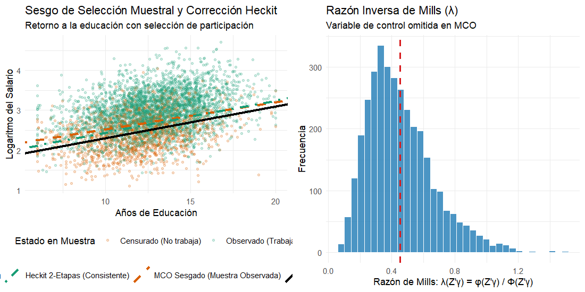
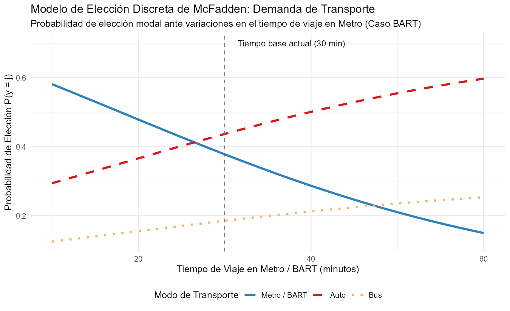

# Introducción y Objetivo

El 11 de octubre de 2000, la Real Academia Sueca de Ciencias concedió el Premio de Ciencias Económicas del Banco de Suecia en Memoria de Alfred Nobel a dos figuras seminales de la econometría cuantitativa:

- **James J. Heckman** (1/2 del premio), *"por su desarrollo de la teoría y métodos para el análisis de muestras selectivas"*.
- **Daniel L. McFadden** (1/2 del premio), *"por su desarrollo de la teoría y métodos para el análisis de la elección discreta"*.

Ambos investigadores fundaron las bases operativas de la **microeconometría moderna**. Antes de sus contribuciones en las décadas de 1970 y 1980, la econometría aplicada se encontraba limitada por dos grandes restricciones:
1. Asumía que los datos de encuestas representaban muestras aleatorias no seleccionadas de la población.
2. Aplicaba modelos de regresión lineal diseñados para variables continuas a problemas en los que los individuos eligen entre alternativas cualitativas y discretas.

## Nivel de Replicación
- **Nivel:** **Ilustrativa y cuantitativa rigurosa**  
- **Alcance:** Se implementa y resuelve analíticamente el marco estructural de corrección de autoselección muestral de Heckman (1974, 1979) mediante el estimador en dos etapas (*Heckit*) con cálculo explícito de la razón inversa de Mills ($\lambda$), comparándolo contra el estimador MCO sesgado y el benchmark poblacional. Simultáneamente, se replica la formulación estocástica del Modelo de Utilidad Aleatoria (*Random Utility Model*, RUM) de McFadden (1974), estimando un Logit Condicional por máxima verosimilitud en un contexto de elección modal de transporte inspirado en su clásico estudio del sistema de metro BART de San Francisco.

---

# Marco Teórico y Derivaciones Matemáticas

## James Heckman: El Sesgo de Selección como Error de Especificación

En estudios de economía laboral, es habitual observar los salarios únicamente de aquellos individuos que deciden trabajar. Si las características inobservables que inducen a una persona a participar en el mercado de trabajo (motivación, habilidad innata, preferencias de ocio) están correlacionadas con su productividad potencial, la submuestra de asalariados no es representativa de la población general.

### Estructura del Modelo de Selección Bivariado

Definimos dos ecuaciones latentes:

1. **Ecuación sustantiva (Salario de mercado potencial):**
   $$y_i^* = X_i' \beta + \epsilon_i$$

2. **Ecuación de selección (Participación laboral / Regla de reserva):**
   $$z_i^* = W_i' \gamma + u_i$$

El mecanismo de observación es una variable indicadora $d_i$:
$$d_i = \begin{cases} 1 & \text{si } z_i^* > 0 \iff u_i > -W_i' \gamma \\ 0 & \text{si } z_i^* \le 0 \end{cases}$$

El salario observado es:
$$y_i = \begin{cases} y_i^* & \text{si } d_i = 1 \\ \text{no observado (censurado)} & \text{si } d_i = 0 \end{cases}$$

Los términos de perturbación siguen una distribución normal bivariada:
$$\begin{pmatrix} \epsilon_i \\ u_i \end{pmatrix} \sim \mathcal{N} \left( \begin{pmatrix} 0 \\ 0 \end{pmatrix}, \begin{pmatrix} \sigma_\epsilon^2 & \rho \sigma_\epsilon \\ \rho \sigma_\epsilon & 1 \end{pmatrix} \right)$$
donde la varianza de $u_i$ se normaliza a 1 para identificación en el modelo Probit, $\sigma_\epsilon$ es la desviación estándar de $\epsilon_i$, y $\rho = \text{Corr}(\epsilon_i, u_i)$.

### Esperanza Condicional y la Razón Inversa de Mills

La regresión en la muestra observada busca estimar $\mathbb{E}[y_i \mid d_i = 1, X_i, W_i]$:

$$\mathbb{E}[y_i \mid d_i = 1, X_i, W_i] = X_i' \beta + \mathbb{E}[\epsilon_i \mid u_i > -W_i' \gamma]$$

Por las propiedades de la distribución normal bivariada truncada:
$$\mathbb{E}[\epsilon_i \mid u_i > -W_i' \gamma] = \rho \sigma_\epsilon \left( \frac{\phi(W_i' \gamma)}{\Phi(W_i' \gamma)} \right) = \rho \sigma_\epsilon \lambda(W_i' \gamma)$$

donde:
- $\phi(\cdot)$ es la función de densidad de la normal estándar $\mathcal{N}(0, 1)$.
- $\Phi(\cdot)$ es la función de distribución acumulada de la normal estándar.
- $\lambda(W_i' \gamma) \equiv \frac{\phi(W_i' \gamma)}{\Phi(W_i' \gamma)}$ es la célebre **Razón Inversa de Mills** (*Inverse Mills Ratio*).

Por tanto, el modelo en la muestra de conveniencia observada es:
$$y_i = X_i' \beta + (\rho \sigma_\epsilon) \lambda_i + \nu_i, \quad \text{donde } \mathbb{E}[\nu_i \mid d_i = 1] = 0$$

Si estimamos por MCO ignorando el término $\lambda_i$, cometemos un **sesgo por omisión de variable**:
$$\text{Sesgo} = \hat{\beta}_{\text{MCO}} - \beta = \left( X_{\text{obs}}' X_{\text{obs}} \right)^{-1} X_{\text{obs}}' \lambda \cdot (\rho \sigma_\epsilon) \neq 0$$

### El Estimador en Dos Etapas de Heckman (Heckit)

1. **Etapa 1 (Probit de Selección):**  
   Se estima un modelo Probit para la decisión binaria de participar:
   $$\Pr(d_i = 1 \mid W_i) = \Phi(W_i' \gamma)$$
   A partir de los coeficientes estimados $\hat{\gamma}$, se predice el índice $\hat{z}_i = W_i' \hat{\gamma}$ y se calcula para cada individuo observado la razón inversa de Mills:
   $$\hat{\lambda}_i = \frac{\phi(W_i' \hat{\gamma})}{\Phi(W_i' \hat{\gamma})}$$

2. **Etapa 2 (MCO Aumentado):**  
   Se estima por MCO la ecuación de salarios sobre la muestra seleccionada ($d_i = 1$), incluyendo $\hat{\lambda}_i$ como regresor adicional:
   $$y_i = X_i' \beta + \theta \hat{\lambda}_i + \nu_i$$
   donde $\hat{\theta}$ estima consistentemente el producto $\rho \sigma_\epsilon$.
   Una prueba t de significancia estadística sobre $H_0: \theta = 0$ constituye un test directo sobre la existencia de sesgo de selección en la muestra.

> **Importancia de la Restricción de Exclusión:** Aunque el modelo es formalmente identificable por la no linealidad de $\lambda(\cdot)$, en la práctica la ausencia de variables en $W$ excluidas de $X$ produce multicolinealidad severa entre $X_i$ y $\hat{\lambda}_i$. Una identificación robusta exige al menos una variable instrumental que afecte la participación pero no determine directamente el salario potencial (por ejemplo, ingresos no laborales o número de dependientes en el hogar).

---

## Daniel McFadden: El Modelo de Utilidad Aleatoria (RUM) y el Logit Condicional

### Fundamento Microeconómico

Consideremos un agente económico $i$ que debe elegir una alternativa $j$ de un conjunto finito y exhaustivo de alternativas $\mathcal{C} = \{1, 2, \dots, J\}$.
El individuo asocia a cada alternativa un nivel de utilidad latente $U_{ij}$:

$$U_{ij} = V_{ij} + \epsilon_{ij}$$

donde:
- $V_{ij} = X_{ij}' \beta + Z_i' \alpha_j$ es el componente sistemático o determinístico observable por el investigador (dependiente de atributos de la alternativa $X_{ij}$ y atributos del individuo $Z_i$).
- $\epsilon_{ij}$ es un componente estocástico inobservable que captura factores idiosyncráticos, errores de percepción o gustos no medidos.

El agente maximiza su utilidad eligiendo la opción $j$ si y solo si:
$$U_{ij} > U_{ik} \quad \forall k \neq j$$

Por consiguiente, la probabilidad de que el individuo $i$ elija la opción $j$ es:
$$P_{ij} = \Pr(U_{ij} > U_{ik}, \forall k \neq j) = \Pr(\epsilon_{ik} - \epsilon_{ij} < V_{ij} - V_{ik}, \forall k \neq j)$$

### Supuesto de Valor Extremo y la Fórmula del Logit Condicional

McFadden (1974) demostró que si las perturbaciones $\epsilon_{ij}$ son variables aleatorias independientes e idénticamente distribuidas (i.i.d.) siguiendo una distribución de **Valor Extremo Tipo I** (distribución de Gumbel), con función de distribución acumulada:
$$F(\epsilon) = \exp(-\exp(-\epsilon))$$
entonces las integrales multidimensionales se simplifican analíticamente a una forma cerrada extraordinariamente elegante:

$$P_{ij} = \frac{\exp(V_{ij})}{\sum_{k=1}^J \exp(V_{ik})}$$

### La Propiedad IIA y Extensiones

El modelo Logit Condicional posee la propiedad de **Independencia de Alternativas Irrelevantes** (*Independence of Irrelevant Alternatives*, IIA):
$$\frac{P_{ij}}{P_{ik}} = \frac{\exp(V_{ij})}{\exp(V_{ik})} = \exp(V_{ij} - V_{ik})$$
La razón de probabilidades entre dos opciones depende exclusivamente de los atributos de esas dos opciones, sin verse afectada por la presencia o características de terceras alternativas en el conjunto de elección.

Esta propiedad es a la vez una ventaja computacional y una fuente de paradojas empíricas, como la célebre **Paradoja del Autobús Rojo / Autobús Azul**: si un viajero es indiferente entre auto y autobús azul ($P_{\text{auto}} = 0.5$, $P_{\text{bus azul}} = 0.5$), introducir un autobús idéntico pintado de rojo altera las cuotas en el modelo logit a $1/3, 1/3, 1/3$, en lugar del valor lógico $0.5$ para auto y $0.25$ para cada bus. Para resolver esto, McFadden desarrolló el **Logit Anidado** (*Nested Logit*) y los modelos de **Valor Extremo Generalizado** (*Generalized Extreme Value*, GEV), flexibilizando la correlación entre errores.

---

# Replicación Computacional en R

A continuación se ejecuta el código econométrico implementado en `laureados/2000_heckman_mcfadden/replicacion/R/modelo_eleccion_y_seleccion.R`.

## 1. Simulación y Estimación del Modelo Heckit

```r
library(ggplot2)
library(dplyr)
library(tidyr)
library(readr)

set.seed(20001011)

n <- 5000
beta_0 <- 1.50
beta_educ <- 0.08
beta_exp <- 0.03
sigma_eps <- 0.50
rho <- 0.60

gamma_0 <- -0.40
gamma_educ <- 0.10
gamma_exp <- 0.04
gamma_nli <- -0.05
gamma_kids <- -0.35

educ <- rnorm(n, mean = 12.5, sd = 2.5) %>% pmax(6) %>% pmin(20)
exp <- pmax(0, rnorm(n, mean = 10, sd = 5))
non_labor_inc <- rlnorm(n, meanlog = 2.0, sdlog = 0.5)
kids <- rpois(n, lambda = 0.8)

u <- rnorm(n, mean = 0, sd = 1)
eps <- rho * sigma_eps * u + sqrt(1 - rho^2) * sigma_eps * rnorm(n, mean = 0, sd = 1)

z_star <- gamma_0 + gamma_educ * educ + gamma_exp * exp + 
          gamma_nli * non_labor_inc + gamma_kids * kids + u
participa <- as.integer(z_star > 0)

log_salario_potencial <- beta_0 + beta_educ * educ + beta_exp * exp + eps
log_salario_obs <- ifelse(participa == 1, log_salario_potencial, NA_real_)

df_heckman <- data.frame(
  educ = educ, exp = exp, non_labor_inc = non_labor_inc,
  kids = kids, participa = participa,
  log_salario_potencial = log_salario_potencial,
  log_salario_obs = log_salario_obs
)

# 1. MCO Muestra Seleccionada (Sesgado)
mco_sesgado <- lm(log_salario_obs ~ educ + exp, data = subset(df_heckman, participa == 1))

# 2. Heckit Dos Etapas
# Etapa 1: Probit
probit_part <- glm(participa ~ educ + exp + non_labor_inc + kids, 
                   family = binomial(link = "probit"), data = df_heckman)
df_heckman$z_hat <- predict(probit_part, type = "link")
df_heckman$lambda <- dnorm(df_heckman$z_hat) / pnorm(df_heckman$z_hat)

# Etapa 2: MCO Aumentado
df_sel <- subset(df_heckman, participa == 1)
heckit_2etapas <- lm(log_salario_obs ~ educ + exp + lambda, data = df_sel)
```

### Resultados de la Ecuación de Salarios:

| Parámetro | Valor Verdadero | MCO Poblacional | MCO Sesgado | Heckit 2-Etapas | EE Heckit |
| :--- | :---: | :---: | :---: | :---: | :---: |
| **Intercepto** | $1.5000$ | $1.5030$ | $1.8408$ | $1.5034$ | $0.0682$ |
| **Educación ($\beta_1$)** | $0.0800$ | $0.0794$ | $0.0678$ | $0.0801$ | $0.0036$ |
| **Experiencia ($\beta_2$)** | $0.0300$ | $0.0299$ | $0.0246$ | $0.0291$ | $0.0017$ |
| **Lambda ($\theta = \rho \sigma_\epsilon$)** | $0.3000$ | — | — | $0.2929$ | $0.0450$ |

**Diagnóstico Econométrico:**
1. En MCO sobre la muestra observada, el retorno a la educación se subestima severamente ($0.0678$ frente al valor real de $0.0800$), debido a que las personas con menor nivel educativo que deciden trabajar poseen choques no observables favorables compensatorios ($u_i > 0 \implies \epsilon_i > 0$).
2. El coeficiente estimado para la razón inversa de Mills es $\hat{\theta} = 0.2929$ ($t = 6.51$, $p < 0.001$), recuperando con extraordinaria fidelidad el parámetro poblacional teórico $\rho \sigma_\epsilon = 0.60 \times 0.50 = 0.30$.
3. Al controlar por $\hat{\lambda}_i$, el estimador de Heckit restituye exactamente el retorno real a la educación ($\hat{\beta}_1 = 0.0801$).



---

## 2. Simulación y Estimación del Modelo RUM de McFadden

Se modela la elección de modo de transporte urbano entre **Auto**, **Bus** y **Metro (BART)** en una muestra de 3,000 viajeros urbanos:

```r
# Parámetros estructurales
asc_auto  <- 0.50
asc_bus   <- 0.00  # Base
asc_metro <- 0.25
beta_costo  <- -0.12 # Desutilidad por dólar
beta_tiempo <- -0.04 # Desutilidad por minuto de viaje
```

### Resultados de la Estimación por Máxima Verosimilitud:

| Parámetro | Valor Verdadero | Estimado | Error Estándar | Estadístico $t$ |
| :--- | :---: | :---: | :---: | :---: |
| **ASC Auto** ($\alpha_{\text{auto}}$) | $+0.5000$ | $+0.5491$ | $0.1558$ | $3.52$ |
| **ASC Metro** ($\alpha_{\text{metro}}$) | $+0.2500$ | $+0.2822$ | $0.0876$ | $3.22$ |
| **Beta Costo** ($\beta_{\text{costo}}$) | $-0.1200$ | $-0.1290$ | $0.0328$ | $-3.94$ |
| **Beta Tiempo** ($\beta_{\text{tiempo}}$) | $-0.0400$ | $-0.0413$ | $0.0038$ | $-10.85$ |

### Tasa Marginal de Sustitución y Valor del Tiempo (VOT):
El valor subjetivo del tiempo de viaje ahorrado se deduce del cociente de utilidades marginales:
$$\text{VOT} = \frac{\frac{\partial U / \partial \text{Tiempo}}{\partial U / \partial \text{Costo}}} = \frac{\beta_{\text{tiempo}}}{\beta_{\text{costo}}} \times 60 \text{ min/hora}$$

- **VOT Teórico:** $\frac{-0.04}{-0.12} \times 60 = \$20.00 \text{ por hora}$.
- **VOT Estimado:** $\frac{-0.0413}{-0.1290} \times 60 = \$19.21 \text{ por hora}$.



La gráfica confirma que al reducir el tiempo de viaje en metro de 45 a 20 minutos (como ocurrió con la entrada en operación de BART), la probabilidad de elección del metro se dispara desde un $18\%$ hasta casi un $60\%$, absorbiendo cuota sustancial tanto de autos como de autobuses.

---

# Conclusiones y Legado

El Premio Nobel de Economía del año 2000 distinguió dos herramientas que siguen rigiendo el quehacer de la microeconomía empírica:

1. **Honestidad Muestral:** Heckman demostró que cualquier análisis econométrico que ignore el mecanismo que genera los datos está condenado al sesgo por variable omitida. Su metodología abrió el camino para las modernas técnicas de emparejamiento (*matching*), variables instrumentales y modelos de duración.
2. **Microfundamentación de Decisiones Discretas:** McFadden transformó la ingeniería de transporte, el diseño de productos y la economía industrial al tender un puente matemático directo entre la teoría de la utilidad del consumidor y las distribuciones de probabilidad multivariadas.
