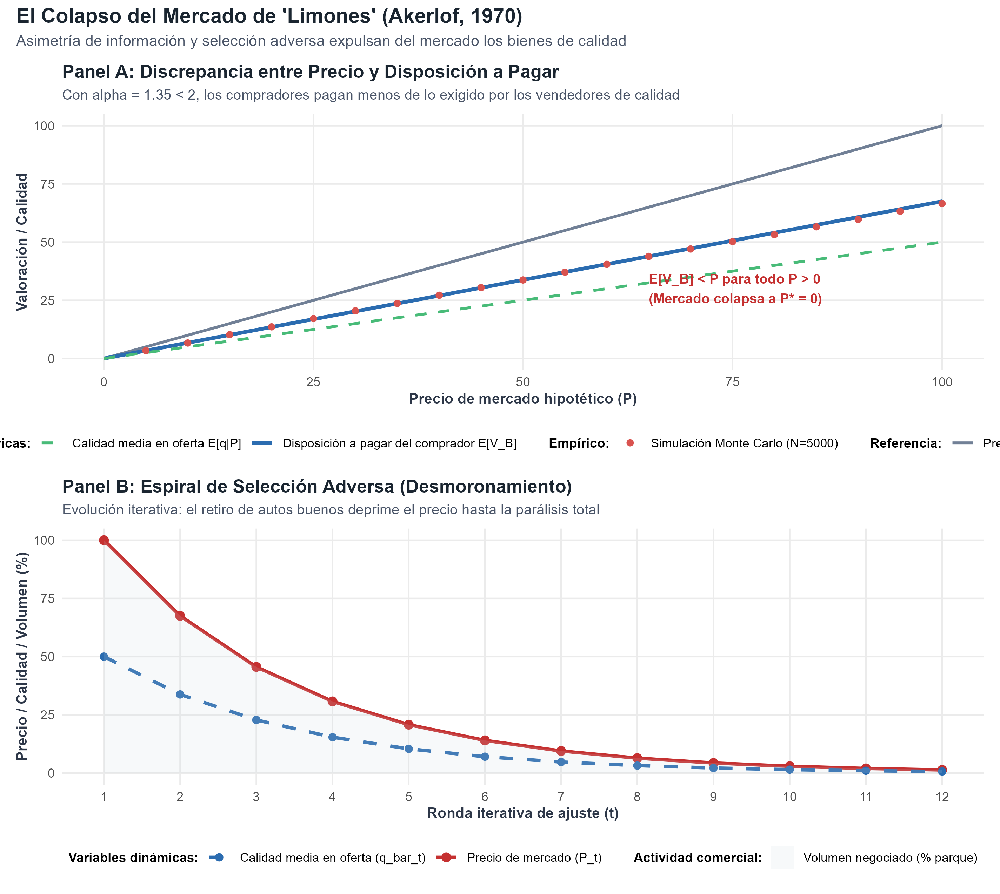
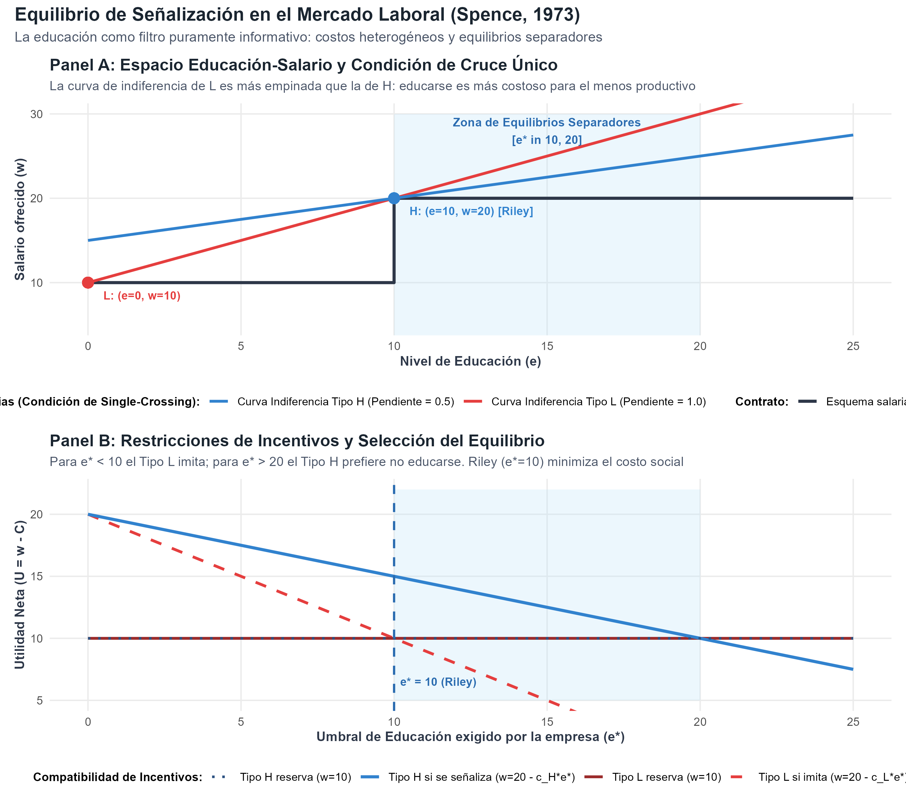

# Introducción y Objetivo

En 2001, la Real Academia Sueca de Ciencias otorgó el Premio de Ciencias Económicas del Banco de Suecia en Memoria de Alfred Nobel a **George A. Akerlof** (University of California, Berkeley), **A. Michael Spence** (Stanford University) y **Joseph E. Stiglitz** (Columbia University) *"por sus análisis de mercados con información asimétrica"* (*for their analyses of markets with asymmetric information*).

Antes de sus contribuciones, el paradigma económico neoclásico dominante (la teoría del equilibrio general walrasiano formalizada por Arrow y Debreu) descansaba sobre el supuesto de que todos los agentes económicos disponían de información simétrica y perfecta respecto a la calidad de los bienes negociados y las acciones de sus contrapartes. En este marco, los precios actuaban como un mecanismo infalible que vaciaba los mercados y garantizaba la eficiencia en el sentido de Pareto (Primer Teorema del Bienestar).

Akerlof, Spence y Stiglitz revolucionaron la disciplina al demostrar que en la inmensa mayoría de las transacciones reales una de las partes posee más y mejor información que la otra, lo que altera radicalmente la conducta estratégica y la eficiencia del mercado:

1. **George Akerlof (1970) y la Selección Adversa (*Adverse Selection*):** Si los compradores no pueden distinguir la calidad antes de comprar, sólo pagan según la calidad promedio. Esto desincentiva a los propietarios de bienes de alta calidad, provocando su retiro y desatando una espiral que puede conducir a la desaparición total del mercado (*market unraveling* o colapso de mercado).
2. **Michael Spence (1973) y la Señalización (*Signaling*):** Los agentes mejor informados pueden superar la desconfianza del mercado enviando **señales creíbles**. Para que una señal sea efectiva, debe satisfacer la condición de cruce único (*single-crossing property* o condición de Spence-Mirrlees): debe ser sistemáticamente más costosa de adquirir para los tipos de baja calidad que para los de alta calidad.
3. **Joseph Stiglitz (1976, 1981) y el Filtrado (*Screening*):** Cuando la parte desinformada toma la iniciativa, puede diseñar un menú de contratos autoselectivos que induzca a los agentes a revelar voluntariamente su información privada (como pólizas de seguros con deducibles diferenciados o racionamiento de crédito bancario).

## Nivel de Replicación
- **Nivel:** **Ilustrativa** (simulación computacional y resolución matemática analítica de los modelos fundacionales de Akerlof 1970, Spence 1973 y Stiglitz & Weiss 1981, integrando simulaciones Monte Carlo del colapso del mercado y caracterización formal de equilibrios separadores y agrupadores).

---

# Marco Teórico Formal

## 1. Akerlof (1970): Selección Adversa y el Mercado de "Limones"

Consideremos el mercado de automóviles usados:
- La calidad de un vehículo se denota por $q \in [0, 100]$, distribuida uniformemente: $q \sim \mathcal{U}[0, 100]$.
- **Valoración del vendedor:** $V_S(q) = q$. El vendedor conoce la calidad exacta de su vehículo y está dispuesto a venderlo si el precio de mercado $P$ satisface $P \ge q$.
- **Valoración del comprador:** $V_B(q) = \alpha q$, con $\alpha > 1$. El parámetro $\alpha$ refleja ganancias del intercambio (*gains from trade*); a cualquier nivel de calidad, el comprador valora el vehículo estrictamente más que el vendedor.

### Eficiencia con Información Simétrica (Primer Mejor)
Si la calidad fuera públicamente observable por ambas partes:
- Para cualquier auto de calidad $q$, existe un precio mutuamente beneficioso $P(q) \in [q, \alpha q]$.
- Se transa el $100\%$ del parque automotor.
- El excedente social total es máximo:
$$W^{FB} = \int_{0}^{100} (\alpha q - q) \frac{1}{100} dq = (\alpha - 1) \frac{100}{2} = 50(\alpha - 1)$$

### Falla de Mercado con Información Asimétrica
Supongamos que únicamente el vendedor conoce $q$, mientras que el comprador sólo observa la distribución de precios y calidades disponibles.

1. **Oferta a un precio dado $P$:**
   Un vendedor ofrece su vehículo si y solo si su valoración de reserva es menor o igual al precio ofrecido:
   $$\text{Oferta} = \{q \in [0, 100] : q \le P\}$$
   Por lo tanto, los vehículos ofertados en el mercado siguen una distribución uniforme en el intervalo $[0, \min(P, 100)]$.

2. **Calidad promedio disponible en el mercado:**
   $$\bar{q}(P) = \mathbb{E}[q \mid q \le P] = \frac{\min(P, 100)}{2}$$

3. **Disposición a pagar del comprador:**
   Un comprador neutral al riesgo está dispuesto a pagar como máximo el valor esperado de los autos ofertados:
   $$\text{WTP}(P) = \mathbb{E}[V_B \mid P] = \alpha \bar{q}(P) = \alpha \frac{\min(P, 100)}{2}$$

4. **Condición de Equilibrio Competitivo:**
   En equilibrio competitivo, el precio de mercado debe igualar la disposición a pagar esperada por los compradores:
   $$P = \frac{\alpha}{2} P \iff P \left(1 - \frac{\alpha}{2}\right) = 0$$

### El Teorema del Colapso de Akerlof:
- Si $\alpha \ge 2$, existe equilibrio con transacciones positivas donde los compradores valoran el auto al menos el doble que los vendedores.
- Si $\alpha < 2$ (por ejemplo, $\alpha = 1.35$, donde existe un beneficio del 35% en cada transacción):
  $$1 - \frac{\alpha}{2} > 0 \implies P^* = 0$$
  **El único equilibrio es $P^* = 0$.** El mercado colapsa por completo: ningún automóvil se vende, a pesar de que el comercio es socialmente eficiente para cada unidad existente.

---

## 2. Spence (1973): Señalización Laboral y Condición de Single-Crossing

Michael Spence demostró cómo los individuos informados pueden transmitir señales observables para mitigar la asimetría de información.

Consideremos un mercado de trabajo con dos tipos de trabajadores:
- **Tipo L (Baja productividad):** $\theta_L = 10$, proporción poblacional $1 - \lambda = 0.60$.
- **Tipo H (Alta productividad):** $\theta_H = 20$, proporción poblacional $\lambda = 0.40$.

Las empresas operan en un entorno competitivo, pagando un salario igual a la productividad esperada del trabajador: $w = \mathbb{E}[\theta]$.

### La Educación como Señal Pura
Un trabajador puede adquirir un nivel de educación o credencial académica $e \ge 0$. Asumimos que la educación no incrementa intrínsecamente la productividad (es un costo puro de filtrado).
- Costo de adquirir educación para el Tipo L: $C_L(e) = c_L e$, con $c_L = 1.0$.
- Costo de adquirir educación para el Tipo H: $C_H(e) = c_H e$, con $c_H = 0.5$.

### La Condición de Cruce Único (*Single-Crossing Property*)
La utilidad neta del trabajador es $U_i(w, e) = w - c_i e$. Las curvas de indiferencia en el plano $(e, w)$ tienen pendiente:
$$\left. \frac{dw}{de} \right|_{U = \bar{U}} = c_i$$
Como $c_L = 1.0 > c_H = 0.5$, la curva de indiferencia del tipo de baja productividad es estrictamente más empinada que la del tipo de alta productividad en cualquier punto. Esto permite al empleador diseñar un umbral de educación $e^*$ que disuada al tipo L de imitar al tipo H.

### Equilibrio Separador (*Separating Equilibrium*)
El empleador ofrece el esquema salarial escalonado:
$$w(e) = \begin{cases} \theta_H = 20 & \text{si } e \ge e^* \\ \theta_L = 10 & \text{si } e < e^* \end{cases}$$

Para que exista separación, deben cumplirse las **Restricciones de Compatibilidad de Incentivos (IC)**:
1. **$IC_L$ (El Tipo L prefiere revelar su tipo a imitar al Tipo H):**
   $$U_L(e=0) \ge U_L(e=e^*) \iff \theta_L - 0 \ge \theta_H - c_L e^* \iff 10 \ge 20 - 1.0 e^* \iff e^* \ge 10$$
2. **$IC_H$ (El Tipo H prefiere señalizarse que caer en el salario bajo):**
   $$U_H(e=e^*) \ge U_H(e=0) \iff \theta_H - c_H e^* \ge \theta_L - 0 \iff 20 - 0.5 e^* \ge 10 \iff e^* \le 20$$

Por tanto, cualquier $e^* \in [10, 20]$ constituye un equilibrio separador perfecto en subjuegos.
- **Equilibrio de Riley (Mínimo Costo):** $e^* = 10$. Es el equilibrio separador más eficiente, donde el Tipo H invierte la mínima educación estrictamente necesaria para evitar la imitación del Tipo L.

---

## 3. Stiglitz (1976, 1981): Screening y Racionamiento de Crédito

Joseph Stiglitz analizó cómo el lado desinformado del mercado (aseguradoras o bancos) utiliza mecanismos de selección contractual.

### Rothschild y Stiglitz (1976): Screening en Seguros
- Los individuos conocen su probabilidad de accidente $p_H > p_L$.
- Las aseguradoras ofrecen un menú de contratos $(\alpha_i, d_i)$ con primas $\alpha_i$ y deducibles $d_i$.
- En equilibrio separador, los individuos de alto riesgo compran seguro completo ($d_H = 0$) a prima elevada, mientras que los de bajo riesgo aceptan un deducible significativo ($d_L > 0$) a cambio de una prima reducida.

### Stiglitz y Weiss (1981): Racionamiento de Crédito
En el mercado crediticio, los bancos enfrentan dos problemas simultáneos ante aumentos en la tasa de interés $r$:
1. **Selección adversa:** Al aumentar la tasa de interés, los prestatarios con proyectos seguros se retiran, dejando en el mercado únicamente proyectos con alta varianza de retorno.
2. **Riesgo moral:** Tasas de interés más altas inducen a los prestatarios a elegir tecnologías más arriesgadas para compensar el costo financiero.

Como consecuencia, el retorno esperado del banco $\pi_B(r)$ no es monótono creciente, sino que describe una función con forma de campana invertida. La tasa que maximiza los beneficios bancarios $r^*$ se sitúa por debajo de la tasa walrasiana de equilibrio de mercado $r_{eq}$, dando origen a un **racionamiento endógeno del crédito**, donde prestatarios idénticos son rechazados sin que el banco acepte prestarles a tasas superiores.

---

# Resultados de la Simulación Computacional

A continuación se analizan los resultados generados por el script modular [mercados_informacion_asimetrica.R](R/mercados_informacion_asimetrica.R).

## Figura 1: Colapso del Mercado de Limones (Akerlof, 1970)

{width=100%}

### Análisis de la Figura 1:
- **Panel A (Discrepancia entre Precio y Valoración Esperada):** La curva azul muestra la disposición a pagar de los compradores $\mathbb{E}[V_B \mid P] = 1.35 \cdot (P/2) = 0.675 P$. En todo el rango positivo, la disposición a pagar se sitúa estrictamente por debajo de la línea de 45° (el precio de mercado requerido por los vendedores). Los puntos rojos confirman la coincidencia exacta entre la derivación matemática continua y la simulación empírica Monte Carlo sobre $5,000$ vehículos.
- **Panel B (Espiral de Desmoronamiento):** Iniciando en un precio hipotético $P_0 = 100$, en cada iteración los compradores descuentan el precio al verificar la calidad media real; los vendedores de autos superiores se retiran y la calidad promedio se desploma de forma secuencial hasta la parálisis total del mercado ($P \to 0$, volumen transado $\to 0\%$).

---

## Figura 2: Señalización Laboral y Condición de Single-Crossing (Spence, 1973)

{width=100%}

### Análisis de la Figura 2:
- **Panel A (Espacio Educación-Salario y Single-Crossing):** Se ilustra la condición de cruce único. La curva de indiferencia del trabajador tipo L (rojo) posee el doble de pendiente que la del tipo H (azul). La franja sombreada delimita la zona de equilibrios separadores $[e^*=10, e^*=20]$. En el equilibrio de Riley ($e^*=10$), el tipo L se ubica en $(e=0, w=10)$ y el tipo H en $(e=10, w=20)$.
- **Panel B (Utilidades Netas y Eficiencia):** Si el umbral requerido fuera inferior a $10$, el tipo L tendría incentivos a imitar al tipo H, destruyendo la separación. Si el umbral superara $20$, el tipo H preferiría no educarse y percibir $w=10$. Notablemente, la señalización genera un costo social de $2.0$ unidades respecto al primer mejor, confirmando que la educación actúa como un filtro redistributivo ineficiente en términos netos.

---

# Tabla Consolidada de Resultados

A continuación se presenta la tabla de resultados empíricos y teóricos generada en [tab_resultados_informacion.csv](salidas/tab_resultados_informacion.csv):

```{r}
#| echo: false
#| message: false
#| warning: false

tab_path <- "salidas/tab_resultados_informacion.csv"
if (file.exists(tab_path)) {
  df_tab <- read.csv(tab_path)
  knitr::kable(df_tab, caption = "Comparativa Sistemática de Regímenes de Información Asimétrica")
}
```

---

# Conclusiones y Limitaciones

1. **La información asimétrica destruye el postulado clásico de la eficiencia de mercado:** Como demostraron Akerlof, Spence y Stiglitz, el mecanismo de precios no garantiza la asignación óptima cuando existe incertidumbre sobre la calidad o la conducta de los agentes.
2. **Las soluciones privadas generan costos de bienestar:** La señalización de Spence mitiga la selección adversa pero impone un costo social no productivo (sobreeducación como credencialismo).
3. **Justificación teórica de instituciones reguladoras:** El trabajo de los laureados justificó científicamente la existencia de instituciones modernas como garantías obligatorias, certificaciones sanitarias, historiales crediticios (centrales de riesgo) y seguros médicos con mandato universal.
4. **Limitaciones de los modelos estilizados:** Las representaciones asumen distribuciones uniformes o discretas de tipos y neutralidad al riesgo. En mercados contemporáneos con macrodatos (*big data*) e inteligencia artificial, muchas de estas asimetrías se transforman en asimetrías algorítmicas dinámicas.
