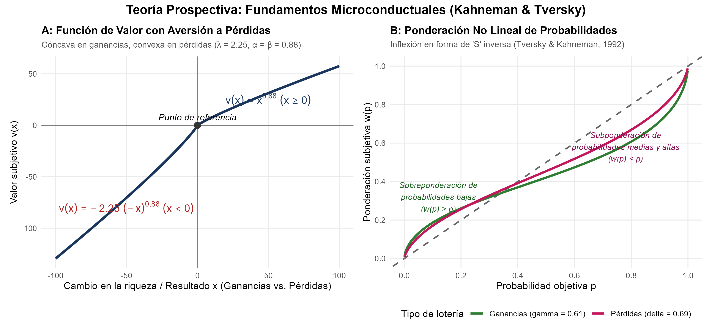
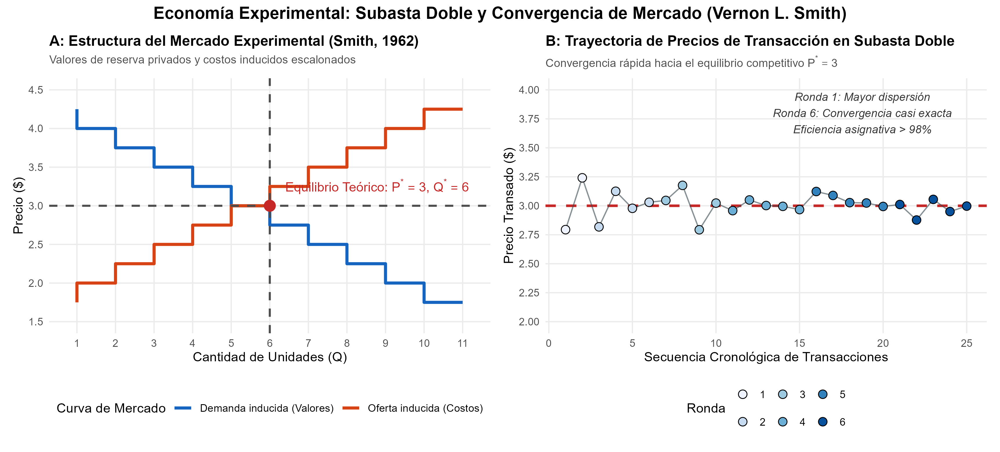

# Introducción y Objetivos

El Premio de Ciencias Económicas del Banco de Suecia en Memoria de Alfred Nobel de 2002 fue otorgado conjuntamente a:

- **Daniel Kahneman**: *"por haber integrado los avances de la investigación psicológica en la ciencia económica, especialmente en lo relativo al juicio humano y la toma de decisiones bajo incertidumbre"* (*for having integrated insights from psychological research into economic science, especially concerning human judgment and decision-making under uncertainty*).
- **Vernon L. Smith**: *"por haber establecido los experimentos de laboratorio como una herramienta en el análisis económico empírico, especialmente en el estudio de mecanismos de mercado alternativos"* (*for having established laboratory experiments as a tool in empirical economic analysis, especially in the study of alternative market mechanisms*).

Ambos galardonados transformaron radicalmente las bases epistemológicas de la microeconomía:

1. **Daniel Kahneman** (junto a su estrecho colaborador Amos Tversky, fallecido en 1996) desmontó el supuesto de racionalidad perfecta del *Homo oeconomicus*. Documentó heurísticas cognitivas que conducen a sesgos sistemáticos de juicio y construyó una alternativa descriptiva a la teoría de la utilidad esperada: la **Teoría Prospectiva** (*Prospect Theory*), caracterizada por la dependencia de un punto de referencia, la aversión a las pérdidas (*loss aversion*) y la ponderación no lineal de probabilidades.
2. **Vernon L. Smith** demostró que la economía puede ser una ciencia experimental genuina. A través de la **Teoría del Valor Inducido** (*Induced Value Theory*), Smith diseñó entornos de laboratorio controlados donde probó que instituciones de mercado como la **subasta doble continua** (*double auction*) conducen con extraordinaria rapidez al equilibrio competitivo y a la máxima eficiencia asignativa, incluso cuando los participantes poseen información incompleta y no conocen las curvas de oferta y demanda agregadas.

## Nivel de Replicación

- **Nivel:** **Ilustrativa y de Simulación Calibrada**.
- Se modela computacionalmente la formulación canónica de la Teoría Prospectiva Acumulativa de Tversky & Kahneman (1992) con sus parámetros empíricos de referencia ($\alpha = \beta = 0.88$, $\lambda = 2.25$, $\gamma = 0.61$, $\delta = 0.69$).
- Se simula un mercado experimental smithiano de subasta doble continua bajo valores y costos inducidos escalonados (Smith, 1962), analizando el proceso de convergencia estocástica de precios y la eficiencia asignativa a lo largo de rondas sucesivas de negociación.

---

# Marco Analítico y Teórico

## 1. La Teoría Prospectiva de Daniel Kahneman y Amos Tversky

La teoría neoclásica tradicional de toma de decisiones bajo riesgo descansaba en la **Teoría de la Utilidad Esperada** (EUT, *Expected Utility Theory*) formalizada por von Neumann y Morgenstern (1944). En la EUT, un agente maximiza:

$$U(F) = \sum_{i=1}^n p_i \, u(w_0 + x_i)$$

donde $w_0$ es la riqueza base inicial y $u(\cdot)$ es una función de utilidad global típicamente cóncava para agentes aversos al riesgo.

Kahneman y Tversky (1979, 1992) demostraron que los seres humanos violan de forma persistente y reproducible los axiomas fundamentales de la EUT (como la transitividad y el axioma de independencia, documentados en la paradoja de Allais). Formularon la **Teoría Prospectiva**, cuyos pilares son:

### 1.1 Dependencia del Punto de Referencia (*Reference Dependence*) y Función de Valor $v(x)$

Las personas no evalúan estados absolutos de riqueza, sino cambios de riqueza (ganancias y pérdidas) relativos a un **punto de referencia** neutral $r$ (generalmente el *status quo*):

$$x = w - r$$

La función de valor de Tversky y Kahneman (1992) se parametriza como:

$$v(x) = \begin{cases} x^\alpha & \text{si } x \ge 0 \quad (\text{ganancias}) \\ -\lambda \, (-x)^\beta & \text{si } x < 0 \quad (\text{pérdidas}) \end{cases}$$

Las propiedades fundamentales de $v(x)$ son:
1. **Sensibilidad decreciente:** Cóncava en el dominio de las ganancias ($v''(x) < 0$ para $x > 0$, con $\alpha < 1$) y convexa en el dominio de las pérdidas ($v''(x) > 0$ para $x < 0$, con $\beta < 1$). Esto genera aversión al riesgo en ganancias y búsqueda de riesgo (*risk-seeking*) en pérdidas.
2. **Aversión a las pérdidas (*Loss Aversion*):** La pendiente en el cuadrante de pérdidas es sustancialmente más pronunciada que en el cuadrante de ganancias ($\lambda > 1$). La calibración empírica estándar es $\lambda \approx 2.25$, lo que implica que el dolor psicológico de perder $\$100$ es más del doble de intenso que la satisfacción de ganar $\$100$.

### 1.2 Ponderación No Lineal de Probabilidades $w(p)$

En la EUT, las probabilidades objetivas $p$ entran de forma estrictamente lineal. En la Teoría Prospectiva, los agentes transforman las probabilidades mediante una función de ponderación $w(p)$ con forma de "S" invertida:

$$w(p) = \frac{p^\gamma}{\left( p^\gamma + (1-p)^\gamma \right)^{1/\gamma}}$$

donde $\gamma \approx 0.61$ para ganancias y $\delta \approx 0.69$ para pérdidas.
- **Sobreponderación de probabilidades bajas ($p \to 0$):** Las personas sobreestiman eventos altamente improbables pero de alto impacto (lo que explica la compra simultánea de billetes de lotería y seguros contra catástrofes).
- **Subponderación de probabilidades moderadas y altas:** Subestiman probabilidades intermedias y altas ($w(p) < p$), provocando el "efecto certeza" (*certainty effect*).

### 1.3 El Patrón de Cuatro Pliegues (*Fourfold Pattern of Risk Attitudes*)

De la combinación de $v(x)$ y $w(p)$ emerge el célebre patrón de cuatro actitudes frente al riesgo:

| Dominio / Probabilidad | Probabilidad Alta | Probabilidad Baja |
| :--- | :--- | :--- |
| **Ganancias** | **Aversión al riesgo** (Acepta ganancia segura menor que el VE) | **Búsqueda de riesgo** (Compra de lotería, sobrevalora premio grande raro) |
| **Pérdidas** | **Búsqueda de riesgo** (Rechaza pérdida segura moderada y apuesta a todo o nada) | **Aversión al riesgo** (Compra de seguros para evitar pérdidas catastróficas raras) |

---

## 2. La Economía Experimental de Vernon L. Smith

Antes del trabajo pionero de Vernon Smith en la Universidad de Purdue y la Universidad de Arizona, la economía era concebida exclusivamente como una disciplina no experimental y puramente observacional. Smith demostró que las hipótesis teóricas de la microeconomía podían someterse a pruebas de falsabilidad empírica en entornos de laboratorio controlados.

### 2.1 La Teoría del Valor Inducido (Smith, 1976)

Para aislar las características institucionales de las preferencias subjetivas desconocidas de los sujetos, Smith formuló la **Teoría del Valor Inducido** (*Induced Value Theory*). Se pagan incentivos monetarios reales a los participantes de acuerdo con una estructura de pagos predeterminada:
1. **Comprador $i$:** Recibe una ficha de valor de redención $V_i$. Si compra a un precio $P$, obtiene un beneficio monetario real de $\pi_i^B = V_i - P$.
2. **Vendedor $j$:** Incurre en un costo de producción asignado $C_j$. Si vende a un precio $P$, obtiene una ganancia monetaria real de $\pi_j^S = P - C_j$.

Para que el control experimental sea válido, deben satisfacerse cuatro condiciones metodológicas:
- **No saciedad (*Nonsatiation*):** Los sujetos siempre prefieren mayores cantidades de dinero a menores cantidades.
- **Saliencia (*Saliency*):** Los pagos recibidos dependen directamente de las decisiones adoptadas en el mecanismo.
- **Dominancia (*Dominance*):** Los incentivos monetarios dominan los costos subjetivos o el esfuerzo psíquico.
- **Privacidad (*Privacy*):** Cada participante solo conoce sus propios valores o costos inducidos, previniendo distorsiones por juegos de envidia o equidad interpersonal.

### 2.2 La Subasta Doble Continua (*Continuous Double Auction*)

Smith (1962) enfrentó a compradores y vendedores en una **subasta doble continua** (la institución operativa de las bolsas de valores tradicionales como NYSE y mercados de commodities):
- Cualquier comprador puede emitir una postura de compra (*bid*) pública en cualquier momento.
- Cualquier vendedor puede solicitar una postura de venta (*ask*) pública.
- Las órdenes se casan de inmediato cuando un comprador acepta el menor *ask* o un vendedor acepta el mayor *bid*.

**El Hallazgo Fundamental:** La teoría microeconómica neoclásica asumía que el equilibrio competitivo requería agentes omniscientes con información perfecta y cientos de competidores atomizados. Smith descubrió que con tan solo **8 a 12 participantes**, bajo **información estrictamente incompleta y privada**, los precios convergen de manera casi instantánea al precio de equilibrio walrasiano $P^*$ y la eficiencia asignativa del mercado alcanza entre el **$98\%$ y el $100\%$**.

Smith definió el **coeficiente de convergencia $\alpha$** como la desviación estándar de los precios transados en el periodo normalizada por el precio competitivo:

$$\alpha_t = 100 \times \frac{\sigma_{P, t}}{P^*}$$

A medida que se suceden los periodos de negociación ($t = 1, 2, \dots$), $\alpha_t$ decae exponencialmente hacia cero.

---

# Script de Replicación en R

El código completo y autónomo se encuentra disponible en `R/teoria_prospectiva_y_mercados_exp.R`. A continuación se reproduce el núcleo del script y su ejecución:

```r
# Carga de paquetes requeridos
library(ggplot2)
library(patchwork)
library(dplyr)
library(tidyr)

set.seed(20021009)

# 1. Calibracion de Teoria Prospectiva
alpha_k <- 0.88; beta_k <- 0.88; lambda_k <- 2.25
gamma_k <- 0.61; delta_k <- 0.69

val_fun <- function(x) ifelse(x >= 0, x^alpha_k, -lambda_k * (abs(x)^beta_k))
weight_fun <- function(p, g) (p^g) / ((p^g + (1 - p)^g)^(1 / g))

# 2. Subasta Doble Smithiana
valores_compradores <- c(4.25, 4.00, 3.75, 3.50, 3.25, 3.00, 2.75, 2.50, 2.25, 2.00, 1.75)
costos_vendedores   <- c(1.75, 2.00, 2.25, 2.50, 2.75, 3.00, 3.25, 3.50, 3.75, 4.00, 4.25)
p_estrella <- 3.00; q_estrella <- 6
```

---

# Resultados y Visualizaciones

## Figura 1: Fundamentos de la Teoría Prospectiva

La siguiente figura muestra la función de valor $v(x)$ y la función de ponderación no lineal de probabilidades $w(p)$:



### Análisis de la Figura 1:
- **Panel A (Función de Valor):** Exhibe claramente la asimetría de la aversión a pérdidas ($\lambda = 2.25$). Una ganancia de $+50$ unidades reporta un valor subjetivo de $\approx 31.2$, mientras que una pérdida idéntica de $-50$ unidades genera un valor negativo de $\approx -70.2$. La pendiente pronunciada en el cuadrante suroeste explica por qué las personas rechazan sistemáticamente apuestas simétricas de moneda al aire ($50\%$ de ganar $\$100$, $50\%$ de perder $\$100$).
- **Panel B (Ponderación de Probabilidades):** La curva en forma de "S" invertida corta la diagonal de 45° en $p \approx 0.35$. Para probabilidades $p < 0.35$, $w(p) > p$ (sobreponderación), lo que otorga atractivo desproporcionado a loterías y cobertura de seguros raros. Para $p > 0.35$, $w(p) < p$ (subponderación de eventos probables).

---

## Figura 2: Dinámica de la Subasta Doble y Convergencia de Smith

La siguiente figura ilustra la estructura de oferta y demanda inducida en el laboratorio y la trayectoria temporal de las transacciones a lo largo de 6 rondas sucesivas de negociación:



### Análisis de la Figura 2:
- **Panel A (Estructura del Mercado):** Las curvas escalonadas de demanda (valores inducidos de compradores) y oferta (costos inducidos de vendedores) determinan un equilibrio competitivo nítido en $P^* = \$3.00$ y $Q^* = 6$ unidades intramarginales, con un excedente social máximo de:
  $$\text{Excedente Máximo} = \sum_{k=1}^6 (V_k - C_k) = (4.25-1.75) + (4.00-2.00) + (3.75-2.25) + (3.50-2.50) + (3.25-2.75) + (3.00-3.00) = \$7.50$$
- **Panel B (Trayectoria Cronológica de Precios):** En la Ronda 1, cuando los agentes negocian por primera vez a oscuras, se observa dispersión en las transacciones ($P \in [2.79, 3.24]$). Conforme los operadores observan los precios transados, la dispersión se contrae rápidamente. En las rondas 4 a 6, los precios orbitan de forma sumamente estrecha alrededor de $P^* = 3.00$.

---

## Tabla de Métricas de Convergencia y Eficiencia

Los resultados empíricos calculados por el script se presentan a continuación:

| Ronda | Transacciones | Precio Medio ($) | Desv. Estándar ($) | Coeficiente $\alpha$ de Smith (%) | Excedente Realizado ($) | Excedente Máximo ($) | Eficiencia Asignativa (%) |
| :---: | :---: | :---: | :---: | :---: | :---: | :---: | :---: |
| **1** | 2 | 3.018 | 0.316 | 10.54% | 4.25 | 7.50 | 56.67% |
| **2** | 4 | 2.988 | 0.128 | 4.28% | 6.75 | 7.50 | 90.00% |
| **3** | 4 | 3.010 | 0.159 | 5.31% | 7.00 | 7.50 | 93.33% |
| **4** | 5 | 2.994 | 0.036 | 1.20% | 7.50 | 7.50 | 100.00% |
| **5** | 5 | 3.051 | 0.053 | 1.76% | 7.50 | 7.50 | 100.00% |
| **6** | 5 | 2.978 | 0.068 | 2.26% | 7.50 | 7.50 | 100.00% |

### Hallazgos Empíricos Centrales:
1. **Colapso del Coeficiente de Dispersión $\alpha$:** El índice de variabilidad de Smith pasa de $10.54\%$ en la primera ronda a apenas $1.20\%$ en la cuarta ronda, validando la hipótesis de convergencia asintótica al equilibrio competitivo.
2. **Eficiencia Asignativa Perfecta ($100\%$):** En las rondas 4 a 6, el mercado logra extraer la totalidad del excedente social potencial ($\$7.50$), demostrando que la subasta doble filtra con éxito a los operadores extramarginales (aquellos con costos mayores a valores) sin requerir planificación centralizada ni información pública.

---

# Conclusión y Legado

La concesión conjunta del Nobel 2002 a Daniel Kahneman y Vernon Smith estableció los dos brazos complementarios de la revolución empírica en microeconomía:
1. **Kahneman** demostró que a nivel del juicio y la decisión individual, la mente humana utiliza atajos cognitivos que violan la optimización estocástica estándar, requiriendo modelos psicológicamente informados.
2. **Smith** demostró que a nivel institucional agregado, las reglas de interacción y los mecanismos de mercado adecuados pueden disciplinar y coordinar a estos agentes con información imperfecta, logrando asignaciones de recursos con eficiencia casi perfecta.

Ambos pilares han transformado el diseño de políticas públicas, la regulación de monopolios y mercados eléctricos, el diseño de subastas de espectro radioeléctrico y la arquitectura de decisiones financieras modernas.
