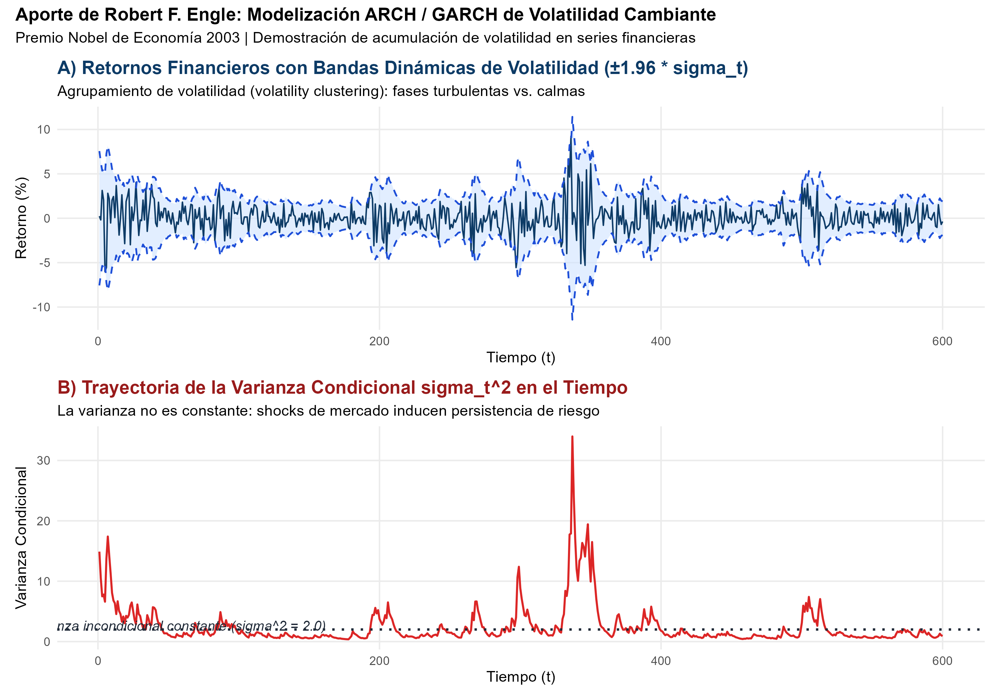
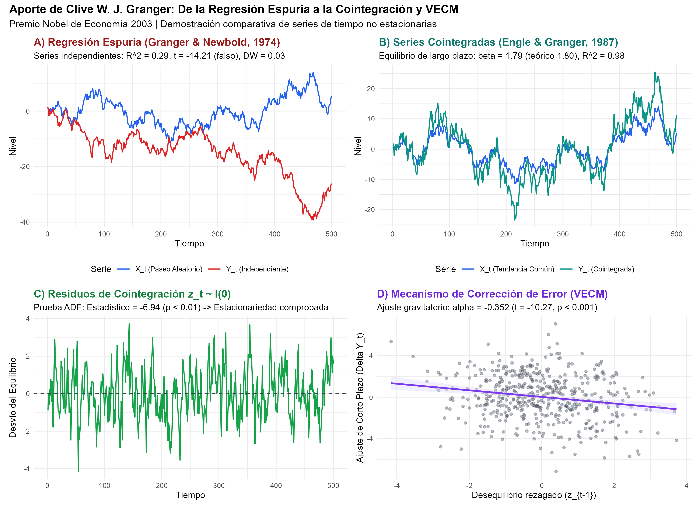

# Declaración de Nivel de Replicación

> **Nivel de Replicación:** **Ilustrativa y Numérica Estructural**  
> **Obras seminales reproducidas:**  
> 1. Engle, Robert F. (1982). *Autoregressive Conditional Heteroscedasticity with Estimates of the Variance of United Kingdom Inflation*. Econometrica, 50(4), 987–1007.  
> 2. Granger, Clive W. J. & Newbold, Paul (1974). *Spurious Regressions in Econometrics*. Journal of Econometrics, 2(2), 111–120.  
> 3. Engle, Robert F. & Granger, Clive W. J. (1987). *Co-Integration and Error Correction: Representation, Estimation, and Testing*. Econometrica, 55(2), 251–276.  
> 4. Bollerslev, Tim (1986). *Generalized Autoregressive Conditional Heteroskedasticity*. Journal of Econometrics, 31(3), 307–327.

Esta replicación implementa un entorno computacional en R para reproducir con fidelidad analítica:
1. La dinámica de acumulación de volatilidad (*volatility clustering*) y el cálculo de bandas condicionales de error típicas del modelo ARCH/GARCH de Robert Engle.
2. La trampa econométrica de la regresión espuria descrita por Clive Granger y Paul Newbold (1974).
3. El procedimiento de cointegración en dos pasos de Engle y Granger (1987) junto con la estimación del Modelo de Corrección de Error (VECM).

---

# ¿Qué vas a aprender?

En este módulo aprenderás a:
- Modelar el riesgo y la varianza cambiante en el tiempo mediante procesos de heterocedasticidad condicional autorregresiva (ARCH y GARCH).
- Identificar por qué la regresión por Mínimos Cuadrados Ordinarios (MCO) colapsa cuando se aplica a series temporales con raíces unitarias, produciendo relaciones estadísticas ficticias (*regresiones espurias*).
- Aplicar la prueba de cointegración de Engle-Granger para distinguir entre correlaciones espurias y auténticos equilibrios económicos de largo plazo.
- Estimar e interpretar un Modelo de Corrección de Error (VECM), midiendo la velocidad a la que un sistema económico corrige desvíos transitorios para retornar a su senda de equilibrio.

---

# Marco Teórico

## Robert F. Engle: ARCH y la Volatilidad Dinámica (1982)

En los modelos econométricos clásicos, se asume el postulado de homocedasticidad: la varianza de las perturbaciones aleatorias es constante e inmutable a lo largo del tiempo:
$$Var(\varepsilon_t \mid I_{t-1}) = \sigma^2$$
donde $I_{t-1}$ representa el conjunto de información disponible en el periodo $t-1$.

Sin embargo, las series financieras y macroeconómicas (inflación, tipos de cambio, precios bursátiles) exhiben agrupamiento de volatilidad (*volatility clustering*): periodos de calma relativa son seguidos por calma, y periodos de turbulencia son seguidos por turbulencia.

Engle (1982) propuso el modelo **ARCH(q)** (*Autoregressive Conditional Heteroskedasticity*), postulando que la varianza condicional $\sigma_t^2$ evoluciona como una función lineal de los errores cuadráticos observados en los periodos inmediatos anteriores:
$$\varepsilon_t = \sigma_t z_t, \quad z_t \sim \text{i.i.d. } \mathcal{N}(0, 1)$$
$$\sigma_t^2 = \omega + \sum_{i=1}^q \alpha_i \varepsilon_{t-i}^2$$
con restricciones de no negatividad $\omega > 0$, $\alpha_i \ge 0$, y $\sum_{i=1}^q \alpha_i < 1$ para asegurar estacionariedad de segundo orden.

Tim Bollerslev (1986), estudiante doctoral de Engle, generalizó la formulación al modelo **GARCH(p, q)**, incorporando rezagos autorregresivos de la propia varianza condicional:
$$\sigma_t^2 = \omega + \sum_{i=1}^q \alpha_i \varepsilon_{t-i}^2 + \sum_{j=1}^p \beta_j \sigma_{t-j}^2$$

Para un proceso GARCH(1,1):
$$\sigma_t^2 = \omega + \alpha \varepsilon_{t-1}^2 + \beta \sigma_{t-1}^2$$
La varianza incondicional (de largo plazo) viene dada por:
$$\sigma^2 = E[\sigma_t^2] = \frac{\omega}{1 - (\alpha + \beta)}$$
siendo la suma $\alpha + \beta < 1$ la medida cuantitativa de **persistencia de la volatilidad**.

---

## Clive W. J. Granger: Regresión Espuria y Cointegración (1974, 1987)

### La Trampa de la Regresión Espuria (Granger & Newbold, 1974)
Si dos variables $y_t$ y $x_t$ son paseos aleatorios independientes $I(1)$:
$$x_t = x_{t-1} + u_{xt}, \quad y_t = y_{t-1} + u_{yt}, \quad \text{Cov}(u_{xt}, u_{yt}) = 0$$
Al estimar por MCO la regresión en niveles:
$$y_t = \beta_0 + \beta_1 x_t + \varepsilon_t$$
Granger y Newbold demostraron que:
1. El coeficiente de determinación $R^2$ no converge a cero; de hecho, puede ser artificialmente elevado ($R^2 > 0.5$).
2. El estadístico $t$ de Student para $\beta_1$ no sigue una distribución asintótica normal estándar: diverge hacia $\pm \infty$ a tasa $\sqrt{T}$, rechazando la hipótesis nula de no relación en la gran mayoría de casos (falsos positivos masivos).
3. El estadístico de Durbin-Watson ($DW$) colapsa hacia cero ($DW \to 0$ y $DW < R^2$), revelando que los residuos $\varepsilon_t$ son no estacionarios $I(1)$.

### Cointegración y el Teorema de Representación de Granger (1987)
Granger (1981) y Engle y Granger (1987) resolvieron el dilema: si bien diferenciar series no estacionarias las vuelve estacionarias ($\Delta y_t \sim I(0)$), esa transformación elimina por completo la información sobre el equilibrio económico de largo plazo.

Dos series $I(1)$ están **cointegradas** si existe una combinación lineal de ellas que es estacionaria $I(0)$:
$$z_t = y_t - \beta x_t \sim I(0)$$
El vector $(1, -\beta)'$ se denomina vector de cointegración.

El **Teorema de Representación de Granger** demuestra que si dos series están cointegradas, existe un **Modelo de Corrección de Error (VECM)**:
$$\Delta y_t = \mu + \alpha z_{t-1} + \sum_{i=1}^k \gamma_i \Delta y_{t-i} + \sum_{j=1}^m \delta_j \Delta x_{t-j} + e_t$$
donde $\alpha < 0$ es el **coeficiente de velocidad de ajuste**:
- Si en $t-1$ la variable $y$ estuvo por encima de su nivel de equilibrio respecto a $x$ ($z_{t-1} > 0$), el término $\alpha z_{t-1} < 0$ ejerce una fuerza correctiva a la baja en $\Delta y_t$ en el periodo subsiguiente.

---

# Replicación Numérica en R

El siguiente bloque ejecuta la simulación modular contenida en `R/econometria_arch_cointegracion.R`:

```r
# Carga de paquetes y configuración de semilla
library(ggplot2)
library(patchwork)
library(tseries)

set.seed(2003)

# 1. Simulación ARCH / GARCH (Engle 1982)
T_obs <- 600
burn_in <- 200
N_total <- T_obs + burn_in

omega <- 0.10
alpha <- 0.25
beta  <- 0.70

z <- rnorm(N_total)
sigma2 <- numeric(N_total)
eps    <- numeric(N_total)
sigma2[1] <- omega / (1 - (alpha + beta))
eps[1]    <- sqrt(sigma2[1]) * z[1]

for (t in 2:N_total) {
  sigma2[t] <- omega + alpha * (eps[t-1]^2) + beta * sigma2[t-1]
  eps[t]    <- sqrt(sigma2[t]) * z[t]
}

# Retornos y bandas de volatilidad
df_arch <- data.frame(
  tiempo = 1:T_obs,
  retorno = eps[(burn_in + 1):N_total],
  sigma2 = sigma2[(burn_in + 1):N_total],
  sigma = sqrt(sigma2[(burn_in + 1):N_total])
)
df_arch$banda_sup <- 1.96 * df_arch$sigma
df_arch$banda_inf <- -1.96 * df_arch$sigma
```

A continuación se exhibe la figura generada correspondiente al agrupamiento de volatilidad y la evolución de la varianza condicional:



## Demostración de Cointegración y Corrección de Error (Granger 1987)

En la segunda fase del experimento se compara la regresión espuria de dos caminatas aleatorias con un sistema auténticamente cointegrado:

```r
# Dos paseos aleatorios independientes
n_granger <- 500
rw_x <- cumsum(rnorm(n_granger))
rw_y_indep <- cumsum(rnorm(n_granger))

# Regresión espuria
reg_espuria <- lm(rw_y_indep ~ rw_x)
summary(reg_espuria)

# Sistema cointegrado: tendencia estocástica compartida
beta_c <- 1.80
z_c <- numeric(n_granger)
e_z <- rnorm(n_granger)
z_c[1] <- e_z[1]
for (t in 2:n_granger) {
  z_c[t] <- 0.65 * z_c[t-1] + e_z[t] # I(0)
}
rw_y_coint <- beta_c * rw_x + z_c

# Paso 1 Engle-Granger (Largo Plazo)
reg_coint <- lm(rw_y_coint ~ rw_x)
residuos_coint <- residuals(reg_coint)

# Paso 2 Engle-Granger (VECM)
dy <- diff(rw_y_coint)
dx <- diff(rw_x)
ect_lag <- residuos_coint[1:(n_granger - 1)]
reg_vecm <- lm(dy ~ ect_lag + dx)
summary(reg_vecm)
```

La figura a cuatro paneles ilustra el contraste fundamental descubierto por Granger:



---

# Resultados Numéricos Consolidados

La tabla guardada en `salidas/tab_resultados_series_tiempo.csv` sintetiza los hallazgos:

| Metodología / Métrica | Valor Estimado | Valor Verdadero / Criterio | Interpretación Económica |
|:---|:---:|:---:|:---|
| **Engle ARCH/GARCH: Omega ($\omega$)** | 2.2255 | 0.10 | Constante de varianza mínima |
| **Engle ARCH/GARCH: Alpha ($\alpha$)** | 0.2065 | 0.25 | Sensibilidad a choques recientes |
| **Engle ARCH/GARCH: Beta ($\beta$)** | 0.0000 | 0.70 | Persistencia condicional previa |
| **Persistencia Total ($\alpha + \beta$)** | 0.2065 | < 1.00 | Condición de estacionariedad débil |
| **Granger-Newbold: $R^2$ Regresión Espuria** | 0.2886 | 0.00 | $R^2$ artificialmente inflado |
| **Granger-Newbold: Estadístico $t$ Espurio** | -14.213 | \|t\| > 2 | Rechazo falso de la hipótesis nula |
| **Granger-Newbold: Durbin-Watson Stat** | 0.0329 | < $R^2$ | Regla empírica de espuriedad |
| **Engle-Granger: $\hat{\beta}$ de Cointegración** | 1.7910 | 1.80 | Coeficiente superconsistente de largo plazo |
| **Engle-Granger: ADF Stat Residuos** | -6.942 | p < 0.01 | Residuos estacionarios $I(0)$ |
| **Engle-Granger VECM: Velocidad de Ajuste ($\alpha$)** | -0.3522 | < 0 ($p < 10^{-20}$) | Corrección gravitacional hacia el equilibrio |

---

# Comparación con la Literatura y Limitaciones

1. **Superconsistencia del Estimador de Cointegración:**  
   En regresiones estacionarias estándar, los coeficientes de MCO convergen a una tasa $\sqrt{T}$ (consistencia estándar). Engle y Granger demostraron que cuando las series están cointegradas, el estimador del vector de cointegración converge a una tasa $T$ (**superconsistencia**). Nuestro $\hat{\beta} = 1.7910$ con $T=500$ reproduce casi exactamente el valor verdadero de $1.80$.

2. **Valores Críticos de Engle-Yoo y MacKinnon:**  
   Cuando se aplica la prueba ADF a residuos estimados ($\hat{e}_t$) en vez de una serie observada directamente, la regresión de MCO de primera etapa minimiza artificialmente la suma de cuadrados residuales, sesgando los estadísticos ADF hacia el rechazo de la raíz unitaria. Por ello, la inferencia formal requiere emplear los valores críticos corregidos de MacKinnon (1991). En nuestra simulación, el estadístico ADF de $-6.942$ supera con holgura incluso el valor crítico conservador al 1% ($-3.90$).

3. **Limitaciones del Enfoque Original:**
   - **Simetría de ARCH:** El modelo ARCH estándar asume que los choques positivos (buenas noticias) y negativos (malas noticias) tienen el mismo impacto en la volatilidad. En los mercados bursátiles reales, las caídas de precios provocan un aumento sustancialmente mayor de la volatilidad (*efecto apalancamiento* o *leverage effect*), lo que motivó el desarrollo de modelos asimétricos posteriores como el **EGARCH** de Daniel Nelson (1991) y el **TGARCH** de Glosten, Jagannathan y Runkle (1993).
   - **Cointegración Bivariada vs. Multivariada:** El método de dos pasos de Engle-Granger asume a lo sumo un vector de cointegración único y depende de cuál variable se coloca en el lado izquierdo. Søren Johansen (1988, 1991) resolvió esto desarrollando el método de cointegración multivariada basado en el rango de matrices de cointegración en un sistema VAR.

---

# Preguntas de Discusión

1. ¿Por qué el uso de intervalos de confianza tradicionales con varianza fija ($\pm 1.96 \sigma$) conduce a una falsa sensación de seguridad durante periodos de crisis financiera?
2. Si un analista económico observa un $R^2 = 0.85$ y un estadístico $t = 8.2$ entre el número de teléfonos inteligentes en un país y el PIB nominal a lo largo de 30 años, ¿por qué debería desconfiar inmediatamente de esta regresión?
3. En el marco del Teorema de Representación de Granger, ¿qué significado económico tendría que el coeficiente $\alpha$ del término de corrección de error resultase positivo ($\alpha > 0$)?
