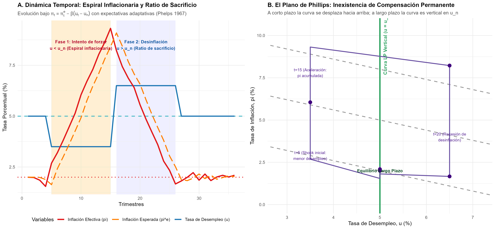
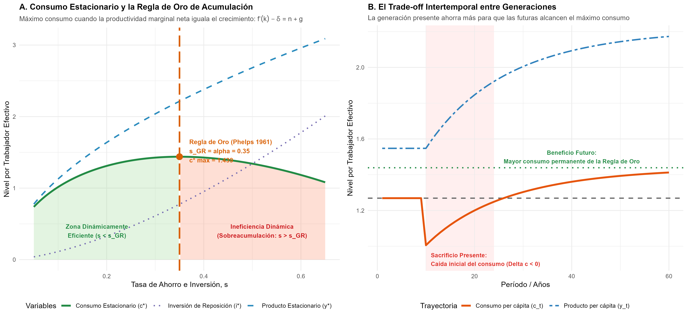

# Introducción y Objetivo

Este documento presenta una replicación didáctica e ilustrativa de las contribuciones seminales de **Edmund S. Phelps**, galardonado con el Premio de Ciencias Económicas del Banco de Suecia en Memoria de Alfred Nobel en 2006 *"por su análisis de las compensaciones intertemporales en la política macroeconómica"*.

La investigación de Phelps unificó dos problemas centrales de la economía agregada bajo un prisma analítico común: la existencia de **compensaciones intertemporales** (*intertemporal tradeoffs*), donde las decisiones de política adoptadas hoy condicionan de forma ineludible las opciones y el bienestar del mañana.

El objetivo central de esta replicación es:
1. Replicar formalmente la **Curva de Phillips Aumentada por Expectativas** formulada por Phelps (1967, 1968), demostrando la hipótesis aceleracionista de la inflación y la verticalidad de la relación de largo plazo en la **tasa natural de desempleo**.
2. Replicar la **Regla de Oro de la Acumulación de Capital** de Phelps (1961), analizando el sendero que maximiza el consumo per cápita de estado estacionario y cuantificando el costo o sacrificio que la generación presente debe asumir para enriquecer a las generaciones futuras.

## Nivel de Replicación
- **Nivel:** **Ilustrativa** (simulación computacional dinámica de la Curva de Phillips con expectativas adaptativas demostrando la aceleración inflacionaria ante intentos sistemáticos de situar el desempleo por debajo de la tasa natural, y simulación de la Regla de Oro de acumulación en el modelo neoclásico de Solow-Swan calibrado).

---

# ¿Qué vas a aprender?

Al estudiar y ejecutar este material aprenderás a:
- Comprender la falla analítica de la Curva de Phillips original (de relación estática) y cómo Phelps introdujo las expectativas de inflación en la determinación de precios y salarios reales.
- Comprobar algebraicamente y mediante simulaciones por qué los intentos de fijar un desempleo persistentemente inferior a la tasa natural desencadenan una espiral de inflación acelerada.
- Visualizar el plano $(u, \pi)$ donde las curvas de corto plazo se desplazan hacia arriba conforme aumentan las expectativas, conformando una Curva de Phillips vertical a largo plazo.
- Derivar la condición matemática de la Regla de Oro ($f'(k^*) - \delta = n + g$) y deducir por qué la tasa de ahorro óptima iguala la participación del capital en el ingreso nacional ($s_{GR} = \alpha$).
- Analizar la dinámica de transición intertemporal y evaluar el dilema distributivo entre generaciones presentes y futuras bajo eficiencia e ineficiencia dinámica.

---

# Marco Teórico

## 1. La Curva de Phillips Aumentada por Expectativas (Phelps 1967, 1968)

A finales de la década de 1950, A. W. Phillips (1958) documentó una relación inversa empírica entre el desempleo y el crecimiento de los salarios nominales en el Reino Unido. Paul Samuelson y Robert Solow (1960) interpretaron este hallazgo como un "menú de opciones" permanente: las autoridades económicas podían elegir mantener un nivel de desempleo bajo a cambio de convivir con una inflación moderada constante.

Edmund Phelps (1967, 1968), de manera simultánea e independiente a Milton Friedman (1968), demostró que este menú era una ilusión. Los trabajadores y las empresas no negocian salarios nominales, sino salarios reales. Por ende, la curva de Phillips relevante a corto plazo debe incorporar la inflación esperada:

$$\pi_t = \pi_t^e - \beta (u_t - u_n) + \varepsilon_t$$

donde:
- $\pi_t$ es la tasa de inflación efectiva en el período $t$.
- $\pi_t^e$ es la inflación esperada por los agentes económicos para el período $t$.
- $u_t$ es la tasa de desempleo observada.
- $u_n$ es la **tasa natural de desempleo** (*natural rate of unemployment*), determinada por factores estructurales (fricciones de búsqueda, rigideces institucionales e información asimétrica).
- $\beta > 0$ es la sensibilidad de las presiones salariales a la holgura del mercado laboral.
- $\varepsilon_t$ representa shocks transitorios de oferta con $\mathbb{E}[\varepsilon_t] = 0$.

### La Hipótesis Aceleracionista
Bajo expectativas adaptativas, los agentes actualizan sus pronósticos en función de los errores de predicción pasados:

$$\pi_t^e = \pi_{t-1}^e + \lambda (\pi_{t-1} - \pi_{t-1}^e), \quad 0 < \lambda \le 1$$

En el caso aceleracionista donde $\lambda = 1$ (o $\pi_t^e = \pi_{t-1}$), la ecuación se transforma en:

$$\pi_t - \pi_{t-1} = - \beta (u_t - u_n) + \varepsilon_t$$

Si las autoridades monetarias intentan forzar sistemáticamente el desempleo por debajo de su tasa natural ($u_t = u_L < u_n$), se cumple que:

$$\Delta \pi_t = \beta (u_n - u_L) > 0$$

La inflación no permanece fija en un nivel alto, sino que **se acelera trimestre tras trimestre**, generando una espiral inflacionaria sin fin.

### Verticalidad de Largo Plazo
En el largo plazo o estado estacionario, las expectativas se ajustan plenamente a la realidad ($\pi_t^e = \pi_t$). Sustituyendo esta condición en la ecuación de Phelps:

$$\pi = \pi - \beta (u - u_n) \implies -\beta (u - u_n) = 0 \implies u = u_n$$

La Curva de Phillips de largo plazo es **estrictamente vertical** en $u = u_n$. Cualquier intento de sostener $u < u_n$ solo crea inflación descontrolada. Más aún, cuando la autoridad decida estabilizar la economía y retornar a la inflación meta, tendrá que forzar temporalmente $u_t > u_n$, pagando el denominado **ratio de sacrificio**.

---

## 2. La Regla de Oro de la Acumulación de Capital (Phelps 1961)

En el modelo neoclásico de crecimiento de Solow-Swan, la evolución del stock de capital por trabajador efectivo $k = K / (A L)$ está gobernada por:

$$\dot{k} = s f(k) - (n + g + \delta) k$$

donde $s$ es la tasa de ahorro e inversión, $f(k)$ es la función de producción intensiva, $n$ es la tasa de crecimiento de la población, $g$ la tasa de progreso tecnológico y $\delta$ la tasa de depreciación física del capital.

En el estado estacionario ($\dot{k} = 0$):
$$k^* = k^*(s), \quad y^* = f(k^*)$$
$$c^*(s) = y^* - i^* = f(k^*) - (n + g + \delta) k^*$$

### Maximización del Consumo de Estado Estacionario
Phelps (1961) se preguntó: *¿qué tasa de ahorro maximiza el consumo per cápita permanente para todas las generaciones?*

Maximizando $c^*$ respecto a $k^*$:
$$\frac{dc^*}{dk^*} = f'(k^*) - (n + g + \delta) = 0$$

$$\implies f'(k_{GR}^*) - \delta = n + g \iff r^* = n + g$$

La condición de la **Regla de Oro** exige que la tasa de rendimiento real neta del capital ($r^* = f'(k^*) - \delta$) sea exactamente igual a la tasa de crecimiento del producto en la senda balanceada ($g + n$).

Para una función Cobb-Douglas $y = k^\alpha$, la productividad marginal es $f'(k) = \alpha k^{\alpha - 1} = \alpha y / k$. Sustituyendo en la condición:
$$\alpha \frac{y^*}{k^*} = n + g + \delta \implies \frac{(n + g + \delta) k^*}{y^*} = \alpha$$
Dado que en estado estacionario $(n + g + \delta) k^* = s y^*$, se concluye de forma elegante:
$$s_{GR} = \alpha$$

La tasa de ahorro de la Regla de Oro es idéntica a la participación de los beneficios del capital en el ingreso nacional.

### Eficiencia e Ineficiencia Dinámica
- **Subacumulación ($s < s_{GR}$ o $r > n + g$):** La economía es *dinámicamente eficiente*. Elevar el ahorro hacia $s_{GR}$ aumentará el consumo de las generaciones futuras, pero impone un costo presente: la generación contemporánea debe recortar su consumo de inmediato.
- **Sobreacumulación ($s > s_{GR}$ o $r < n + g$):** La economía sufre de *ineficiencia dinámica*. Se ha invertido tanto capital que la depreciación absorbe más producto del que el capital produce en el margen. Reducir el ahorro a $s_{GR}$ incrementa el consumo inmediatamente hoy y para todas las generaciones futuras sin ningún costo.

---

# Ejecución y Script en R

El análisis cuantitativo se implementó en el script reproducible [phelps_curva_phillips_regla_oro.R](file:///laureados/2006_phelps/replicacion/R/phelps_curva_phillips_regla_oro.R). 

```r
# Ejecución autónoma desde consola R o terminal
source("R/phelps_curva_phillips_regla_oro.R")
```

---

# Resultados Cuantitativos

## 1. La Curva de Phillips Aumentada y la Espiral Inflacionaria

La siguiente figura presenta los resultados de la simulación del modelo de Phelps:



### Interpretación de los Resultados:
1. **Panel A (Dinámica Temporal del Ciclo Phelps):**
   - En los períodos $t=1 \dots 4$, la economía parte en equilibrio neutral ($u = 5.0\%$, $\pi = 2.0\%$).
   - A partir de $t=5$, una política monetaria sobreexpansiva reduce artificialmente el desempleo a $u = 3.5\% < u_n$. Durante los primeros trimestres, la inflación sube moderadamente, pero las expectativas de inflación $\pi_t^e$ se revisan gradualmente al alza. Al cabo de 10 trimestres ($t = 15$), la inflación se dispara a más del $9.3\%$.
   - En $t=16$, para frenar la espiral inflacionaria, la autoridad monetaria induce una recesión forzando $u = 6.5\% > u_n$. La holgura en el mercado de trabajo comprime gradualmente las expectativas hacia la meta del $2.0\%$, retornando al equilibrio en $t=27$.
2. **Panel B (El Plano de Phillips $u$ vs. $\pi$):**
   - El sendero de la economía (trayectoria con flechas) muestra claramente que la curva de Phillips de corto plazo no es estática: se desplaza sucesivamente hacia arriba a medida que $\pi^e$ sube de $2\%$ a $5\%$ y a $8\%$.
   - A largo plazo, el equilibrio solo es sostenible a lo largo de la línea vertical verde en $u = u_n = 5.0\%$.

---

## 2. La Regla de Oro y el Dilema Intergeneracional

La siguiente figura muestra el análisis de la acumulación de capital y la transición intertemporal:



### Interpretación de los Resultados:
1. **Panel A (Consumo Estacionario):**
   - La curva de consumo per cápita $c^*(s)$ alcanza su máximo global estricto en $s_{GR} = \alpha = 0.35$, con un consumo per cápita de estado estacionario de $c^* = 1.439$.
   - A la izquierda ($s < 0.35$), mayores tasas de ahorro aumentan el consumo de largo plazo (eficiencia dinámica).
   - A la derecha ($s > 0.35$), el ahorro excesivo reduce el consumo debido al enorme costo de mantener el stock de capital depreciado (ineficiencia dinámica).
2. **Panel B (Transición Dinámica y Sacrificio Intergeneracional):**
   - Una economía con subahorro ($s_0 = 0.18$, consumo inicial $c_0^* = 1.269$) que decide adoptar la Regla de Oro ($s = 0.35$) en el año 10 sufre una caída inmediata y drástica en el consumo per cápita a $c_{10} = 1.006$ ($\Delta c < 0$).
   - La generación actual se aprieta el cinturón. A medida que el nuevo capital entra en operación, el consumo se recupera y supera el nivel histórico a partir del año 24, beneficiando permanentemente a las generaciones futuras.

---

## 3. Resumen Cuantitativo de las Simulaciones

A continuación se resume la tabla generada en [tab_phelps_simulaciones.csv](salidas/tab_phelps_simulaciones.csv):

| Modelo | Parámetro / Escenario | Métrica 1 | Valor 1 | Métrica 2 | Valor 2 | Métrica 3 | Valor 3 |
| :--- | :--- | :--- | :--- | :--- | :--- | :--- | :--- |
| **Curva de Phillips** | 1. Política Neutral ($u = 5.0\%$) | Desempleo Promedio | $5.00\%$ | Inflación Máxima | $2.02\%$ | Aceleración Neta | $-0.29\%$ |
| **Curva de Phillips** | 2. Estímulo Continuo ($u = 3.5\%$) | Desempleo Promedio | $3.67\%$ | Inflación Máxima | $24.29\%$ | Aceleración Neta | $+22.29\%$ |
| **Curva de Phillips** | 3. Ciclo Phelps (Boom y Desinflación) | Desempleo Promedio | $5.00\%$ | Inflación Máxima | $9.32\%$ | Aceleración Neta | $+0.09\%$ |
| **Regla de Oro** | Tasa $s = 0.10$ (Subacumulación) | Capital $k^*$ | $1.410$ | Consumo $c^*$ | $1.015$ | Brecha $r - (n+g)$ | $+0.2000$ |
| **Regla de Oro** | Tasa $s = 0.18$ (Subacumulación) | Capital $k^*$ | $3.482$ | Consumo $c^*$ | $1.269$ | Brecha $r - (n+g)$ | $+0.0756$ |
| **Regla de Oro** | Tasa $s = 0.25$ (Subacumulación) | Capital $k^*$ | $5.772$ | Consumo $c^*$ | $1.385$ | Brecha $r - (n+g)$ | $+0.0320$ |
| **Regla de Oro** | **Tasa $s = 0.35$ (Regla de Oro Óptima)** | **Capital $k^*$** | **$9.685$** | **Consumo $c^*$** | **$1.439$** | **Brecha $r - (n+g)$** | **$0.0000$** |
| **Regla de Oro** | Tasa $s = 0.45$ (Sobreacumulación) | Capital $k^*$ | $14.257$ | Consumo $c^*$ | $1.394$ | Brecha $r - (n+g)$ | $-0.0178$ |
| **Regla de Oro** | Tasa $s = 0.55$ (Sobreacumulación) | Capital $k^*$ | $19.414$ | Consumo $c^*$ | $1.271$ | Brecha $r - (n+g)$ | $-0.0291$ |

---

# Implicancias para la Macroeconomía Contemporánea

Las formulaciones de Edmund Phelps alteraron decisivamente las instituciones de gobernanza económica:
1. **Fin del activismo inflacionario ingenuo:** Se desterró la creencia de que un banco central puede generar empleo sostenido mediante políticas monetarias inflacionarias permanentes.
2. **Independencia de los Bancos Centrales:** La necesidad de anclar $\pi^e$ justificó aislar a los comités de política monetaria de las presiones políticas de corto plazo para evitar el sesgo inflacionario (Kydland y Prescott 1977, Barro y Gordon 1983).
3. **Fondos de Estabilización y Sostenibilidad Fiscal:** El criterio de la Regla de Oro fundamenta hoy la gestión de fondos soberanos (como el Fondo de Pensiones del Gobierno de Noruega) y las reglas fiscales estructurales, protegiendo el bienestar y la dotación de capital de las futuras generaciones frente a la miopía electoral.

---

# Referencias

- Phelps, E. S. (1961). *The Golden Rule of Accumulation: A Fable for Growthmen*. American Economic Review, 51(4), 638–643.
- Phelps, E. S. (1967). *Phillips Curves, Expectations of Inflation and Optimal Unemployment over Time*. Economica, 34(135), 254–281.
- Phelps, E. S. (1968). *Money-Wage Dynamics and Labor-Market Equilibrium*. Journal of Political Economy, 76(4, Part 2), 678–711.
- Phelps, E. S. et al. (1970). *Microeconomic Foundations of Employment and Inflation Theory*. W. W. Norton & Company.
- Phelps, E. S. (1972). *Inflation Policy and Unemployment Theory: The Cost-Benefit Approach to Monetary Planning*. W. W. Norton & Company.
- Royal Swedish Academy of Sciences (2006). *Intertemporal Tradeoffs in Macroeconomic Policy*. Scientific Background on the Sveriges Riksbank Prize in Economic Sciences in Memory of Alfred Nobel 2006.
