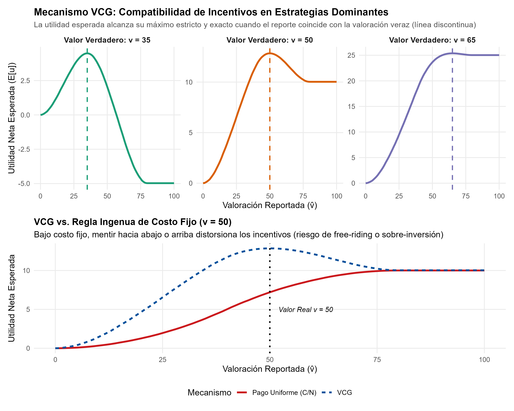
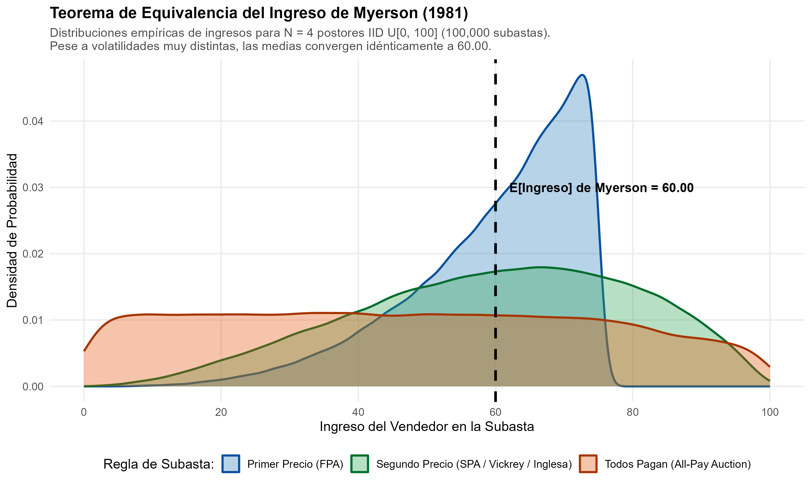

# Introducción y Objetivo

En 2007, la Real Academia Sueca de Ciencias otorgó el Premio del Banco de Suecia en Ciencias Económicas en Memoria de Alfred Nobel conjuntamente a **Leonid Hurwicz** (University of Minnesota), **Eric S. Maskin** (Institute for Advanced Study, Princeton) y **Roger B. Myerson** (University of Chicago) *"por haber sentado las bases de la teoría del diseño de mecanismos"* (*for having laid the foundations of mechanism design theory*).

La teoría económica clásica iniciada por Adam Smith enseñaba que la "mano invisible" del mercado competitivo coordina eficientemente las decisiones descentralizadas. Sin embargo, en innumerables situaciones prácticas (desde la provisión de carreteras y defensa nacional, hasta las subastas de espectro radioeléctrico, las compras públicas y la reducción de emisiones contaminantes), los mercados convencionales fallan debido a la presencia de **información asimétrica privada**, **externalidades** y **comportamiento estratégico**.

El diseño de mecanismos invierte la pregunta económica tradicional: en lugar de tomar las instituciones existentes como dadas y predecir su resultado, el diseñador define primero el **objetivo social o económico deseado** (eficiencia de Pareto, equidad, maximización de recaudación) y procede a **diseñar las reglas del juego e incentivos** para que los agentes privados, actuando en su propio interés egoísta, alcancen inevitablemente ese resultado social óptimo.

## Nivel de Replicación
- **Nivel:** **Ilustrativa** (simulación computacional y verificación analítica de dos pilares normativos de la teoría: el mecanismo Vickrey-Clarke-Groves para provisión eficiente de bienes públicos bajo estrategias dominantes y el Teorema de Equivalencia del Ingreso de Myerson en cuatro estructuras de subastas).

---

# Fundamentos Teóricos del Diseño de Mecanismos

## 1. Leonid Hurwicz y el Principio de Compatibilidad de Incentivos (1972, 1973)

Durante el debate sobre el cálculo económico socialista (Mises, Hayek y Lange), Leonid Hurwicz comprendió que el problema central de cualquier sistema económico no radica únicamente en procesar información computacional, sino en los **incentivos para revelar dicha información con veracidad**.

Hurwicz formalizó un sistema económico descentralizado como un mecanismo compuesto por:
1. Un conjunto de agentes $i \in \{1, \dots, N\}$, cada uno con información privada o **tipo** $\theta_i \in \Theta_i$ (preferencias, tecnologías o valoraciones).
2. Un espacio de mensajes o estrategias $M_i$.
3. Una regla de asignación de resultados $g: M_1 \times \dots \times M_N \to X$.

Hurwicz acuñó el término **compatibilidad de incentivos** (*incentive compatibility*): un mecanismo es compatible con incentivos si ningún agente tiene incentivo individual para mentir o distorsionar su mensaje estratégico, dadas las reglas del sistema y las estrategias de los demás.

### El Teorema de Imposibilidad de Hurwicz (1972)
Hurwicz demostró un resultado devastador para la economía del bienestar: en economías con información asimétrica y agentes estratégicos, **ningún mecanismo de asignación de recursos que no sea dictatorial puede ser simultáneamente compatible con incentivos y lograr una asignación de Pareto óptima de primer mejor en todos los entornos posibles**, salvo en el caso límite de competencia perfecta con infinitos agentes tomadores de precios.

---

## 2. El Principio de Revelación (Hurwicz, Myerson 1979, 1981)

Uno de los mayores avances metodológicos de la teoría de juegos es el **Principio de Revelación** (*Revelation Principle*), formalizado en distintas variantes por Hurwicz (1972), Dasgupta, Hammond y Maskin (1979) y Roger Myerson (1979, 1981):

> **Principio de Revelación:** Cualquier función de elección social que pueda ser implementada mediante un mecanismo indirecto complejo y arbitrario (donde los agentes envían ofertas complejas, señales o mensajes multidimensionales) puede ser implementada de manera idéntica mediante un **mecanismo directo y veraz**, donde el espacio de mensajes de cada agente consiste simplemente en reportar su verdadero tipo ($\hat{\theta}_i = \theta_i$) y decir la verdad constituye un equilibrio.

Gracias a este teorema, el analista no necesita buscar en el espacio infinito de juegos posibles: basta con restringirse a mecanismos directos donde la restricción de compatibilidad de incentivos adopta la forma canónica:
$$u_i(\theta_i, \theta_i) \ge u_i(\hat{\theta}_i, \theta_i) \quad \forall \hat{\theta}_i \ne \theta_i$$

---

## 3. El Mecanismo Vickrey-Clarke-Groves (VCG)

En el caso de utilidades cuasilineales ($u_i = v_i(x) - p_i$), William Vickrey (1961), Edward Clarke (1971) y Theodore Groves (1973), formalizados plenamente por Hurwicz, idearon el **Mecanismo VCG**, la única familia de mecanismos que garantiza eficiencia social ex-post en **estrategias dominantes** (DSIC - *Dominant-Strategy Incentive Compatible*).

Consideremos un proyecto público discreto con coste social $C > 0$. Cada agente $i$ posee una valoración privada $v_i \ge 0$.
- Regla de decisión eficiente:
  $$x^*(\hat{v}) = \begin{cases} 1 & \text{si } \sum_{i=1}^N \hat{v}_i \ge C \\ 0 & \text{si } \sum_{i=1}^N \hat{v}_i < C \end{cases}$$

- Regla pivote de Clarke (*Clarke Pivot Rule*):
  Cada agente $i$ paga una transferencia correspondiente al daño o **externalidad neta que su presencia impone sobre los demás**:
  $$p_i = \max\left(0, C - \sum_{j \ne i} \hat{v}_j\right) \quad \text{si } x^*(\hat{v}) = 1$$
  $$p_i = 0 \quad \text{si } x^*(\hat{v}) = 0$$

Bajo esta regla, el agente $i$ maximiza:
$$\max_{\hat{v}_i} \left[ v_i \cdot \mathbf{1}_{\{\hat{v}_i + \sum_{j \ne i} \hat{v}_j \ge C\}} - \left(C - \sum_{j \ne i} \hat{v}_j\right) \right]$$
El problema privado del agente se alinea exactamente con la función de bienestar social. Por tanto, **reportar la verdad ($\hat{v}_i = v_i$) es una estrategia débilmente dominante para todo perfil de valoraciones ajenas**.

---

## 4. Eric Maskin y la Teoría de la Implementación (1977, 1999)

Eric Maskin dio un salto cualitativo al abordar el problema inverso: cuando el diseñador define una regla de elección social $F(\theta)$, ¿cómo garantizar que **todos los equilibrios del juego** produzcan los resultados deseados y no solo uno de ellos?

Maskin caracterizó la **implementabilidad en Equilibrio de Nash**:
1. **Monotonicidad de Maskin:** Si una alternativa $a$ es socialmente óptima bajo el estado del mundo $\theta$, y al pasar a otro estado $\theta'$ la posición relativa de $a$ no empeora en las preferencias de ningún agente, entonces $a$ debe seguir siendo socialmente óptima bajo $\theta'$.
2. **Condición de No Veto de Poder (*No-Veto Power*):** Si al menos $N-1$ agentes consideran que la alternativa $a$ es su opción preferida superior en el estado $\theta$, entonces $a$ debe ser socialmente elegible.

Maskin probó que en entornos con al menos 3 agentes ($N \ge 3$), cualquier función de elección social que satisfaga la monotonicidad de Maskin y la condición de no veto es plenamente implementable en equilibrios de Nash.

---

## 5. Roger Myerson y el Teorema de Equivalencia del Ingreso (1981)

En su célebre artículo *Optimal Auction Design* (1981), Roger Myerson revolucionó la microeconomía al caracterizar la familia completa de subastas eficientes y óptimas.

Myerson demostró que para $N$ postores neutrales al riesgo con tipos privados independientes e idénticamente distribuidos (IID) según $F(v)$ estrictamente creciente:

> **Teorema de Equivalencia del Ingreso (Myerson 1981):** Cualquier mecanismo de subasta donde:
> 1. El objeto se asigna de manera eficiente al postor con la mayor valoración ($v_{(1)}$), y
> 2. El postor con la menor valoración admisible ($v_0$) espera obtener cero excedente neto,
> genera exactamente el **mismo ingreso esperado para el vendedor**, independientemente de las reglas concretas de licitación.

Para valoraciones uniformes $v_i \sim \mathcal{U}[0, \bar{v}]$, el ingreso esperado teórico del vendedor bajo cualquier subasta estándar con $N$ postores es exactamente:
$$\mathbb{E}[R] = \mathbb{E}\left[v_{(2)}\right] = \frac{N - 1}{N + 1} \bar{v}$$

Para $N = 4$ postores y $\bar{v} = 100$:
$$\mathbb{E}[R] = \frac{4 - 1}{4 + 1} \times 100 = \frac{3}{5} \times 100 = \mathbf{60.00}$$

---

# Resultados de la Simulación Computacional

A continuación se presentan los resultados obtenidos al ejecutar el script de replicación [mecanismos_vcg_y_myerson.R](R/mecanismos_vcg_y_myerson.R).

## Figura 1: Compatibilidad de Incentivos en el Mecanismo VCG

{width=100%}

### Análisis de la Figura 1:
- **Panel Superior:** Se evalúa la utilidad esperada del agente bajo tres valoraciones reales ($v \in \{35, 50, 65\}$) frente a la incertidumbre sobre los demás participantes. En todos los casos, la curva de utilidad esperada alcanza su máximo estricto y único exactamente en la línea vertical discontinua ($\hat{v} = v$). Reportar por debajo induce la pérdida de proyectos beneficiosos; reportar por encima obliga a pagar impuestos Clarke que exceden la verdadera valoración del agente.
- **Panel Inferior (VCG vs. Regla Ingenua de Costo Fijo):** Con una regla estática de reparto igualitario ($C/N = 40$), un agente con $v = 50$ sufre incentivos severos a sub-reportar para hacer *free-riding* si cree que otros cubrirán el costo, o a mentir para no financiar proyectos donde su costo asignado excede su beneficio marginal. El mecanismo VCG elimina de raíz el comportamiento de polizón.

---

## Figura 2: Teorema de Equivalencia del Ingreso de Myerson (1981)

{width=100%}

### Análisis de la Figura 2:
- La simulación Monte Carlo de $100\,000$ subastas con $N = 4$ postores IID $\mathcal{U}[0, 100]$ confirma con exactitud la predicción de Myerson.
- Aunque la **varianza del ingreso del vendedor difiere sustancialmente** entre reglas de licitación (la Subasta de Primer Precio concentra los ingresos entre 40 y 75 con desviación estándar de $12.21$, mientras que la Subasta de Segundo Precio/Inglesa presenta una desviación de $19.97$ y la Subasta de Todos Pagan alcanza $40.01$), **la media empírica de los ingresos converge idénticamente al valor teórico de $60.00$**.

---

# Tabla Comparativa de Formatos de Subasta

A continuación se presenta la tabla cuantitativa exportada en [tab_resultados_mecanismos.csv](salidas/tab_resultados_mecanismos.csv):

```{r}
#| echo: false
#| message: false
#| warning: false

tab_path <- "salidas/tab_resultados_mecanismos.csv"
if (file.exists(tab_path)) {
  df_tab <- read.csv(tab_path)
  knitr::kable(
    df_tab,
    digits = 4,
    caption = "Simulación Monte Carlo de Subastas: Verificación del Teorema de Myerson (N = 4, M = 100,000)"
  )
}
```

### Hallazgos Numéricos Clave:
1. **Subasta de Primer Precio (FPA):** Ingreso medio simulado $= \mathbf{59.9503}$ (Error Estándar $= 0.0386$). Diferencia vs. teórico $= -0.0497$.
2. **Subasta de Segundo Precio (SPA / Vickrey):** Ingreso medio simulado $= \mathbf{60.0207}$ (Error Estándar $= 0.0632$). Diferencia vs. teórico $= +0.0207$.
3. **Subasta Inglesa Ascendente:** Ingreso medio simulado $= \mathbf{60.0207}$ (idéntico a SPA por equivalencia estratégica bajo valores privados).
4. **Subasta de Todos Pagan (All-Pay):** Ingreso medio simulado $= \mathbf{59.8451}$ (Error Estándar $= 0.1265$).
5. **Eficiencia Asignativa:** $100.0\%$ en los cuatro formatos, ya que en todos ellos el postor con la mayor valoración $v_{(1)}$ gana el bien en equilibrio simétrico.

---

# Conclusiones y Extensiones

1. **Hurwicz demostró que la información no puede tratarse de forma estática:** los participantes responderán a las reglas manipulando estratégicamente sus declaraciones si el sistema no está diseñado para alinear el interés privado con el bien público.
2. **El Principio de Revelación simplificó radicalmente la ingeniería institucional:** permitió a los economistas y formuladores de política caracterizar los límites de lo que cualquier institución humana puede lograr.
3. **Myerson y Maskin abrieron la era del diseño de mercados aplicados:** la teoría del diseño de mecanismos se convirtió en el fundamento teórico de las subastas multimillonarias de espectro de la FCC, las subastas algorítmicas de publicidad digital de Google y Meta, y las plataformas de contratación electrónica del Estado.
4. **Limitaciones teóricas:** En la práctica real, los postores pueden ser adversos al riesgo (rompiendo la equivalencia del ingreso a favor de la subasta de primer precio), formar cárteles colusorios o enfrentar restricciones de liquidez y presupuesto que condicionan la viabilidad del mecanismo VCG.
