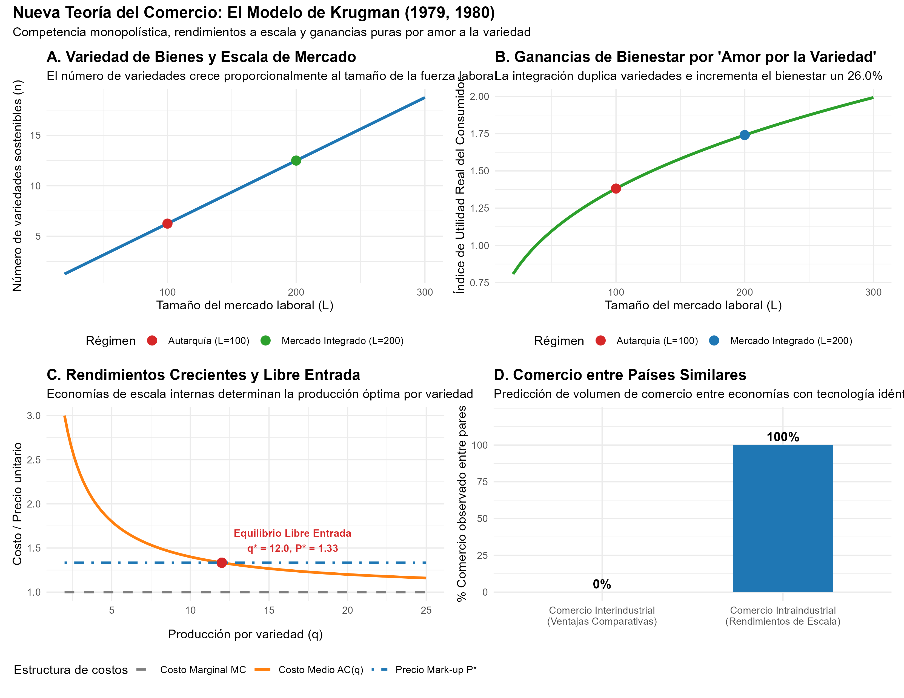
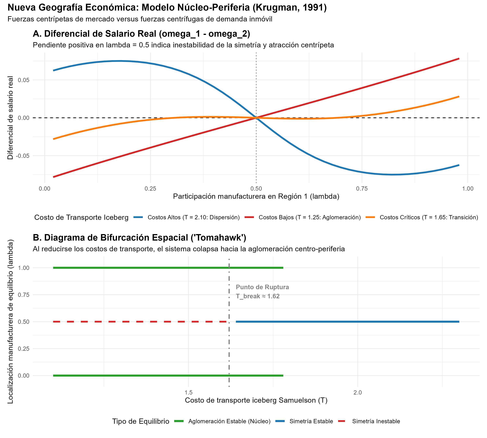

# Declaración de Nivel de Replicación

> **Nivel de Replicación:** **Ilustrativa**  
> **Fundamentación:** El aporte de Paul Krugman galardonado con el Premio del Banco de Suecia en Ciencias Económicas en Memoria de Alfred Nobel 2008 es fundamentalmente teórico y analítico. Sus modelos refundaron el comercio internacional y la economía espacial sin sustentarse en un único conjunto de datos microempírico propietario, sino proveyendo la microfundamentación rigurosa de fenómenos estilizados masivos: el comercio intraindustrial bilateral entre naciones industrializadas similares y la aglomeración regional de la actividad manufacturera. Este reporte implementa una **simulación numérica computacional y analítica** de sus dos modelos pilares:
> 1. El modelo de **comercio intraindustrial con rendimientos crecientes a escala y competencia monopolística** de **Krugman (1979, 1980)** basado en variedades de Dixit-Stiglitz.
> 2. El modelo de **bifurcación espacial Núcleo-Periferia (*Core-Periphery*)** de **Krugman (1991)** y **Fujita, Krugman y Venables (1999)** con costos de transporte iceberg.

---

# Marco Teórico

## La Nueva Teoría del Comercio: Krugman (1979, 1980)

Hasta finales de la década de 1970, la teoría pura del comercio internacional descansaba casi exclusivamente en la ventaja comparativa:
- El modelo ricardiano explicaba los flujos por diferencias tecnológicas internacionales.
- El modelo de Heckscher-Ohlin atribuía el comercio a diferencias en la dotación relativa de factores productivos (capital, trabajo, tierra).

Ambos paradigmas predecían que el comercio debía ocurrir primordialmente entre naciones profundamente disímiles (por ejemplo, el Norte industrial intercambiando maquinaria por alimentos y materias primas del Sur agrícola: **comercio interindustrial**). 

Sin embargo, las estadísticas posteriores a la Segunda Guerra Mundial contradecían frontalmente esta predicción: más del 60% del comercio global se producía entre países con niveles semejantes de desarrollo, tecnología y dotaciones factoriales (Estados Unidos, Alemania, Francia, Reino Unido, Japón), intercambiando variedades del mismo sector manufacturero (automóviles alemanes por automóviles franceses o estadounidenses: **comercio intraindustrial**).

Krugman (1979) resolvió este enigma combinando la teoría de competencia monopolística de **Dixit y Stiglitz (1977)** con rendimientos crecientes a escala internos a la firma:

### Preferencias por Variedad (Dixit-Stiglitz)
Los consumidores tienen preferencias que valoran la diversidad de bienes (*love of variety*):
$$U = \left( \sum_{i=1}^N c_i^{\frac{\sigma - 1}{\sigma}} \right)^{\frac{\sigma}{\sigma - 1}}$$
donde $\sigma > 1$ representa la elasticidad de sustitución constante entre cualquiera de las dos variedades.

### Tecnología y Estructura de Costos
Cada variedad es producida por una firma monopolista individual con función de costos laborales:
$$l_i = \alpha + \beta q_i$$
donde $\alpha > 0$ es el costo fijo en unidades de trabajo (que genera costos medios decrecientes o economías de escala internas) y $\beta > 0$ es el requerimiento marginal de trabajo.

### Equilibrio de Libre Entrada
Cada firma maximiza beneficios fijando un mark-up óptimo sobre el costo marginal:
$$p = \frac{\sigma}{\sigma - 1} \beta w$$
Normalizando el salario competitivo a $w = 1$, el precio de equilibrio está anclado por los parámetros tecnológicos y de preferencia. Bajo libre entrada, las firmas entran al mercado hasta que los beneficios extraordinarios se anulan ($\pi_i = 0$):
$$(p - \beta) q = \alpha \implies q^* = \frac{\alpha (\sigma - 1)}{\beta}$$

El empleo de cada firma en equilibrio es:
$$l^* = \alpha + \beta q^* = \alpha \sigma$$

En una economía cerrada (autarquía) con una dotación laboral de $L$ trabajadores, el número de firmas y variedades producidas es finito:
$$n_{aut} = \frac{L}{l^*} = \frac{L}{\alpha \sigma}$$

### Efecto de la Integración Comercial
Cuando dos países idénticos de tamaño $L$ se integran en un mercado común sin barreras:
- El tamaño del mercado laboral global se duplica a $2L$.
- Como $q^*$ y $p^*$ permanecen inalterados por variedad, el número total de variedades disponibles para los consumidores se duplica exactamente:
$$N = 2 n_{aut} = \frac{2L}{\alpha \sigma}$$
- Cada consumidor consume una cantidad menor de cada variedad individual ($c_i = q^* / 2L$), pero su utilidad per cápita aumenta estrictamente:
$$U_{trade} = 2^{\frac{1}{\sigma - 1}} U_{aut} > U_{aut}$$

**Conclusión fundamental:** El comercio internacional genera ganancias netas de bienestar incluso entre naciones absolutamente idénticas, impulsado exclusivamente por la especialización a escala y la expansión de la gama de variedades disponibles para los consumidores.

---

## La Nueva Geografía Económica: Krugman (1991)

En su célebre artículo de 1991 en el *Journal of Political Economy*, Krugman abordó una pregunta geoeconómica básica pero no resuelta: ¿por qué la manufactura y los servicios avanzados se concentran masivamente en ciertas regiones o megalópolis mientras otras quedan como periferias agrícolas despobladas?

El **Modelo Núcleo-Periferia (*Core-Periphery Model*)** formaliza la tensión entre dos fuerzas contrapuestas en un espacio de dos regiones (1 y 2) con dos sectores:
1. **Sector Agrícola ($A$):** rendimientos constantes a escala, competencia perfecta, bienes homogéneos, costos de transporte nulos y trabajadores ligados a la tierra e inmóviles entre regiones ($L_{A1} = L_{A2} = \frac{1 - \mu}{2}$). Participación en el gasto: $(1 - \mu)$.
2. **Sector Manufacturero ($M$):** rendimientos crecientes, bienes diferenciados Dixit-Stiglitz con elasticidad $\sigma$, trabajadores manufactureros móviles interregionalmente ($L_M = \mu$). La proporción de trabajadores en la Región 1 es $\lambda \in [0, 1]$. Participación en el gasto: $\mu$.
3. **Costos de Transporte Iceberg (Samuelson):** Para transportar una unidad de manufactura de una región a la otra, deben despacharse $T > 1$ unidades; una fracción se "derrite" en el camino. El parámetro de libertad de comercio es $\phi = T^{1 - \sigma} \in [0, 1]$.

### Las Fuerzas en Conflicto
- **Fuerzas Centrípetas (Aglomeración):**
  - *Encadenamiento hacia atrás (Backward linkage / Home Market Effect):* Las firmas prefieren establecerse en la región que ya cuenta con el mayor mercado de consumidores para minimizar costos de transporte sobre el grueso de sus ventas.
  - *Encadenamiento hacia adelante (Forward linkage):* Los trabajadores prefieren residir en la región con mayor concentración de manufacturas porque disfrutan de un índice de precios más bajo (ahorran costos de transporte de importación), lo que eleva su salario real.
- **Fuerza Centrífuga (Dispersión):**
  - La demanda dispersa de los agricultores inamovibles en la periferia crea un incentivo para que algunas firmas se ubiquen en la región periférica a fin de abastecer ese mercado local sin enfrentar la intensa competencia del núcleo.

### El Sistema de Ecuaciones de Equilibrio
Para una distribución laboral $\lambda$ y un costo de transporte $T$:
- Ingresos nominales regionales:
  $$Y_1 = \mu \lambda w_1 + \frac{1 - \mu}{2}, \quad Y_2 = \mu (1 - \lambda) w_2 + \frac{1 - \mu}{2}$$
- Índices de precios de manufacturas:
  $$G_1 = \left[ \lambda w_1^{1-\sigma} + (1 - \lambda) \phi w_2^{1-\sigma} \right]^{\frac{1}{1-\sigma}}, \quad G_2 = \left[ \lambda \phi w_1^{1-\sigma} + (1 - \lambda) w_2^{1-\sigma} \right]^{\frac{1}{1-\sigma}}$$
- Salarios nominales manufactureros (beneficio cero):
  $$w_1 = \left[ Y_1 G_1^{\sigma-1} + Y_2 G_2^{\sigma-1} \phi \right]^{1/\sigma}, \quad w_2 = \left[ Y_1 G_1^{\sigma-1} \phi + Y_2 G_2^{\sigma-1} \right]^{1/\sigma}$$
- Salarios reales:
  $$\omega_1 = w_1 G_1^{-\mu}, \quad \omega_2 = w_2 G_2^{-\mu}$$

La migración responde al diferencial de salario real: $\Delta \omega(\lambda, T) = \omega_1 - \omega_2$.

### La Bifurcación Catastrófica ("Tomahawk")
- Cuando los costos de transporte son altos ($T > T_{break}$): los costos de envío aíslan los mercados locales; la fuerza centrífuga domina y la dispersión simétrica ($\lambda = 0.5$) es el único equilibrio estable.
- A medida que los costos de transporte descienden por debajo del punto crítico $T_{break}$ (por ejemplo, con la construcción de canales, ferrocarriles o autopistas): la simetría se vuelve inestable ($\left. \frac{d\Delta\omega}{d\lambda} \right|_{\lambda = 0.5} > 0$). El sistema experimenta una bifurcación catastrófica tipo horquilla (*subcritical pitchfork* o diagrama "Tomahawk"): cualquier leve asimetría inicial desencadena un proceso acumulativo de migración que culmina en la aglomeración total en una sola región ($\lambda = 1$ o $\lambda = 0$).

---

# Implementación Numérica en R

El script autónomo `R/modelo_comercio_geografia_krugman.R` implementa los algoritmos de simulación para ambos modelos.

```r
# Carga de librerías esenciales
library(tidyverse)
library(scales)
library(patchwork)

# Parámetros canónicos de Krugman (1979)
alpha_val <- 4.0      # Costo fijo en trabajo
beta_val  <- 1.0      # Requerimiento marginal de trabajo
sigma_val <- 4.0      # Elasticidad de sustitución (rho = 0.75)
w_val     <- 1.0      # Salario normalizado

# Variables de equilibrio de la firma
p_star <- (sigma_val / (sigma_val - 1)) * beta_val * w_val
q_star <- (alpha_val * (sigma_val - 1)) / beta_val
l_star <- alpha_val * sigma_val
```

Para el modelo núcleo-periferia de 1991, el sistema de salarios nominales se resuelve mediante un algoritmo iterativo de punto fijo sobre el operador de contracción hasta alcanzar una tolerancia $\epsilon < 10^{-7}$.

---

# Resultados de la Simulación

## Modelo de Comercio Intraindustrial (Krugman, 1979)



Los resultados numéricos revelan:
1. **Escala y Variedades:** En autarquía con $L = 100$, la economía sostiene $n = 6.25$ variedades con una utilidad per cápita de $U = 1.3815$. Al integrarse dos economías idénticas en un mercado de $L = 200$, el número de variedades se expande a $N = 12.50$, elevando la utilidad per cápita a $U = 1.7406$.
2. **Ganancia Neta de Comercio:** La ganancia de bienestar derivada exclusivamente de la mayor variedad es de **+25.99%** sin necesidad de divergencias en productividad o salarios. Con cuatro países integrados ($L = 400$), la ganancia asciende a **+58.74%**.
3. **Escala Constante por Firma:** La producción individual permanece invariante en $q^* = 12.0$ y el precio en $P^* = 1.33$. Las economías de escala operan a nivel del sector agregado mediante la multiplicación de la gama de bienes.

---

## Modelo Núcleo-Periferia (Krugman, 1991)



El análisis del espacio económico muestra:
1. **Punto de Ruptura ($T_{break} \approx 1.62$):** Para costos de transporte iceberg elevados ($T = 2.10$), la curva de diferencial salarial $\Delta \omega$ cruza $\lambda = 0.5$ con pendiente negativa, garantizando la estabilidad del patrón geográfico disperso y equilibrado.
2. **Colapso hacia la Aglomeración:** Cuando los costos de transporte caen a $T = 1.25$ (por debajo de $T_{break}$), la pendiente en el punto simétrico se vuelve marcadamente positiva. Los encadenamientos circulares centrípetos superan a la fuerza centrífuga, haciendo inestable la dispersión y atrayendo el 100% de la manufactura hacia una sola región núcleo ($\lambda \to 1.0$), donde el salario real alcanza $\omega_1 \approx 0.999$, dejando a la periferia desindustrializada.

---

## Tabla Resumen de Simulaciones

La siguiente tabla resume los equilibrios numéricos obtenidos a través de las distintas configuraciones institucionales y de transporte:

```{r}
#| echo: false
tab_res <- readr::read_csv("salidas/tab_krugman_simulacion.csv", show_col_types = FALSE)
knitr::kable(tab_res, digits = 3, caption = "Resumen de escenarios simulados: Krugman (1979, 1991)")
```

---

# Comparación con la Literatura y Extensiones Posteriores

El trabajo de Paul Krugman definió el estándar metodológico sobre el cual se edificaron los avances modernos del comercio y la economía urbana:
1. **Heterogeneidad de Firmas (Melitz, 2003):** Marc Melitz enriqueció el modelo de Krugman al introducir firmas heterogéneas en productividad. Mientras que en Krugman todas las empresas exportan, Melitz demuestra que solo las firmas más eficientes superan los costos fijos de entrada al comercio exterior, depurando el mercado y elevando la productividad agregada.
2. **Nuevos Modelos Cuantitativos de Comercio Espacial (Eaton & Kortum, 2002; Redding & Rossi-Hansberg, 2017):** La Nueva Geografía Económica evolucionó desde modelos estilizados de 2 regiones hacia modelos espaciales cuantitativos calibrados con datos georreferenciados continuos (GPEC), capaces de predecir el impacto de nuevas líneas de alta velocidad, puertos marítimos y peajes de congestión urbana.
3. **Límites de la Aglomeración:** En economías avanzadas, los costos de congestión urbana (precio del suelo, atascos, contaminación) actúan como fuerzas centrífugas adicionales que equilibran la hiperconcentración en las megaciudades metropolitanas.
