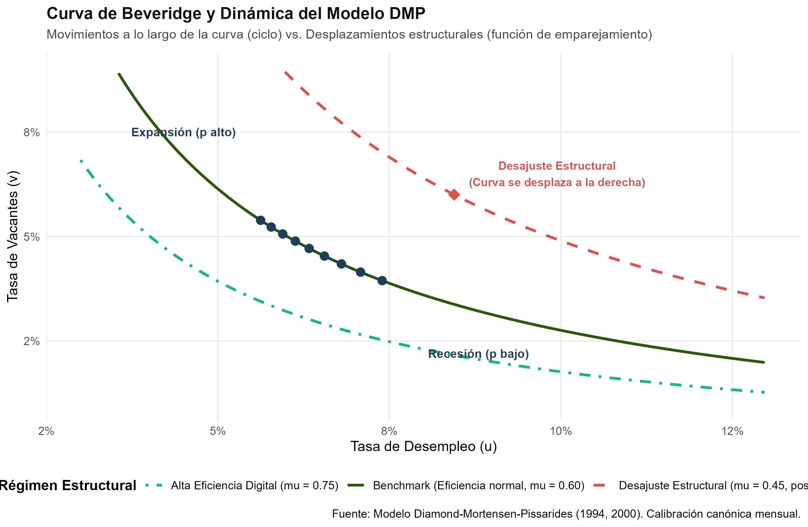
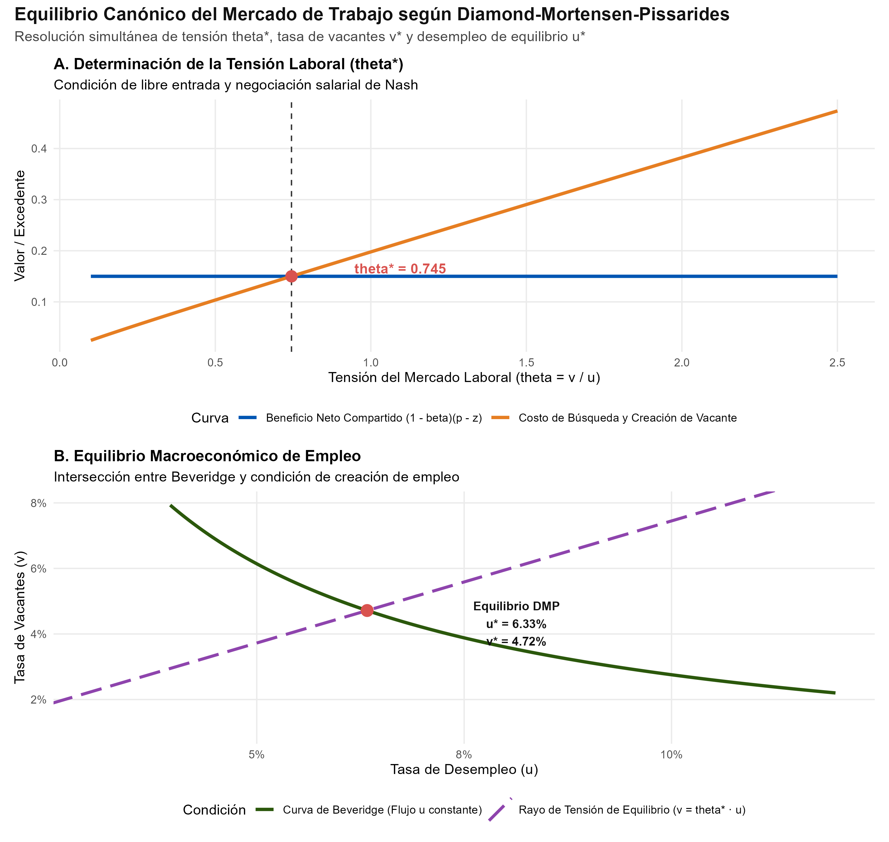

# Introducción y Objetivo

En 2010, la Real Academia Sueca de Ciencias otorgó el Premio de Ciencias Económicas en Memoria de Alfred Nobel a **Peter A. Diamond** (MIT), **Dale T. Mortensen** (Northwestern University) y **Christopher A. Pissarides** (London School of Economics) *"por su análisis de los mercados con fricciones de búsqueda"* (*for their analysis of markets with search frictions*).

Antes de sus contribuciones, la teoría económica clásica modelaba los mercados bajo el paradigma walrasiano de equilibrio general: compradores y vendedores se encontraban instantáneamente sin costo, un subastador benevolente fijaba el precio de equilibrio que vaciaba el mercado y no existía desempleo involuntario ni vacantes no cubiertas. 

Diamond, Mortensen y Pissarides transformaron de raíz este enfoque al construir el **modelo DMP** (*Diamond-Mortensen-Pissarides model*), el marco canónico para analizar el mercado laboral moderno. El modelo explica por qué conviven simultáneamente trabajadores desempleados buscando empleo y empresas con vacantes abiertas sin cubrir, y formaliza cómo el proceso descentralizado de búsqueda, los costos de emparejamiento y el poder de negociación determinan los salarios reales y la tasa de desempleo de equilibrio.

## Nivel de Replicación
- **Nivel:** **Ilustrativa** (simulación numérica y resolución analítica del modelo canónico DMP en tiempo continuo estacionario de Mortensen y Pissarides 1994 y Pissarides 2000, calibrado a frecuencia mensual con parámetros representativos del mercado de trabajo; derivación de la curva de Beveridge, resolución de la condición de creación de vacantes y evaluación de la regla de eficiencia de Hosios 1990).

---

# Fundamentos Teóricos del Modelo DMP

## 1. La Paradoja de Diamond (Diamond, 1971)

El punto de partida conceptual fue formulado por Peter Diamond en 1971. Diamond demostró que en un mercado donde muchas empresas venden un producto idéntico a costo marginal $c$, si los consumidores enfrentan un **costo de búsqueda positivo $\epsilon > 0$** (por infinitesimal que sea) para visitar otra tienda, el único equilibrio de Nash en precios es el **precio de monopolio** $p^m$, no el precio competitivo walrasiano ($p = c$). 

Si todos cobraran $p = c$, una empresa individual podría subir su precio a $c + \epsilon - \delta$; ningún comprador gastaría $\epsilon$ en buscar otra tienda para ahorrar menos de $\epsilon$. En consecuencia, todas las firmas suben precios sucesivamente hasta alcanzar la renta monopolística. Esta paradoja reveló que la presencia de pequeñas fricciones de información destruye los resultados competitivos convencionales y genera rentas bilaterales ex-post que deben ser negociadas.

## 2. La Función Agregada de Emparejamiento (*Matching Function*)

En el mercado de trabajo, las empresas tienen $v$ vacantes abiertas y hay $u$ trabajadores desempleados (normalizando la fuerza laboral total a $L = 1$). El proceso estocástico por el cual se coordinan y celebran contratos se resume mediante una función de emparejamiento con rendimientos constantes a escala (CRS), típicamente Cobb-Douglas:

$$M(u, v) = \mu u^{\alpha} v^{1-\alpha}$$

donde $\mu > 0$ denota la eficiencia estructural del emparejamiento y $\alpha \in (0, 1)$ representa la elasticidad del matching respecto al desempleo.

Se define la **tensión del mercado laboral** (*labor market tightness*) como:
$$\theta \equiv \frac{v}{u}$$

A partir de $\theta$, se derivan las probabilidades por unidad de tiempo:
- **Tasa de cobertura de vacantes para una empresa:**
  $$q(\theta) = \frac{M(u, v)}{v} = \mu \theta^{-\alpha}, \quad \text{con } q'(\theta) < 0$$
- **Tasa de salida del desempleo para un trabajador:**
  $$f(\theta) = \frac{M(u, v)}{u} = \theta q(\theta) = \mu \theta^{1-\alpha}, \quad \text{con } f'(\theta) > 0$$

### Externalidades de Búsqueda
El modelo captura dos externalidades bilaterales:
1. **Externalidad de congestión:** Cuando una empresa publica una vacante adicional, aumenta $\theta$, reduciendo la probabilidad $q(\theta)$ de que las demás empresas cubran sus puestos. Análogamente, un desempleado adicional reduce la probabilidad de los otros desempleados.
2. **Externalidad de grosor del mercado (*thick-market externality*):** Más vacantes aumentan la probabilidad $f(\theta)$ de que los desempleados encuentren empleo rápidamente.

---

## 3. Dinámica del Desempleo y Curva de Beveridge

Sea $\delta > 0$ la tasa exógena de destrucción de puestos de trabajo (*job separation rate*). La variación temporal del desempleo viene dada por el balance entre flujos de entrada y flujos de salida:

$$\dot{u}_t = \delta (1 - u_t) - f(\theta_t) u_t$$

En el **estado estacionario** ($\dot{u}_t = 0$):
$$\delta (1 - u^*) = f(\theta^*) u^* \implies u^* = \frac{\delta}{\delta + f(\theta^*)} = \frac{\delta}{\delta + \mu \theta^{* 1-\alpha}}$$

Dado que $\theta = v / u$, la relación entre desempleo y vacantes define analíticamente la **Curva de Beveridge**:
$$v(u) = u \cdot \left[ \frac{\delta (1 - u)}{\mu u} \right]^{\frac{1}{1-\alpha}}$$

La curva tiene pendiente negativa estricta en el plano $(u, v)$: en recesiones, cuando las vacantes caen, el desempleo debe aumentar para restaurar el balance de flujos. Un deterioro en la eficiencia del emparejamiento ($\mu \downarrow$) desplaza la curva entera hacia afuera.

---

## 4. Ecuaciones de Valor de Bellman y Creación de Empleo (JC)

Sea $r > 0$ la tasa subjetiva de descuento. Sean los valores esperados de los estados:
- $V$: Valor de una vacante no cubierta.
- $J$: Valor de un puesto de trabajo ocupado por un trabajador productivo.
- $U$: Valor de un trabajador en desempleo.
- $W$: Valor de un trabajador ocupado.

### Las Firmas
Una vacante cuesta $c > 0$ unidades por unidad de tiempo en publicación y selección:
$$r V = -c + q(\theta) (J - V)$$

Bajo la **condición de libre entrada** (*free-entry condition*), las empresas crean vacantes hasta agotar las rentas esperadas, de modo que en equilibrio $V = 0$:
$$0 = -c + q(\theta) J \implies J = \frac{c}{q(\theta)}$$

El valor de un empleo ocupado con productividad marginal $p$ y salario $w$ satisface:
$$r J = p - w - \delta (J - V) \implies J = \frac{p - w}{r + \delta}$$

Igualando ambas expresiones de $J$ se obtiene la **Condición de Creación de Empleo** (*Job Creation Condition*, JC):
$$\frac{p - w}{r + \delta} = \frac{c}{q(\theta)} \iff p - w = \frac{(r + \delta) c}{\mu \theta^{-\alpha}}$$

### Los Trabajadores
Un desempleado disfruta de un valor de reserva / subsidio $z$ (que incluye ocio y seguro de desempleo):
$$r U = z + f(\theta) (W - U)$$
$$r W = w - \delta (W - U)$$

Restando ambas ecuaciones:
$$W - U = \frac{w - z}{r + \delta + f(\theta)}$$

---

## 5. Negociación Salarial de Nash y Curva Salarial (WC)

Cuando una firma y un trabajador se encuentran, surge un excedente cuasirrentista bilateral $S = (W - U) + J$. El salario se determina mediante la **solución de negociación generalizada de Nash**:

$$\max_w (W - U)^\beta J^{1-\beta}$$

donde $\beta \in (0, 1)$ es el poder de negociación relativo del trabajador. La condición de primer orden impone:
$$W - U = \frac{\beta}{1-\beta} J$$

Sustituyendo $J = \frac{c}{q(\theta)}$ y $f(\theta) = \theta q(\theta)$, se despeja la **Curva Salarial** (*Wage Curve*, WC):
$$w = (1 - \beta) z + \beta (p + c \theta)$$

El salario es un promedio ponderado entre el valor de reserva del trabajador $z$ y la productividad marginal del puesto aumentada por el ahorro del costo de búsqueda empresarial ($p + c \theta$).

---

## 6. Determinación Simultánea del Equilibrio

Sustituyendo el salario negociado en la condición de creación de empleo:
$$(1 - \beta)(p - z) - \beta c \theta = \frac{(r + \delta) c}{\mu \theta^{-\alpha}}$$
$$(1 - \beta)(p - z) = c \left[ \beta \theta + \frac{r + \delta}{\mu} \theta^\alpha \right]$$

Esta ecuación tiene una **solución única y estrictamente positiva $\theta^*$**:
- El lado izquierdo representa la porción del excedente neto de producción capturada por la firma.
- El lado derecho representa el costo marginal esperado de mantener la vacante abierta hasta cubrirla.

Con $\theta^*$, se calculan recursivamente:
1. $w^* = (1 - \beta) z + \beta (p + c \theta^*)$
2. $u^* = \frac{\delta}{\delta + \mu (\theta^*)^{1-\alpha}}$
3. $v^* = \theta^* \cdot u^*$

---

## 7. La Condición de Eficiencia de Hosios (Hosios, 1990)

Un planificador social benevolente que busca maximizar el valor presente del producto neto descontado sujeto a la tecnología de emparejamiento elige la tensión óptima $\theta^{SP}$. 

Arthur Hosios (1990) demostró formalmente que el equilibrio descentralizado de mercado coincide con el óptimo social si y solo si:
$$\beta = \alpha$$

Es decir, cuando **el poder de negociación del trabajador iguala la elasticidad del desempleo en la función de emparejamiento**. 
- Si $\beta > \alpha$: los salarios son ineficientemente elevados; las empresas crean muy pocas vacantes (subempleo y desempleo excesivo).
- Si $\beta < \alpha$: los salarios son demasiado bajos; las empresas sobrecrean vacantes generando congestión masiva en el mercado sin suficiente absorción de mano de obra.

---

# Implementación y Simulación en R

El siguiente bloque ejecuta la calibración canónica a frecuencia mensual representativa de economías desarrolladas:

```{r}
#| message: false
#| warning: false

library(ggplot2)
library(dplyr)
library(readr)
library(scales)

# Cargar tabla de resultados generada por el script R
tab_res <- read_csv("salidas/tab_resultados_dmp.csv", show_col_types = FALSE)
knitr::kable(tab_res %>% 
               mutate(across(c(theta, duracion_u, duracion_v, valor_firma), round, 3)) %>%
               mutate(across(c(desempleo, vacantes), ~percent(., accuracy = 0.01))) %>%
               mutate(salario = round(salario, 3)),
             caption = "Resultados del Modelo DMP ante Escenarios Macroeconómicos y Estructurales")
```

---

# Análisis de Resultados y Visualizaciones

## 1. Curva de Beveridge: Ciclo Económico vs. Desajustes Estructurales

La relación inversa entre desempleo y vacantes observada empíricamente por William Beveridge en 1944 encuentra su fundamentación microeconómica en la condición de flujo estacionario del modelo DMP:

{width=90%}

### Hallazgos Clave:
1. **Movimientos a lo largo de la curva (Fluctuaciones Cíclicas):**
   - Cuando la productividad agregada $p$ fluctúa a lo largo del ciclo económico (puntos azules), la economía se desplaza sobre la misma curva de Beveridge. 
   - En expansiones ($p = 1.05$), las vacantes se disparan a $5.15\%$ y el desempleo se reduce a $5.86\%$.
   - En recesiones ($p = 0.95$), las vacantes caen a $4.25\%$ y el desempleo se eleva a $6.94\%$.
2. **Desplazamientos hacia afuera (Desajuste Estructural de Habilidades):**
   - Una caída en la eficiencia de emparejamiento ($\mu = 0.45$, rombo rojo) desplaza la curva entera hacia la derecha. 
   - La economía experimenta simultáneamente un desempleo mayor ($8.45\%$) y una tasa elevada de vacantes ($6.00\%$), reflejando desajuste geográfico o de cualificaciones post-crisis.

---

## 2. Determinación del Equilibrio Macroeconómico

El equilibrio general se determina de manera recursiva mediante dos bloques:

{width=90%}

- **Panel A (Tensión Laboral $\theta^*$):** La intersección de la curva de beneficio neto compartido $(1 - \beta)(p - z)$ con el costo marginal esperado de vacante determina $\theta^* \approx 0.745$.
- **Panel B (Equilibrio $(u^*, v^*)$):** El rayo de tensión $v = \theta^* u$ corta a la Curva de Beveridge en el punto exacto de equilibrio macroeconómico: $u^* = 6.33\%$ y $v^* = 4.72\%$.

---

# Comparación Teórica y Limitaciones (El Puzzle de Shimer)

A pesar de su éxito monumental, el modelo DMP canónico fue sometido a una profunda revisión empírica a principios de los años 2000:

1. **El Puzzle de Shimer (Shimer, 2005):**
   - Robert Shimer demostró que con la calibración canónica de Nash, la tensión laboral $\theta$ en el modelo DMP es casi **diez veces menos volátil** que en los datos históricos estadounidenses (datos JOLTS y CPS).
   - *Causa:* La negociación salarial de Nash continua reacciona excesivamente a los aumentos de productividad $p$, absorbiendo la mayor parte de las ganancias en mayores salarios $w^*$ en lugar de incentivar a las firmas a crear vacantes.
2. **Extensiones Modernas:**
   - **Rigidez salarial (Hall, 2005):** Introducir salarios reales con ajuste lento amplifica fuertemente la volatilidad de las vacantes.
   - **Calibración de Hagedorn y Manovskii (2008):** Fijar un valor de reserva $z = 0.95$ muy cercano a la productividad genera un excedente marginal muy volátil que reproduce la fluctuación observada en los datos.

---

# Conclusión

El marco DMP de Diamond, Mortensen y Pissarides redefinió la macroeconomía moderna al demostrar que el desempleo y las vacantes no son anomalías transitorias, sino el resultado inevitable de un proceso estocástico de búsqueda en presencia de fricciones reales. Sus herramientas analíticas continúan siendo el estándar indispensable para evaluar reformas de seguros de desempleo, políticas activas de empleo y desajustes estructurales en las economías globales.
