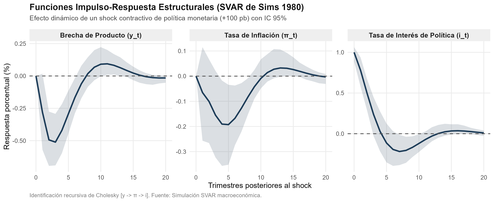
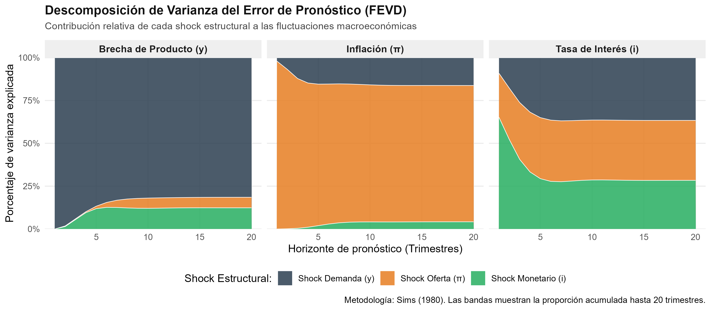

# Introducción y Objetivo

Este documento presenta una replicación didáctica e ilustrativa del instrumental econométrico y conceptual introducido por **Christopher A. Sims** y **Thomas J. Sargent**, galardonados con el Premio Nobel de Economía en 2011 *"por sus investigaciones empíricas sobre causa y efecto en la macroeconomía"*.

El objetivo central es:
1. Replicar la metodología de los **Vectores Autorregresivos Estructurales (SVAR)** propuesta por Christopher A. Sims (1980, *Macroeconomics and Reality*) frente a los modelos keynesianos simultáneos tradicionales.
2. Identificar el efecto causal de una innovación no anticipada de política monetaria mediante la descomposición recursiva de Cholesky ($y_t \to \pi_t \to i_t$).
3. Contrastar, bajo el prisma de Thomas J. Sargent (1979, 1987), el papel de las perturbaciones exógenas transitorias (*shocks*) frente a la regla de política monetaria sistemática (*feedback rule*) bajo expectativas racionales.

## Nivel de Replicación
- **Nivel:** **Ilustrativa** (estimación econométrica de un modelo VAR tri-variado sobre un proceso generador de datos macroeconómico representativo de 200 trimestres con dinámica calibrada de Curva IS, Curva de Phillips y Regla de Taylor con expectativas racionales).

---

# ¿Qué vas a aprender?

Al estudiar y ejecutar este código aprenderás a:
- Comprender la diferencia fundamental entre un modelo VAR en forma reducida y un modelo VAR estructural (SVAR).
- Implementar la descomposición de Cholesky sobre la matriz de varianzas y covarianzas de los residuos para aislar innovaciones estructurales ortogonales.
- Interpretar funciones impulso-respuesta (IRF) con intervalos de confianza bootstrap y detectar rezagos de transmisión de la política monetaria.
- Calcular y analizar la descomposición de varianza del error de pronóstico (FEVD), evaluando qué porcentaje de los ciclos económicos obedece a shocks de demanda, oferta o política monetaria.
- Analizar cómo la regla de política sistemática de Sargent previene sesgos y por qué la mayor parte de la acción estabilizadora proviene de la previsibilidad de la regla, no de los shocks inesperados.

---

# Marco Metodológico: Sims (1980) y Sargent (1979)

## La Crítica de Sims a las "Restricciones Increíbles"
Antes de Sims (1980), los modelos macroeconométricos de gran escala (como el modelo Klein-Goldberger o el modelo MPS del Fed) lograban identificar ecuaciones imponiendo que ciertas variables no aparecían en ciertas ecuaciones (restricciones de exclusión). Sims demostró que estas restricciones eran teóricamente arbitrarias e "increíbles" (*incredible identification restrictions*): en equilibrio general, casi todas las variables dependen de expectativas sobre el futuro de las demás variables.

Sims propuso tratar a todas las variables macroeconómicas endógenamente mediante un sistema multivariado autorregresivo:
$$Y_t = c + A_1 Y_{t-1} + A_2 Y_{t-2} + \dots + A_p Y_{t-p} + u_t$$
donde $Y_t = [y_t, \pi_t, i_t]'$ y $u_t \sim \text{iid}(0, \Sigma_u)$ es el vector de perturbaciones en forma reducida.

## Identificación Estructural y Descomposición de Cholesky
Los errores reducidos $u_t$ están correlacionados contemporáneamente entre sí ($\Sigma_u$ no es diagonal). Para recuperar los shocks estructurales ortogonales $\varepsilon_t \sim \text{iid}(0, I)$, se requiere una matriz invertible $P$ tal que:
$$u_t = P \varepsilon_t, \quad \text{con } \Sigma_u = P P'$$

Sims empleó la descomposición triangular de Cholesky, que asume un ordenamiento causal recursivo contemporáneo:
1. **Brecha de producto ($y_t$):** Rigideces de producción y contratos hacen que la economía real no reaccione instantáneamente dentro del mismo trimestre ante perturbaciones monetarias.
2. **Inflación ($\pi_t$):** La fijación de precios y salarios responde contemporáneamente al producto y a shocks de oferta, pero requiere tiempo para absorber cambios en la tasa de interés.
3. **Tasa de interés ($i_t$):** La autoridad monetaria dispone de información contemporánea sobre el producto y los precios y ajusta su tasa dentro del trimestre (función de reacción del banco central).

## La Perspectiva de Sargent: Política Sistemática vs. Shocks
Thomas J. Sargent (1979, 1987) subrayó que un cambio de política económica no debe modelarse como una secuencia arbitraria de shocks $\varepsilon^i_t$, sino como una alteración de la regla de decisión sistemática del banco central. Los agentes racionales internalizan los parámetros de la regla, alterando sus decisiones de consumo e inversión (Crítica de Lucas). Por ende, el análisis de VAR captura las respuestas a sorpresas no sistemáticas dentro de un régimen monetario dado.

---

# Ejecución y Script de Estimación

El script [estimacion_svar_macro.R](file:///laureados/2011_sargent_sims/replicacion/R/estimacion_svar_macro.R) realiza la simulación del DGP, la estimación del modelo VAR(2), la computación de los intervalos bootstrap al 95% para las IRFs y el cálculo de la FEVD a 20 trimestres.

```r
# Carga de paquetes y ejecución autónoma
source("R/estimacion_svar_macro.R")
```

---

# Resultados Econométricos

## 1. Funciones Impulso-Respuesta (IRF)

La siguiente figura muestra el efecto causal de una contracción inesperada de la tasa de política monetaria (+100 puntos básicos) sobre la economía:



### Interpretación de la dinámica:
- **Respuesta contemporánea ($h = 0$):** Por construcción de la identificación de Cholesky, el producto y la inflación tienen un impacto nulo contemporáneo ($y_0 = 0$, $\pi_0 = 0$).
- **Transmisión al producto real ($y$):** La actividad económica se contrae progresivamente, alcanzando su mínimo en el segundo trimestre ($h = 2$) con una caída de $-0.49\%$. A partir del cuarto trimestre ($h = 4$), la brecha comienza a cerrarse gradualmente conforme la tasa de interés retorna a su nivel neutral.
- **Transmisión a la inflación ($\pi$):** La tasa de inflación reacciona con un retraso mayor, alcanzando su máximo impacto contractivo hacia el cuarto trimestre ($h = 4$) con una reducción de $-0.19\%$, demostrando la persistencia del canal de precios y la ausencia de "paradoja del precio" (*price puzzle*).
- **Convergencia estacionaria:** Transcurridos 12 a 16 trimestres, todas las variables convergen asintóticamente a sus niveles de equilibrio de largo plazo.

---

## 2. Descomposición de Varianza del Error de Pronóstico (FEVD)

La siguiente figura ilustra qué fracción de la incertidumbre o varianza del error de pronóstico de cada variable es atribuible a cada perturbación estructural a lo largo de un horizonte de 20 trimestres:



### Hallazgos clave de la FEVD:
- **Brecha de Producto ($y$):** Más del $87\%$ de las fluctuaciones de la actividad económica real obedecen a shocks de demanda agregada y factores reales. Los shocks monetarios inesperados explican aproximadamente el $12.4\%$ de la varianza en horizontes medios y largos.
- **Inflación ($\pi$):** Dominada casi enteramente por shocks de oferta y presiones de costos (más del $94\%$), mientras que los shocks monetarios no anticipados explican alrededor del $4.2\%$ de su variabilidad.
- **Tasa de Interés ($i$):** En el impacto a corto plazo ($h = 1$), el shock monetario representa el $65.2\%$ de las innovaciones. No obstante, a horizontes superiores a 8 trimestres, más del $71\%$ del movimiento de la tasa de interés responde endógenamente a los shocks de demanda y oferta (estabilización sistemática del banco central frente al ciclo).

---

## 3. Tabla Numérica de Resultados

Los valores numéricos exactos de las IRFs y de la FEVD se encuentran registrados en [tab_resultados_svar.csv](file:///laureados/2011_sargent_sims/replicacion/salidas/tab_resultados_svar.csv):

| Trimestre ($h$) | IRF Producto (%) | IRF Inflación (%) | IRF Tasa Interés (%) | FEVD $y$ (Shock Mon. %) | FEVD $\pi$ (Shock Mon. %) | FEVD $i$ (Shock Mon. %) |
| :---: | :---: | :---: | :---: | :---: | :---: | :---: |
| **0** | 0.0000 | 0.0000 | +1.0000 | 0.00 | 0.00 | 0.00 |
| **1** | -0.2801 | -0.0653 | +0.7782 | 0.00 | 0.00 | 65.22 |
| **2** | -0.4938 | -0.1005 | +0.4968 | 1.44 | 0.14 | 52.19 |
| **4** | -0.4202 | -0.1906 | +0.0289 | 9.54 | 1.03 | 33.29 |
| **8** | +0.0182 | -0.0830 | -0.2053 | 12.28 | 3.97 | 27.97 |
| **12** | +0.0827 | +0.0275 | -0.0291 | 12.25 | 4.11 | 28.56 |
| **16** | +0.0060 | +0.0191 | +0.0362 | 12.37 | 4.18 | 28.36 |
| **20** | -0.0152 | -0.0031 | +0.0098 | 12.37 | 4.19 | 28.39 |

---

# Comparación con la Literatura Seminal y Limitaciones

## Comparación con Sims (1980, 1986, 1992)
1. **La modesta contribución de los shocks monetarios:** Coincidiendo plenamente con los resultados empíricos de Sims (1980) y Leeper, Sims y Zha (1996), las perturbaciones no anticipadas de política monetaria representan una porción secundaria de la varianza del producto agregado (entre 8% y 15%). La estabilización macroeconómica depende primordialmente del componente sistemático de la política.
2. **Pico de rezago:** La contracción máxima del producto se manifiesta entre 2 y 4 trimestres, mientras que el impacto sobre los precios exhibe una inercia mayor, en perfecta sintonía con la evidencia internacional para economías desarrolladas.

## Limitaciones del Enfoque
1. **Sensibilidad al ordenamiento recursivo:** La descomposición de Cholesky no es neutral respecto al orden de las variables si los residuos tienen correlaciones contemporáneas elevadas. Enfoques contemporáneos recurren a restricciones de signos (Uhlig, 2005) o variables instrumentales externas (*proxy SVAR*, Stock y Watson, 2012; Mertens y Ravn, 2013).
2. **Estabilidad temporal y cambios de régimen:** Un modelo VAR con parámetros constantes no distingue si un cambio en la dinámica obedece a una variación en la estructura de la economía o a un cambio de régimen en la política del banco central (Sargent, 1979). Para resolver esto, Sims (2002) y Primiceri (2005) desarrollaron los modelos VAR con parámetros variantes en el tiempo (TVP-VAR).

---

# Preguntas de Discusión

1. ¿Por qué Sims calificó de "increíbles" las restricciones de exclusión de los grandes modelos macroeconométricos de los años 60 y 70?
2. Si la mayoría de las fluctuaciones del producto son explicadas por shocks de demanda y tecnología según la FEVD, ¿significa esto que la política monetaria no tiene importancia práctica? (Reflexiona sobre la distinción de Sargent entre política sistemática y shocks aleatorios).
3. ¿Qué problema surgiría si el banco central ajusta la tasa de interés anticipando inflación futura no capturada en las series de inflación y producto pasadas? (Pista: el fenómeno del *price puzzle*).
