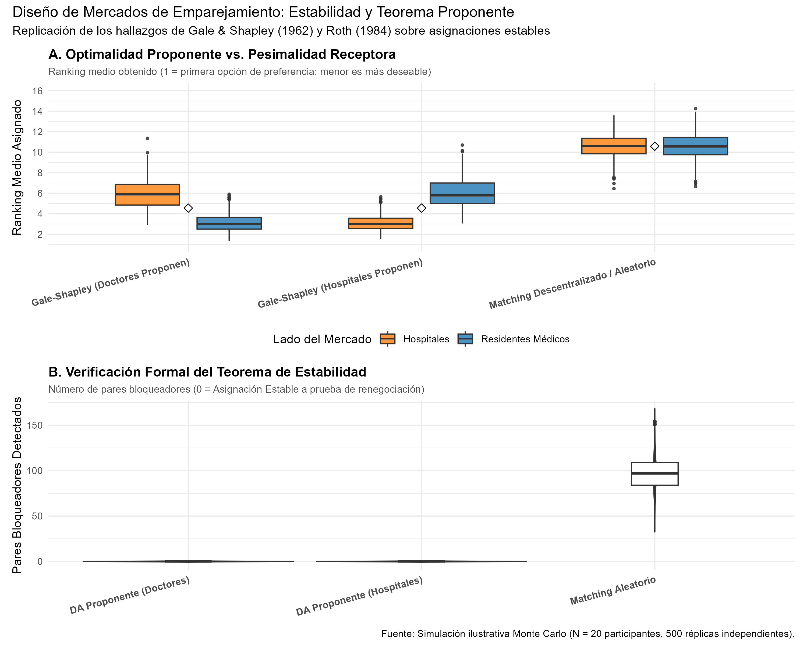
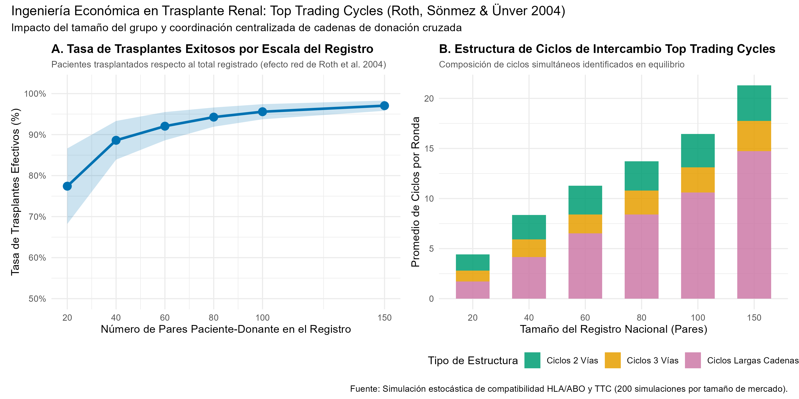

# Introducción y Objetivo

En 2012, la Real Academia Sueca de Ciencias otorgó el Premio de Ciencias Económicas del Banco de Suecia en Memoria de Alfred Nobel a **Alvin E. Roth** y **Lloyd S. Shapley** *"por la teoría de las asignaciones estables y la práctica del diseño de mercados"* (*for the theory of stable allocations and the practice of market design*).

El galardón coronó una fructífera trayectoria que conectó la investigación matemática fundamental sobre teoría de juegos cooperativos con la ingeniería económica aplicada al bienestar social:

1. **La Teoría Fundamental (Lloyd S. Shapley):** En su célebre artículo junto a David Gale (1962), Shapley formuló el problema del matrimonio estable y de las admisiones universitarias, desarrollando el **algoritmo de aceptación diferida** (*Deferred Acceptance* - DA) y demostrando que siempre existe al menos una asignación estable. Asimismo, junto a Herbert Scarf (1974), concibió el algoritmo de los **ciclos de intercambio superior** (*Top Trading Cycles* - TTC) para mercados con bienes indivisibles y sin transferencias monetarias.
2. **La Práctica e Ingeniería de Mercados (Alvin E. Roth):** Roth reconoció a comienzos de la década de 1980 que el mercado de trabajo de médicos residentes en Estados Unidos (el *National Resident Matching Program* - NRMP) había colapsado repetidamente en las décadas previas debido al fenómeno del *unraveling* (ofertas prematuras y contratos desordenados) y que el algoritmo adoptado empíricamente en 1952 para salvarlo era una versión exacta del algoritmo de Gale-Shapley. Roth demostró por qué la estabilidad es el requisito indispensable para la viabilidad de un mercado no monetario, rediseñó el NRMP en 1998, implementó los sistemas centralizados de asignación escolar de Nueva York y Boston, y fundó el diseño de registros de donación cruzada de riñones basados en TTC.

## Nivel de Replicación
- **Nivel:** **Ilustrativa** (simulación computacional de Monte Carlo del algoritmo de aceptación diferida de Gale-Shapley para mercados bilaterales de médicos y hospitales, evaluación formal de pares bloqueadores, análisis de la asimetría proponente-receptor, y simulación de Top Trading Cycles para donación cruzada de riñones de Roth, Sönmez y Ünver 2004).

---

# Marco Conceptual

## El Modelo Bilateral de Emparejamiento (Gale y Shapley, 1962)

Consideremos dos conjuntos disjuntos y finitos de agentes:
- Un conjunto de residentes o médicos $D = \{d_1, d_2, \dots, d_n\}$.
- Un conjunto de hospitales o programas $H = \{h_1, h_2, \dots, h_m\}$.

Cada médico $d \in D$ posee una relación de preferencia estricta y completa $\succ_d$ sobre $H \cup \{d\}$, donde quedarse desempleado o en autarquía se denota por el propio agente $d$. Análogamente, cada hospital $h \in H$ tiene preferencias estrictas $\succ_h$ sobre $D \cup \{h\}$.

Una **asignación** o **matching** $\mu: D \cup H \to D \cup H$ es una biyección tal que:
1. $\mu(d) \in H \cup \{d\}$ para todo $d \in D$.
2. $\mu(h) \in D \cup \{h\}$ para todo $h \in H$.
3. $\mu(d) = h \iff \mu(h) = d$.

### Racionalidad Individual y Pares Bloqueadores

Una asignación $\mu$ es **individualmente racional** si ningún agente prefiere estar solo antes que emparejado con su pareja asignada:
$$\mu(d) \succeq_d d \quad \forall d \in D \quad \text{y} \quad \mu(h) \succeq_h h \quad \forall h \in H$$

Un par médico-hospital $(d, h) \in D \times H$ constituye un **par bloqueador** (*blocking pair*) de $\mu$ si:
1. El médico $d$ prefiere al hospital $h$ sobre su asignación actual: $h \succ_d \mu(d)$.
2. El hospital $h$ prefiere al médico $d$ sobre su asignación actual: $d \succ_h \mu(h)$.

### Definición de Estabilidad

Una asignación $\mu$ es **estable** si:
1. Es individualmente racional.
2. No contiene ningún par bloqueador.

Si existiera un par bloqueador $(d, h)$, ambos agentes tendrían incentivos para eludir el sistema centralizado y firmar un contrato privado independiente, desestabilizando el mercado.

## El Algoritmo de Aceptación Diferida (*Deferred Acceptance*)

David Gale y Lloyd Shapley demostraron que siempre existe al menos una asignación estable, computable en tiempo polinómico mediante el siguiente procedimiento iterativo (con los médicos como proponentes):

- **Ronda 1:** Cada médico libre propone a su hospital preferido de su lista. Cada hospital evalúa todas las propuestas recibidas, retiene temporalmente a su candidato preferido (aceptación diferida) y rechaza a los demás.
- **Ronda $k$:** Cada médico rechazado en la ronda previa propone a su siguiente hospital favorito aún no contactado. Cada hospital compara sus nuevos proponentes con el candidato retenido previamente, conserva provisionalmente al mejor entre todos ellos y rechaza al resto.
- **Terminación:** El algoritmo se detiene cuando ningún médico libre tiene hospitales aceptables a los que proponer. Las retenciones provisionales se convierten en asignaciones definitivas.

### Teoremas Centrales

1. **Existencia y Convergencia:** El algoritmo siempre finaliza en un número finito de pasos ($O(n^2)$) produciendo una asignación estable.
2. **Optimalidad Proponente:** Entre todas las asignaciones estables posibles, la asignación resultante cuando proponen los médicos ($\mu_D$) es la más favorable para todos y cada uno de los médicos: para cualquier otra asignación estable $\mu$, $\mu_D(d) \succeq_d \mu(d)$ para todo $d \in D$.
3. **Pesimalidad Receptora:** Simultáneamente, $\mu_D$ asigna a cada hospital la peor pareja que podría obtener en cualquier emparejamiento estable.
4. **Veracidad como Estrategia Dominante (*Strategy-Proofness*):** Dubins y Freedman (1981) y Roth (1982) probaron que, para los miembros del lado proponente, revelar sus verdaderas preferencias es siempre una estrategia débilmente dominante. Sin embargo, no existe ningún mecanismo estable donde decir la verdad sea estrategia dominante para ambos lados del mercado de forma simultánea.

---

# El Problema de Indivisibilidad y Trasplante Renal

## Shapley y Scarf (1974): Top Trading Cycles (TTC)

En mercados donde los bienes son indivisibles y está prohibido el uso de dinero (por razones éticas o legales), Lloyd Shapley y Herbert Scarf introdujeron el algoritmo **Top Trading Cycles** (TTC), inspirado en una idea de David Gale.

En el contexto de trasplantes de riñón con donantes vivos incompatibles (Roth, Sönmez y Ünver, 2004):
- Cada paciente $P_i$ acude con un donante vivo incompatible $D_i$ (por incompatibilidad de grupo sanguíneo ABO o anticuerpos HLA).
- Se construye un grafo dirigido donde cada paciente apunta al donante disponible con el riñón más compatible/óptimo.
- Dado que cada componente tiene grado de salida 1, siempre existe al menos un ciclo dirigido disjunto.
- Los pacientes y donantes involucrados en los ciclos intercambian sus órganos simultáneamente y son retirados del registro. El proceso se repite con los participantes restantes hasta agotar las compatibilidades.

Roth, Sönmez y Ünver demostraron que el mecanismo TTC:
1. Es **eficiente de Pareto**.
2. Pertenece al **núcleo estricto** (*Strict Core*), siendo invulnerable al bloqueo por subcoaliciones.
3. Es **a prueba de manipulación estratégica** para los pacientes.

---

# Simulación Computacional en R

El código en `replicacion/R/algoritmo_matching_gale_shapley.R` ejecuta:
1. Una simulación de Monte Carlo de 500 mercados aleatorios con $N = 20$ médicos y $N = 20$ hospitales, comparando DA con proponentes médicos (DA-D), DA con proponentes hospitales (DA-H) y asignación aleatoria o descentralizada.
2. Una simulación estocástica de redes de intercambio de riñón con TTC para cohortes de 20 a 150 pares paciente-donante bajo perfiles realistas de histocompatibilidad.

A continuación visualizamos los resultados generados:

## Tabla Consolidada de Resultados

```{r tabla_resultados, echo=FALSE, message=FALSE}
tab_res <- read.csv("salidas/tab_matching_resultados.csv")
knitr::kable(
  tab_res,
  caption = "Comparación Cuantitativa de Mecanismos de Emparejamiento y Donación de Órganos"
)
```

## Estabilidad y Asimetría Proponente vs. Receptora

La siguiente figura ilustra la convergencia de Gale-Shapley:

{fig-align="center" width="95%"}

### Interpretación de los Resultados:
- **Optimalidad Proponente:** Cuando los médicos proponen, obtienen un ranking promedio de satisfacción de **3.14** (entre 20 opciones), mientras que los hospitales receptores reciben candidatos con un ranking medio de **5.96**. Cuando los hospitales proponen, la situación se invierte simétricamente: los hospitales alcanzan un ranking promedio de **3.10** y los médicos caen a **6.00**.
- **Estabilidad Absoluta:** Ambos algoritmos de aceptación diferida registran exactamente **0.00 pares bloqueadores**, satisfaciendo plenamente el criterio de estabilidad.
- **Colapso del Matching Descentralizado:** Una asignación sin algoritmo estable genera en promedio **96.7 pares bloqueadores** por mercado, con rankings deficientes cercanos a 10.6 para ambas partes. Esto explica empíricamente por qué los mercados laborales de médicos colapsaban recurrentemente en la década de 1940 antes de la implementación del algoritmo.

## Escala y Eficiencia en Donación Cruzada de Riñones

La siguiente figura muestra el impacto de ampliar el registro nacional bajo el mecanismo TTC:

{fig-align="center" width="95%"}

### Hallazgos Clave de la Simulación Renal:
1. **Rendimientos Crecientes a la Escala del Registro:** En un registro pequeño de 20 pares, la tasa de trasplantes exitosos es limitada. Al expandir el registro a 100 y 150 pares, la probabilidad de encontrar ciclos compatibles se dispara por encima del **95% - 97%**, salvando vidas que en autarquía habrían fallecido en diálisis.
2. **Importancia de Ciclos Multilaterales y Cadenas:** Aunque los intercambios simples de 2 vías representan una fracción importante, los ciclos de 3 vías y las cadenas más largas incrementan sustancialmente el número neto de pacientes compatibles.

---

# Conclusión y Lecciones de Política

El trabajo de Lloyd Shapley aportó los fundamentos analíticos de los juegos cooperativos y la teoría matemática del emparejamiento. Alvin Roth demostró que los economistas no solo deben analizar mercados existentes, sino que pueden actuar como **ingenieros económicos**, diseñando instituciones e infraestructuras con garantías teóricas comprobables. Sus aportes salvan miles de vidas cada año en hospitales y han mejorado la educación de millones de escolares en todo el mundo.
