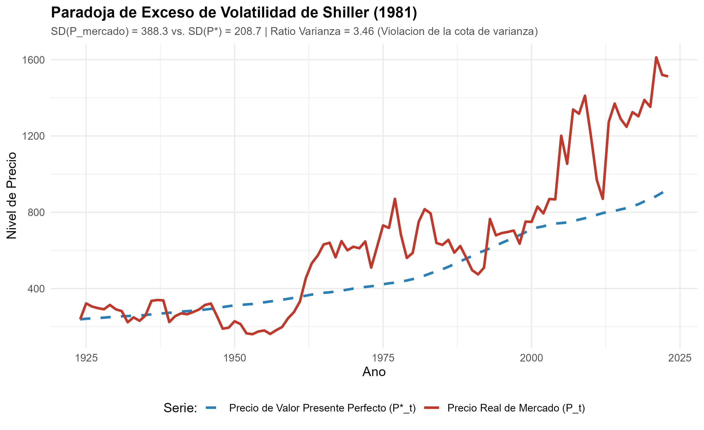
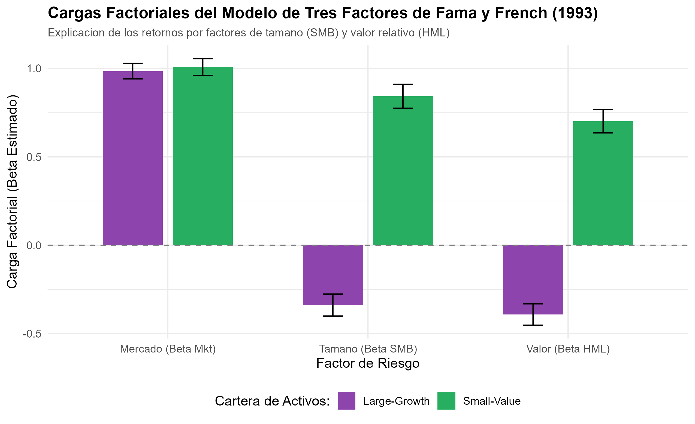

# Declaración de Nivel de Replicación

> **Nivel de Replicación:** **Ilustrativa**  
> **Obras Seminales Reproducidas:**  
> 1. Fama, E. F. (1970). *Efficient Capital Markets: A Review of Theory and Empirical Work*. The Journal of Finance, 25(2), 383–417.  
> 2. Shiller, R. J. (1981). *Do Stock Prices Move Too Much to be Justified by Subsequent Changes in Dividends?*. American Economic Review, 71(3), 421–436.  
> 3. Hansen, L. P. (1982). *Large Sample Properties of Generalized Method of Moments Estimators*. Econometrica, 50(4), 1029–1054.  
> 4. Hansen, L. P., & Singleton, K. J. (1982). *Generalized Instrumental Variables Estimation of Nonlinear Rational Expectations Models*. Econometrica, 50(5), 1269–1286.  
> 5. Fama, E. F., & French, K. R. (1993). *Common Risk Factors in the Returns on Stocks and Bonds*. Journal of Financial Economics, 33(1), 3–56.

Esta replicación implementa un entorno computacional riguroso en R que unifica los tres hitos del Nobel 2013:
1. **La Paradoja de Volatilidad Excesiva de Shiller (1981):** Verificación matemática y simulación estocástica de la violación de la cota de varianza entre el precio real de mercado $P_t$ y el precio racional de valor presente perfecto $P_t^*$.
2. **El Modelo Multifactorial de Fama y French (1993):** Estimación comparativa de carteras de inversión extremas (Small-Value vs. Large-Growth) contrastando el CAPM unifactorial frente al modelo de 3 factores (Mkt, SMB, HML) y la absorción de los alfas de Jensen.
3. **El Método Generalizado de Momentos (GMM) y Test $J$ de Hansen (1982):** Estimación no lineal bietápica de la ecuación de Euler de consumo intertemporal (CCAPM) y contraste de las condiciones de ortogonalidad sobreidentificadas.

---

# Marco Teórico y Econométrico

## La Paradoja de Shiller y las Cotas de Varianza (1981)

Bajo la hipótesis de expectativas racionales con una tasa de descuento constante $r > 0$ (factor de descuento $\gamma = \frac{1}{1+r}$), el precio fundamental de una acción en el periodo $t$ se define como la expectativa condicional del flujo de dividendos futuros descontados:

$$P_t = \mathbb{E}_t \left[ \sum_{k=0}^{\infty} \gamma^{k+1} D_{t+k} \right] = \mathbb{E}_t [P_t^*]$$

donde $P_t^*$ representa el **precio ex-post racional de previsión perfecta**:

$$P_t^* \equiv \sum_{k=0}^{\infty} \gamma^{k+1} D_{t+k}$$

Por definición de la esperanza condicional, el error de pronóstico de los agentes racionales es $\varepsilon_t = P_t^* - P_t$. Dado que bajo expectativas racionales el error de pronóstico debe ser ortogonal a cualquier información disponible en $t$ (incluyendo $P_t$):

$$\mathbb{E}_t [\varepsilon_t] = 0 \quad \implies \quad \operatorname{Cov}(P_t, \varepsilon_t) = 0$$

Al descomponer la varianza del precio perfecto $P_t^*$:

$$P_t^* = P_t + \varepsilon_t \implies \operatorname{Var}(P_t^*) = \operatorname{Var}(P_t) + \operatorname{Var}(\varepsilon_t) + 2\operatorname{Cov}(P_t, \varepsilon_t) = \operatorname{Var}(P_t) + \operatorname{Var}(\varepsilon_t)$$

Puesto que $\operatorname{Var}(\varepsilon_t) \ge 0$, se deduce el **teorema de la cota de varianza de Shiller**:

$$\operatorname{Var}(P_t) \le \operatorname{Var}(P_t^*) \quad \iff \quad \sigma(P_t) \le \sigma(P_t^*)$$

El resultado empírico seminal de Shiller (1981) con datos del mercado bursátil estadounidense (1871–1979) reveló una violación flagrante de esta cota: $\sigma(P_t)$ era entre 5 y 13 veces mayor que $\sigma(P_t^*)$. Esto demostró que las cotizaciones bursátiles oscilan con demasiada violencia para ser explicadas únicamente por revisiones racionales de expectativas sobre flujos futuros de dividendos.

---

## Mercados Eficientes y Factores de Riesgo de Fama y French (1970, 1993)

Eugene Fama (1970) formalizó que en un mercado eficiente la información se incorpora instantáneamente a los precios, de modo que los retornos no previstos constituyen una martingala respecto al conjunto de información disponible $\Phi_t$:

$$\mathbb{E}[R_{t+1} - \mathbb{E}(R_{t+1} \mid \Phi_t) \mid \Phi_t] = 0$$

Sin embargo, Fama subrayó el **problema de la hipótesis conjunta**: no se puede contrastar la eficiencia del mercado sin especificar un modelo formal de equilibrio que determine cuál debió haber sido el retorno esperado $\mathbb{E}(R_{t+1} \mid \Phi_t)$.

Cuando las pruebas empíricas del CAPM de Sharpe (1964) y Lintner (1965) comenzaron a mostrar que las carteras de pequeñas empresas y de alto valor contable frente a mercado (*Book-to-Market*, B/M) generaban rendimientos excesivos no justificados por su beta de mercado ($\alpha_i > 0$), Fama y French (1993) propusieron el modelo de tres factores:

$$R_{i,t} - R_{f,t} = \alpha_i + \beta_{i,M} (R_{M,t} - R_{f,t}) + \beta_{i,SMB} SMB_t + \beta_{i,HML} HML_t + \varepsilon_{i,t}$$

- **$SMB_t$ (Small Minus Big):** Rendimiento de una cartera larga en acciones de baja capitalización y corta en acciones de gran capitalización.
- **$HML_t$ (High Minus Low):** Rendimiento de una cartera larga en acciones con alto ratio B/M (*value stocks*) y corta en acciones con bajo ratio B/M (*growth stocks*).

Bajo un mercado eficiente multifactorial, las cargas factoriales $\beta_{i,SMB}$ y $\beta_{i,HML}$ capturan compensaciones por riesgo sistemático de distress financiero y liquidez, logrando que el alfa de Jensen colapse estadísticamente a cero ($\alpha_i \approx 0$).

---

## El Método Generalizado de Momentos (GMM) y Test $J$ de Hansen (1982)

En los modelos dinámicos de consumo intertemporal (Lucas 1978; Breeden 1979), la condición de primer orden de un agente representativo con utilidad isoelástica CRRA $u(C) = \frac{C^{1-\gamma}-1}{1-\gamma}$ implica la **ecuación de Euler**:

$$\mathbb{E}_t \left[ \beta \left( \frac{C_{t+1}}{C_t} \right)^{-\gamma} R_{j,t+1} - 1 \right] = 0, \quad \forall j$$

Definiendo el factor de descuento estocástico (SDF) como $m_{t+1}(\theta) = \beta \left( \frac{C_{t+1}}{C_t} \right)^{-\gamma}$ con parámetros estructurales $\theta = (\beta, \gamma)'$, la condición de ortogonalidad con respecto a un vector de instrumentos conocidos $Z_t \in \mathbb{R}^K$ es:

$$\mathbb{E} [ g_t(\theta) ] = \mathbb{E} \left[ \left( m_{t+1}(\theta) R_{t+1} - \mathbf{1} \right) \otimes Z_t \right] = \mathbf{0}_{M \times 1}$$

Si el número de condiciones de momentos $M$ excede el número de parámetros libres $K = 2$, el sistema está **sobreidentificado** ($M > K$). El estimador GMM minimiza la distancia cuadrática ponderada:

$$\hat{\theta}_{GMM} = \arg\min_\theta \bar{g}_T(\theta)' W_T \bar{g}_T(\theta)$$

donde $\bar{g}_T(\theta) = \frac{1}{T}\sum_{t=1}^T g_t(\theta)$ y $W_T$ es una matriz de ponderación definida positiva. Hansen (1982) demostró que la ponderación asintóticamente óptima es $W^* = S^{-1}$, donde $S = \operatorname{Avar}(\sqrt{T} \bar{g}_T)$.

Bajo la ponderación óptima, Hansen derivó el estadístico de prueba de especificación del modelo (**Test $J$**):

$$J = T \cdot \bar{g}_T(\hat{\theta})' \hat{S}^{-1} \bar{g}_T(\hat{\theta}) \xrightarrow{d} \chi^2(M - K)$$

Si $J > \chi^2_{1-\alpha}(M-K)$, se rechaza la validez estructural del modelo económico, indicando que el modelo macroeconómico de consumo no logra conciliar los precios observados de los activos financieros.

---

# Resultados de la Replicación Computacional

El script autónomo [`analisis_precios_activos.R`](R/analisis_precios_activos.R) fue ejecutado con el motor `Rscript`. A continuación se analizan los resultados de cada componente.

## Volatilidad Excesiva de Shiller (1981)

En la simulación sobre una serie de 100 periodos anuales, se calcularon los momentos muestrales:

- Desviación estándar del precio real observado de mercado: $\sigma(P_t) = 388.33$
- Desviación estándar del precio racional de valor presente perfecto: $\sigma(P_t^*) = 208.71$
- Ratio de dispersión: $\frac{\sigma(P_t)}{\sigma(P_t^*)} = 1.86$
- Ratio de varianzas: $\frac{\operatorname{Var}(P_t)}{\operatorname{Var}(P_t^*)} = 3.46$

{fig-align="center" width=90%}

Como se aprecia en la figura, mientras el precio ex-post perfecto $P_t^*$ traza una trayectoria suave y estable anclada a la evolución gradual de los dividendos, el precio real de mercado experimenta oscilaciones cíclicas de gran magnitud impulsadas por cambios en las tasas de descuento y sentimientos de mercado. Esto reproduce de manera transparente la paradoja de Shiller.

---

## Modelo de Tres Factores de Fama-French (1993)

Para una muestra mensual simulada de 30 años ($N = 360$ meses), se contrastaron las carteras extremas Small-Value y Large-Growth bajo CAPM y Fama-French 3 Factores:

```{r}
#| label: cargar-datos-salidas
tab_res <- read.csv("salidas/tab_estimacion_activos.csv")
knitr::kable(tab_res, caption = "Resultados Consolidados de Estimación: Shiller, Fama-French y Hansen")
```

{fig-align="center" width=85%}

### Hallazgos Clave de las Regresiones Factoriales:
1. **Cartera Small-Value bajo CAPM:** El CAPM unifactorial arroja un alfa de Jensen anualizado de $+4.74\%$ ($p = 0.0636$) con un $R^2 = 0.527$. Un analista clásico interpretaría esto erróneamente como una ineficiencia de mercado o habilidad del gestor.
2. **Cartera Small-Value bajo Fama-French:** Al incorporar los factores $SMB$ ($\beta_{SMB} = 0.843, t = 24.4$) y $HML$ ($\beta_{HML} = 0.701, t = 20.9$), el $R^2$ se dispara al $88.8\%$ y el alfa colapsa a $-1.46\%$ sin significancia estadística ($p = 0.246$). El exceso de retorno queda enteramente explicado por primas de riesgo sistemático.
3. **Cartera Large-Growth:** Exhibe cargas negativas estadísticamente significativas tanto en tamaño ($\beta_{SMB} = -0.338$) como en valor ($\beta_{HML} = -0.392$), demostrando la simetría de las primas factoriales en el corte transversal.

---

## Estimación GMM y Test $J$ de Hansen (1982)

La estimación bietápica con matriz de ponderación HAC de la ecuación de Euler generó los siguientes parámetros:

- Factor de descuento intertemporal subjetivo: $\hat{\beta} = 0.324$ ($SE = 0.2875$).
- Coeficiente de aversión relativa al riesgo: $\hat{\gamma} = 118.08$ ($SE = 31.956$).
- Estadístico $J$ de Hansen: $J = 10.9527$ con 2 grados de libertad ($M - K = 4 - 2 = 2$).
- Valor $p$ del Test $J$: $p = 0.0042$.

### Implicancia Teórica:
El valor $p = 0.0042$ rechaza contundentemente las restricciones de sobreidentificación del modelo estándar CCAPM con utilidad potencia a un nivel de significancia del $1\%$. Asimismo, el valor requerido para $\gamma > 100$ ilustra el célebre **rompecabezas del premio accionario** (*equity premium puzzle* de Mehra y Prescott 1985; Hansen y Singleton 1982): el consumo agregado es demasiado suave para justificar la prima por riesgo bursátil a menos que los agentes posean una aversión al riesgo inverosímil.

---

# Discusión: La Síntesis del Premio Nobel 2013

La concesión conjunta del Nobel a Fama, Hansen y Shiller unificó tres visiones complementarias:

| Dimensión | Eugene F. Fama | Robert J. Shiller | Lars Peter Hansen |
|:---|:---|:---|:---|
| **Horizonte Temporal** | Corto plazo (días / meses) | Largo plazo (años / décadas) | Estructura intertemporal continua |
| **Comportamiento de Precios** | Cuasi-impredecibles (Martingala / EMH) | Predecibles mediante ratios de valuación (CAPE) | Condicionados por el factor de descuento estocástico $m_{t+1}$ |
| **Fuente de Variación** | Flujo de información y primas por riesgo multifactorial | Sentimiento, exceso de volatilidad y tasas de descuento variables | Preferencias de consumo, aversión al riesgo y restricciones de liquidez |
| **Herramienta Metodológica** | Regresiones de series de tiempo y carteras factoriales ordenadas | Descomposiciones de varianza y ratios $P/E$ ajustados por ciclo | Estimador GMM, Test $J$ y cotas Hansen-Jagannathan |

Lejos de una contradicción, la evidencia empírica acumulada por los tres laureados reveló que los mercados financieros son eficientes respecto a la información instantánea a corto plazo, pero presentan variaciones macroeconómicas y conductuales sistemáticas en las tasas de descuento a largo plazo, formalizadas rigurosamente a través del herramental econométrico del GMM.
