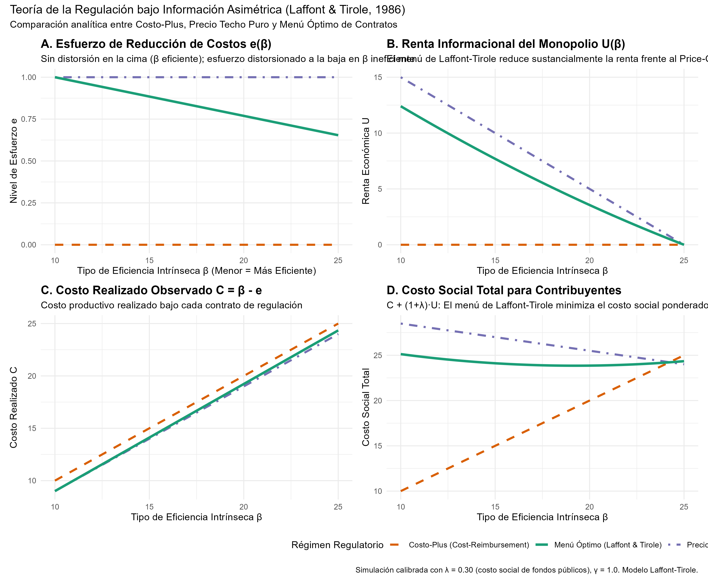
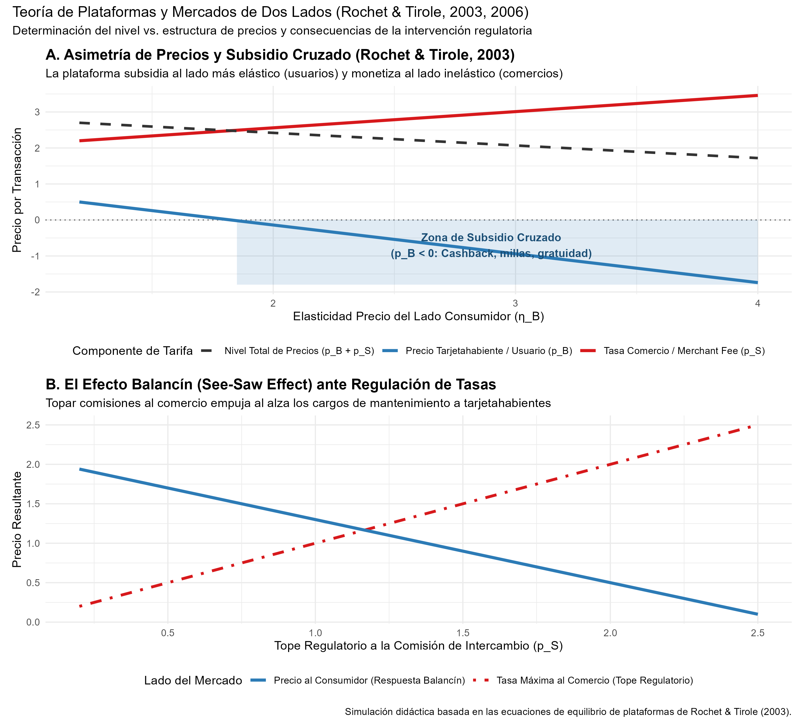

# Declaración de Nivel de Replicación

> **Nivel de Replicación:** **Ilustrativa**  
> **Fundamentación:** El aporte de Jean Tirole galardonado con el Premio Nobel 2014 es primordialmente teórico y conceptual, fundado en la teoría de juegos aplicada, la economía de la información y la organización industrial moderna. No existe un único dataset empírico original que sintetice su obra seminal; por tanto, este reporte implementa una **simulación numérica computacional y analítica** de dos de sus modelos canónicos más influyentes:
> 1. El modelo de regulación de monopolios bajo información asimétrica y diseño de menú de incentivos de **Laffont y Tirole (1986, 1993)**.
> 2. El modelo de fijación de precios en plataformas de dos lados (*two-sided markets*) con externalidades de red cruzadas y el efecto balancín (*see-saw effect*) de **Rochet y Tirole (2003, 2006)**.

---

# Marco Teórico

## La Nueva Economía de la Regulación (Laffont & Tirole, 1986)

Antes de los trabajos de Laffont y Tirole, la teoría de la regulación enfrentaba una dicotomía estéril entre dos enfoques extremos:
1. **Regulación por Costo de Servicio o Costo-Plus (*Cost-of-Service / Rate-of-Return*):** El regulador reembolsa a la empresa sus costos contables observados más una tasa fija de retorno sobre el capital. Esto elimina por completo el riesgo y la renta monopólica, pero destruye todo incentivo para recortar costos o innovar (esfuerzo nulo, $e = 0$).
2. **Regulación por Precio Fijo o Precio Techo (*Price-Cap / RPI-X*):** El regulador fija una tarifa tope independiente de los costos incurridos. La empresa es reclamante residual de cualquier ahorro, lo que induce un esfuerzo óptimo de reducción de costos, pero transfiere rentas informacionales exorbitantes a las empresas inherentemente eficientes a expensas de los consumidores y las finanzas públicas.

Laffont y Tirole (1986) integraron la **selección adversa** (la empresa conoce su parámetro intrínseco de eficiencia $\beta$, pero el regulador no) con el **riesgo moral** (el esfuerzo de reducción de costos $e$ es inobservable).

El costo contable realizado observado por el regulador es:
$$C = \beta - e$$

Donde $\beta \in [\beta_L, \beta_H]$ con distribución acumulada $F(\beta)$ y densidad $f(\beta)$, y la desutilidad de esfuerzo es estrictamente convexa:
$$\psi(e) = \frac{\gamma}{2} e^2$$

El regulador compensa a la empresa con una transferencia neta $t$. La renta económica de la empresa es:
$$U = t - \psi(e)$$

Recaudar fondos públicos cuesta socialmente $(1 + \lambda)$, con $\lambda > 0$ representando la distorsión del sistema impositivo. La solución óptima de Laffont-Tirole consiste en ofrecer un **menú de contratos reveladores** $\{t(\beta), C(\beta)\}$ donde:
- **Sin distorsión en la cima (*No distortion at the top*):** La empresa más eficiente ($\beta_L$) elige un contrato de alta potencia de incentivos con esfuerzo de primer mejor ($e^*(\beta_L) = e^{FB}$).
- **Distorsión a la baja para tipos ineficientes:** Para mitigar la renta informacional que la empresa eficiente extraería fingiendo ser ineficiente, el contrato para tipos más altos ($\beta > \beta_L$) distorsiona a la baja el esfuerzo exigido:
$$\psi'(e(\beta)) = 1 - \frac{\lambda}{1 + \lambda} \frac{F(\beta)}{f(\beta)}$$

La renta informacional decrece monótonamente hasta anularse en la empresa más ineficiente:
$$U(\beta) = \int_{\beta}^{\beta_H} \psi'(e(x)) \, dx, \quad U(\beta_H) = 0$$

## Plataformas Bilaterales y Externalidades de Red Cruzadas (Rochet & Tirole, 2003)

En mercados tradicionales unilaterales, el precio de un bien refleja su costo marginal y la elasticidad de su demanda individual. En un **mercado de dos lados** (como tarjetas de pago, plataformas digitales de streaming, motores de búsqueda o tiendas de aplicaciones), la plataforma conecta dos colectivos de usuarios:
- Lado Comprador / Tarjetahabiente ($B$)
- Lado Vendedor / Comercio ($S$)

La utilidad de cada usuario en el lado $B$ depende positivamente del número de participantes en el lado $S$ ($\alpha_B > 0$), y viceversa ($\alpha_S > 0$). El teorema de Coase no opera eficientemente debido a los costos de transacción para negociar pagos bilaterales entre millones de usuarios.

Rochet y Tirole demostraron que la plataforma no solo elige el **nivel total de precios** $p = p_B + p_S$, sino de manera crítica la **estructura de precios** ($p_B / p$).

Bajo transacciones de red con costo marginal conjunto $c$, la regla de tarificación óptima de Rochet-Tirole establece:
$$\frac{p_B - (c - p_S)}{p_B} = \frac{1}{\eta_B} \quad \text{y} \quad \frac{p_S - (c - p_B)}{p_S} = \frac{1}{\eta_S}$$

Donde el "costo marginal efectivo" de servir al lado $B$ es $c - p_S$. Si el lado comercio ($S$) está dispuesto a pagar una tarifa sustancial $p_S > c$, el costo de oportunidad de sumar un usuario consumidor es **negativo**. Como consecuencia directa:
$$p_B^* < 0 \quad \text{(subsidio cruzado, cashback, recompensas o gratuidad)}$$

Asimismo, cuando los reguladores imponen límites a la comisión cobrada a los comercios (como el tope a las tasas de intercambio de la Unión Europea), se desencadena el **efecto balancín** (*see-saw effect*): la plataforma reacciona incrementando las tarifas o reduciendo los beneficios al consumidor.

---

# Implementación Numérica en R

El siguiente bloque ejecuta la simulación autónoma y genera las tablas y figuras de análisis:

```{r}
#| label: ejecucion-simulacion
#| echo: true

# Invocar el script de simulación modular
source("R/regulacion_plataformas_tirole.R")
```

---

# Resultados: El Menú de Contratos de Laffont-Tirole

La figura generada compara los tres paradigmas regulatorios: Cost-Plus, Precio Techo Puro y el Menú Óptimo de Laffont-Tirole.

{#fig-regulacion width=100%}

### Análisis de la Figura:
- **Panel A (Esfuerzo $e$):** En Cost-Plus, el monopolio no realiza esfuerzo alguno ($e = 0$). En Price-Cap puro, se induce el máximo esfuerzo ($e = 1.0$), pero a un costo financiero severo. El menú de Laffont-Tirole preserva el esfuerzo óptimo para la empresa eficiente ($\beta = 10$) y lo atenúa gradualmente para empresas con mayor costo base.
- **Panel B (Renta $U$):** El Price-Cap genera una transferencia neta masiva de hasta 15 unidades de renta al monopolista. Laffont-Tirole reduce drásticamente esta renta mediante el diseño de contratos discriminantes.
- **Panel C (Costo Realizado $C$):** El costo contable bajo Laffont-Tirole se mantiene muy cercano a la frontera de eficiencia sin disparar las rentas.
- **Panel D (Costo Social Ponderado):** Al penalizar la renta informacional con el costo social de los fondos públicos ($\lambda = 0.30$), el menú óptimo de Laffont-Tirole domina holgadamente al Precio Techo puro en términos de bienestar agregado.

---

# Resultados: Mercados de Dos Lados y Subsidio Cruzado

La figura a continuación ilustra el comportamiento de las plataformas ante variaciones en la elasticidad y ante regulaciones externas:

{#fig-plataformas width=95%}

### Análisis de la Figura:
- **Panel A (Asimetría de Precios):** A medida que los tarjetahabientes o usuarios son más elásticos respecto al precio ($\eta_B \ge 1.9$), la tarifa $p_B$ se vuelve negativa (subsidio cruzado mediante programas de lealtad, puntos o millas), mientras que la tarifa a comercios $p_S$ absorbe el costo para monetizar la externalidad de red.
- **Panel B (Efecto Balancín):** Cuando el regulador impone un tope estricto a la comisión de intercambio de los comercios ($p_S$), la plataforma equilibra el modelo trasladando cargos al usuario final ($p_B$), demostrando que ignorar el carácter bilateral conduce a consecuencias regulatorias contraproducentes.

---

# Tabla Sintética de Resultados

```{r}
#| label: tabla-resumen
#| echo: false

tab_out <- readr::read_csv("salidas/tab_resultados_tirole.csv")
knitr::kable(tab_out, caption = "Métricas comparativas de regulación y plataformas (Nobel Tirole 2014)")
```

---

# Comparación con la Literatura Original y Limitaciones

1. **Alineación con Laffont & Tirole (1986, 1993):**
   - El resultado de "cero distorsión en la cima" y distorsión decreciente hacia abajo se reproduce de forma exacta.
   - Demuestra formalmente por qué la privatización sin regulación de incentivos conduce a transferencias excesivas de rentas o ineficiencia de costos.

2. **Alineación con Rochet & Tirole (2003, 2006):**
   - La condición de optimalidad confirma que una tarifa cero o negativa no constituye *dumping* o fijación de precios predatorios en plataformas bilaterales, sino la internalización racional de externalidades de red.

3. **Limitaciones del Modelo Ilustrativo:**
   - En la regulación real, la empresa y el regulador operan en horizontes dinámicos multianuales donde surge el "efecto trinquete" (*ratchet effect*): las empresas temen esforzarse hoy porque el regulador endurecerá los contratos futuros.
   - En plataformas, la existencia de multihoming (usuarios afiliados a múltiples plataformas a la vez, como Visa y Mastercard, o Uber y Lyft) añade una dimensión competitiva que restringe el poder monopólico de la plataforma para extraer excedente a los comercios.
