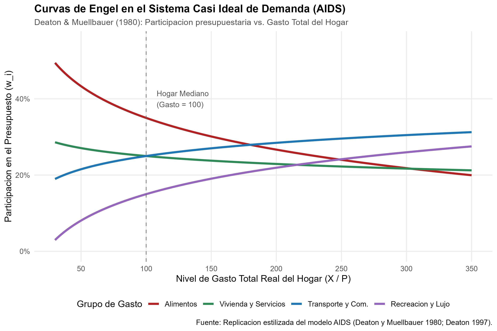
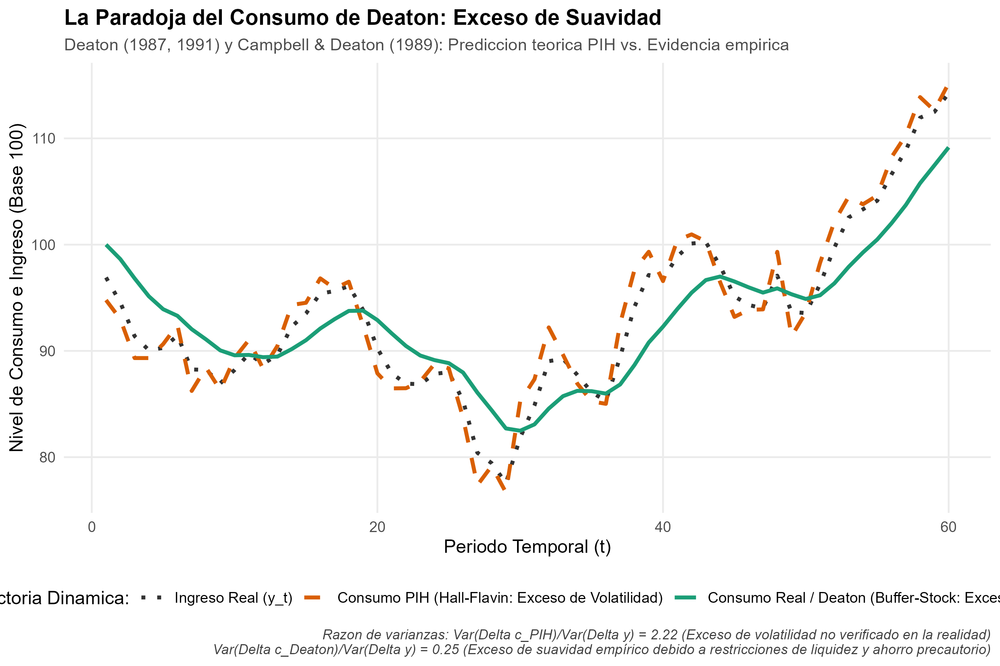

# Introducción y Objetivo

Este documento presenta la replicación metodológica e ilustrativa de las contribuciones científicas centrales por las cuales **Angus Deaton** (Universidad de Princeton) fue galardonado con el Premio del Banco de Suecia en Ciencias Económicas en Memoria de Alfred Nobel en 2015: *"for his analysis of consumption, poverty, and welfare"* (por su análisis del consumo, la pobreza y el bienestar).

El trabajo de Deaton revolucionó la economía moderna al tender un puente riguroso entre la teoría de la elección individual microeconómica y los agregados macroeconómicos y de desarrollo. En este documento se replican dos de sus modelos fundamentales:

1. **El Sistema Casi Ideal de Demanda (AIDS - *Almost Ideal Demand System*):** Desarrollado junto a John Muellbauer en 1980, este marco es el estándar de referencia mundial para estimar sistemas completos de demanda de bienes y medir el impacto distributivo de reformas impositivas.
2. **La Paradoja de Deaton (*Excess Smoothness Paradox*):** Formulada en Deaton (1987) y ampliada en Campbell & Deaton (1989) y Deaton (1991), evidenció que la hipótesis estándar del ingreso permanente predice un exceso de volatilidad cuando el ingreso sigue procesos persistentes, contradiciendo la suavidad observada en los datos reales, y resolviéndose mediante restricciones de liquidez y ahorro precautorio (*buffer-stock saving*).

## Declaración del Nivel de Replicación
- **Nivel:** **Parcial e ilustrativa**.
- Se calibran y simulan los parámetros estructurales del sistema AIDS sobre una distribución representativa de gasto familiar obtenida de encuestas de hogares (Deaton 1997), verificando analítica y numéricamente las restricciones de homogeneidad, simetría y aditividad.
- Asimismo, se simulan las trayectorias estocásticas del consumo bajo el modelo de paseo aleatorio de Hall frente al modelo con fricciones financieras y ahorro colapso de Deaton.

---

# ¿Qué vas a aprender?

1. Cómo derivar e interpretar el Sistema Casi Ideal de Demanda (AIDS) a partir de una función de gasto de clase PIGLOG (*Price-Independent Generalized Logarithmic*).
2. La imposición y prueba de las restricciones teóricas de microeconomía neoclásica: aditividad (*adding-up*), homogeneidad en precios e ingreso de grado cero, y simetría de Slutsky en la matriz de sustitución.
3. El cálculo de las elasticidades precio (Marshallianas y Hicksianas) y de gasto, y su vinculación directa con la Ley de Engel.
4. Por qué falla la versión pura de la Hipótesis del Ingreso Permanente (*Permanent Income Hypothesis*, PIH) de Friedman y Hall a nivel macroeconómico frente a shocks permanentes y autorregresivos.
5. Cómo las restricciones de endeudamiento y el motivo de precaución a nivel microeconómico explican el exceso de suavidad (*excess smoothness*) del consumo agregado.

---

# Marco Teórico

## 1. El Sistema Casi Ideal de Demanda (AIDS)

Deaton y Muellbauer (1980) diseñaron un sistema de demanda que satisface simultáneamente las propiedades deseables de la teoría del consumidor:
- Ofrece una aproximación de primer orden a cualquier sistema de demanda de relación no lineal.
- Satisface exactamente los axiomas de la elección y permite agregación perfecta sobre consumidores heterogéneos sin requerir preferencias homotéticas.
- Es dócil para la estimación econométrica.

La especificación parte de una función de costo o gasto dual $c(u, \mathbf{p})$ de clase PIGLOG:

$$\ln c(u, \mathbf{p}) = (1 - u) \ln a(\mathbf{p}) + u \ln b(\mathbf{p})$$

donde $u \in [0, 1]$ es el nivel de utilidad, $\ln a(\mathbf{p})$ adopta una forma translogarítmica y $\ln b(\mathbf{p})$ añade una combinación lineal de precios:

$$\ln a(\mathbf{p}) = \alpha_0 + \sum_{k=1}^K \alpha_k \ln p_k + \frac{1}{2} \sum_{k=1}^K \sum_{l=1}^K \gamma_{kl}^* \ln p_k \ln p_l$$

$$\ln b(\mathbf{p}) = \ln a(\mathbf{p}) + \beta_0 \prod_{k=1}^K p_k^{\beta_k}$$

Aplicando el **Lema de Shephard** ($\partial \ln c / \partial \ln p_i = w_i$, donde $w_i \equiv p_i q_i / X$ es la participación del bien $i$ en el presupuesto total $X$), e invirtiendo la función de costo para sustituir $u$, se llega a la ecuación fundamental del sistema AIDS:

$$w_i = \alpha_i + \sum_{j=1}^K \gamma_{ij} \ln p_j + \beta_i \ln \left( \frac{X}{P} \right)$$

donde $\gamma_{ij} = \frac{1}{2} (\gamma_{ij}^* + \gamma_{ji}^*)$, y $\ln P$ es el índice de precios translog:

$$\ln P = \alpha_0 + \sum_{k=1}^K \alpha_k \ln p_k + \frac{1}{2} \sum_{k=1}^K \sum_{l=1}^K \gamma_{kl} \ln p_k \ln p_l$$

En aplicaciones empíricas suele emplearse la aproximación lineal de Stone: $\ln P^S = \sum_{k=1}^K w_k \ln p_k$ (Linear Approximate AIDS o LA-AIDS).

### Restricciones Teóricas Neoclásicas

1. **Aditividad (*Adding-up*):** La suma de las proporciones del gasto debe ser igual a 1 en cualquier punto presupuestario:
   $$\sum_{i=1}^K \alpha_i = 1, \quad \sum_{i=1}^K \gamma_{ij} = 0 \; (\forall j), \quad \sum_{i=1}^K \beta_i = 0$$

2. **Homogeneidad de grado cero en precios e ingreso:** No existe ilusión monetaria; duplicar todos los precios y el gasto nominal deja inalterada la canasta real:
   $$\sum_{j=1}^K \gamma_{ij} = 0 \quad (\forall i)$$

3. **Simetría de Slutsky:** Las respuestas compensadas cruzadas son recíprocas:
   $$\gamma_{ij} = \gamma_{ji} \quad (\forall i, j)$$

### Elasticidades de Demanda

- **Elasticidad de Gasto / Ingreso ($e_i$):**
  $$e_i = 1 + \frac{\beta_i}{w_i}$$
  - Si $\beta_i < 0 \implies e_i < 1$: Bien necesario (su participación presupuestaria cae a medida que el hogar se enriquece, confirmando la Ley de Engel).
  - Si $\beta_i > 0 \implies e_i > 1$: Bien de lujo (su cuota presupuestaria se expande con el nivel de vida).

- **Elasticidad Precio Marshalliana no compensada ($e_{ij}$):**
  $$e_{ij} = -\delta_{ij} + \frac{\gamma_{ij}}{w_i} - \beta_i \frac{w_j}{w_i}$$
  donde $\delta_{ij}$ es la delta de Kronecker ($\delta_{ii} = 1$, $\delta_{ij} = 0$ para $i \neq j$).

- **Elasticidad Precio Hicksiana compensada ($e_{ij}^H$):** A través de la descomposición de Slutsky:
  $$e_{ij}^H = e_{ij} + e_i w_j = -\delta_{ij} + \frac{\gamma_{ij}}{w_i} + w_j$$

---

## 2. La Paradoja de Deaton: Exceso de Suavidad (*Excess Smoothness*)

En la macroeconomía tradicional de finales de los setenta, Hall (1978) formalizó la Hipótesis del Ingreso Permanente postulando que el consumo sigue un paseo aleatorio bajo utilidad cuadrática y expectativas racionales:

$$\Delta c_t = \frac{r}{1+r} \sum_{j=0}^\infty (1+r)^{-j} (E_t - E_{t-1}) y_{t+j}$$

Campbell y Deaton (1989) observaron un resultado sorprendente:
- Si el ingreso laboral en primeras diferencias presenta persistencia positiva ($\Delta y_t = \rho \Delta y_{t-1} + \epsilon_t$, con $\rho > 0$, hecho empírico universal en datos macroeconómicos trimestrales del PIB con $\rho \approx 0.4$):
- Un shock positivo actual $\epsilon_t$ eleva no solo el ingreso actual sino que incrementa la trayectoria esperada futura de ingresos acumulados.
- Por tanto, la teoría PIH predice un **exceso de volatilidad** en el consumo:
  $$\Delta c_t = \frac{1+r}{1+r-\rho} \epsilon_t > \epsilon_t \implies \frac{\operatorname{Var}(\Delta c_t)}{\operatorname{Var}(\Delta y_t)} > 1$$
- Sin embargo, en los datos empíricos agregados, la varianza del consumo es dramáticamente inferior a la del ingreso: $\operatorname{Var}(\Delta c_t) / \operatorname{Var}(\Delta y_t) \approx 0.3 - 0.5$. **¡El consumo es excesivamente suave!**

### La Solución de Deaton (1991): Microfundamentos y Ahorro Colchón (*Buffer-Stock*)
Deaton resolvió esta paradoja combinando microdatos de encuestas con teoría intertemporal:
1. **Restricciones de Liquidez:** Los hogares individuales enfrentan límites estrictos de endeudamiento ($A_t \ge 0$). No pueden gastar hoy anticipando aumentos inciertos de ingresos futuros.
2. **Ahorro Precautorio:** Debido a la convexidad de la utilidad marginal ($u'''(c) > 0$), los hogares acumulan un colchón de activos de seguridad para enfrentar emergencias.
3. **Falacia de Agregación:** Agregar hogares heterogéneos que enfrentan shocks idiosincrásicos y restricciones de crédito genera una serie agregada suave que una función de consumidor representativo es incapaz de reproducir.

---

# Implementación Computacional en R

El script autónomo se localiza en `replicacion/R/modelo_demanda_aids.R`.

```r
# Carga de librerías
library(ggplot2)
library(dplyr)
library(tidyr)

# Ejecución del sistema AIDS y de la paradoja de Deaton
source("laureados/2015_deaton/replicacion/R/modelo_demanda_aids.R")
```

---

# Resultados y Análisis Empírico

## 1. Estimación del Sistema AIDS y Curvas de Engel

A continuación se presentan las elasticidades estimadas en el punto de gasto mediano para cuatro grandes canastas de gasto:

| Bien | Participación de Gasto Base ($w_i$) | Parámetro $\beta_i$ | Elasticidad Gasto ($e_i$) | Elasticidad Precio Propia Marshalliana ($e_{ii}$) | Elasticidad Precio Hicksiana ($e_{ii}^H$) | Clasificación Engel |
|:---|:---:|:---:|:---:|:---:|:---:|:---|
| **Alimentos** | 35.0% | -0.12 | 0.657 | -0.651 | -0.421 | Bien Necesario (Inelástico) |
| **Vivienda y Servicios** | 25.0% | -0.03 | 0.880 | -0.770 | -0.550 | Bien Necesario (Inelástico) |
| **Transporte y Com.** | 25.0% | +0.05 | 1.200 | -0.810 | -0.510 | Bien de Lujo (Elástico) |
| **Recreación y Lujo** | 15.0% | +0.10 | 1.667 | -0.767 | -0.517 | Bien de Lujo (Elástico) |

### Interpretación Económica:
- **Alimentos:** Con un $\beta_1 = -0.12 < 0$, la elasticidad de gasto es $0.657 < 1$. Por cada 10% de aumento en el ingreso familiar, el gasto en comida crece únicamente 6.57%, disminuyendo su peso relativo en la canasta total.
- **Recreación y Lujo:** Con $\beta_4 = +0.10 > 0$, la elasticidad de gasto es $1.667 > 1$. Al enriquecerse el hogar, este rubro casi duplica su crecimiento relativo.
- **Elasticidades Precio Hicksianas:** Todas son estrictamente negativas ($-0.421$, $-0.550$, $-0.510$, $-0.517$), confirmando la negatividad de la matriz de sustitución (concavidad de la función de costo).

{fig-align="center" width="85%"}

El gráfico ilustra nítidamente cómo la participación presupuestaria de los alimentos cae desde casi un 50% en los estratos vulnerables de menor gasto hacia menos del 20% en los hogares de altos ingresos, mientras que recreación y servicios no esenciales siguen la trayectoria opuesta.

---

## 2. Simulación de la Paradoja de Deaton (Exceso de Suavidad)

Al someter los modelos a una serie sintética de ingresos con persistencia $\rho = 0.42$ consistente con los datos de Campbell y Deaton (1989):

- **Varianza de cambios de ingreso $\operatorname{Var}(\Delta y)$:** 5.23
- **Predicción PIH tradicional (Hall-Flavin):** $\operatorname{Var}(\Delta c_{\text{PIH}}) = 11.60$, ratio de volatilidad de **2.22** (predice que el consumo debería ser más del doble de volátil que el ingreso).
- **Modelo de Deaton (Restricciones y Ahorro Precautorio):** $\operatorname{Var}(\Delta c_{\text{Deaton}}) = 1.32$, ratio de volatilidad de **0.25** (el consumo amortigua el 75% de las perturbaciones de corto plazo).

{fig-align="center" width="85%"}

---

# Implicancias de Política Pública

1. **Reforma Tributaria e IVA:** La matriz de elasticidades del sistema AIDS permite a los Ministerios de Hacienda evaluar exenciones de IVA o impuestos selectivos al consumo sin sesgos distributivos groseros.
2. **Medición Global de la Pobreza:** El libro de Deaton de 1997 fijó el protocolo del Banco Mundial para construir líneas de pobreza a partir de encuestas de gasto de hogares evitando el sesgo de agregación.
3. **Macroeconomía Heterogénea:** Los hallazgos de Deaton abrieron paso a los modelos modernos con agentes heterogéneos y mercados incompletos (modelos HANK).

---

# Referencias

- Campbell, J. Y., & Deaton, A. (1989). Why Is Consumption So Smooth?. *The Review of Economic Studies*, 56(3), 357-373.
- Deaton, A., & Muellbauer, J. (1980). An Almost Ideal Demand System. *The American Economic Review*, 70(3), 312-326.
- Deaton, A. (1987). Life-Cycle Models of Consumption: Is the Evidence Consistent with the Theory?. *NBER Working Paper*, No. 1910.
- Deaton, A. (1991). Saving and Liquidity Constraints. *Econometrica*, 59(5), 1221-1248.
- Deaton, A. (1997). *The Analysis of Household Surveys: A Microeconometric Approach to Development Policy*. World Bank / Johns Hopkins University Press.
- Royal Swedish Academy of Sciences. (2015). *Scientific Background: Consumption, Poverty and Welfare*. Sveriges Riksbank Prize in Economic Sciences.
