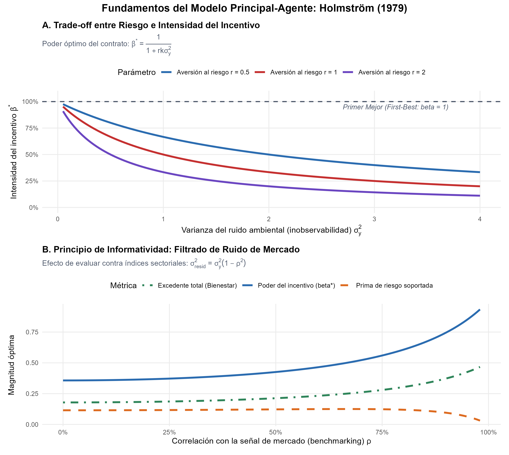
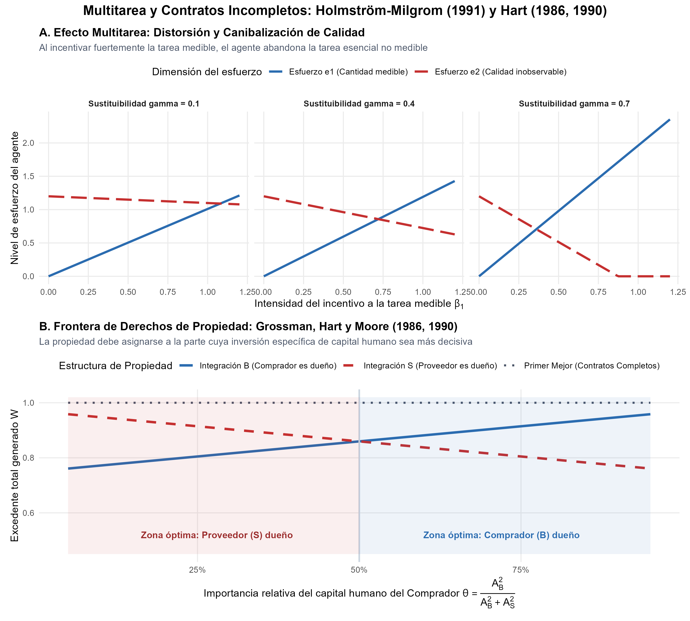

# Introducción y Objetivo

En 2016, la Real Academia Sueca de Ciencias otorgó el Premio del Banco de Suecia en Ciencias Económicas en Memoria de Alfred Nobel a **Oliver Hart** (Harvard University) y **Bengt Holmström** (MIT) *"por sus contribuciones a la teoría de los contratos"* (*for their contributions to contract theory*).

Las relaciones económicas modernas (desde el contrato laboral de un empleado y los bonos por rendimiento de un director ejecutivo, hasta los acuerdos de suministro entre empresas o la privatización de servicios públicos) están mediadas por contratos. Sin embargo, los contratos reales nunca son exhaustivos ni perfectos:
1. **Asimetría de información y riesgo moral:** El principal no puede observar directamente el esfuerzo o diligencia del agente, debiendo diseñar incentivos vinculados a resultados observables pero ruidosos (Holmström, 1979, 1991).
2. **Incompletitud contractual y derechos de propiedad:** En transacciones complejas, es imposible prever, redactar y verificar ante tribunales todas las contingencias futuras. Ante la imprevisibilidad, la titularidad del activo físico confiere los **derechos residuales de control** (*residual rights of control*), determinando el poder de negociación ex-post y los incentivos a invertir ex-ante (Grossman y Hart, 1986; Hart y Moore, 1990; Hart, 1995).

## Nivel de Replicación
- **Nivel:** **Ilustrativa** (simulación computacional de los modelos microeconómicos fundamentales de Holmström 1979, Holmström-Milgrom 1991 y Grossman-Hart 1986, analizando analítica y numéricamente el trade-off entre riesgo e incentivos, el principio de informatividad, el dilema de esfuerzo multitarea y la frontera de integración vertical).

---

# Marco Teórico Formal

## 1. Holmström (1979): El Trade-off entre Riesgo e Incentivos

Consideremos la relación entre un principal neutral al riesgo y un agente adverso al riesgo en el marco Lineal-Exponencial-Normal (LEN):
- **Producción:** $y = e + \varepsilon$, donde $e \ge 0$ es el esfuerzo no observable del agente y $\varepsilon \sim \mathcal{N}(0, \sigma_y^2)$ es un choque estocástico incontrolable.
- **Costo de esfuerzo:** $C(e) = \frac{1}{2} k e^2$, con $k > 0$.
- **Preferencias del agente:** Aversión absoluta al riesgo constante (CARA) con parámetro $r > 0$:
  $$U(w, e) = -\exp\left(-r [w - C(e)]\right)$$
- **Contrato lineal de compensación:** $w(y) = \alpha + \beta y$, donde $\alpha$ es el salario fijo base y $\beta \in [0, 1]$ es el coeficiente de pago por desempeño.

El agente maximiza su **Equivalente de Certeza** (*Certainty Equivalent*, $CE$):
$$CE = \mathbb{E}[w] - \frac{1}{2} r \operatorname{Var}(w) - C(e) = \alpha + \beta e - \frac{1}{2} r \beta^2 \sigma_y^2 - \frac{1}{2} k e^2$$

### Condición de Primer Orden de Incentivos (IC)
El agente elige el esfuerzo que maximiza su equivalente de certeza:
$$\frac{\partial CE}{\partial e} = \beta - k e = 0 \implies e^*(\beta) = \frac{\beta}{k}$$

### Excedente Total y Contrato Óptimo de Segundo Mejor
Bajo la restricción de participación individual (IR) normalizada con utilidad de reserva $CE = 0$, el principal elige $\beta$ para maximizar el excedente total esperado:
$$\max_{\beta} W(\beta) = \mathbb{E}[y - C(e)] - \text{Prima de Riesgo} = \frac{\beta}{k} - \frac{1}{2 k} \beta^2 - \frac{1}{2} r \beta^2 \sigma_y^2$$

Derivando con respecto a $\beta$:
$$\frac{1}{k} - \frac{\beta}{k} - r \beta \sigma_y^2 = 0 \implies \beta^* = \frac{1}{1 + r k \sigma_y^2}$$

#### Conclusiones Fundamentales:
- **Primer Mejor ($FB$):** Si el agente es neutral al riesgo ($r = 0$) o no existe ruido observable ($\sigma_y^2 = 0$), entonces $\beta^* = 1$. El agente se convierte en el residual claimant y el esfuerzo es socialmente óptimo ($e^* = 1/k$).
- **Segundo Mejor ($SB$):** Cuando $r > 0$ y $\sigma_y^2 > 0$, el incentivo óptimo es estrictamente menor a la unidad ($\beta^* < 1$). Forzar un $\beta$ elevado impone una prima de riesgo prohibitiva $\frac{1}{2} r \beta^2 \sigma_y^2$ que el principal debe compensar aumentando el salario fijo $\alpha$.

## 2. El Principio de Informatividad (*Informativeness Principle*)
Holmström (1979) formuló una regla universal: **cualquier señal medible que contenga información sobre el esfuerzo del agente debe incluirse en la compensación, y cualquier ruido irrelevante debe excluirse.**

Supongamos que el principal observa una señal externa de mercado o de pares $z = \eta + \theta_z$, donde el choque de mercado $\eta$ está correlacionado con el ruido del agente $\varepsilon$ con coeficiente $\rho \in (-1, 1)$. Mediante la Evaluación de Desempeño Relativo (*Relative Performance Evaluation*, RPE), el principal filtra el choque de mercado:
$$\sigma_{\text{resid}}^2 = \sigma_y^2 (1 - \rho^2)$$

El poder óptimo del incentivo bajo RPE se expande a:
$$\beta^*_{\text{RPE}} = \frac{1}{1 + r k \sigma_y^2 (1 - \rho^2)}$$
A medida que la correlación de mercado $\rho \to 1$, el ruido se anula por completo ($\sigma_{\text{resid}}^2 \to 0$), eliminando la prima de riesgo y restituyendo la eficiencia de primer mejor $\beta^* \to 1$.

---

## 3. Holmström y Milgrom (1991): Incentivos Multitarea y Distorsión

En las organizaciones reales, los empleados casi nunca realizan una sola tarea. Típicamente gestionan múltiples dimensiones:
- $e_1$: Tarea medible y cuantificable en el corto plazo (ej. cantidad producida, ventas inmediatas, aprobados en exámenes).
- $e_2$: Tarea compleja o inobservable a corto plazo (ej. calidad artesanal, atención al cliente, mantenimiento de maquinaria preventiva, formación holística).

Beneficio del principal: $B(e_1, e_2) = p_1 e_1 + p_2 e_2$.  
Costo conjunto del esfuerzo:
$$C(e_1, e_2) = \frac{1}{2}\left(c_1 e_1^2 + c_2 e_2^2 + 2\gamma e_1 e_2\right)$$
donde $\gamma > 0$ representa la rivalidad de recursos o tiempo entre tareas.

Si el contrato solo puede remunerar la dimensión medible $y_1$ ($w = \alpha + \beta_1 y_1$), el agente resuelve:
$$\max_{e_1, e_2} \beta_1 e_1 - \frac{1}{2}\left(c_1 e_1^2 + c_2 e_2^2 + 2\gamma e_1 e_2\right)$$

Condiciones de primer orden:
1. $c_1 e_1 + \gamma e_2 = \beta_1$
2. $\gamma e_1 + c_2 e_2 = 0 \implies e_2 = -\frac{\gamma}{c_2} e_1$

Resolviendo el sistema:
$$e_1(\beta_1) = \frac{c_2 \beta_1}{c_1 c_2 - \gamma^2}, \qquad e_2(\beta_1) = -\frac{\gamma \beta_1}{c_1 c_2 - \gamma^2}$$

### Implicación de Política Organizacional:
Un incentivo de alta potencia sobre la cantidad ($\beta_1 \uparrow$) genera la **canibalización** de la calidad ($e_2 \downarrow$). Para preservar la calidad en tareas interconectadas, el principal debe restringir intencionalmente el incentivo sobre la métrica cuantitativa ($\beta_1^* \ll 1$), justificando la prevalencia de sueldos fijos y descripciones de cargo estándar en la administración pública y docencia.

---

## 4. Grossman, Hart y Moore (1986, 1990): Contratos Incompletos y Propiedad

Oliver Hart revolucionó la teoría de la empresa al notar que los contratos son inevitablemente **incompletos**:
- Las partes no pueden estipular contractualmente contingencias futuras complejas ni inversiones intangibles de capital humano $i_B$ e $i_S$.
- Ante la ausencia de cláusulas específicas ex-post, quien ostenta la titularidad física del activo posee los **derechos residuales de control** (*residual rights of control*).
- Si surge un conflicto ex-post, las partes renegocian el excedente bajo negociación bilateral de Nash (50/50).
- La opción de salida (*outside option*) de cada parte depende de si puede operar con el activo físico en caso de desacuerdo:
  - **Integración de B (B-ownership):** El comprador $B$ retiene el activo; su opción externa es $v_B = \lambda_B A_B i_B$, mientras que el proveedor $S$ queda desprotegido ($v_S = 0$).
  - **Integración de S (S-ownership):** El proveedor $S$ retiene el activo; su opción externa es $v_S = \lambda_S A_S i_S$, mientras $B$ no obtiene nada ($v_S = 0$).

### Regla Óptima de Propiedad:
La propiedad debe pertenecer a la parte cuya inversión en capital humano sea más decisiva para la generación de valor conjunto. La integración vertical no siempre es deseable: hacer que una parte sea dueña fortalece sus incentivos a invertir, pero debilita inexorablemente los incentivos de la otra parte.

---

# Resultados de la Simulación Computacional

A continuación se presentan los resultados numéricos y gráficos generados por el script [modelo_teoria_contratos.R](R/modelo_teoria_contratos.R).

## Figura 1: Trade-off de Riesgo-Incentivos y Principio de Informatividad (Holmström, 1979)

{width=100%}

### Análisis de la Figura 1:
- **Panel A (Trade-off de Riesgo):** A medida que la varianza del ruido ambiental $\sigma_y^2$ aumenta, la intensidad óptima del incentivo $\beta^*$ desciende abruptamente. Este descenso es más pronunciado cuanto mayor sea la aversión al riesgo del agente ($r=2.0$ frente a $r=0.5$).
- **Panel B (Principio de Informatividad):** La incorporación de una señal de benchmarking de mercado $\rho$ purga el ruido estocástico del entorno. A mayor correlación $\rho$, el poder del incentivo $\beta^*$ y el excedente social aumentan, mientras que la prima de riesgo se contrae.

---

## Figura 2: Incentivos Multitarea y Derechos de Propiedad (Hart y Holmström)

{width=100%}

### Análisis de la Figura 2:
- **Panel A (Distorsión Multitarea):** Cuando las tareas compiten por recursos cognitivos o tiempo ($\gamma = 0.7$), remunerar agresivamente la métrica medible $y_1$ produce el abandono total de la calidad no medible $e_2$. El bienestar se maximiza bajo un esquema de incentivos moderados o amortiguados.
- **Panel B (Frontera de Grossman-Hart-Moore):** Se observa la asignación óptima de activos: cuando el capital humano del comprador es decisivo ($\theta > 0.5$), la integración bajo el control del comprador ($B$-ownership) genera el excedente máximo. Cuando la especialización del proveedor es más crítica ($\theta < 0.5$), el proveedor debe conservar la propiedad del activo.

---

# Tabla Sintética de Regímenes Contractuales

A continuación se resume la tabla de salidas cuantitativas exportada en [tab_resultados_contratos.csv](salidas/tab_resultados_contratos.csv):

```{r}
#| echo: false
#| message: false
#| warning: false

tab_path <- "salidas/tab_resultados_contratos.csv"
if (file.exists(tab_path)) {
  df_tab <- read.csv(tab_path)
  knitr::kable(df_tab, caption = "Comparativa de Regímenes Contractuales y Asignación de Derechos de Propiedad")
}
```

---

# Conclusiones y Limitaciones

1. **Holmström demostró que los contratos óptimos no maximizan el esfuerzo a ultranza, sino que equilibran la provisión de incentivos frente al seguro de riesgo.** Los esquemas de pago por desempeño mal diseñados transfieren riesgo excesivo a agentes vulnerables o provocan distorsiones masivas cuando las tareas son multidimensionales.
2. **Hart demostró que los límites de la empresa y la propiedad de los activos no son meros detalles organizacionales, sino la respuesta económica a la imposibilidad de redactar contratos completos.** Los derechos residuales de control protegen las inversiones específicas de capital humano frente al oportunismo contractual.
3. **Limitaciones del modelo simulado:** Los modelos asumen preferencias CARA-Normal lineales en Holmström y división de Nash 50/50 en Hart. En la práctica, las estructuras de remuneración ejecutiva incluyen no linealidades complejas (opciones sobre acciones con precios de ejercicio) y asimetrías de información durante la renegociación ex-post.
