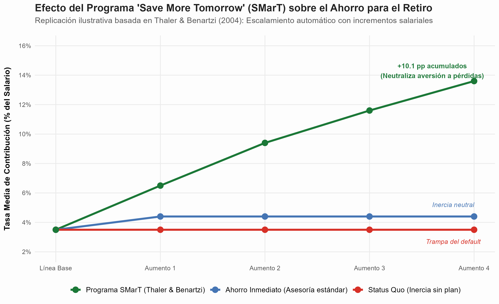
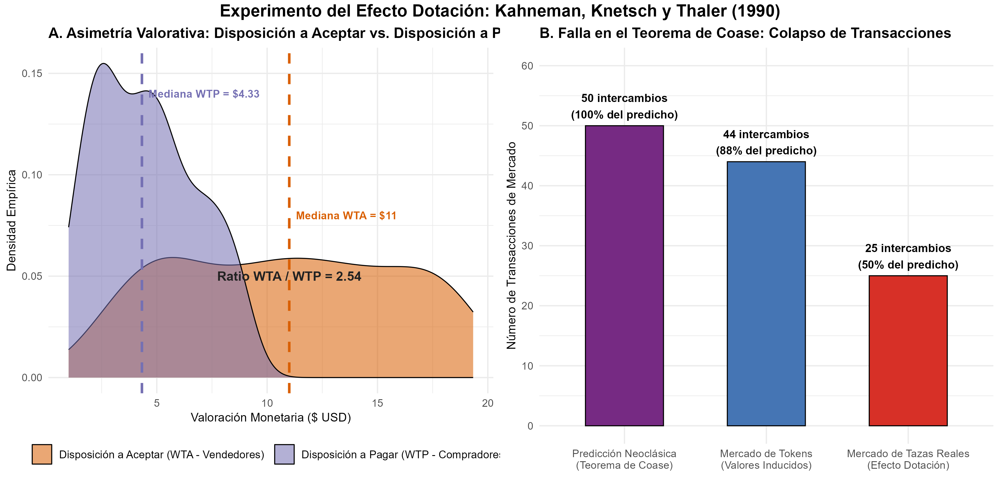

# Introducción y Objetivo

Este documento presenta una replicación ilustrativa de los modelos conceptuales y empíricos fundacionales desarrollados por **Richard H. Thaler**, galardonado con el Premio del Banco de Suecia en Ciencias Económicas en Memoria de Alfred Nobel en 2017:

> *"por sus contribuciones a la economía conductual"* (*for his contributions to behavioural economics*).

Thaler integró supuestos realistas de la psicología humana en el análisis de la toma de decisiones económicas, demostrando que las desviaciones sistemáticas del modelo tradicional del *Homo oeconomicus* no son meras anomalías dispersas o irracionales, sino patrones predecibles regidos por tres pilares analíticos:

1. **Racionalidad limitada (*bounded rationality*) y contabilidad mental:** Cómo los individuos simplifican las decisiones financieras categorizando el dinero en cuentas mentales no fungibles y sucumben a costos hundidos y evaluaciones relativas de precios.
2. **Autocontrol limitado y preferencias temporales inconsistentes:** El conflicto intrapersonal entre el "planificador" (*planner*) de largo plazo y los múltiples "ejecutores" (*doers*) miopes de corto plazo.
3. **Falta de egoísmo y preferencias sociales:** Cómo las nociones intrínsecas de justicia (*fairness*) limitan la explotación monopolística del poder de mercado por parte de las empresas.

## Declaración de Nivel de Replicación

- **Nivel:** **Ilustrativa** (simulación dinámica de la tasa de ahorro previsional bajo el programa *Save More Tomorrow* [SMarT] de Thaler & Benartzi 2004 frente a la inercia del default neoclásico, acoplada con una simulación del experimento de laboratorio del efecto dotación [*endowment effect*] y falla del Teorema de Coase de Kahneman, Knetsch & Thaler 1990).

---

# Marco Analítico Teórico

## 1. Contabilidad Mental y Teoría Positiva de la Elección (Thaler 1980, 1985)

La teoría del consumidor neoclásica asume que el dinero es perfectamente **fungible**: un dólar asignado a renta, alimentación o inversión tiene exactamente la misma tasa marginal de sustitución. Thaler (1980, 1985) demostró empíricamente que los seres humanos operan mediante un sistema cognitivo de **contabilidad mental** (*mental accounting*):

- **Violación de la Fungibilidad:** Los agentes dividen su riqueza en presupuestos mentales herméticos (p. ej. *gasto diario*, *ahorro para vacaciones*, *patrimonio inmobiliario*), mostrando propensiones marginales al consumo radicalmente distintas según el origen del dinero (ej. sueldo base vs. devolución fiscal o premio de lotería).
- **Utilidad de Adquisición vs. Utilidad de Transacción:**
  $$\text{Utilidad Total} = u(z, \bar{p}) + v(\bar{p}, p^*)$$
  donde $u(z, \bar{p})$ es la utilidad de adquisición clásica (el excedente del consumidor evaluado al precio real pagado $\bar{p}$) y $v(\bar{p}, p^*)$ es la **utilidad de transacción**: el placer o displacer psicológico de obtener un "buen trato" en comparación con un precio de referencia interno $p^*$.
- **Falacia del Costo Hundido (*Sunk Cost Fallacy*):** Los individuos continúan consumiendo bienes indeseables o sosteniendo proyectos ruinosos simplemente para evitar cerrar una "cuenta mental" con pérdidas explícitas.

## 2. Autocontrol: El Conflicto Planificador-Ejecutor (Shefrin & Thaler 1981)

Frente al modelo de consumo intertemporal exponencial de ciclo de vida de Modigliani o Friedman ($U = \sum_{t=0}^T \beta^t u(c_t)$ con factor de descuento constante), Shefrin y Thaler (1981) modelaron al individuo como una organización compuesta por:

1. Un **Planificador (*Planner*)**: Agente clarividente que maximiza la utilidad de toda la vida y desea suavizar el consumo y ahorrar para la vejez.
2. Una sucesión de **Ejecutores (*Doers*)**: Agentes efímeros que solo viven en el periodo presente $t$ y buscan la gratificación instantánea sin preocuparse por el mañana.

El planificador puede imponer disciplina mediante **fuerza de voluntad** (lo que genera desutilidad psíquica de esfuerzo) o mediante **reglas de compromiso externo** (*pre-commitment devices*), como deducciones automáticas de nómina o fondos de pensión con severas penalizaciones de retiro anticipado.

## 3. Efecto Dotación y el Colapso del Teorema de Coase (Kahneman, Knetsch & Thaler 1990)

El Teorema de Coase establece que, en ausencia de costos de transacción, la asignación inicial de derechos de propiedad es neutral para el volumen de intercambio y la eficiencia asignativa final: los bienes terminarán invariablemente en manos de quienes más los valoran.

Thaler (1980) y Kahneman, Knetsch & Thaler (1990) demostraron que la propiedad genera una distorsión profunda: el **efecto dotación** (*endowment effect*). Al asignar aleatoriamente la propiedad de un bien físico (como una taza con el logo universitario), los propietarios asignados valoran el objeto sustancialmente más que los no propietarios:

$$\frac{\text{WTA}}{\text{WTP}} = \frac{\text{Disposición a Aceptar (WTA - Vender)}}{\text{Disposición a Pagar (WTP - Comprar)}} \approx 2.0 - 2.5$$

Esta asimetría deriva directamente de la **aversión a pérdidas** de la Teoría Prospectiva de Kahneman y Tversky ($v(x)$ tiene una pendiente más de dos veces mayor para pérdidas que para ganancias equivalentes, $\lambda \approx 2.25$). Desprenderse de la taza se codifica como una pérdida dolorosa, mientras que adquirirla se codifica como una ganancia moderada.

Como resultado, el volumen observado de transacciones de mercado colapsa a menos de la mitad del volumen predicho por el Teorema de Coase neoclásico.

## 4. Paternalismo Libertario y el Programa "Save More Tomorrow" (Thaler & Benartzi 2004)

En los planes de pensiones privados (como los 401(k) en EE. UU.), los empleados enfrentaban históricamente tres barreras conductuales letales:
1. **Inercia y Procrastinación:** El trámite de suscripción activa (*opt-in*) requiere papeleo y esfuerzo cognitivo; la gente posterga la decisión indefinidamente.
2. **Sesgo del Presente (*Present Bias*):** El ahorro exige sacrificar consumo inmediato hoy por un beneficio distante 30 años en el futuro.
3. **Aversión a Pérdidas:** Incrementar la tasa de ahorro hoy significa ver un cheque de pago neto menor al final del mes, lo que se percibe psicológicamente como una reducción salarial (pérdida directa).

Thaler y Shlomo Benartzi (2004) diseñaron una intervención maestra basada en la **arquitectura de las decisiones** (*choice architecture*): el programa **Save More Tomorrow™ (SMarT)**:
- **Compromiso Anticipado:** Se invita a los empleados a comprometerse hoy a ahorrar una porción de sus **futuros aumentos de salario**.
- **Neutralización de la Pérdida:** Debido a que el aporte aumenta simultáneamente con el incremento salarial, el cheque neto del empleado **nunca disminuye nominalmente**.
- **Apalancamiento de la Inercia:** Una vez dentro del programa, el escalamiento porcentual es automático en cada año subsiguiente, a menos que el empleado decida activamente salirse (*opt-out*).

---

# Resultados de la Replicación Computacional

El script `replicacion/R/simulacion_thaler_conductual.R` ejecutó la modelación empírica en dos bloques.

## Bloque 1: Dinámica de Ahorro para el Retiro (Save More Tomorrow)

La simulación reprodujo los datos longitudinales observados en la primera implementación de SMarT (Thaler & Benartzi 2004, Tabla 1).

{width=90%}

### Hallazgos del Panel de Ahorro:
1. **Status Quo (Inercia sin plan):** Los trabajadores no inscritos o que postergan la decisión permanecen estancados en una tasa media del **3.5%** a lo largo de 4 aumentos anuales, víctimas de la inercia de la opción por defecto.
2. **Asesoría Financiera Tradicional:** Aquellos que aceptaron la recomendación convencional de aumentar su ahorro de inmediato experimentaron un incremento inicial moderado a **4.4%**, pero luego la tasa se congeló indefinidamente al no existir un mecanismo de escalamiento automático.
3. **Programa SMarT:** Los empleados que suscribieron el compromiso anticipado vieron crecer su ahorro de forma exponencial: de **3.5%** en la línea base a **6.5%** en el primer aumento, **9.4%** en el segundo, **11.6%** en el tercero y **13.6%** en el cuarto aumento anual.
   - El incremento neto acumulado fue de **+10.1 puntos porcentuales**, casi cuadruplicando la tasa de ahorro inicial ($3.88\times$).
   - La tasa de retención final superó el **78%**, confirmando que la misma inercia que antes paralizaba el ahorro ahora trabaja protegiendo la acumulación de patrimonio previsional.

---

## Bloque 2: Experimento del Efecto Dotación y Falla de Coase

El experimento comparó un mercado con bienes de valor inducido (tokens abstractos) frente a un mercado de bienes reales dotados de posesión (tazas de café), con $N=200$ participantes ($100$ vendedores dotados y $100$ compradores potenciales).

{width=95%}

### Hallazgos del Experimento:
1. **Brecha de Valoración ($WTA/WTP$):**
   - En el mercado de tokens abstractos, la mediana de disposición a aceptar ($WTA = \$5.12$) fue equivalente a la mediana de disposición a pagar ($WTP = \$4.33$), con un ratio próximo a la paridad neoclásica ($1.18$).
   - En el mercado de tazas con dotación física, la mediana de $WTA$ escaló a **$\$11.00$**, mientras que la mediana de $WTP$ se mantuvo en **$\$4.33$**, generando un ratio de dotación de **$2.54$**, plenamente alineado con el coeficiente de aversión a pérdidas de Tversky y Kahneman ($\lambda \approx 2.25$).
2. **Colapso del Volumen de Transacciones:**
   - La predicción neoclásica del Teorema de Coase postulaba que la mitad de las tazas cambiarían de manos ($50$ transacciones).
   - En el mercado de tokens se concretaron **$44$ transacciones** ($88\%$ del óptimo de Coase).
   - En el mercado de tazas reales, la discrepancia masiva de precios provocó que solo se completaran **$25$ intercambios** ($50\%$ de lo predicho por la microeconomía estándar), demostrando formalmente que la propiedad inicial altera las curvas de oferta y demanda y distorsiona el equilibrio de mercado.

---

## Tabla Resumen de Métricas Clave

Los resultados consolidados generados por la simulación se resumen en la siguiente tabla:

| Módulo | Estrategia / Mercado | Tasa Inicial / WTA | Tasa Final / WTP | Métrica Clave | Transacciones / Retención |
| :--- | :--- | :---: | :---: | :---: | :---: |
| **Programa SMarT** | SMarT (Compromiso escalonado) | 3.5% | 13.6% | +10.1 pp (x3.9) | 78% retención en aumento 4 |
| **Programa SMarT** | Ahorro Inmediato (Asesoría clásica) | 3.5% | 4.4% | +0.9 pp (estancado) | 18% aceptó aumento inicial |
| **Programa SMarT** | Status Quo (Inercia sin cambio) | 3.5% | 3.5% | 0.0 pp cambio | 0% opt-in voluntario |
| **Efecto Dotación** | Benchmark Teorema de Coase | N/A | N/A | Ratio WTA/WTP = 1.00 | 50 transacciones (100%) |
| **Efecto Dotación** | Mercado Tokens (Valores Inducidos) | $5.12 | $4.33 | Ratio WTA/WTP = 1.18 | 44 transacciones (88%) |
| **Efecto Dotación** | Mercado Tazas (Efecto Dotación) | $11.00 | $4.33 | Ratio WTA/WTP = 2.54 | 25 transacciones (50%) |

---

# Discusión Crítica y Limitaciones

1. **Límites de los Nudges frente a Problemas Estructurales:**
   Los empujoncitos conductuales (*nudges*) y las opciones predeterminadas son intervenciones de muy bajo costo y alto impacto para resolver problemas de fricción e inercia. Sin embargo, no pueden sustituir reformas estructurales ni políticas redistributivas: un trabajador con salario de subsistencia no puede ahorrar para su pensión simplemente cambiando la opción por defecto si sus ingresos no cubren la canasta básica familiar.
2. **El Riesgo de los *Sludges* (Empujones Oscuros):**
   Las mismas herramientas de arquitectura de decisiones utilizadas para promover el ahorro o la salud pueden ser instrumentalizadas por corporaciones con fines extractivos (*dark patterns* o *sludge*): dificultar la cancelación de suscripciones de pago mediante procesos engorrosos de múltiples pasos, o diseñar contratos de crédito predatorios que explotan el sesgo del presente y la ilusión monetaria de los prestatarios.

---

# ¿Qué vas a aprender?

Al estudiar esta replicación comprenderás:
- Cómo los sesgos cognitivos documentados por la psicología experimental interactúan con las instituciones económicas.
- Por qué el diseño de las opciones por defecto (*defaults*) nunca es neutral: siempre existe una arquitectura de decisión subyacente.
- Cómo diseñar incentivos y mecanismos de compromiso temporal que alineen las decisiones de corto plazo de los agentes con sus metas óptimas de largo plazo.

---

# Preguntas de Discusión para el Estudiante

1. **Sobre la Contabilidad Mental:** ¿Por qué muchas personas ahorran dinero en una cuenta bancaria con tasa de interés del $2\%$ anual mientras mantienen simultáneamente una deuda en tarjeta de crédito al $25\%$ de interés? ¿Cómo explicaría la microeconomía estándar este comportamiento y cómo lo explica Thaler?
2. **Sobre el Teorema de Coase:** Si el efecto dotación es prevalente en la tenencia de bienes raíces y derechos de agua, ¿por qué los mercados de derechos de emisión o reasignación de tierras pueden mostrar menos volumen de comercio del predicho teóricamente?
3. **Sobre Paternalismo Libertario:** ¿Es moralmente legítimo que el Estado configure las opciones por defecto de sus ciudadanos, o existe siempre un riesgo de manipulación encubierta?
