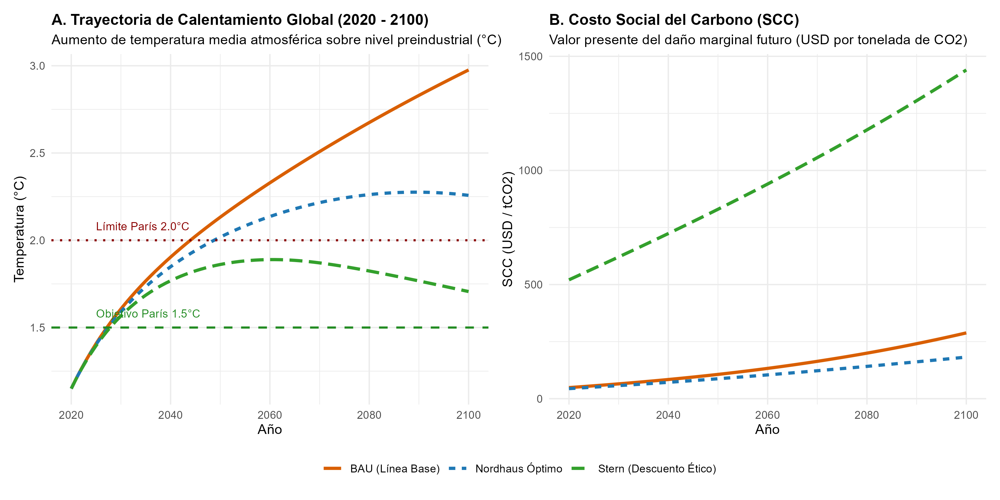
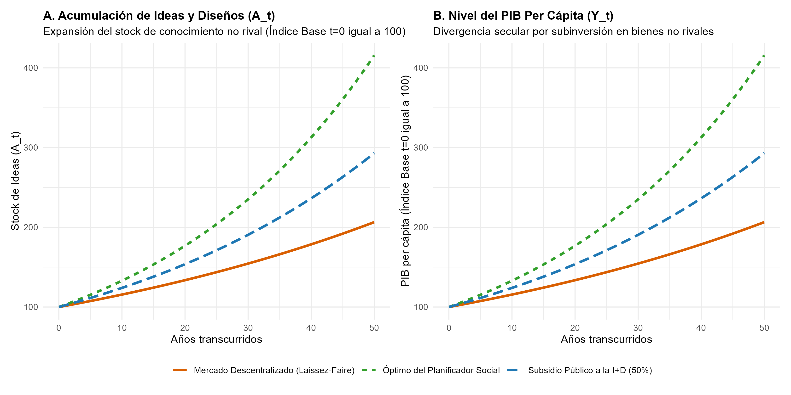

# Introducción y Objetivo

Este documento presenta una replicación ilustrativa y computacional de los modelos fundacionales que motivaron la concesión del Premio del Banco de Suecia en Ciencias Económicas en Memoria de Alfred Nobel 2018 a:

- **William D. Nordhaus**: *"por integrar el cambio climático en el análisis macroeconómico de largo plazo"* (*for integrating climate change into long-run macroeconomic analysis*).
- **Paul M. Romer**: *"por integrar las innovaciones tecnológicas en el análisis macroeconómico de largo plazo"* (*for integrating technological innovations into long-run macroeconomic analysis*).

Ambos laureados transformaron la macroeconomía al endogeneizar dos fuerzas determinantes que la teoría neoclásica previa trataba como restricciones o factores exógenos: los límites biofísicos de la naturaleza y la generación intencional de conocimiento tecnológico.

## Declaración de Nivel de Replicación
- **Nivel:** **Ilustrativa** (simulación dinámica acoplada del modelo biofísico-macroeconómico DICE de Nordhaus para 2020--2100 bajo escenarios de tasa de descuento, y simulación analítica de equilibrio general del modelo de crecimiento endógeno con bienes no rivales de Romer 1990).

---

# Marco Analítico Teórico

## 1. El Modelo DICE de William Nordhaus

El modelo **DICE** (*Dynamic Integrated Climate-Economy*, Nordhaus 1993, 2017) integra la macroeconomía neoclásica de crecimiento óptimo de Ramsey-Cass-Koopmans con un modelo geofísico de ciclo de carbono y balance energético atmosférico.

### Macroeconomía y Emisiones
La producción global bruta $Y_t$ utiliza capital $K_t$, trabajo $L_t$ y productividad total de los factores $A_t$:
$$Y_t = A_t K_t^\gamma L_t^{1-\gamma}$$

Las emisiones industriales brutas de dióxido de carbono ($CO_2$) son proporcionales a la producción:
$$E_{\text{ind}, t} = \sigma_t (1 - \mu_t) Y_t$$
donde:
- $\sigma_t$ es la intensidad de carbono de la economía (que declina en el tiempo gracias al progreso técnico autónomo).
- $\mu_t \in [0, 1]$ es la tasa de control o abatimiento de emisiones elegida por la política económica.

### Ciclo del Carbono y Forzamiento Radiactivo
La acumulación de carbono en la atmósfera ($M_t$) sigue una ecuación de balance de masa:
$$M_t = M_{\text{pre}} + (M_{t-1} - M_{\text{pre}})(1 - \delta_M) + \beta E_{t-1}$$
donde $M_{\text{pre}}$ es la concentración preindustrial ($\approx 588 \text{ GtC} \approx 280\text{ ppm}$), $\beta$ es la fracción de retención aérea inmediata y $\delta_M$ representa la tasa neta de absorción oceánica y de la biosfera.

El aumento de la concentración de gases de efecto invernadero genera forzamiento radiactivo ($F_t$, medido en $\text{W/m}^2$):
$$F_t = \eta \frac{\ln(M_t / M_{\text{pre}})}{\ln(2)} + F_{\text{ex}, t}$$
con $\eta \approx 3.68 \text{ W/m}^2$ correspondiente al forzamiento por duplicación de la concentración preindustrial de $CO_2$.

### Calentamiento y Daños Económicos
La temperatura atmosférica sobre el nivel preindustrial ($T_t$) evoluciona con inercia térmica:
$$T_t = T_{t-1} + c_1 \left[ F_t - \lambda_T T_{t-1} \right]$$
donde $\lambda_T = \eta / S$ está determinada por la sensibilidad climática de equilibrio $S \approx 3.1^\circ\text{C}$.

Nordhaus introdujo una **función de daño económico cuadrática** $\Omega(T_t)$, que reduce el producto disponible para consumo e inversión:
$$Y_{\text{neto}, t} = [1 - \Omega(T_t) - \Lambda(\mu_t)] Y_t$$
$$\Omega(T_t) = \theta_2 T_t^2, \quad \Lambda(\mu_t) = \theta_1 \mu_t^{\theta_3}$$
donde $\Lambda(\mu_t)$ es la función convexa de costos de abatimiento ($\theta_3 \approx 2.6$).

### El Costo Social del Carbono (SCC) y la Controversia de la Tasa de Descuento
El **Costo Social del Carbono** ($SCC_t$) mide el valor presente descontado de los daños económicos marginales que una tonelada adicional de $CO_2$ emitida en el periodo $t$ causará a lo largo de los siglos siguientes:
$$SCC_t = \sum_{s=t}^{\infty} \left(\frac{1}{1 + r}\right)^{s-t} \frac{\partial \text{Daño}_s}{\partial E_t}$$

Bajo la regla de Ramsey, la tasa de descuento intertemporal del bienestar es:
$$r = \rho + \eta_c g$$
donde $\rho$ es la tasa pura de preferencia temporal, $\eta_c$ es la elasticidad de la utilidad marginal del consumo y $g$ es la tasa de crecimiento del consumo per cápita.

Surge aquí el célebre debate económico:
- **Enfoque Descriptivo (Nordhaus 1993, 2007, 2017):** Usa tasas observadas en mercados de capital ($\rho \approx 1.5\% \implies r \approx 4.25\%$), recomendando una "rampa de política climática" (*climate policy ramp*): mitigación moderada al inicio que se intensifica gradualmente.
- **Enfoque Prescriptivo/Ético (Informe Stern 2007):** Argumenta que discriminar a las generaciones futuras es éticamente insostenible ($\rho = 0.1\% \implies r \approx 1.4\%$), exigiendo reducciones masivas e inmediatas de emisiones y arrojando un SCC sustancialmente mayor.

---

## 2. El Modelo de Ideas y Bienes No Rivales de Paul Romer (1990)

En *Endogenous Technological Change* (1990), Paul Romer desmanteló el supuesto del progreso técnico como "maná caído del cielo" de Solow (1956).

### No Rivalidad y Rendimientos Crecientes
Romer clasificó los bienes económicos en dos dimensiones fundamentales:
1. **Rivalidad:** Un bien físico (una máquina, un barril de petróleo, una hora de trabajo) es **rival**: su uso por una persona impide simultáneamente su uso por otra. En contraste, una fórmula química, un algoritmo o un plano de ingeniería es un **bien no rival**: puede ser utilizado simultáneamente por infinitas personas sin desgastarse.
2. **Excluibilidad:** Capacidad legal o técnica de impedir que otros usen el bien sin pagar (patentes, secretos comerciales, derechos de autor).

La función de producción agregada con ideas $A$ exhibe:
- Rendimientos constantes a escala en los insumos rivales tradicionales ($K, L$).
- **Rendimientos crecientes a escala** al incluir las ideas no rivales $A$:
$$F(\lambda K, \lambda L, \lambda A) > \lambda F(K, L, A)$$

Por el teorema de Euler para funciones homogéneas, si los factores rivales se remuneran a su producto marginal ($r K + w L = Y$), no queda remanente para remunerar a los creadores de ideas. Por ende, **el crecimiento impulsado por ideas es incompatible con la competencia perfecta**: requiere precios superiores al costo marginal (competencia monopolística y derechos de propiedad intelectual).

### Estructura del Modelo de Romer (1990)
La economía consta de tres sectores:
1. **Sector de Bienes Finales:** Produce con trabajo $H_Y$ e insumos intermedios de capital variado $x_i$:
   $$Y = H_Y^\alpha L^\beta \int_0^A x_i^{1-\alpha-\beta} di$$
2. **Sector de Bienes Intermedios:** Monopolistas con patentes de duración infinita producen variedades de capital $x_i$ con un margen de ganancia:
   $$p_i = \frac{r}{1-\alpha-\beta} > r$$
   generando beneficios de monopolio $\pi$.
3. **Sector de Investigación y Desarrollo (I+D):** Emplea investigadores $H_A$ y el stock acumulado de conocimientos $A_t$:
   $$\dot{A} = \delta H_A A$$
   donde el término $A$ refleja la externalidad intertemporal de que los nuevos investigadores "se apoyan sobre los hombros de gigantes" (*standing on shoulders of giants*).

### La Falla de Mercado: Mercado Descentralizado vs Óptimo Social
La tasa de crecimiento de equilibrio en el estado estacionario es $g = \dot{A}/A = \delta H_A = \delta s_A H$.

1. **Equilibrio descentralizado de mercado:** La fracción de investigadores $s_A^{\text{mercado}}$ se determina por la igualación de salarios entre la investigación y la manufactura:
   $$s_A^{\text{mercado}} = \frac{\alpha \delta H - \rho}{\alpha \delta H + \theta \delta H}$$
2. **Óptimo del planificador social:** El planificador internaliza que las ideas creadas hoy aumentarán la productividad de todos los futuros investigadores para siempre, y no sufre por el margen monopolístico de las patentes:
   $$s_A^{\text{óptimo}} = \frac{\delta H - \rho}{\theta \delta H} > s_A^{\text{mercado}}$$

**Resultado central:** El libre mercado invierte sistemáticamente menos de lo óptimo en investigación y desarrollo ($s_A^{\text{mercado}} < s_A^{\text{óptimo}}$), lo que justifica económicamente subsidios directos a la I+D, financiamiento de universidades y patentes temporales bien calibradas.

---

# Simulación Computacional y Replicación en R

La simulación se ejecuta de manera autónoma en el script `R/modelo_dice_y_romer.R`. A continuación se analizan los resultados generados.

## 1. Simulación del Modelo DICE (Nordhaus)

Se calibraron tres escenarios para el periodo 2020--2100:
1. **BAU (Línea Base):** Mitigación casi nula ($\mu = 0.03$).
2. **Nordhaus Óptimo:** Rampa de mitigación gradual óptima con descuento de mercado ($r = 4.25\%$).
3. **Stern Ético:** Mitigación acelerada guiada por una tasa pura de preferencia temporal cercana a cero ($r = 1.40\%$).

### Resultados Cuantitativos Clave

La siguiente tabla resume los resultados biofísicos y el Costo Social del Carbono calculados por el modelo:

| Escenario | Tasa Descuento | Temp. 2050 (°C) | Temp. 2100 (°C) | Daño 2100 (% PIB) | SCC 2020 (USD/t) | SCC 2050 (USD/t) | SCC 2100 (USD/t) |
|:---|:---:|:---:|:---:|:---:|:---:|:---:|:---:|
| **BAU (Línea Base)** | 4.25% | 2.13 | 2.98 | 2.09% | $48.6 | $106.4 | $288.2 |
| **Nordhaus Óptimo** | 4.25% | 2.02 | 2.26 | 1.20% | $44.1 | $87.3 | $182.1 |
| **Stern Ético** | 1.40% | 1.86 | 1.71 | 0.69% | $520.7 | $829.9 | $1,440.2 |

*Fuente: Generado por `R/modelo_dice_y_romer.R` y archivado en `salidas/tab_dice_escenarios_carbono.csv`.*

### Visualización Gráfica del Clima y Daño Marginal

{width=100%}

**Hallazgos clave:**
- En el escenario BAU, la temperatura global alcanza casi $3.0^\circ\text{C}$ sobre los niveles preindustriales para el año 2100, provocando pérdidas directas anuales de más del $2\%$ del PIB global en daños climáticos.
- La rampa de Nordhaus estabiliza el calentamiento en torno a $2.26^\circ\text{C}$, con un costo social del carbono de partida de aproximadamente USD 44/tonelada de $CO_2$, duplicándose para 2050 conforme la economía y los daños marginales crecen.
- El enfoque prescriptivo de Stern, al no descontar fuertemente el bienestar de las generaciones distantes, fija un costo social del carbono superior a USD 500/t, lo cual justifica una descarbonización casi total en las primeras tres décadas.

---

## 2. Simulación del Modelo de Crecimiento con Ideas de Romer (1990)

Se comparó la asignación de recursos y la senda temporal del stock de ideas y del PIB per cápita entre:
1. **Mercado Descentralizado (Laissez-Faire):** $s_A = 7.5\%$, tasa de crecimiento $g = 1.45\%$.
2. **Subsidio a la I+D (50% de estímulo pigouviano):** $s_A = 12.5\%$, tasa de crecimiento $g = 2.15\%$.
3. **Óptimo del Planificador Social:** $s_A = 17.5\%$, tasa de crecimiento $g = 2.85\%$.

### Visualización Gráfica de la Divergencia de Crecimiento

{width=100%}

**Hallazgos clave:**
- La subinversión del mercado libre en investigación genera una brecha acumulativa masiva en el nivel de vida.
- Al cabo de 50 años, el stock de ideas y el PIB per cápita bajo el óptimo social es más del doble ($416$ vs $206$) del alcanzado por una economía de libre mercado sin intervención que depende exclusivamente del monopolio privado de patentes.
- Un subsidio público moderado a la investigación cierra más de la mitad de la brecha de bienestar secular, confirmando el rol correctivo insustituible del Estado en bienes no rivales.

---

# Síntesis: Dos Caras de la Misma Moneda

El Premio Nobel de 2018 simboliza una complementariedad económica profunda:
1. **Nordhaus** modeló el mayor fallo de mercado global negativo: las emisiones de gases de efecto invernadero constituyen una externalidad negativa no compensada hacia bienes comunales rivales (la atmósfera y la estabilidad climática). La solución económica óptima es **poner un precio al carbono** (impuesto pigouviano o límites transferibles) para que el mercado reconozca su verdadero costo social.
2. **Romer** modeló el mayor fallo de mercado positivo: las ideas y la tecnología son bienes no rivales cuya creación genera externalidades positivas masivas hacia toda la sociedad. El mercado descentralizado subinvierte porque no puede remunerar a los creadores sin generar monopolios. La solución económica óptima es **financiar y subsidiar la ciencia y la innovación**.

La transición hacia la sostenibilidad ecológica no puede lograrse solo castigando las emisiones fósiles (Nordhaus) ni solo esperando milagros tecnológicos fortuitos (Solow); requiere la integración de ambos: **precios al carbono para desalentar las tecnologías sucias y subsidios masivos a la innovación para acelerar el stock de ideas limpias no rivales**.
