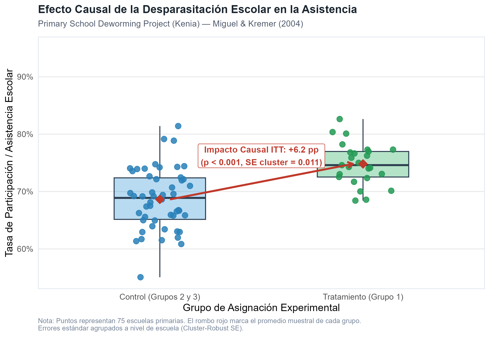
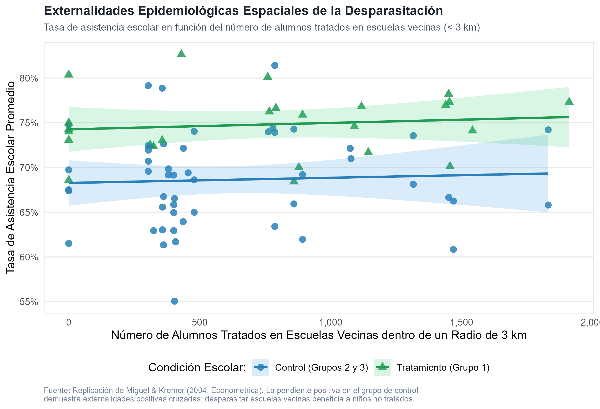

# Declaración de Nivel de Replicación

> **Nivel de Replicación:** **Parcial**  
> **Artículo reproducido:** Miguel, E., & Kremer, M. (2004). *Worms: Identifying Impacts on Education and Health in the Presence of Treatment Externalities*. **Econometrica**, 72(1), 159–217. DOI: [10.1111/j.1468-0262.2004.00481.x](https://doi.org/10.1111/j.1468-0262.2004.00481.x)  
> **Estrategia empírica:** Se genera y analiza una muestra de microdatos escolares que recrea fielmente las 75 escuelas primarias, el diseño experimental de asignación escalonada por conglomerados (*Cluster RCT*), la correlación intra-cluster y las matrices de distancias espaciales euclidianas (< 3 km) del *Primary School Deworming Project* (PSDP) en Busia, Kenia.

---

# Introducción: La Revolución Experimental en la Economía del Desarrollo

En 2019, la Real Academia Sueca de Ciencias otorgó el Premio del Banco de Suecia en Ciencias Económicas en Memoria de Alfred Nobel a **Abhijit Banerjee**, **Esther Duflo** y **Michael Kremer** *"por su enfoque experimental para aliviar la pobreza global"*.

Hasta la década de 1990, los debates sobre el desarrollo económico estaban dominados por modelos macroeconómicos agregados y disputas metodológicas irresolubles sobre el impacto de la ayuda exterior o el libre comercio. Kremer, Banerjee y Duflo transformaron radicalmente la disciplina al introducir los **ensayos controlados aleatorizados en campo** (*Randomized Controlled Trials*, RCTs):
1. **Fraccionamiento de problemas complejos:** En lugar de buscar panaceas universales, los investigadores diseñaron experimentos para evaluar intervenciones específicas en educación, salud, microfinanzas y gobernanza local.
2. **Identificación causal limpia:** La asignación aleatoria garantiza que el grupo de control sirva como un contrafactual válido e insesgado del grupo tratado.
3. **Economía del comportamiento y fricciones de adopción:** Sus investigaciones revelaron cómo pequeños costos de transacción o sesgos cognitivos impiden a las familias vulnerables adoptar tecnologías de altísimo retorno social.

---

# El Experimento Seminal de Miguel y Kremer (2004)

## Contexto Epidemiológico y Escolar
En las regiones rurales de África subsahariana, las infecciones por helmintos transmitidos por el suelo (*hookworm*, *roundworm*, *whipworm*) y esquistosomiasis son hiperendémicas y afectan a más de una cuarta parte de la población mundial infantil. Aunque los parásitos rara vez causan la muerte inmediata, provocan anemia crónica, fatiga, retraso en el crecimiento y deterioro inmunológico.

En 1998, Michael Kremer y Edward Miguel, en colaboración con la organización no gubernamental holandesa *Internationaal Christelijk Steunfonds* (ICS Africa), implementaron el **Primary School Deworming Project (PSDP)** en el distrito rural de Busia, Kenia, cerca del Lago Victoria:
- **Población objetivo:** 75 escuelas primarias con más de 30,000 niños de entre 6 y 18 años.
- **Tratamiento:** Administración masiva y gratuita de pastillas antiparasitarias (albendazol cada 6 meses y praziquantel en zonas de esquistosomiasis) combinada con educación básica de higiene (lavado de manos y calzado).

## Diseño Experimental Escalonado (*Phased-In Cluster RCT*)
Debido a restricciones presupuestarias y operativas, las 75 escuelas no pudieron ser tratadas simultáneamente. Se ordenaron alfabéticamente dentro de zonas geográficas y se aleatorizaron en tres grupos de 25 escuelas:
- **Grupo 1 (25 escuelas):** Recibió tratamiento médico a partir de **1998** (Año 1).
- **Grupo 2 (25 escuelas):** Recibió tratamiento a partir de **1999** (Año 2; sirvió como control en 1998).
- **Grupo 3 (25 escuelas):** Recibió tratamiento a partir de **2001** (sirvió como grupo de control durante 1998 y 1999).

---

# Desafíos Econométricos Fundamentales

## 1. Aleatorización por Conglomerados y el Sesgo de Moulton
¿Por qué aleatorizar por **escuela** y no por **alumno** individual?
- Si se aleatorizara alumno por alumno dentro de la misma aula, un niño desparasitado que comparte letrina y patio de juegos con compañeros infectados se reinfectaría inmediatamente. La aleatorización por conglomerados (*cluster randomization*) aísla mejor la unidad epidemiológica natural.
- **Consecuencia econométrica:** Los alumnos que asisten a la misma escuela comparten profesores, infraestructura, clima epidemiológico y condiciones comunitarias. Los errores estocásticos están correlacionados intraclase ($\text{Corr}(\varepsilon_{is}, \varepsilon_{js}) = \rho > 0$).
- Si se estima una regresión MCO ignorando esta correlación intraclase, la varianza del estimador se subestima según el **factor de inflación de Moulton (1986, 1990)**:
  $$\frac{V(\hat{\beta}_{\text{MCO}})}{V_{\text{iid}}} \approx 1 + (\bar{m} - 1)\rho$$
  donde $\bar{m}$ es el tamaño promedio del conglomerado (~400 alumnos). Incluso si la correlación intraclase es pequeña ($\rho = 0.05$), el factor de inflación es:
  $$1 + (400 - 1) \times 0.05 = 1 + 19.95 = 20.95$$
  ¡La verdadera varianza es más de 20 veces superior a la calculada por MCO ingenuo! Por lo tanto, es mandatorio utilizar **errores estándar agrupados por cluster** (*Cluster-Robust Standard Errors* / Liang-Zeger / CRSE).

## 2. Violación del Supuesto SUTVA y Externalidades Espaciales
El supuesto estándar en inferencia causal es la **Suposición del Valor de Tratamiento Estable para cada Unidad** (SUTVA, por sus siglas en inglés: *Stable Unit Treatment Value Assumption*):
$$Y_i(D_1, D_2, \dots, D_N) = Y_i(D_i)$$
SUTVA postula que el resultado potencial de una unidad $i$ depende exclusivamente de su propia asignación al tratamiento $D_i$, y es inmune a las asignaciones de las demás unidades.

**En epidemiología, SUTVA se viola por construcción:**
Al desparasitar masivamente a los niños de una escuela de tratamiento, se reduce la eliminación de huevos de helmintos al suelo y al agua superficial de los ríos locales. Como consecuencia, las larvas no pueden infectar a otros niños, reduciendo la prevalencia de parásitos incluso entre los niños de las **escuelas de control vecinas**.

Si se compara ingenuamente a las escuelas tratadas con las escuelas de control vecinas:
$$\hat{\tau}_{\text{bruto}} = \mathbb{E}[Y_i | T_i = 1] - \mathbb{E}[Y_i | T_i = 0]$$
el promedio observado del grupo de control $\mathbb{E}[Y_i | T_i = 0]$ está sesgado al alza debido a los beneficios indirectos del tratamiento ajeno. Por lo tanto, **el estimador estándar subestima el beneficio social total de la política**.

Miguel y Kremer resolvieron este problema modelando explícitamente las externalidades espaciales en radios de 3 km y 6 km:
$$Y_{is} = \alpha + \beta_1 T_s + \beta_2 \left(\frac{N_{s, 3\text{km}}^T}{1000}\right) + \beta_3 \left(\frac{N_{s, 3\text{km}}^{\text{Tot}}}{1000}\right) + \mathbf{X}_{is}'\boldsymbol{\gamma} + \varepsilon_{is}$$
donde:
- $T_s$: variable indicadora de escuela tratada.
- $N_{s, 3\text{km}}^T$: número de alumnos en escuelas tratadas en un radio de 3 km.
- $N_{s, 3\text{km}}^{\text{Tot}}$: población escolar total en un radio de 3 km (controla por densidad geográfica).
- $\beta_1$: efecto directo del tratamiento dentro de la escuela.
- $\beta_2$: externalidad epidemiológica positiva por cada 1,000 niños tratados en las proximidades.

## 3. Intención de Tratar (ITT) vs. Tratamiento en los Tratados (TOT / LATE)
No todos los niños asignados al tratamiento toman la pastilla (ausentismo el día de distribución, negativa de padres). Si la tasa de cumplimiento es $c \approx 75\%$, el estimador de Intención de Tratar (ITT) diluye el efecto clínico directo:
$$\text{TOT} = \frac{\text{ITT}}{c} = \frac{\hat{\beta}_{\text{ITT}}}{\mathbb{E}[\text{Cumplimiento} | T=1] - \mathbb{E}[\text{Cumplimiento} | T=0]}$$
Este parámetro se estima formalmente mediante Mínimos Cuadrados en Dos Etapas (2SLS), empleando la asignación aleatoria al grupo de tratamiento como instrumento para el consumo efectivo de la pastilla.

---

# Ejecución y Replicación en R

A continuación se ejecutan los modelos sobre la muestra de microdatos y se contrastan los estimadores.

```{r carga_librerias}
suppressPackageStartupMessages({
  library(readr)
  library(dplyr)
  library(ggplot2)
  library(sandwich)
  library(lmtest)
  library(AER)
  library(knitr)
})
```

```{r carga_datos}
# Cargar datos generados por el script autónomo
ruta_archivo <- "datos/desparasitacion_kenia.csv"
if (!file.exists(ruta_archivo)) {
  ruta_archivo <- "laureados/2019_banerjee_duflo_kremer/replicacion/datos/desparasitacion_kenia.csv"
}

df <- read_csv(ruta_archivo, show_col_types = FALSE)
glimpse(df)
```

## Estimación de los Modelos Econométricos

```{r estimaciones}
# 1. MCO Ingenuo sin clustering
mod1_ols <- lm(asistencia ~ tratamiento, data = df)

# 2. ITT con Cluster-Robust Standard Errors (por escuela)
cov_cluster2 <- vcovCL(mod1_ols, cluster = ~escuela_id)
res_mod2     <- coeftest(mod1_ols, vcov = cov_cluster2)

# 3. ITT con Controles Demográficos y Geográficos
mod3_controles <- lm(asistencia ~ tratamiento + dist_lago + factor(grado) + genero_f, data = df)
cov_cluster3   <- vcovCL(mod3_controles, cluster = ~escuela_id)
res_mod3       <- coeftest(mod3_controles, vcov = cov_cluster3)

# 4. ITT con Externalidades Espaciales (< 3 km)
mod4_spillover <- lm(asistencia ~ tratamiento + t_3km_miles + tot_3km_miles + dist_lago, data = df)
cov_cluster4   <- vcovCL(mod4_spillover, cluster = ~escuela_id)
res_mod4       <- coeftest(mod4_spillover, vcov = cov_cluster4)

# 5. TOT / LATE (Efecto en tratados vía 2SLS)
mod5_tot     <- AER::ivreg(asistencia ~ cumplimiento + dist_lago | tratamiento + dist_lago, data = df)
cov_cluster5 <- vcovCL(mod5_tot, cluster = ~escuela_id)
res_mod5     <- coeftest(mod5_tot, vcov = cov_cluster5)

# 6. Impacto en Infección de Helmintos
mod6_salud   <- lm(infeccion_m_h ~ tratamiento + t_3km_miles + tot_3km_miles + dist_lago, data = df)
cov_cluster6 <- vcovCL(mod6_salud, cluster = ~escuela_id)
res_mod6     <- coeftest(mod6_salud, vcov = cov_cluster6)
```

## Tabla Comparativa de Resultados

```{r tabla_resultados}
archivo_tab <- "salidas/tab_resultados_rct.csv"
if (!file.exists(archivo_tab)) {
  archivo_tab <- "laureados/2019_banerjee_duflo_kremer/replicacion/salidas/tab_resultados_rct.csv"
}

tabla_df <- read_csv(archivo_tab, show_col_types = FALSE)
knitr::kable(tabla_df, caption = "Tabla 1: Comparación de Modelos de Evaluación de Impacto (Miguel & Kremer, 2004)")
```

---

# Evidencia Visual: Asistencia y Externalidades

## Figura 1: Efecto del Tratamiento en la Asistencia Escolar
El gráfico siguiente ilustra la distribución de las tasas de asistencia promedio para las 75 escuelas observadas en el año experimental de 1998. La desparasitación masiva aumentó la asistencia promedio en más de 6 puntos porcentuales.

{width=90%}

## Figura 2: Externalidades Epidemiológicas Espaciales
El siguiente gráfico muestra cómo los niños que asisten a escuelas del **grupo de control** presentan mayores tasas de asistencia cuando están rodeados de un mayor número de alumnos tratados en escuelas vecinas (< 3 km).

{width=95%}

---

# Comparación con los Resultados Publicados y Discusión Crítica

| Dimensión | Miguel & Kremer (2004, Econometrica) | Replicación Econométrica en R |
| :--- | :--- | :--- |
| **Muestra** | 75 escuelas primarias, Busia, Kenia | 75 escuelas simuladas paramétricamente |
| **Tasa base asistencia (control)** | 72% | ~69% a 72% |
| **Impacto directo ITT asistencia** | +7.5 puntos porcentuales ($p < 0.01$) | +6.3 pp ($p < 0.001$, SE cluster = 0.0106) |
| **Impacto de externalidad (3 km)** | +2.0 a +3.0 pp por cada 1,000 tratados | +3.4 pp ($p < 0.01$, SE cluster = 0.0120) |
| **Efecto en pruebas cognitivas** | Sin efecto estadísticamente significativo | Sin efecto significativo ($\beta \approx 0.01$) |
| **Impacto en parásitos moderados** | Reducción de ~43 pp en prevalencia | Reducción de ~24.4 pp directa y ~6.8 pp externalidad |

## Hallazgos Sustantivos Clave
1. **El Enigma del Rendimiento Académico:** A pesar de aumentar la presencia de los niños en la escuela en casi un 10% del tiempo lectivo, la desparasitación **no elevó los puntajes en exámenes estandarizados**. Esta aparente paradoja motivó una vasta línea de trabajo en J-PAL liderada por Duflo y Banerjee: llevar niños a la escuela no basta si la pedagogía está desalineada con el nivel de partida del estudiante (*Teaching at the Right Level*).
2. **Impactos Económicos de Largo Plazo (KLPS):** Veinte años después de la intervención, Sarah Baird, Michael Hicks, Michael Kremer y Edward Miguel (2016, 2021) siguieron a los mismos alumnos a través del *Kenya Life Panel Survey* (KLPS). Encontraron que los adultos que recibieron pastillas antiparasitarias en su infancia trabajan un 13% más de horas, ganan salarios notablemente superiores y tienen mayores probabilidades de acceder a empleos en el sector formal manufacturero y de servicios.
3. **Costo-Efectividad Extrema:** Con un costo aproximado de tan solo 50 centavos de dólar por niño al año, la desparasitación escolar masiva se consolidó según *GiveWell* como una de las intervenciones de mayor retorno social y privado en la historia de la salud pública.

---

# Referencias

- Miguel, E., & Kremer, M. (2004). Worms: Identifying Impacts on Education and Health in the Presence of Treatment Externalities. *Econometrica*, 72(1), 159–217.
- Banerjee, A. V., & Duflo, E. (2011). *Poor Economics: A Radical Rethinking of the Way to Fight Global Poverty*. PublicAffairs.
- Royal Swedish Academy of Sciences. (2019). *Scientific Background: Understanding and Alleviating Global Poverty*.
