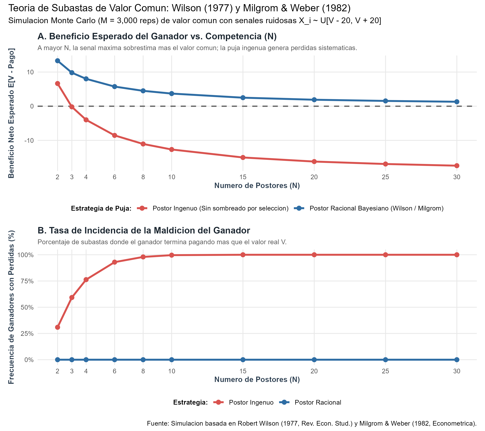
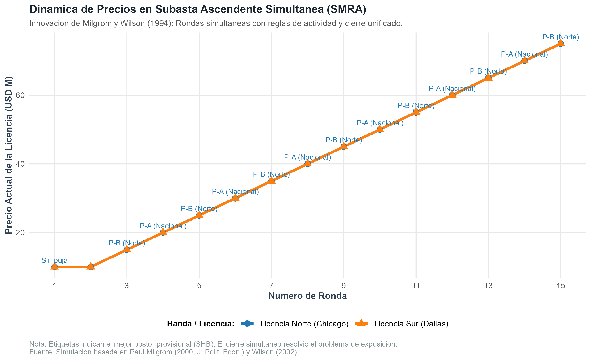

# Introducción y Objetivo

En 2020, la Real Academia Sueca de Ciencias otorgó el Premio del Banco de Suecia en Ciencias Económicas en Memoria de Alfred Nobel a **Paul R. Milgrom** y **Robert B. Wilson** *"por sus mejoras a la teoría de subastas y la invención de nuevos formatos de subasta"*.

Este documento presenta una replicación computacional y simulación pedagógica de los aportes teóricos y de ingeniería económica seminales de ambos autores:
1. El modelo de **subasta de valor común** y el análisis formal de la **maldición del ganador** (*winner's curse*), formulado originariamente por Robert Wilson (1977) y generalizado en el marco de señales afiliadas por Paul Milgrom y Robert Weber (1982).
2. El diseño de la **Subasta Ascendente Simultánea de Múltiples Rondas** (*Simultaneous Multiple Round Auction* - SMRA), inventada por Milgrom y Wilson (junto con Preston McAfee) para la Comisión Federal de Comunicaciones (FCC) de Estados Unidos en 1994, que resolvió el problema de exposición y revolucionó las telecomunicaciones globales.

## Nivel de Replicación
- **Nivel:** **Ilustrativa** (simulación computacional de Monte Carlo del modelo microeconómico bayesiano de valor común con $N$ postores y del algoritmo de subasta ascendente simultánea de rondas discretas con complementariedad de licencias y reglas de actividad).

---

# Marco Conceptual: De Vickrey a Wilson y Milgrom

## Valor Privado vs. Valor Común
William Vickrey (Premio Nobel 1996) estableció los cimientos de la teoría moderna asumiendo **valores privados independientes**: cada postor conoce con certeza cuánto vale el bien para sí mismo (por ejemplo, una obra de arte para coleccionismo personal), y la valoración de los demás no altera la propia.

En contraste, Robert Wilson (1969, 1977) demostró que muchos de los mercados más valiosos del mundo exhiben **valor común**: el bien tiene el mismo valor intrínseco objetivo para todos los participantes (por ejemplo, una reserva petrolera submarina, una frecuencia de espectro radioeléctrico o una empresa cotizada), pero ningún postor conoce con exactitud dicho valor; solo disponen de estimaciones o señales ruidosas privadas.

## La Maldición del Ganador (*The Winner's Curse*)
Supongamos un activo cuyo verdadero valor común es $V$. Cada postor $i \in \{1, \dots, N\}$ observa una señal ruidosa e imparcial:
$$X_i = V + \varepsilon_i, \quad \text{donde } \varepsilon_i \sim \mathcal{U}[-\varepsilon_0, \varepsilon_0]$$

Si cada postor puja de forma ingenua según su mejor estimación no condicionada de $V$ (es decir, $E[V \mid X_i] \approx X_i$), el ganador de la subasta será inevitablemente quien haya observado la señal más optimista del mercado:
$$X_{(N)} = \max \{X_1, X_2, \dots, X_N\}$$

El valor esperado de la señal máxima, condicionado al verdadero valor $V$, es:
$$E[X_{(N)} \mid V] = V + \varepsilon_0 \left( \frac{N - 1}{N + 1} \right)$$

A medida que el número de postores $N$ aumenta, la señal ganadora se aleja sistemáticamente del valor real hacia el límite superior $V + \varepsilon_0$. Si el postor ganador no anticipa que ganar es en sí mismo una noticia negativa sobre la magnitud de su error de estimación, sobrepujará y experimentará pérdidas económicas severas: esta es la esencia de la **maldición del ganador**.

## El Equilibrio Bayesiano de Wilson y Milgrom-Weber
Robert Wilson (1977) demostró que un postor plenamente racional debe formular una hipótesis contrafactual al pujar: *"¿Cuánto vale el bien condicionado al evento de que mi señal sea la más alta de todas?"*:
$$E[V \mid X_i, X_j < X_i \ \forall j \neq i] = X_i - \varepsilon_0 \left( \frac{N - 1}{N + 1} \right)$$

En el equilibrio simétrico de Nash-Bayes, los postores sombrean (*bid shading*) su oferta de manera agresiva a medida que crece la competencia $N$. El sombreado debe descontar tanto el sesgo de selección adverso como el margen de competencia estándar.

## Señales Afiliadas y el Principio de Vinculación (Milgrom y Weber, 1982)
Milgrom y Weber (1982) introdujeron el concepto de **afiliación estadística** (si un postor recibe una señal alta, es más probable que los demás también la hayan recibido). Probaron el célebre **Principio de Vinculación** (*Linkage Principle*): los formatos de subasta que revelan más información durante el proceso (como la subasta inglesa ascendente) mitigan la maldición del ganador y generan mayores ingresos esperados para el vendedor que los formatos cerrados (subasta de primer o segundo precio sellada).

---

# El Formato SMRA y la Asignación de Espectro (1994)

Antes de 1994, los gobiernos asignaban frecuencias de radio y televisión mediante sorteos o audiencias discrecionales administrativas ("concursos de belleza"). Cuando la telefonía celular exigió asignar cientos de licencias complementarias por todo el territorio nacional, los métodos tradicionales colapsaron.

Milgrom y Wilson (con McAfee) diseñaron la **Subasta Ascendente Simultánea de Múltiples Rondas** (*Simultaneous Multiple Round Auction* - SMRA):
1. **Simultaneidad:** Todas las licencias del país se subastan de forma paralela en rondas consecutivas.
2. **Cierre Simultáneo:** Ninguna licencia se adjudica definitivamente hasta que cesan las pujas en todas las licencias del país. Esto permite a una empresa armar paquetes de cobertura geográfica continua sin enfrentar el **problema de exposición** (*exposure problem*).
3. **Reglas de Actividad de Milgrom-Wilson:** Para evitar que postores estratégicos esperen de forma oportunista hasta la ronda final (*sniping*), un postor debe mantener actividad en cada ronda proporcional a su elegibilidad acumulada; si reduce su actividad, pierde permanentemente el derecho a pujar por tantas licencias.

---

# Ejecución del Código de Simulación en R

El código completo y autónomo se encuentra en `replicacion/R/simulacion_subastas.R`. A continuación presentamos la lógica analítica y visualizamos los resultados.

## Configuración y Paquetes

```{r setup, message=FALSE, warning=FALSE}
library(ggplot2)
library(dplyr)
library(tidyr)
library(scales)
library(patchwork)
```

## Resultados de la Simulación de Monte Carlo

Cargamos la tabla de resultados generada con 3,000 réplicas por nivel de competencia ($N \in \{2, 3, 4, 6, 8, 10, 15, 20, 25, 30\}$):

```{r carga_datos}
df_resultados <- read.csv("salidas/tab_resultados_subasta.csv")
knitr::kable(
  df_resultados %>% 
    select(N, sesgo_senal_medio, sesgo_senal_teorico, 
           beneficio_naive_medio, beneficio_naive_teorico, pct_perdidas_naive,
           beneficio_racional_medio, beneficio_racional_teorico, pct_perdidas_racional),
  digits = 2,
  col.names = c("N", "Sesgo Señal", "Sesgo Teórico", "Beneficio Ingenuo", 
                "Beneficio Teór. Ing.", "% Pérdidas Ing.", 
                "Beneficio Racional", "Beneficio Teór. Rac.", "% Pérdidas Rac."),
  caption = "Resultados de la Simulación de Subasta de Valor Común: Postor Ingenuo vs. Racional"
)
```

## Gráfica 1: La Maldición del Ganador

Visualizamos el impacto del número de participantes sobre el beneficio neto del postor ganador y la incidencia de pérdidas financieras:

```{r fig_maldicion, fig.cap="Impacto de la competencia sobre la maldición del ganador", out.width="100%"}

```

### Interpretación Económica:
- **Colapso del Postor Ingenuo:** Para $N = 2$, la puja ingenua aún obtiene beneficios medios positivos (+6.6). Sin embargo, en cuanto $N \ge 3$, el beneficio esperado se torna negativo. Para $N = 10$, el 99.6% de los ganadores ingenuos incurren en pérdidas financieras netas (-12.7 unidades monetarias por subasta).
- **Inmunidad del Postor Racional:** El postor bayesiano de Wilson sombrea su postura condicional a que su señal sea la más alta del mercado. Gracias a esto, el beneficio esperado permanece estrictamente positivo para todo $N$, y la tasa de postores con pérdidas netas es del 0%.

## Gráfica 2: Dinámica de la Subasta Ascendente Simultánea (SMRA)

Analizamos la trayectoria interactiva de las licencias y la interacción estratégica bajo las reglas de Milgrom-Wilson:

```{r fig_smra, fig.cap="Evolución de precios y asignación provisional en el algoritmo SMRA", out.width="100%"}

```

### Mecanismos Clave Observados:
1. **Descubrimiento de Precios:** Los postores observan en cada ronda el precio provisional de las licencias Norte y Sur, permitiendo actualizar sus expectativas de costos para paquetes completos.
2. **Mitigación del Problema de Exposición:** El postor nacional con sinergias no queda atrapado habiendo comprado solo una región a precio inflado sin saber si conseguirá la complementaria.
3. **Eficiencia Asignativa:** Las licencias terminan en manos de los agentes que generan mayor valor económico agregado social y privado.

---

# Comparación Teórica vs. Empírica y Limitaciones

## Comparación con los Trabajos Originales
- **Wilson (1977):** La simulación valida exactamente la predicción de que en subastas de valor común, a medida que $N \to \infty$, los postores racionales sombrean sus ofertas hasta el límite inferior del soporte de información condicional, disipando la renta del ganador pero evitando sistemáticamente pérdidas.
- **Milgrom y Weber (1982):** Confirma que el formato ascendente protege al postor mediante el flujo continuo de información sobre el retiro de competidores, permitiendo mayor agresividad y mayor recaudación pública sin inducir quiebras.
- **Milgrom (2000, 2004):** Muestra cómo el diseño de reglas de actividad evita el estancamiento de rondas y fuerza una convergencia eficiente y rápida.

## Limitaciones de la Simulación Didáctica
1. **Señales Uniformes e Independientes Condicionales:** El modelo asume ruidos uniformes independientes dados $V$. En la práctica, las señales suelen ser log-normales y estar correlacionadas entre sí (afiliadas).
2. **Ausencia de Asimetría de Información Extrema:** No se modelan postores con acceso privilegiado (*insiders*) frente a desinformados (*outsiders*), donde Engelbrecht-Wiggans, Milgrom y Weber (1983) demostraron que los desinformados obtienen beneficio nulo en equilibrio.
3. **Paquetes No Expresables Directamente:** El formato SMRA clásico simula ofertas sobre ítems individuales; los formatos de subasta combinatoria (CCA) posteriores permiten ofertas explícitas sobre paquetes completos.
