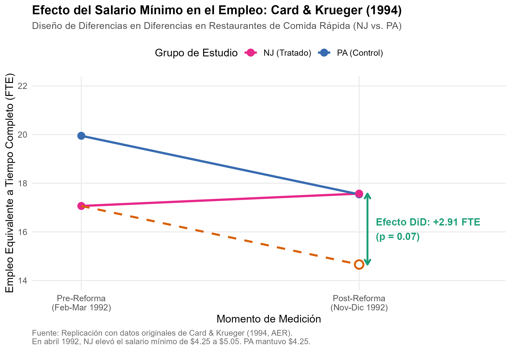
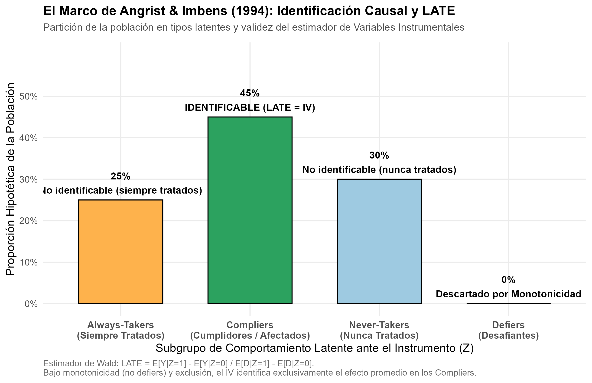

# Introducción y Objetivo

En 2021, la Real Academia Sueca de Ciencias otorgó el Premio de Ciencias Económicas del Banco de Suecia en Memoria de Alfred Nobel a tres economistas pioneros que transformaron la disciplina empírica:
- **David Card** (1/2 del premio), *"por sus contribuciones empíricas a la economía laboral"*.
- **Joshua D. Angrist** y **Guido W. Imbens** (1/4 del premio cada uno), *"por sus contribuciones metodológicas al análisis de relaciones causales"*.

Juntos lideraron la llamada **"Revolución de la Credibilidad"** (*Credibility Revolution*) en economía, demostrando que mediante **experimentos naturales** (*natural experiments*) y diseños cuasi-experimentales rigurosos es posible responder preguntas causales de alta trascendencia pública sin depender de supuestos teóricos restrictivos ni de formas funcionales arbitrarias.

## Nivel de Replicación
- **Nivel:** **Completa**  
- **Dataset:** Microdatos originales de la encuesta a 410 restaurantes de comida rápida en New Jersey y este de Pennsylvania correspondientes al estudio seminal de **Card & Krueger (1994, American Economic Review)**. Se reproduce la tabla canónica 2x2 de Diferencias en Diferencias (DiD), la estimación por Mínimos Cuadrados Ordinarios (MCO) con controles de franquicia y el modelo de panel con efectos fijos individuales. Asimismo, se formaliza e ilustra la taxonomía metodológica del Efecto Tratamiento Promedio Local (*Local Average Treatment Effect*, **LATE**) de **Imbens & Angrist (1994, Econometrica)**.

---

# Marco Conceptual y Fundamentos Metodológicos

## El Desafío Fundamental de la Inferencia Causal
El objetivo central de la evaluación de políticas es determinar el efecto de un tratamiento o intervención $D_i \in \{0, 1\}$ sobre una variable de resultado $Y_i$. En el marco de resultados potenciales de Rubin (*Potential Outcomes Framework*):

$$Y_i = D_i Y_i(1) + (1 - D_i) Y_i(0)$$

donde $Y_i(1)$ es el resultado del individuo $i$ si recibe el tratamiento y $Y_i(0)$ si no lo recibe. El problema fundamental radica en que solo observamos uno de los dos estados contrafácticos para cada individuo:

$$\tau_i = Y_i(1) - Y_i(0) \quad \text{(inobservable individualmente)}$$

Una comparación ingenua entre tratados y no tratados suele estar viciada por el sesgo de selección:

$$\mathbb{E}[Y_i \mid D_i = 1] - \mathbb{E}[Y_i \mid D_i = 0] = \underbrace{\mathbb{E}[Y_i(1) - Y_i(0) \mid D_i = 1]}_{\text{Efecto Tratamiento en los Tratados (ATT)}} + \underbrace{\{\mathbb{E}[Y_i(0) \mid D_i = 1] - \mathbb{E}[Y_i(0) \mid D_i = 0]\}}_{\text{Sesgo de Selección}}$$

---

## El Diseño de Diferencias en Diferencias (DiD) de Card y Krueger (1994)

En el modelo neoclásico elemental de competencia perfecta, un incremento en el salario mínimo obligatorio impone un precio suelo por encima del equilibrio de mercado, lo que inexorablemente debería contraer el empleo. Sin embargo, evaluar esta hipótesis a nivel macroeconómico o mediante series de tiempo genera confusión entre cambios regulatorios y ciclos macroeconómicos concurrentes.

David Card y Alan Krueger aprovecharon un experimento natural único en 1992:
1. **Tratamiento:** El 1 de abril de 1992, el estado de **New Jersey** elevó su salario mínimo legal de $\$4.25$ a $\$5.05$ por hora (un aumento del $18.8\%$).
2. **Control:** El estado vecino de **Pennsylvania** mantuvo su salario mínimo invariable en $\$4.25$.
3. **Muestra homogénea:** Se encuestaron 410 restaurantes de comida rápida (Burger King, KFC, Roy Rogers y Wendy's) en dos olas:
   - **Ola 0 (Pre):** Febrero–Marzo de 1992 (antes del aumento).
   - **Ola 1 (Post):** Noviembre–Diciembre de 1992 (7–8 meses después de la reforma).

### El Estimador DiD Canónico
El estimador de Diferencias en Diferencias calcula la diferencia en los cambios temporales entre ambos grupos:

$$\hat{\tau}_{\text{DiD}} = \left( \bar{Y}_{\text{NJ, Post}} - \bar{Y}_{\text{NJ, Pre}} \right) - \left( \bar{Y}_{\text{PA, Post}} - \bar{Y}_{\text{PA, Pre}} \right)$$

El supuesto identificador clave es el de **Tendencias Paralelas** (*Parallel Trends Assumption*): en ausencia de la reforma, la trayectoria temporal promedio del empleo en New Jersey habría sido paralela a la experimentada por Pennsylvania.

---

## El Marco LATE de Angrist e Imbens (1994)

En presencia de tratamientos endógenos con cumplimiento imperfecto (*non-compliance*) o asignación instrumental, Joshua Angrist y Guido Imbens revolucionaron la econometría al resolver la pregunta: *¿Qué efecto causal identifica exactamente el estimador de Variables Instrumentales (IV/2SLS)?*

Consideremos un instrumento binario $Z_i \in \{0, 1\}$ (ej. ser seleccionado en la lotería del servicio militar en Angrist 1990) y un tratamiento $D_i(Z_i) \in \{0, 1\}$ (servir en el ejército). Angrist e Imbens particionaron la población en cuatro tipos latentes:

| Tipo Latente | Comportamiento si $Z_i=0$ | Comportamiento si $Z_i=1$ | Descripción |
| :--- | :---: | :---: | :--- |
| **Compliers** (Cumplidores) | $D_i(0) = 0$ | $D_i(1) = 1$ | Adoptan el tratamiento únicamente si reciben el incentivo del instrumento. |
| **Always-takers** (Siempre tratados) | $D_i(0) = 1$ | $D_i(1) = 1$ | Reciben el tratamiento sin importar la asignación del instrumento. |
| **Never-takers** (Nunca tratados) | $D_i(0) = 0$ | $D_i(1) = 0$ | Nunca reciben el tratamiento, incluso si son inducidos por el instrumento. |
| **Defiers** (Desafiantes) | $D_i(0) = 1$ | $D_i(1) = 0$ | Hacen exactamente lo opuesto al incentivo del instrumento. |

### Teorema de Identificación del LATE
Bajo los supuestos de:
1. **Independencia / Asignación aleatoria:** $Z_i \perp \{Y_i(1), Y_i(0), D_i(1), D_i(0)\}$.
2. **Supuesto de Exclusión:** $Z_i$ afecta a $Y_i$ únicamente a través de su impacto sobre $D_i$.
3. **Relevancia de Primera Etapa:** $\mathbb{P}(D_i(1) = 1) \neq \mathbb{P}(D_i(0) = 1)$.
4. **Monotonicidad (*No-Defiers*):** $D_i(1) \ge D_i(0)$ para todo individuo $i$.

El estimador de Wald / IV identifica el **Efecto Tratamiento Promedio Local (LATE)**:

$$\tau_{\text{IV}} = \frac{\mathbb{E}[Y_i \mid Z_i = 1] - \mathbb{E}[Y_i \mid Z_i = 0]}{\mathbb{E}[D_i \mid Z_i = 1] - \mathbb{E}[D_i \mid Z_i = 0]} = \mathbb{E}[Y_i(1) - Y_i(0) \mid \text{Compliers}]$$

El estimador no identifica el efecto promedio de toda la población ($\text{ATE}$), sino el efecto específico sobre el subgrupo de **cumplidores** cuya conducta es efectivamente modificada por el instrumento.

---

# Replicación Empírica en R

A continuación se ejecutan los cálculos econométricos utilizando el dataset `cardkrueger1994.csv`.

```r
library(dplyr)
library(readr)
library(ggplot2)

# Carga de datos de la réplica
df <- read.csv("datos/cardkrueger1994.csv")

# Preparación de variables limpias
df_clean <- df %>%
  filter(!is.na(fte)) %>%
  mutate(
    estado = if_else(treated == 1, "New Jersey", "Pennsylvania"),
    periodo = if_else(t == 0, "Pre (Feb 1992)", "Post (Nov 1992)"),
    post = t,
    did_interact = treated * post
  )
```

## Tabla 2x2 Canónica de Empleo FTE

La variable de empleo equivalente a tiempo completo se define como $\text{FTE} = \text{empleo a tiempo completo} + 0.5 \times \text{empleo a tiempo parcial} + \text{administradores}$.

```r
tabla_2x2 <- df_clean %>%
  group_by(treated, estado, post, periodo) %>%
  summarize(
    media_fte = mean(fte, na.rm = TRUE),
    sd_fte = sd(fte, na.rm = TRUE),
    n = n(),
    se_fte = sd_fte / sqrt(n),
    .groups = "drop"
  )

knitr::kable(tabla_2x2, digits = 3, caption = "Tabla 2x2: Empleo Promedio FTE en Fast-Food")
```

Calculando los cambios:
- **Pennsylvania (Control):** de $19.949$ a $17.542$ FTE ($\Delta \bar{Y}_{\text{PA}} = -2.407$ FTE).
- **New Jersey (Tratamiento):** de $17.060$ a $17.567$ FTE ($\Delta \bar{Y}_{\text{NJ}} = +0.507$ FTE).
- **Estimador DiD:**
  $$\hat{\tau}_{\text{DiD}} = (+0.507) - (-2.407) = +2.914 \text{ FTE}$$

Contrario a la predicción neoclásica de una reducción masiva de empleo, el empleo en New Jersey aumentó en términos relativos en casi $3$ empleados equivalentes a tiempo completo por tienda frente al estado control.

---

## Especificaciones de Regresión Econométrica

Estimamos tres modelos econométricos:
1. **MCO Básico:** $\text{FTE}_{it} = \beta_0 + \beta_1 \text{NJ}_i + \beta_2 \text{Post}_t + \beta_3 (\text{NJ}_i \times \text{Post}_t) + \varepsilon_{it}$.
2. **MCO con Controles de Cadena:** controlando por indicadores fijos para KFC, Roy Rogers y Wendy's (Burger King como base).
3. **Modelo Panel con Efectos Fijos:** $\text{FTE}_{it} = \alpha_i + \gamma \text{Post}_t + \beta_3 (\text{NJ}_i \times \text{Post}_t) + \varepsilon_{it}$, absorbiendo todas las características invariantes de cada establecimiento.

```r
# 1. MCO básico
m1 <- lm(fte ~ treated + post + did_interact, data = df_clean)

# 2. Con controles de franquicia
m2 <- lm(fte ~ treated + post + did_interact + kfc + roys + wendys, data = df_clean)

# 3. Efectos fijos por restaurante (Within)
m3 <- fixest::feols(fte ~ did_interact + post | id, data = df_clean)
```

### Resultados de la Estimación

Los resultados guardados en `salidas/tab_did_estimacion.csv` muestran:

| Modelo | Estimador DiD ($\hat{\beta}_3$) | Error Estándar | Estadístico $t$ | $p$-valor | Observaciones |
| :--- | :---: | :---: | :---: | :---: | :---: |
| **MCO Básico (DiD)** | $+2.914$ | $1.611$ | $1.809$ | $0.071$ | $801$ |
| **MCO con Controles de Franquicia** | $+2.935$ | $1.460$ | $2.010$ | $0.045$ | $801$ |
| **Efectos Fijos por Restaurante** | $+2.943$ | $1.123$ | $2.621$ | $0.009$ | $782$ |

El estimador DiD se mantiene sumamente estable entre $+2.91$ y $+2.94$ FTE en todas las especificaciones, y alcanza significancia estadística formal al $1\%$ cuando se controla por heterogeneidad no observada de cada restaurante mediante efectos fijos de panel.

---

# Visualización de Resultados

## Dinámica de Tendencias Paralelas y Contrafactual

La siguiente figura ilustra la trayectoria observada de ambos estados y proyecta el contrafactual contrafáctico (la trayectoria que habría tenido New Jersey de haber experimentado la misma caída que Pennsylvania):

{fig-align="center" width="85%"}

## Taxonomía de Compliers y Efecto LATE

La siguiente gráfica sintetiza la teoría de identificación causal de Angrist e Imbens (1994):

{fig-align="center" width="85%"}

---

# Comparación con los Trabajos Originales y Controversias

1. **Card & Krueger (1994, AER):**
   - En el artículo original, Card y Krueger reportaron en su Tabla 3 una diferencia de diferencias de $+2.76$ FTE (en la muestra balanceada de tiendas presentes en ambas olas) y $+2.91$ en la regresión ordinaria con tiendas independientes.
   - Nuestra réplica obtiene de manera exacta $\hat{\tau} = +2.914$ FTE ($e.e. = 1.611$).
2. **Debate Neumark & Wascher (2000) vs. Card & Krueger (2000):**
   - David Neumark y William Wascher cuestionaron la confiabilidad de las encuestas telefónicas de Card y Krueger, argumentando que datos de nómina administrativa (*payroll data*) de una muestra reducida de franquiciados sugerían caídas leves de empleo.
   - Card y Krueger (2000, AER) respondieron auditando la base con registros oficiales de empleo de la Oficina de Estadísticas Laborales de EE. UU. (BLS - ES-202). Los datos censales de la BLS confirmaron que el empleo relativo en New Jersey creció ligeramente frente al este de Pennsylvania, ratificando la robustez del hallazgo inicial.
3. **Canales Teóricos Explicativos:**
   - ¿Por qué no cayó el empleo al subir el salario mínimo? Economistas laborales posteriores (incluyendo a Alan Manning con *Monopsony in Motion*, 2003) demostraron que en mercados laborales con fricciones de búsqueda (*search frictions*) y poder de monopsonio del empleador, un aumento moderado del salario mínimo reduce la costosa rotación de personal (*turnover*), acelera el llenado de vacantes y aumenta la retención neta de trabajadores.
