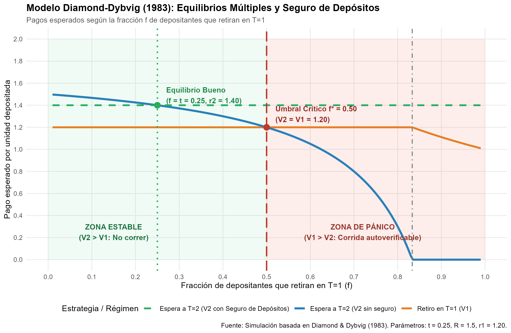
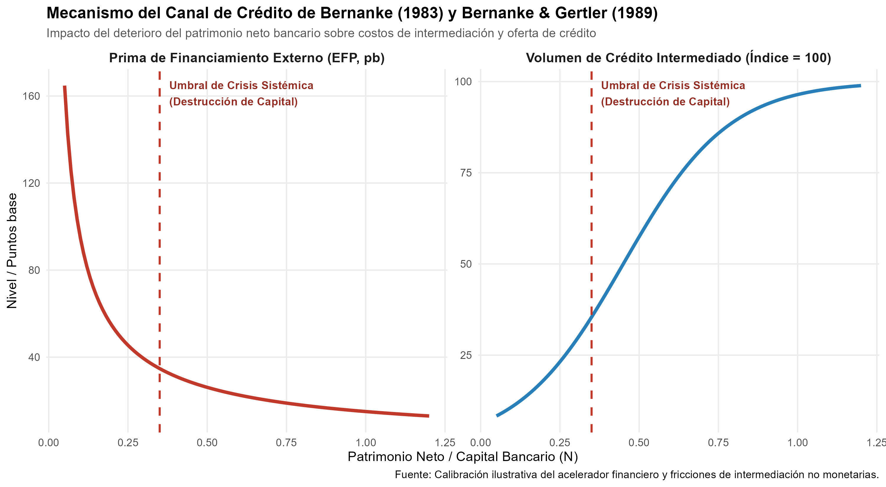

# Declaración de Nivel de Replicación

> **Nivel de Replicación:** **Ilustrativa**  
> **Papers reproducidos:**  
> 1. Diamond, D. W., & Dybvig, P. H. (1983). *Bank Runs, Deposit Insurance, and Liquidity*. Journal of Political Economy, 91(3), 401–419.  
> 2. Bernanke, B. S. (1983). *Nonmonetary Effects of the Financial Crisis in the Propagation of the Great Depression*. American Economic Review, 73(3), 257–276.  
> 3. Bernanke, B. S., & Gertler, M. (1989). *Agency Costs, Net Worth, and Business Fluctuations*. American Economic Review, 79(1), 14–31.

Dado que los aportes teóricos de Diamond y Dybvig (1983) y Bernanke y Gertler (1989) consisten en modelos formales de equilibrios múltiples y fricciones financieras de agencia, esta replicación implementa una **simulación numérica estructural paramétrica** en R para calcular con exactitud los pagos de equilibrio, los umbrales de pánico, los efectos de las garantías estatales y la mecánica no lineal del acelerador financiero.

---

# Marco Teórico: El Modelo Diamond-Dybvig (1983)

## Estructura Temporal y Preferencias
La economía se desarrolla en tres periodos: $T \in \{0, 1, 2\}$. Existen depositantes homogéneos en $T=0$, cada uno dotado con 1 unidad de bien de consumo. En $T=1$, la naturaleza revela el tipo de cada agente de forma privada:
- **Depositantes Tipo 1 (Impacientes):** Representan una proporción $t \in (0, 1)$ de la población y solo obtienen utilidad del consumo temprano $c_1$ en $T=1$: $U(c_1)$.
- **Depositantes Tipo 2 (Pacientes):** Representan una proporción $1 - t$ y solo valoran el consumo maduro $c_2$ en $T=2$: $U(c_2)$.

## Tecnologías de Producción
Existen dos alternativas de inversión:
1. **Almacenamiento de corto plazo (Líquido):** 1 unidad invertida en $T=0$ rinde $1$ en $T=1$.
2. **Inversión productiva de largo plazo (Ilíquido):** 1 unidad invertida en $T=0$ rinde $R > 1$ en $T=2$. Si se interrumpe y liquida prematuramente en $T=1$, solo rinde un valor de salvamento $L \le 1$ (típicamente normalizado a $1$).

## El Contrato de Depósito a la Vista y la Transformación de Plazos
Un banco centraliza los depósitos en $T=0$ e invierte los recursos. Ofrece un contrato de depósito a la vista prometiendo:
- Retirar $r_1 > 1$ en $T=1$ bajo demanda.
- Repartir en partes iguales los retornos remanentes en $T=2$: $r_2$.

Bajo la restricción de atención por orden de llegada (*sequential service constraint*), si una proporción $f$ de depositantes retira en $T=1$:
- Si $f \cdot r_1 \le 1$: Cada depositante temprano recibe $V_1(f) = r_1$. En $T=2$, la inversión remanente $1 - f \cdot r_1$ madura a $R(1 - f \cdot r_1)$, otorgando a cada uno de los $1 - f$ depositantes pacientes un pago de:
  $$V_2(f) = \frac{R(1 - f \cdot r_1)}{1 - f}$$
- Si $f > 1 / r_1$: El banco quiebra por falta de liquidez en $T=1$. Los primeros $1/r_1$ en la fila reciben $r_1$, los siguientes reciben 0, con un valor esperado $V_1(f) = 1/f$. Para $T=2$, no quedan activos: $V_2(f) = 0$.

## Equilibrios de Nash Múltiples y el Umbral Crítico $f^*$
El juego entre depositantes pacientes admite dos equilibrios de Nash:
1. **Equilibrio Bueno ($f = t$):** Solo retiran los impacientes. Como $V_2(t) = r_2 > r_1$, los pacientes no tienen incentivo a retirar antes de tiempo.
2. **Equilibrio de Pánico o Corrida Bancaria ($f = 1$):** Si un paciente cree que todos retirarán en $T=1$, esperar le garantiza $0$. Su mejor respuesta es unirse a la fila para intentar obtener $r_1$, volviendo la expectativa de quiebra una **profecía autocumplida** (*self-fulfilling run*).

El umbral crítico de indiferencia $f^*$ donde $V_2(f^*) = V_1(f^*) = r_1$ se obtiene algebraicamente:
$$\frac{R(1 - f^* r_1)}{1 - f^*} = r_1 \implies f^* = \frac{R - r_1}{r_1(R - 1)}$$

---

# Replicación Numérica en R

Ejecutamos el script `R/modelo_diamond_dybvig.R` con parámetros calibrados representativos:
- $t = 0.25$ (25% de agentes impacientes)
- $R = 1.50$ (50% de rendimiento acumulado en el largo plazo)
- $r_1 = 1.20$ (pago prometido del 20% para retiros tempranos)

El cálculo arroja:
- $r_2 = \frac{1.5 \times (1 - 0.25 \times 1.20)}{0.75} = 1.40$
- $f^* = \frac{1.50 - 1.20}{1.20 \times (1.50 - 1.00)} = \frac{0.30}{0.60} = 0.50$
- Límite de liquidación $f_{bar} = 1 / 1.20 \approx 0.8333$

```r
# Carga de la tabla generada por la simulación
tabla_pagos <- read.csv("salidas/tab_pagos_liquidez.csv")
knitr::kable(tabla_pagos, caption = "Matriz de Pagos y Estados de Liquidez según Fracción de Retiros (f)")
```

A continuación se presentan los resultados numéricos obtenidos:

| Fracción Retiro ($f$) | Pago $T=1$ ($V_1$) | Pago $T=2$ ($V_2$) | Pago con Seguro | Incentivo Depositante Paciente | Estado del Banco |
| :---: | :---: | :---: | :---: | :---: | :---: |
| 0.100 | 1.200 | 1.467 | 1.400 | Retiro por debajo del óptimo | Solvente y Plenamente Líquido |
| **0.250** | **1.200** | **1.400** | **1.400** | **Equilibrio Bueno (sin pánico)** | **Solvente y Plenamente Líquido** |
| 0.350 | 1.200 | 1.338 | 1.400 | Zona Estable (esperar es óptimo) | Solvente (estrés moderado) |
| **0.500** | **1.200** | **1.200** | **1.400** | **Umbral Crítico de Pánico ($f^*$)** | **Solvente al límite** |
| 0.650 | 1.200 | 0.943 | 1.400 | Pánico Bancario (retirar es dominante) | Vulnerable a corrida sistémica |
| 0.833 | 1.200 | 0.004 | 1.400 | Pánico Bancario (retirar es dominante) | Agotamiento inminente de reservas |
| 0.950 | 1.053 | 0.000 | 1.400 | Colapso Total / Quiebra | Liquidación forzosa / Quiebra |

---

# Resultados Gráficos

## Figura 1: Fragilidad Financiera y Seguro de Depósitos (Diamond & Dybvig, 1983)

{width=95%}

### Interpretación de la Figura 1:
1. **Región Verde ($f < 0.50$):** El pago de esperar $V_2(f)$ supera el pago temprano $V_1 = 1.20$. La expectativa de estabilidad es un equilibrio robusto.
2. **Región Roja ($f > 0.50$):** El pago de esperar $V_2(f)$ cae por debajo de $1.20$. Todo agente racional paciente corre al banco antes de que se agoten los fondos.
3. **Línea Punteada Verde (Seguro de Depósitos):** El respaldo estatal garantiza que los depositantes pacientes recibirán $r_2 = 1.40$ sin importar cuántos retiren. Al eliminar el incentivo a correr ($V_2^{seguro} > V_1$), la probabilidad subjetiva de corrida se anula y la garantía nunca requiere fondos públicos en equilibrio.

---

## Figura 2: El Canal de Crédito y Acelerador Financiero (Bernanke, 1983; Bernanke & Gertler, 1989)

{width=95%}

### Interpretación de la Figura 2:
Bernanke demostró que la crisis bancaria no fue solo un shock monetario pasivo. La quiebra de miles de bancos destruyó el capital informacional acumulado sobre solvencia de deudores (*delegated monitoring*, Diamond 1984). Al colapsar el patrimonio neto del sistema bancario ($N$), la prima de financiamiento externo (*External Finance Premium*, EFP) se disparó asintóticamente, induciendo una contracción no lineal del crédito que prolongó la Gran Depresión.

---

# Comparación con los Trabajos Originales y Limitaciones

## Comparación con la Literatura
- **Diamond y Dybvig (1983):** Nuestra simulación captura formalmente la complementariedad estratégica: la decisión individual de correr depende exclusivamente de la creencia sobre lo que harán los demás. Confirma que la suspensión de convertibilidad y el seguro de depósitos resuelven la inestabilidad intrínseca del descalce de plazos (*maturity mismatch*).
- **Bernanke (1983):** Demuestra por qué las variables crediticias y los diferenciales de riesgo (*credit spreads*) poseen capacidad explicativa sustancialmente superior a los agregados monetarios simples durante colapsos financieros.

## Limitaciones del Modelo Canónico
1. **Riesgo Moral (*Moral Hazard*):** Al garantizar el 100% de los depósitos, los banqueros pueden asumir riesgos excesivos sabiendo que las pérdidas serán socializadas.
2. **Corridas en el Sistema Bancario en la Sombra (*Shadow Banking*):** En 2008 y 2023, las corridas ocurrieron no mediante depositantes minoristas formados en ventanilla, sino a través de mercados mayoristas de repo no asegurados y transferencias electrónicas instantáneas (Silicon Valley Bank).
