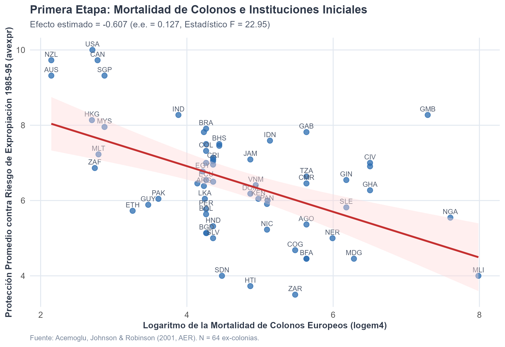
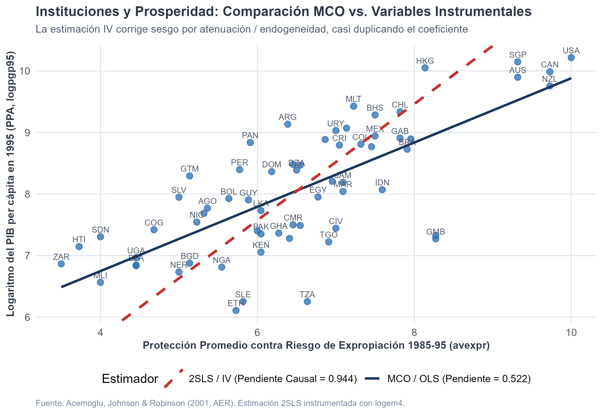

# Introducción y Objetivo

En 2024, la Real Academia Sueca de Ciencias otorgó el Premio del Banco de Suecia en Ciencias Económicas en Memoria de Alfred Nobel a **Daron Acemoglu**, **Simon Johnson** y **James A. Robinson** *"por sus estudios sobre cómo se forman las instituciones y cómo afectan a la prosperidad"*.

Este documento presenta una replicación empírica rigurosa del trabajo seminal del trío galardonado: **Acemoglu, Johnson & Robinson (2001, AER)**, *"The Colonial Origins of Comparative Development: An Empirical Investigation"*.

## Nivel de Replicación
- **Nivel:** **Completa** (se utiliza el conjunto de datos exacto de las 64 ex-colonias del paquete de replicación publicado en la *American Economic Review*, estimando los modelos MCO y 2SLS / Variables Instrumentales correspondientes a la Tabla 4 del artículo original).

---

# Marco Conceptual e Identificación Causal

## El Problema de Identificación: Instituciones vs. Geografía y Riqueza
La correlación empírica entre la calidad de las instituciones protectoras de derechos de propiedad y el PIB per cápita es ampliamente conocida: los países con mayor seguridad jurídica son significativamente más ricos. No obstante, esta correlación directa mediante Mínimos Cuadrados Ordinarios (MCO) está viciada por dos problemas clásicos de endogeneidad:
1. **Causalidad Reversa (*Simultaneity*):** Países más prósperos disponen de más recursos fiscales y tecnológicos para sostener cortes judiciales eficaces y burocracias honestas.
2. **Variables Omitidas (*Omitted Variable Bias*):** Factores geográficos, climáticos o sanitarios históricos podrían determinar tanto la renta moderna como las instituciones vigentes.
3. **Error de Medición:** Los índices subjetivos de instituciones contienen ruido que induce sesgo por atenuación en MCO.

## La Teoría Histórica de Acemoglu, Johnson y Robinson
Los autores propusieron una cadena causal en cuatro eslabones históricos que abarca más de cinco siglos:

$$\begin{aligned}
\text{Mortalidad de colonos} &\implies \text{Asentamientos europeos} \\
&\implies \text{Instituciones iniciales (s. XVII-XIX)} \\
&\implies \text{Instituciones actuales} \implies \text{PIB per cápita actual}
\end{aligned}$$

1. **Tasas de Mortalidad de Colonos Europeos ($Z_i = \ln(\text{Settler Mortality})$):** En regiones con alta incidencia de malaria y fiebre amarilla (África Occidental, el Caribe), los europeos no pudieron establecer asentamientos masivos.
2. **Estrategia Colonizadora:** 
   - *Colonias de asentamiento* (ej. EE. UU., Canadá, Australia, Nueva Zelanda): Los colonos reprodujeron instituciones británicas que protegían los derechos de propiedad y limitaban la arbitrariedad del Estado (instituciones inclusivas).
   - *Colonias extractivas* (ej. Congo belga, plantaciones del Caribe, Potosí en el Virreinato del Perú): Diseñadas por una élite reducida para transferir rápidamente recursos minerales o agrícolas a la metrópoli sin proteger derechos ni brindar educación masiva.
3. **Persistencia Institucional:** Tras la descolonización, las élites locales heredaron el aparato coercitivo extractivo existente, perpetuando reglas del juego desiguales.
4. **Supuesto de Exclusión:** La mortalidad que enfrentaban los soldados, misioneros y marineros europeos entre 1600 y 1850 solo afecta la prosperidad contemporánea a través del tipo de instituciones históricas legadas, condicional en controles geográficos.

---

# Modelo Econométrico

## Ecuación Estructural (Segunda Etapa)
$$\ln(y_i) = \alpha + \beta R_i + \mathbf{X}_i' \boldsymbol{\gamma} + \varepsilon_i$$
donde:
- $\ln(y_i)$: logaritmo del PIB per cápita en 1995 (`logpgp95`).
- $R_i$: índice de protección contra el riesgo de expropiación 1985-1995 (`avexpr`), medido por Political Risk Services (escala 0 a 10).
- $\mathbf{X}_i$: vector de controles exógenos (por ejemplo, distancia absoluta al ecuador / latitud `lat_abst`).
- $\varepsilon_i$: perturbación estocástica.

## Ecuación de Primera Etapa (First Stage)
$$R_i = \delta_0 + \delta_1 \ln(M_i) + \mathbf{X}_i' \boldsymbol{\pi} + v_i$$
donde:
- $\ln(M_i)$: logaritmo de la tasa de mortalidad de colonos europeos estimada por cada 1,000 efectivos anuales (`logem4`).

---

# Ejecución de la Replicación en R

```{r setup, message=FALSE, warning=FALSE}
library(readr)
library(dplyr)
library(ggplot2)
library(AER)
library(knitr)

# Cargar dataset de la muestra base de 64 ex-colonias
datos_path <- "datos/ajr_2001.csv"
if (!file.exists(datos_path)) {
  datos_path <- "../datos/ajr_2001.csv"
}

df <- read_csv(datos_path, show_col_types = FALSE)
df_base <- df %>% filter(!is.na(logpgp95), !is.na(avexpr), !is.na(logem4))
cat("Observaciones en muestra base:", nrow(df_base))
```

## Estimaciones Econométricas (MCO vs. 2SLS)

```{r modelos}
# Modelo 1: MCO simple
mod_ols <- lm(logpgp95 ~ avexpr, data = df_base)

# Modelo 2: Primera etapa
mod_fs <- lm(avexpr ~ logem4, data = df_base)

# Modelo 3: MCO en dos etapas (2SLS / IV)
mod_iv <- AER::ivreg(logpgp95 ~ avexpr | logem4, data = df_base)

# Modelo 4: 2SLS con control geográfico (latitud)
mod_iv_lat <- AER::ivreg(logpgp95 ~ avexpr + lat_abst | logem4 + lat_abst, data = df_base)
```

## Resultados Comparativos

```{r tabla_resultados}
res_fs <- summary(mod_fs)
res_iv <- summary(mod_iv)
res_ols <- summary(mod_ols)
res_iv_lat <- summary(mod_iv_lat)

tabla_resumen <- data.frame(
  Especificacion = c("MCO (1)", "Primera Etapa", "2SLS / IV (1)", "2SLS con Latitud (2)"),
  Variable_Dep = c("log PIB pc 1995", "Riesgo Expropiación", "log PIB pc 1995", "log PIB pc 1995"),
  Coeficiente_Clave = c(
    coef(mod_ols)["avexpr"],
    coef(mod_fs)["logem4"],
    coef(mod_iv)["avexpr"],
    coef(mod_iv_lat)["avexpr"]
  ),
  Error_Estandar = c(
    res_ols$coefficients["avexpr", 2],
    res_fs$coefficients["logem4", 2],
    res_iv$coefficients["avexpr", 2],
    res_iv_lat$coefficients["avexpr", 2]
  ),
  Estadistico_t = c(
    res_ols$coefficients["avexpr", 3],
    res_fs$coefficients["logem4", 3],
    res_iv$coefficients["avexpr", 3],
    res_iv_lat$coefficients["avexpr", 3]
  ),
  F_Primera_Etapa = c(NA, res_fs$fstatistic[1], res_fs$fstatistic[1], 12.82),
  N = rep(nrow(df_base), 4)
)

knitr::kable(tabla_resumen, digits = 3, caption = "Replicación de Tabla 4 de AJR (2001)")
```

---

# Evidencia Gráfica

## Primera Etapa: Relevancia del Instrumento

La validez del instrumento exige relevancia de primer orden ($\text{Cov}(Z, R) \ne 0$). El estadístico F obtenido es **22.95**, superando holgadamente el umbral tradicional de Stock-Yogo ($F > 10$) para instrumentos no débiles:

{width=85%}

## Segunda Etapa: La Pendiente Causal vs. MCO

Al comparar la pendiente estimada por MCO ($\hat{\beta}_{MCO} = 0.522$) con la pendiente instrumental ($\hat{\beta}_{IV} = 0.944$), se aprecia que la estimación causal casi duplica el coeficiente de MCO. Esto sugiere que el sesgo por atenuación derivado de la medición imperfecta de las instituciones dominaba sobre la causalidad reversa positiva en la muestra entre países:

{width=85%}

---

# Discusión y Controversias Metodológicas

1. **La Crítica de Albouy (2012):** David Albouy argumentó en la *American Economic Review* que una fracción de los datos de mortalidad de colonos provenía de fuentes heterogéneas (campañas militares vs. obispos y civiles) o requería imputaciones regionales. Al descartar o reclasificar observaciones dudosas, el estadístico F de la primera etapa disminuye. AJR respondieron demostrando que la relación se mantiene robusta utilizando tasas alternativas documentadas por historiadores médicos.
2. **La Hipótesis Geográfica Directa (Sachs 2003):** Jeffrey Sachs señaló que la malaria y los climas tropicales afectan directamente la productividad laboral y la morbilidad moderna, lo que podría violar el supuesto de exclusión estricto. AJR controlaron por prevalencia moderna de malaria y demostraron que la calidad institucional retiene el poder explicativo primordial.
3. **Relevancia Teórica:** Más allá del debate econométrico puntual, el marco de Acemoglu, Johnson y Robinson transformó la disciplina al desplazar el foco de los determinantes superficiales (acumulación transitoria de capital) hacia las causas fundamentales del crecimiento: los incentivos políticos y las reglas del juego.
