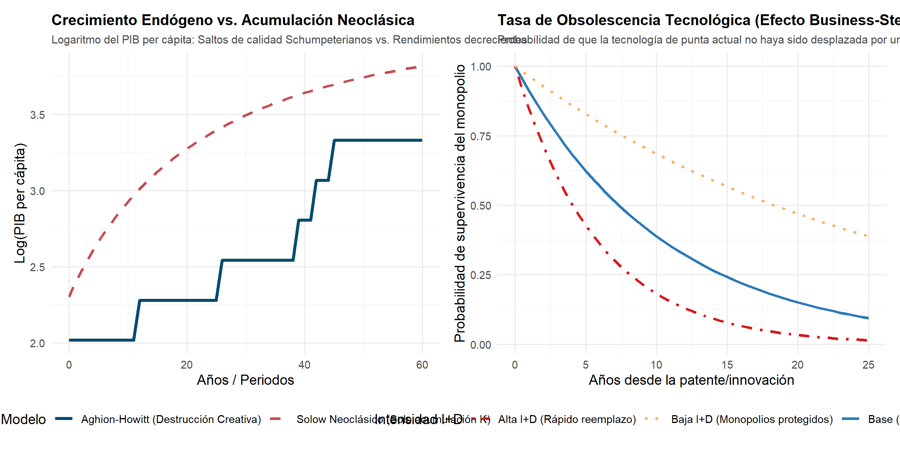
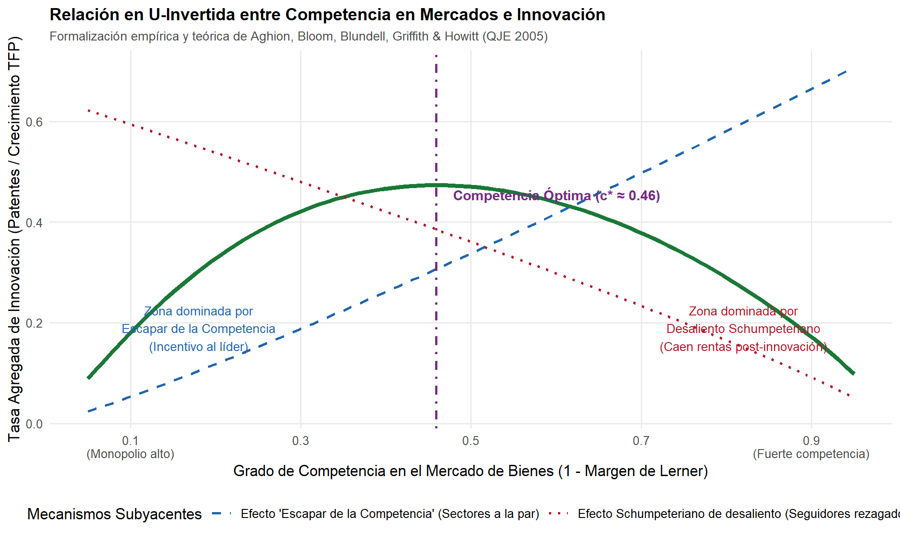

# Introducción y Objetivo

Este documento presenta una replicación didáctica e ilustrativa de los modelos teóricos y empíricos fundamentales que motivaron la concesión del Premio Nobel de Economía 2025 a **Joel Mokyr**, **Philippe Aghion** y **Peter Howitt** *"por haber explicado el crecimiento económico impulsado por la innovación"*.

En particular, esta replicación aborda:
1. El **Modelo de Crecimiento a través de la Destrucción Creativa** de Philippe Aghion y Peter Howitt (1992, *Econometrica*), modelando la asignación de recursos a investigación y desarrollo (I+D), la llegada estocástica de innovaciones de salto de calidad ($\gamma$) y la obsolescencia forzada de tecnologías monopolistas anteriores (*business-stealing effect*).
2. La comparación dinámica entre el **crecimiento endógeno schumpeteriano** y la **acumulación de capital neoclásica** de Solow (1956), demostrando por qué el crecimiento per cápita sostenido requiere progreso tecnológico continuo y no mero ahorro de capital.
3. La formalización teórica y empírica de la **relación en U-invertida entre competencia e innovación** de Aghion, Bloom, Blundell, Griffith y Howitt (2005, *Quarterly Journal of Economics*), reconciliando el efecto de "escapar de la competencia" en sectores tecnológicamente parejos (*neck-and-neck*) con el desaliento schumpeteriano en sectores asimétricos.
4. El puente histórico-conceptual con la teoría del "conocimiento útil" (*useful knowledge*) de Joel Mokyr (2002, *The Gifts of Athena*), analizando cómo las instituciones y la reducción de costos de acceso al conocimiento científico expanden el parámetro de eficiencia de la investigación ($\lambda$).

## Declaración de Nivel de Replicación
- **Nivel:** **Ilustrativa** (simulación numérica y analítica basada en los parámetros estructurales canónicos de Aghion-Howitt 1992 y Aghion et al. 2005).

---

# Marco Analítico Teórico

## 1. El Modelo de Aghion y Howitt (1992)

La economía consta de tres sectores: bienes finales, bienes intermedios e investigación y desarrollo (I+D).

### Producción Final
El bien final $y$ se produce de forma competitiva combinando insumos intermedios $x$ con tecnología:
$$y_t = A_t x_t^\alpha, \quad 0 < \alpha < 1$$
donde $A_t$ representa el índice de calidad o productividad de la tecnología de frontera vigente en el periodo $t$.

### Monopolio Intermedio
El insumo intermedio es producido por un monopolista protegido por una patente temporal con tecnología lineal $x_t = L_x$. El monopolista maximiza beneficios:
$$\pi_t = \max_{x_t} \left\{ p_t(x_t) x_t - w_t x_t \right\} = \frac{1 - \alpha}{\alpha} x_t w_t = \pi_0 A_t$$
donde el precio $p_t(x_t) = \alpha A_t x_t^{\alpha - 1}$ se deriva de la demanda del bien final.

### Sector de I+D y Destrucción Creativa
Las innovaciones se generan empleando trabajo de investigación $n_t$. Los inventos llegan siguiendo un proceso estocástico de Poisson con tasa de llegada de flujo:
$$\mu_t = \lambda n_t$$
Cada innovación genera una mejora de calidad discreta proporcional:
$$A_{t+1} = \gamma A_t, \quad \gamma > 1$$

El nuevo innovador desplaza inmediatamente al monopolista previo (*destrucción creativa*), capturando las rentas monopolísticas $\pi_{t+1}$ hasta que una innovación subsecuente lo vuelva obsoleto.

El valor presente neto descontado de una nueva patente $V_{t+1}$ toma en cuenta tanto la tasa de interés real $r$ como la tasa de destrucción creativa $\lambda n_{t+1}$:
$$V_{t+1} = \frac{\pi_{t+1}}{r + \lambda n_{t+1}}$$

### Condición de Arbitraje y Crecimiento de Estado Estacionario
En equilibrio con libre entrada al sector de investigación, el salario industrial manufacturero $w_t$ iguala el ingreso marginal esperado de la investigación:
$$w_t = \lambda V_{t+1} \implies \frac{w_t}{\lambda} = \frac{\pi_{t+1}}{r + \lambda n_{t+1}}$$

Sustituyendo $w_t$ y $\pi_{t+1} = \gamma \pi_t$ con dotación laboral fija $L = x + n$, el nivel de empleo en I+D en equilibrio estacionario ($n^*$) satisface:
$$n^* = \frac{\gamma \left(\frac{1-\alpha}{\alpha}\right) L - \frac{r}{\lambda}}{1 + \gamma \left(\frac{1-\alpha}{\alpha}\right)}$$

La tasa media de crecimiento económico a largo plazo viene dada por:
$$g = \mu \ln(\gamma) = \lambda n^* \ln(\gamma)$$

La tasa a la que las empresas incumbentes pierden su posición dominante (obsolescencia tecnológica de patentes) es:
$$\text{Tasa de Obsolescencia} = \lambda n^*$$

---

## 2. Competencia de Mercado y la Curva en U-Invertida (Aghion et al. 2005)

Aghion et al. (2005) resolvieron la tensión histórica entre Joseph Schumpeter (quien sostenía que el poder de monopolio incentiva la innovación) y Kenneth Arrow (quien postulaba que los monopolios descansan en sus laureles):

1. **Sectores a la par (*Neck-and-Neck*):** Empresas con tecnologías similares compiten intensamente. Un incremento en la competencia de mercado $c$ reduce sus ganancias colusorias pre-innovación, incentivándolas a innovar para sacar ventaja y "escapar de la competencia" (*escape-competition effect*):
   $$\frac{\partial n_0}{\partial c} > 0$$
2. **Sectores asimétricos (*Unlevel*):** El líder domina el mercado y el seguidor tecnológico está rezagado. Una competencia extrema erosiona las rentas que el seguidor obtendría si lograra innovar, reduciendo drásticamente su incentivo a invertir (*efecto schumpeteriano de desaliento*):
   $$\frac{\partial n_1}{\partial c} < 0$$
3. **Equilibrio agregado:** Ponderando la proporción endógena de sectores a la par ($\mu_0$) y asimétricos ($\mu_1$), la tasa agregada de innovación traza una **U-invertida**: crece cuando la competencia aumenta desde niveles monopólicos, alcanza un máximo óptimo $c^*$, y declina si la competencia es hiper-agresiva.

---

## 3. El Fundamento Histórico de Joel Mokyr: Conocimiento Útil

Joel Mokyr (1990, 2002) aportó la respuesta histórica a por qué el crecimiento sostenido comenzó en Occidente con la Revolución Industrial:
- **Conocimiento Proposicional ($\Omega$):** El saber científico sobre "qué" y "por qué" operan los fenómenos naturales.
- **Conocimiento Prescriptivo ($\lambda$):** Las técnicas, manuales y recetas aplicadas sobre "cómo" fabricar artefactos.
- La Ilustración Industrial del siglo XVIII creó redes de sociedades científicas, enciclopedias y estándares abiertos que abarrotaron los costos de acceso al conocimiento, incrementando la productividad de la investigación ($\lambda$) e impidiendo que los rendimientos decrecientes agotaran el progreso técnico.

---

# Resultados de la Simulación en R

Ejecutamos el script reproducible `R/modelo_crecimiento_schumpeteriano.R`:

```r
source("R/modelo_crecimiento_schumpeteriano.R")
```

## Comparación Dinámica: Schumpeter vs. Solow Neoclásico

La siguiente figura muestra (Panel Izquierdo) la trayectoria logarítmica del PIB per cápita en una economía schumpeteriana con saltos de calidad estocásticos frente al modelo de Solow (donde el producto se estanca al alcanzar el estado estacionario del capital físico $k^*$), y (Panel Derecho) la tasa de supervivencia de las patentes debido a la destrucción creativa:



## Relación en U-Invertida entre Competencia e Innovación

La simulación numérica del modelo de Aghion et al. (2005) refleja cómo la interacción entre el efecto de escapar de la competencia y el desaliento schumpeteriano genera el punto óptimo de competencia:



## Tabla de Análisis de Sensibilidad y Escenarios de Política

A continuación se presentan los resultados numéricos de las simulaciones bajo diferentes parámetros de salto de calidad ($\gamma$), productividad científica ($\lambda$), tasa de interés ($r$) y regulación pro-competencia ($c$):

```{r echo=FALSE, message=FALSE}
tab <- read.csv("salidas/tab_simulacion_crecimiento.csv")
knitr::kable(tab, digits = 3, caption = "Resultados Numéricos de Simulación: Parámetros y Crecimiento de Equilibrio")
```

### Hallazgos Principales de la Simulación:
1. **Saltos tecnológicos radicales ($\gamma = 1.55$):** Un aumento en el tamaño de la innovación (como el surgimiento de tecnologías de propósito general como la inteligencia artificial) eleva el crecimiento del PIB del 2.48% al 4.71% anual.
2. **Eficiencia en el acceso al conocimiento ($\lambda = 0.40$, tesis de Mokyr):** Reducir las barreras de acceso a la ciencia eleva la tasa de innovación anual a más del 16%, acelerando simultáneamente la tasa de obsolescencia de monopolios ineficientes.
3. **Miopía financiera ($r = 0.09$):** Altas tasas de interés o primas de riesgo excesivas deprimen el empleo en I+D al descontar agresivamente los flujos futuros de las patentes.
4. **Competencia óptima ($c^* \approx 0.46$):** Las economías con marcos regulatorios antimonopolio moderados maximizan la innovación agregada superando tanto a los monopolios cerrados ($1.37\%$ de crecimiento) como a la hiper-competencia destructora de rentas ($0.93\%$ de crecimiento).

---

# Conclusiones y Limitaciones

1. **Aporte transformador:** Aghion, Howitt y Mokyr demostraron que el progreso tecnológico no es un "maná caído del cielo" ni un residuo exógeno, sino el resultado endógeno de incentivos económicos, protección equilibrada de patentes, apertura competitiva y fundamentos institucionales del conocimiento científico.
2. **Limitaciones del modelo estilizado:**
   - Asume simetría sectorial perfecta; en economías reales existen tecnologías de propósito general (GPT) que afectan de forma heterogénea a distintas industrias.
   - No incorpora fricciones de reasignación laboral en el corto plazo: los trabajadores desplazados de las empresas incumbentes pueden enfrentar costos de transición significativos antes de reubicarse en las empresas innovadoras.
