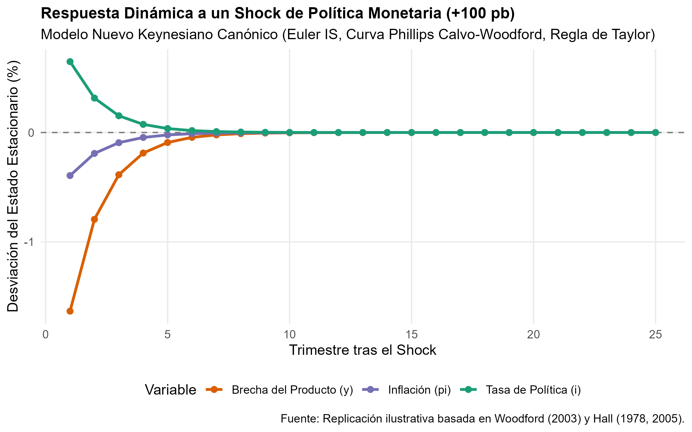
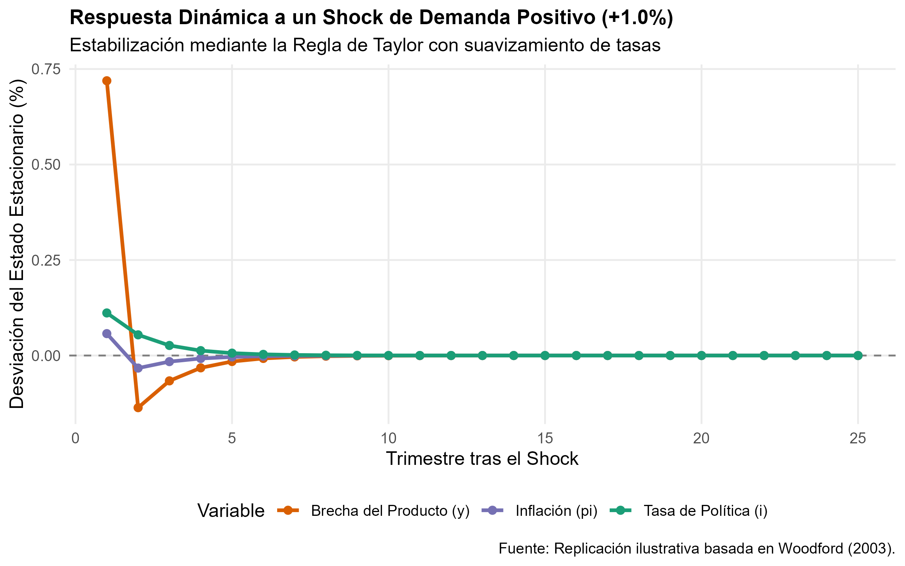

# Introducción y Objetivo

Este documento presenta una replicación didáctica e ilustrativa del marco analítico central que fundamenta la concesión del Premio Nobel de Economía 2026 a **Robert E. Hall** y **Michael Woodford** *"por los microfundamentos de la estabilización macroeconómica"*.

El objetivo es resolver numéricamente el modelo canónico Nuevo Keynesiano de tres ecuaciones formulado por Michael Woodford (2003, *Interest and Prices*) y sustentado en las decisiones microeconómicas de suavizamiento del consumo demostradas por Robert E. Hall (1978, 1988) y rigideces de salarios/precios (Hall 1980, 2005; Rotemberg y Woodford 1997).

## Nivel de Replicación
- **Nivel:** **Ilustrativa** (simulación dinámica con parámetros canónicos de calibración bajo expectativas racionales).

---

# Marco Teórico del Modelo

El modelo consta de tres bloques fundamentales:

## 1. Curva IS Dinámica (Ecuación de Euler del Consumidor)
Derivada de la maximización intertemporal de la utilidad de los hogares bajo expectativas racionales (Hall, 1978; Woodford, 2003):
$$y_t = \mathbb{E}_t[y_{t+1}] - \sigma^{-1} (i_t - \mathbb{E}_t[\pi_{t+1}] - r^n) + g_t$$
donde:
- $y_t$: brecha del producto (*output gap*).
- $i_t$: tasa de interés nominal de política monetaria.
- $\pi_{t+1}$: inflación futura esperada.
- $\sigma^{-1}$: elasticidad intertemporal de sustitución.
- $g_t$: perturbación exógena de demanda agregada / gasto.

## 2. Curva de Phillips Nuevo Keynesiana (NKPC)
Derivada del comportamiento óptimo de fijación de precios escalonada de las empresas (modelo de Calvo y extensiones de Rotemberg y Woodford, 1997):
$$\pi_t = \beta \mathbb{E}_t[\pi_{t+1}] + \kappa y_t + u_t$$
donde:
- $\beta$: factor de descuento subjetivo de los agentes.
- $\kappa$: sensibilidad de la inflación a la brecha de capacidad económica.
- $u_t$: shock de oferta o empuje de costos (*cost-push shock*).

## 3. Regla de Política Monetaria con Inercia (Regla de Taylor-Woodford)
Regla sistemática de política monetaria con suavización de tasas (Woodford 1999, 2001):
$$i_t = \rho_i i_{t-1} + (1 - \rho_i) (\phi_\pi \pi_t + \phi_y y_t) + \varepsilon^m_t$$
donde $\phi_\pi > 1$ cumple el **Principio de Taylor**, asegurando estabilidad macroeconómica y anclaje de expectativas.

---

# Código de Simulación y Resultados

```{r setup, message=FALSE, warning=FALSE}
library(dplyr)
library(tidyr)
library(ggplot2)

source("R/modelo_nuevo_keynesiano.R")
```

Las figuras generadas en `salidas/` muestran la respuesta del sistema ante dos perturbaciones estructurales:

## Respuesta a un Shock Contractivo de Política Monetaria (+100 pb)
Un incremento inesperado de la tasa de interés eleva la tasa de interés real esperada. Por el mecanismo de sustitución intertemporal de Hall-Woodford, los hogares posponen consumo presente, contrayendo la brecha del producto ($y_t < 0$) y reduciendo la inflación ($\pi_t < 0$). La inercia de tasas ($\rho_i = 0.75$) permite que la economía regrese suavemente a su estado estacionario.



## Respuesta a un Shock Positivo de Demanda Agregada (+1.0%)
Ante una expansión exógena de la demanda agregada, el banco central responde elevando la tasa nominal en una proporción mayor que 1 a 1 frente a la inflación ($\phi_\pi = 1.5$), encareciendo el crédito para estabilizar las presiones inflacionarias y cerrar la brecha de producto.



---

# Conclusiones y Limitaciones

1. **Aporte clave:** Woodford y Hall transformaron la macroeconomía al demostrar que las políticas de estabilización no operan sobre agregados mecánicos, sino gestionando las expectativas de hogares y empresas que optimizan intertemporalmente.
2. **Limitaciones:** Este modelo asume agentes homogéneos sin restricciones de liquidez severas (*Representative Agent New Keynesian*, RANK). Desarrollos recientes incorporan agentes heterogéneos (*Heterogeneous Agent New Keynesian*, HANK) para capturar fricciones financieras adicionales.
